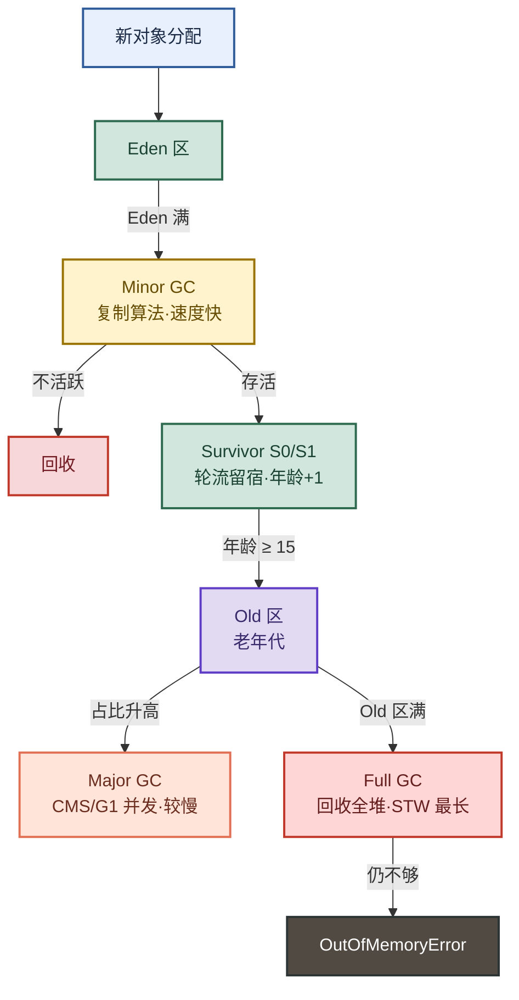

# AGENTS.md — docx 笔记 → 移动端阅读网页 工作流指南

> 本文件是给 AI Agent 的"操作手册"。下次拿到新的 docx 笔记需要转成"书架式"移动端阅读网页时，按本指南执行即可，无需重新摸索。
>
> 最后验证可用：JVM工具、JVM垃圾回收 两篇已完成全流程（HTML 片段 + Markdown 笔记 + Mermaid SVG）。

---

## 0. 任务总览

**最终目标**：把一批 docx 笔记转成手机上"书架式"阅读的网页应用，最终用 HBuilderX 打包成 Android APK。

**分两步**（先做第一步，用户确认后再做第二步）：

| 步骤 | 内容 | 产出 |
|---|---|---|
| 第一步 | 笔记内容处理 + 脑图/流程图生成 | 每篇一个 HTML 片段 + 一份 .md 笔记 + notes.json 元数据 + SVG 图 |
| 第二步 | 书架 + 阅读器页面 | index.html（书架）+ reader.html（阅读器） |

> **本指南主要覆盖第一步。** 第二步的规格在 §9。

---

## 1. 目录结构

```
D:\data\文档\有道云笔记导出\
├── doc\                          # 原始 docx 笔记（31 篇）
│   ├── 1.JVM工具.docx
│   ├── 4.JVM垃圾回收.docx
│   └── ...（编号.标题.docx）
├── notes-site\                   # 产出目录
│   ├── notes\                    # HTML 片段 + Markdown 笔记
│   │   ├── jvm-tools.html        # 结构化 HTML 片段（供阅读器注入）
│   │   ├── jvm-tools.md          # 讲义式 Markdown 笔记（供 Obsidian/语雀/手机备忘录）
│   │   ├── jvm-gc.html
│   │   └── jvm-gc.md
│   ├── assets\                   # 导出的 SVG 图（Mermaid 生成）
│   │   ├── 01-JVM分代回收流程.svg
│   │   └── ...
│   ├── lib\                      # 本地托管的前端库（避免 CDN 失败）
│   │   └── mermaid.min.js
│   ├── notes.json                # 元数据（id/title/category/cover/tags/summary/file）
│   └── preview.html              # 临时预览页（供用户看第一步效果，非正式页面）
└── AGENTS.md                     # 本文件
```

**id 命名规则**：用 kebab-case，取笔记标题的英文/拼音简称。如 `JVM工具` → `jvm-tools`，`JVM垃圾回收` → `jvm-gc`。

> **⚠️ 硬性规则：所有产出文件（包括 assets/ 下的 SVG、notes/ 下的 HTML/MD、images/ 下的图片）的文件名必须用英文 kebab-case，禁止使用中文或全角字符。**
>
> **原因**：HBuilderX 云打包时，项目中含中文文件名的文件会直接报错"App打包时，项目中文件名不能含有中文或全角字符"，导致打包失败。
>
> **示例**：
> - ❌ `01-JVM分代回收流程.svg`
> - ✅ `01-jvm-gen-collect.svg`
>
> SVG 文件名格式：`{序号}-{英文描述}.svg`，如 `01-jvm-gen-collect.svg`、`02-gc-collector-choice.svg`。

---

## 2. 工具链（已验证可用）

| 工具 | 路径 | 用途 |
|---|---|---|
| Python | `D:\work\conda\python.exe` | 解压 docx（zip）、起静态服务器 |
| Node | `D:\work\Node\node.exe` | 语法检查、mermaid-cli |
| npx | `D:\work\Node\npx.ps1` | 运行 `@mermaid-js/mermaid-cli` 导出 SVG |
| mermaid-cli | `npx -y @mermaid-js/mermaid-cli` | Mermaid → SVG（版本 12.0.0） |

**静态服务器**（给用户预览用，端口用 **5181**，5180 会和别的服务冲突）：

```powershell
Start-Process -FilePath "D:\work\conda\python.exe" `
  -ArgumentList "-m","http.server","5181","--bind","127.0.0.1" `
  -WorkingDirectory "D:\data\文档\有道云笔记导出\notes-site" `
  -WindowStyle Hidden
# 用户访问：http://127.0.0.1:5181/preview.html
```

**停旧服务器**（换端口或重启时）：

```powershell
$conns = Get-NetTCPConnection -LocalPort 5181 -ErrorAction SilentlyContinue
foreach($p in ($conns.OwningProcess | Select-Object -Unique)){
  Stop-Process -Id $p -Force -ErrorAction SilentlyContinue
}
```

---

## 3. docx → 纯文本（第一步）

docx 是 zip 包，正文在 `word/document.xml`，图片在 `word/media/`。

```powershell
$ErrorActionPreference='Stop'
Add-Type -AssemblyName System.IO.Compression.FileSystem

function Extract-Docx($docxPath, $outDir){
  if(Test-Path $outDir){ Remove-Item $outDir -Recurse -Force }
  [System.IO.Compression.ZipFile]::ExtractToDirectory($docxPath, $outDir)
}

function DocxToText($xmlPath, $outPath){
  $xml = Get-Content $xmlPath -Raw -Encoding UTF8
  $xml = $xml -replace '</w:p>', "`n"          # 段落 → 换行
  $xml = $xml -replace '<w:br[^>]*/>', "`n"    # 手动换行
  $xml = $xml -replace '<w:tab[^>]*/>', "`t"
  $xml = $xml -replace '<[^>]+>', ''           # 去所有标签
  $xml = $xml -replace '&amp;','&' -replace '&lt;','<' -replace '&gt;','>' `
              -replace '&quot;','"' -replace '&#39;',"'" -replace '&nbsp;',' '
  $lines = $xml -split "`n" | ForEach-Object { $_.TrimEnd() }
  $text = ($lines -join "`n") -replace "(`r?`n){3,}", "`n`n"
  [System.IO.File]::WriteAllText($outPath, $text, [System.Text.UTF8Encoding]::new($false))
}

# 用法
$base = "D:\data\文档\有道云笔记导出"
Extract-Docx "$base\doc\1.JVM工具.docx" "$base\_tmp_jvmtool"
DocxToText "$base\_tmp_jvmtool\word\document.xml" "$base\_tmp_jvmtool.txt"
# 然后用 read 工具读 _tmp_jvmtool.txt
```

**检查图片**：看解压后的 `word/media/` 目录。有图片则记下文件名，正文图片按 §4.4 输出 ``；无图片则跳过。

**清理**：处理完删除 `_tmp_*` 临时目录和文件。

---

## 4. 第一步产出规范

每篇笔记产出 3 类文件：
1. **HTML 片段**（`notes/{id}.html`）—— 供第二步阅读器注入
2. **Markdown 笔记**（`notes/{id}.md`）—— 供 Obsidian/语雀/手机备忘录，含 Mermaid 图
3. **SVG 图**（`assets/*.svg`）—— Mermaid 导出，高清可放大

外加全局一份 **notes.json** 元数据。

### 4.1 HTML 片段（notes/{id}.html）

**结构**：`<section class="note" data-note-id="{id}">` 包裹，**不含** `<html>/<head>/<body>`（供前端注入）。

**4 条硬性要求**：

1. **精要化**：保留核心结论和关键细节，删口语化冗余（"好的，为你定制…"、"把这三份材料打印出来…"等）。原文不完整处用 `<span class="supplement">补充：…</span>` 标注（样式：浅灰背景 + 虚线左边框）。
2. **重点突出**：关键术语用 `<mark>` 高亮；每个 `<h2>` 小节标题下用一行 `<p class="tldr">` 给 ≤20 字一句话总结。
3. **脑图/流程图**：见 §5（用 Mermaid，不用 markmap）。
4. **图片**：正文图片用 ``，**不要 Base64**。

**片段内嵌样式约定**（供阅读器复用）：

```html
<section class="note" data-note-id="{id}" data-note-title="{标题}">
  <h2>一、xxx</h2>
  <p class="tldr">≤20字总结</p>
  <p>正文，关键术语用 <mark>高亮</mark>。</p>
  <span class="supplement">补充：原文不完整处补全</span>
  <table class="cmp">...</table>
  <blockquote>面试话术</blockquote>
</section>
```

**片段不内嵌 `<style>`**，样式由第二步的 reader.html 统一提供（见 §9）。

### 4.2 notes.json 元数据

```json
[
  {
    "id": "jvm-gc",
    "title": "JVM垃圾回收核心体系",
    "category": "JVM",
    "cover": "assets/images/jvm-gc/cover.webp",
    "tags": ["JVM","垃圾回收","GC","可达性分析","G1","ZGC"],
    "summary": "可达性分析判存活 → 四种回收算法 → 分代回收流程 → 收集器选型",
    "file": "notes/jvm-gc.html"
  }
]
```

**字段说明**：
- `cover`：封面图路径。原文无图时先留占位路径，第二步生成真实封面（见 §9.3）。
- `summary`：一句话概括，用于书架卡片展示。
- `file`：HTML 片段相对路径。

### 4.3 Markdown 笔记（notes/{id}.md）—— 讲义式风格

**严格参考** `D:\Ai\aiStudyProject\ai-interview-guide\docs\个人笔记\` 下的笔记风格（大模型认知.md / langchain.md / 场景落地题.md）。

**风格规范**（对照参考项目）：

| 要素 | 规范 | 示例 |
|---|---|---|
| 标题 | `# 主题：副标题` | `# JVM 垃圾回收：从判活到收集器选型的完整链路` |
| 开头 | `> 目标：…` 引用块（2~3 行） | `> 目标：不背孤立名词。遇到题目先判断"问的是哪一层"…` |
| 总图 | `## 先记住这张总图` + Mermaid flowchart | 见 §5 |
| 主线 | `**一句话主线：**…` | `**一句话主线：**可达性分析判死活 → 新生代复制 → G1/ZGC` |
| 章节 | `## N. xxx：副标题`（数字编号） | `## 2. 如何判断对象需要回收` |
| 节内 | 先一句话 → 表格（带"记忆画面"列）→ **易混点** | 见下 |
| 表格 | 最后一列用"记忆画面/记忆钩子"做类比 | `| 复制算法 | … | 搬家：只搬活人，老房子整片拆 |` |
| 速记 | `**速记：**…` | `**速记：**栈、静、常、JNI、线程` |
| 场景题 | `## 高频场景题：用一句诊断开头` | `### "Full GC 频繁但内存没降，怎么查？"` |
| 话术 | `## 面试回答模板：三句话讲清一题` | `> 问题本质是… / 机制是… / 调优时看…` |
| 复习 | `## 最后复习：闭眼回忆 N 句` | 8 条编号列表 |
| 练习 | `## 怎么练才记得住` | 4 条主动回忆法 |

**硬性要求**：
- **纯 Markdown**，0 个 HTML 标签（`<section>/<mark>/<table>` 等全删）。
- 表格用 `| 表头 | 表头 |` 标准语法。
- 参数/命令用反引号包裹（`-XX:MaxTenuringThreshold`）。
- 关键术语用 **加粗**，不用 `==高亮==`。
- 每节至少一处 **易混点**（加粗），帮用户区分容易搞混的概念。

### 4.4 图片处理

- 原文有图：解压 docx 后看 `word/media/`，把图片复制到 `notes-site/assets/images/{id}/`，正文用 ``。
- 原文无图：跳过，`cover` 字段留占位路径。

---

## 5. 脑图/流程图：用 Mermaid flowchart（重要！）

> **踩坑记录**：最初用 markmap 渲染脑图，CDN 加载各种失败（ESM/UMD 混用、katex 依赖缺失、卡死、白屏）。**改用 Mermaid flowchart 后彻底解决。** Mermaid 单文件 UMD、CDN 稳定、浏览器原生支持、能导出 SVG。

### 5.1 用 flowchart 不用 mindmap

- **方向**：流程类用 `TD`（从上到下），链路/选型类用 `LR`（从左到右）。
- **节点形状**：
  - 核心步骤：圆角矩形 `[文本]`
  - 判断/决策：菱形 `{文本}`
  - 数据库/存储：圆柱 `[(文本)]`
  - 起止：圆角 `([文本])`
- **连线**：`-->` 带箭头，可加标签 `-->|条件|`。
- **配色**：每个节点用 `style` 加不同颜色（见 §5.2 配色方案）。

### 5.2 配色方案（统一用这套）

| 颜色 | 十六进制 | 用途 |
|---|---|---|
| 蓝 | `fill:#E8F0FD,stroke:#315C9A,color:#1D2C46` | 入口 / 工具 / 起点 |
| 绿 | `fill:#D1E7DD,stroke:#2D6A4F,color:#1B4332` | 正常 / 存活 / 推荐 |
| 黄 | `fill:#FFF3CD,stroke:#997404,color:#664D03` | 关键 / 判断 / 注意点 |
| 紫 | `fill:#E2D9F3,stroke:#5F3DC4,color:#3B2A6B` | 进阶 / 老年代 / 次级 |
| 浅红 | `fill:#FFD6D6,stroke:#C0392B,color:#641E1E` | 异常 / 危险 / 失败 |
| 粉红 | `fill:#F8D7DA,stroke:#C0392B,color:#721C24` | 废弃 / 不推荐 |
| 深灰 | `fill:#514A42,stroke:#2D3436,color:#FFFFFF` | 最终失败（OOM 等） |
| 浅蓝虚线 | `fill:#DCEEFB,stroke:#1971C2,stroke-dasharray:5,color:#0B3D63` | 辅助组件（配置/容器/监控） |

所有节点统一 `stroke-width:2px`（辅助组件用 1px + 虚线）。

### 5.3 flowchart 示例（来自 jvm-gc.md）



**节点文本规范**：
- 用 `<br/>` 换行（节点内多行）。
- 含特殊字符（括号/冒号）时，整段文本用双引号包裹：`A["文本(带括号)"]`。
- 节点文字精炼，每个节点 ≤ 12 字，副标题用 `·` 分隔（如 `Minor GC<br/>复制算法·速度快`）。

### 5.4 每篇笔记放几张图

- **总图**（必须）：`## 先记住这张总图` 下放一张，概括全文主干。
- **分图**（按需）：复杂章节（如收集器选型、排障流程）各放一张。
- 每篇 2~4 张为宜，不要每张都画。

---

## 6. Mermaid → SVG 导出

### 6.1 准备

```powershell
$site = "D:\data\文档\有道云笔记导出\notes-site"
New-Item -ItemType Directory -Force -Path "$site\assets" | Out-Null
# 写配置（控制视口宽度，导出高清图）
[System.IO.File]::WriteAllText("$site\mermaid-config.json",
  '{"width":2200,"height":1510,"fontSize":20}', [System.Text.UTF8Encoding]::new($false))
[System.IO.File]::WriteAllText("$site\puppeteer-config.json",
  '{"args":["--no-sandbox"]}', [System.Text.UTF8Encoding]::new($false))
```

### 6.2 提取 .md 里的 mermaid 块

```powershell
$c = Get-Content "$site\notes\jvm-gc.md" -Raw -Encoding UTF8
$blocks = [regex]::Matches($c, '(?s)```mermaid\r?\n(.*?)```')
for($i=0; $i -lt $blocks.Count; $i++){
  [System.IO.File]::WriteAllText("$site\_mm_$i.mmd",
    $blocks[$i].Groups[1].Value, [System.Text.UTF8Encoding]::new($false))
}
```

### 6.3 导出 SVG

```powershell
Set-Location $site
& npx -y @mermaid-js/mermaid-cli -i _mm_0.mmd -o "assets/01-图名.svg" -c mermaid-config.json
# 每个图导一次，-i 输入 .mmd，-o 输出 .svg
```

**注意**：
- 首次运行 npx 会下载 mermaid-cli + puppeteer（Chromium），较慢（1~3 分钟），属正常。
- 输出 SVG 约 200KB（2200px 宽），高清可放大，浏览器直接打开或 `` 嵌入。
- 文件名用英文 kebab-case + 序号前缀（`01-`、`02-`…），方便排序。**禁止用中文文件名**（HBuilderX 云打包会报错）。

### 6.4 清理

```powershell
Remove-Item "$site\_mm_*.mmd" -Force
Remove-Item "$site\mermaid-config.json","$site\puppeteer-config.json" -Force
```

---

## 7. preview.html（临时预览页）

**用途**：让用户在浏览器里看第一步效果（正文 + 流程图），**不是**第二步正式页面。

**关键设计**（踩坑后总结）：
- **本地托管 mermaid**：`<script src="lib/mermaid.min.js">`，不用 CDN（CDN 加载慢/失败是之前卡死白屏的根源）。
  - 下载：`Invoke-WebRequest https://cdn.jsdelivr.net/npm/mermaid@10/dist/mermaid.min.js -OutFile lib/mermaid.min.js`
- **mermaid 渲染**：`mermaid.render(id, code)` 返回 `{svg}`，注入容器。
- **降级兜底**：mermaid 加载失败时，用纯 HTML/CSS 静态树渲染（带层级颜色 d1~d4），保证页面一定打得开。
- **正文样式**：mark 高亮、tldr、supplement 虚线框、表格，全部内联在 preview.html 的 `<style>` 里。
- **tab 切换**：多篇笔记用顶部按钮切换，每篇一个 panel。

**preview.html 里要 fetch 加载 `notes/{id}.html`**，所以必须通过 HTTP 服务器访问（不能 file:// 直接打开，CORS 会拦）。

---

## 8. 踩坑记录（重要，别重蹈覆辙）

| 坑 | 现象 | 原因 | 解法 |
|---|---|---|---|
| markmap CDN 失败 | 脑图区白屏/纯文本/卡死 | markmap-view 根路径返回 ESM 非 UMD，`window.markmap` undefined；markmap-lib 强依赖 `window.katex`；es-module-shims 实时编译太重 | **改用 Mermaid flowchart**，单文件 UMD，稳定 |
| Mermaid CDN 加载失败 | 走降级静态树 | CDN 3.3MB 加载慢/超时 | **本地托管** `lib/mermaid.min.js` |
| 静态树根节点不渲染 | 降级树空白 | 根节点 `content` 为空，`buildStaticTree` 开头 `if(!node.content) return ''` 直接返回空 | 根节点特殊处理：`isRoot` 时跳过 content 判断，直接渲染 children |
| 模板文本泄漏到正文 | 脑图区显示 Markdown 原文 | `querySelectorAll('#text-id script[type=template]')` 的 `#text-id` 选择器不匹配嵌套 script | 渲染前从 `#text-id` 内删除所有 `script[type=template]`，或用正则提取后从 innerHTML 剔除 |
| 端口冲突 | 预览页打不开 | 5180 和别的服务冲突 | **固定用 5181** |
| PowerShell `??` 报错 | 脚本执行失败 | 旧版 PowerShell 不支持空合并运算符 `??` | 用 `if(-not $x){ $x = ... }` |
| Node 正则转义地狱 | 测试脚本报错 | PowerShell here-string 里 `\/` 被转义 | 把测试 JS 写到临时 .js 文件再 `node xx.js` 执行，不用 `-e` 内联 |
| docx 路径 | 找不到 docx | docx 在 `doc/` 子目录，不在基目录 | docx 路径用 `$base\doc\xxx.docx` |
| **改了代码打包不生效** | 在 `D:\project\Learn\java-interview-note` 改了 html/js，HBuilderX 重新打包安装后 App 里还是老代码 | **HBuilderX 打包的是另一个目录 `D:\Ai\aiStudyProject\hy-note`**，不是本仓库。两个目录是独立副本，改仓库代码不会自动同步到打包目录 | **改完代码必须手动复制到打包目录**，见下方「打包目录同步清单」 |
| **App 里笔记正文空白** | 头部（标题/摘要/标签）正常显示，但 `#md-content` 正文区空白；每日笔记正常，Java 笔记不正常 | HBuilderX App 的 WebView 在 `file://` 协议下 **`fetch()` 读取子目录文件（如 `notes/xxx.md`）会被拦截**，但 fetch 根目录文件（`notes.json`）能成功——所以头部能显示（json 读到了），正文不能显示（md 读不到） | `updater.js` 的 `read` 方法加 **三级降级：fetch → XMLHttpRequest → plus.io**。XHR 对 file:// 比 fetch 宽松，实测 XHR 那级就生效 |
| **App 里报错看不到** | JS 报错或 fetch 失败时 App 白屏/空白，无法排查 | 老代码只 `console.error`，App 里看不到 console；没有全局错误兜底 | `app.html` 加 `#fatal-error` 全局错误框（黑底红字）+ `selectNote` catch 里把错误**内联显示在正文区**（不依赖 console） |

### 打包目录同步清单（重要！每次改完代码必做）

**打包目录**：`D:\Ai\aiStudyProject\hy-note`（HBuilderX 打包的就是这个目录）
**开发目录**：`D:\project\Learn\java-interview-note\notes-site`（本仓库，AI Agent 改代码的地方）

两个目录结构一样（文件都在根目录，不在子目录），但是**独立的两份副本**。在开发目录改完代码后，必须复制到打包目录，否则打包出来的 APK 还是老代码。

**需要同步的文件**（改了哪个就复制哪个）：

```powershell
$src = "D:\project\Learn\java-interview-note\notes-site"
$dst = "D:\Ai\aiStudyProject\hy-note"

# 常见需要同步的文件（按需取消注释）
Copy-Item "$src\app.html"      "$dst\app.html"      -Force  # Java 笔记阅读器
Copy-Item "$src\daily.html"    "$dst\daily.html"    -Force  # 每日笔记阅读器
Copy-Item "$src\ai-app.html"   "$dst\ai-app.html"   -Force  # AI 笔记阅读器
Copy-Item "$src\index.html"    "$dst\index.html"    -Force  # 首页（书架）
Copy-Item "$src\updater.js"    "$dst\updater.js"    -Force  # 更新管理器（含三级降级）
Copy-Item "$src\theme.js"      "$dst\theme.js"      -Force  # 主题
Copy-Item "$src\settings-panel.js" "$dst\settings-panel.js" -Force  # 设置面板
Copy-Item "$src\notes.json"    "$dst\notes.json"    -Force  # 笔记元数据
Copy-Item "$src\daily.json"    "$dst\daily.json"    -Force  # 每日笔记元数据
# 新增的笔记 md 也要复制
Copy-Item "$src\notes\*.md"    "$dst\notes\"        -Force
Copy-Item "$src\notes\daily\*.md" "$dst\notes\daily\" -Force
```

**⚠️ 绝对不要覆盖的文件**：
- `manifest.json` —— 打包目录的是 **HBuilderX 的 App 配置**（含 AppID、权限、签名，9KB+），和开发目录的 `manifest.json`（笔记更新清单，200 字节）**完全不是一回事**，覆盖了会丢失 AppID 导致打包失败
- `hy-note.keystore` —— Android 签名证书
- `unpackage/` —— HBuilderX 的打包缓存和产物

**验证同步成功**：
```powershell
# 对比两边文件大小/时间，确认复制到位
Get-Item "$dst\app.html","$dst\updater.js" | Select-Object Name, Length, LastWriteTime
```

**打包流程**：
1. 开发目录改代码 → 复制到打包目录（按上面清单）
2. HBuilderX 打开 `D:\Ai\aiStudyProject\hy-note`
3. 右键项目 → **刷新**（确保认到新文件）
4. **发行 → 原生App-云打包**
5. 装到手机验证

---

## 9. 第二步规格（等用户确认第一步后做）

### 9.1 index.html — 书架页
- 网格布局，每本书显示：封面缩略图 + 标题 + 分类标签。
- 封面用 **Base64 内嵌**（宽 240px WebP）。
- 数据以 `const NOTES = [...]` 形式**内联**，**禁止 fetch 本地 JSON**（file:// 下 fetch 会被 CORS 拦）。
- 点击卡片 → 跳转 `reader.html#/{id}`。

### 9.2 reader.html — 阅读器
- 根据 URL hash（`#/{id}`）加载对应笔记。
- 顶部"正文/脑图"切换按钮。
- 正文用 `fetch('notes/{id}.html')` 加载 HTML 片段注入（需 HTTP 服务器；若 file:// 则改为内联片段）。
- 脑图用 Mermaid 渲染（`lib/mermaid.min.js` 本地托管），支持折叠展开。
- 正文支持字号调节（小/中/大）。

### 9.3 移动端适配
- 优先适配 **360~430px** 宽度。
- 点击区域 ≥ **44px**。
- 封面图：原文无图时用纯 CSS 生成主题色封面（标题 + 分类），不依赖外部图片。

### 9.4 打包
- 用 HBuilderX 打包成 Android APK。
- 所有资源（lib/mermaid.min.js、notes/*.html、assets/*.svg）需随包携带，**不能依赖外网 CDN**。

---

## 10. 执行清单（拿到新 docx 时照做）

1. **读 docx**：`doc/` 下找到目标文件 → 解压 → `document.xml` → 纯文本 → `read` 通读内容。
2. **检查图片**：看 `word/media/`，有图则记下。
3. **写 HTML 片段**：`notes/{id}.html`，按 §4.1 四条要求。
4. **写 Markdown 笔记**：`notes/{id}.md`，按 §4.3 讲义式风格 + §5 Mermaid flowchart。
5. **更新 notes.json**：加一条元数据。
6. **导出 SVG**：按 §6 提取 mermaid 块 → mmdc 导出到 `assets/`。
7. **更新 preview.html**：加一个 tab + panel，fetch 新片段。
8. **起服务器**：5181 端口，给用户预览链接。
9. **验证**：
   - JS 语法：提取内联 JS → `node --check`。
   - Mermaid 语法：`mermaid.default.parse(code)`（Node 里 `require("mermaid").default.parse`）。
   - 可达性：`Invoke-WebRequest` 检查每个资源 200。
10. **清理**：删 `_tmp_*`、`_mm_*.mmd`、配置文件。

**用户确认第一步后**，再按 §9 做第二步（书架 + 阅读器）。

---

## 11. 已完成示例（可参照）

- `notes/jvm-tools.html` + `notes/jvm-tools.md` + `assets/03-JVM排障三剑客.svg` + `assets/04-微服务全链路.svg`
- `notes/jvm-gc.html` + `notes/jvm-gc.md` + `assets/01-JVM分代回收流程.svg` + `assets/02-垃圾收集器选型.svg`

参考风格来源：`D:\Ai\aiStudyProject\ai-interview-guide\docs\个人笔记\`（大模型认知.md / langchain.md / 场景落地题.md）。
