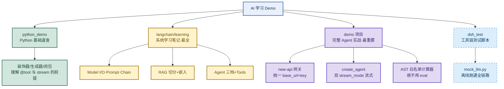
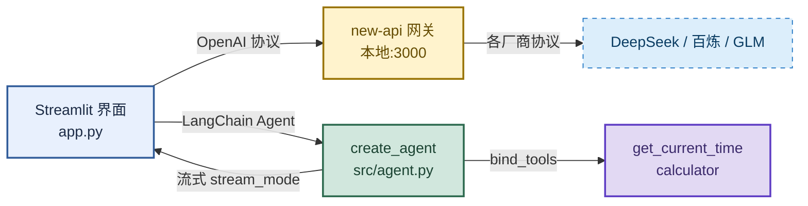
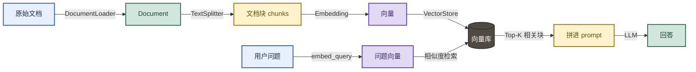
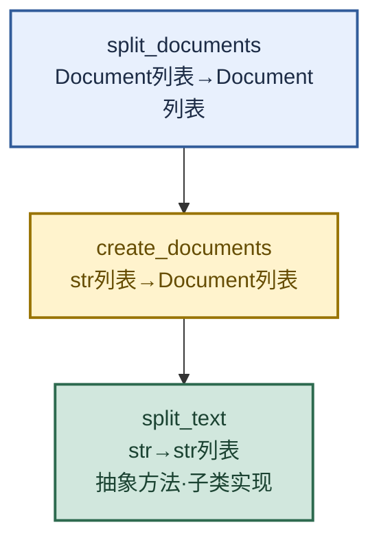
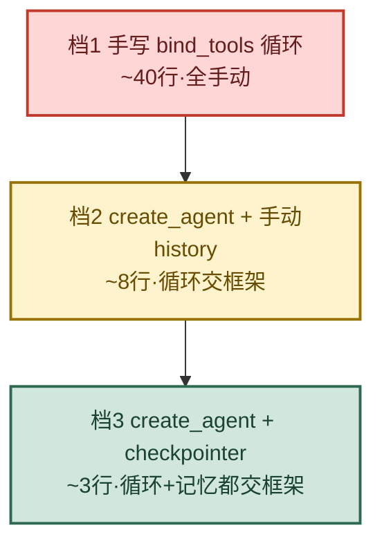
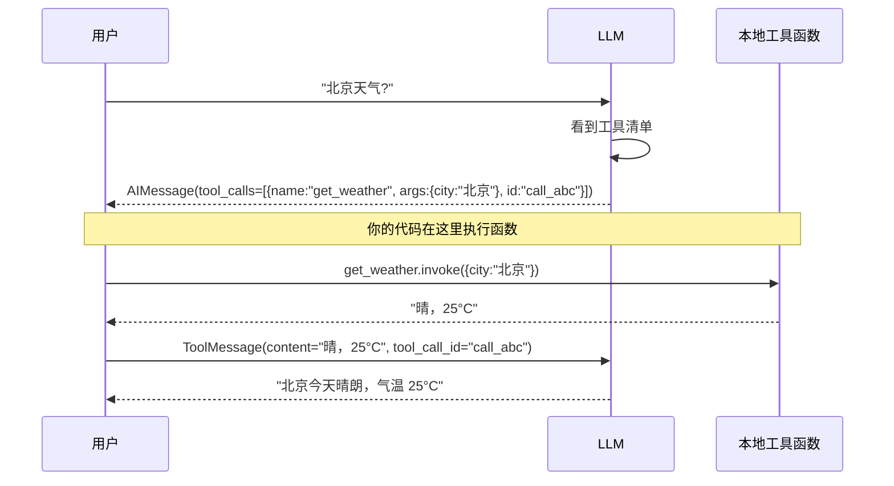
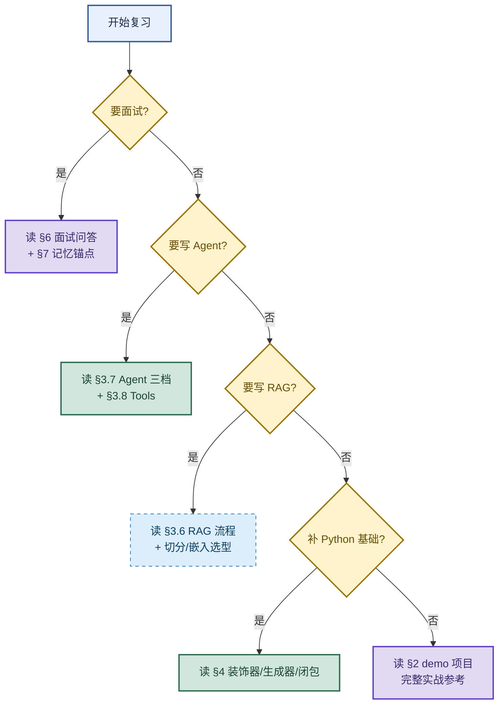

# AI 学习 Demo 项目总结：从 Python 基础到 LangChain Agent 全栈实战

> 目标：不背孤立名词。遇到 LangChain/Agent 题目先判断"问的是哪一层"——Model I/O、Prompt、Chain、RAG、Agent、Tools，再用一句话主线串起四个 demo 目录的核心产出，最后落到面试高频问答与记忆锚点。
>
> 读图顺序：先看下方"先记住这张总图"，再按问题回看各节。每节底部都有**易混点**或**速记**；先遮住解释自己讲，再对照正文。
>
> 本笔记整理自 `D:\Ai\` 下四个目录：`demo`、`langchain`、`python_demo`、`dsh_test`。

**一句话主线：** Python 基础打底 → LangChain 六大概念（Model I/O / Prompt / Chain / Memory / RAG / Agent）→ demo 项目用网关 + create_agent 落地完整 Agent → dsh_test 用 mock LLM 跑通离线测试。

---

## 先记住这张总图



**速记：** 四个目录价值等级——demo ⭐⭐⭐⭐⭐（完整可运行 Agent，面试可直接讲）、langchain/learning ⭐⭐⭐⭐⭐（最全系统笔记）、python_demo ⭐⭐⭐（基础速查）、dsh_test ⭐⭐（测试脚本）。

---

## 1. 四个目录总览与学习路径

| 目录 | 价值等级 | 一句话定位 | 核心产出 |
|------|:---:|------|------|
| `demo` | ⭐⭐⭐⭐⭐ | **完整可运行的 Agent 项目**（面试可直接讲） | LangChain 1.x Agent + Streamlit + new-api 网关 |
| `langchain/learning` | ⭐⭐⭐⭐⭐ | **LangChain 系统学习笔记**（最全） | 12 个主题模块 + 详细笔记 + 面试题 |
| `python_demo/learn` | ⭐⭐⭐ | **Python 基础语法速查** | 8 个文件覆盖基础→高级特性 |
| `dsh_test` | ⭐⭐ | **DSH 工具链测试脚本** | mock LLM、离线测试、new-api 下载器 |

### 学习路径推荐

```mermaid
flowchart LR
    A[python_demo<br/>Python 基础] --> B[langchain/learning<br/>01-04 模块]
    B --> C[langchain/learning<br/>06 RAG + 07 Agent]
    C --> D[demo 项目<br/>完整 Agent 实战]
    D --> E[langchain/learning<br/>08-12 进阶]
    E --> F[13_filesearch_agent<br/>全栈项目]

    style A fill:#D1E7DD,stroke:#2D6A4F,stroke-width:2px,color:#1B4332
    style B fill:#FFF3CD,stroke:#997404,stroke-width:2px,color:#664D03
    style C fill:#FFF3CD,stroke:#997404,stroke-width:2px,color:#664D03
    style D fill:#E2D9F3,stroke:#5F3DC4,stroke-width:2px,color:#3B2A6B
    style E fill:#FFF3CD,stroke:#997404,stroke-width:2px,color:#664D03
    style F fill:#D1E7DD,stroke:#2D6A4F,stroke-width:2px,color:#1B4332
```



**易混点：** 学习路径不是"按编号顺序读完"，而是"基础 → 核心两块（RAG+Agent）→ 完整项目实战 → 进阶 → 全栈"。demo 项目放在中间，因为它把前面学的串起来。

---

## 2. demo 项目：完整 Agent 实战（最重要）

### 2.1 架构总图



**核心设计思想**：项目代码里**没有任何厂商 SDK**，只认一个 `base_url + key`，换模型只改 `.env` 一行。

### 2.2 目录结构与职责

```
demo/
├─ app.py              # Streamlit 界面（流式打字机 + 工具轨迹展示）
├─ src/
│   ├─ config.py       # 读 .env，配置自检（frozen dataclass）
│   ├─ llm.py          # 构造指向 new-api 的 ChatOpenAI
│   ├─ tools.py        # @tool 工具：时间 / 计算器（AST 白名单）
│   └─ agent.py        # create_agent + 流式输出（双 stream_mode）
└─ .env                # 真实配置（已 gitignore）
```

### 2.3 必须记忆的 5 个点

#### ① LangChain 1.x 的 Agent 入口变了

```python
# ✅ LangChain 1.x（本项目用的）
from langchain.agents import create_agent
agent = create_agent(model=llm, tools=tools, system_prompt="...")

# ❌ 0.x 的写法，1.x 已移除，不要照抄网上的旧教程
from langchain.agents import initialize_agent, AgentExecutor  # 报错！
```

**易混点：** `create_agent` 是 1.x 的入口，`initialize_agent` / `AgentExecutor` 是 0.x 的，1.x 已移除。网上旧教程大多还是 0.x 写法，直接抄会报错。

#### ② 流式输出要同时订阅两种事件

```python
# src/agent.py 的核心
async for mode, payload in agent.astream(
    {"messages": list(history)},
    stream_mode=["messages", "updates"],   # ← 两种同时订阅
):
    if mode == "messages":
        # 逐 token，用于打字机效果
        chunk, _meta = payload
        if isinstance(chunk, AIMessageChunk):
            yield _text_of(chunk.content)
    elif mode == "updates":
        # 节点级，拿结构化的工具调用与结果
        for _node, update in payload.items():
            for message in update.get("messages", []):
                if isinstance(message, AIMessage) and message.tool_calls:
                    # 记录工具调用
                    pass
                elif isinstance(message, ToolMessage):
                    # 记录工具返回
                    pass
```

**为什么不能只用 messages？** token 片段里拼 JSON 不可靠；updates 给的是结构化的 `tool_calls` 和 `ToolMessage`，两者分工。

**易混点：** `messages` 模式拿逐 token（打字机用），`updates` 模式拿节点级结构化事件（工具轨迹用）。两者职责不同，缺一不可。

#### ③ 计算器工具用 AST 白名单，绝不用 eval

```python
# src/tools.py —— 安全求值
_BIN_OPS = {
    ast.Add: operator.add, ast.Sub: operator.sub,
    ast.Mult: operator.mul, ast.Div: operator.truediv,
    ast.Pow: operator.pow,
}

def _eval_node(node):
    if isinstance(node, ast.Constant) and isinstance(node.value, (int, float)):
        return node.value
    if isinstance(node, ast.BinOp) and type(node.op) in _BIN_OPS:
        return _BIN_OPS[type(node.op)](_eval_node(node.left), _eval_node(node.right))
    raise ValueError("只允许数字和 + - * / ** 等")
```

**易混点：** `eval` 是"任意代码执行"，用户输入 `__import__('os').system('rm -rf /')` 就完了。AST 白名单只放行数字和指定运算符，从根上杜绝代码注入。

#### ④ 配置层用 frozen dataclass + 自检

```python
@dataclass(frozen=True)   # frozen=True → 可哈希，能做 Streamlit 缓存键
class Settings:
    base_url: str
    api_key: str
    # ...
    @property
    def ready(self) -> bool:
        return not self.problems   # 自检：base_url / api_key / model 是否齐全
```

**易混点：** `frozen=True` 不是为了"防篡改"那么简单，更实际的作用是让 dataclass 实例**可哈希**，能当 Streamlit `@st.cache_data` 的缓存键。非 frozen 实例不可哈希，缓存会报错。

#### ⑤ 错误翻译成"该去哪修"

```python
# app.py —— 把 401/404/超时翻译成可操作提示
if "401" in raw or "unauthorized" in low:
    hints.append("令牌无效 → 到 new-api 后台「令牌」页重新生成")
if "404" in raw or "model_not_found" in low:
    hints.append("模型不存在 → 检查 base_url 结尾是否带 /v1")
```

**速记：** 错误提示要告诉用户"该去哪修"，而不是把原始 stack trace 甩出来。401→令牌页，404→base_url 结尾 /v1。

### 2.4 面试可讲的点

- **为什么加网关**：项目侧只依赖 `base_url + key`，上游换厂商/换 key/限额都不改业务代码；网关侧统一做额度、限流、审计。
- **Agent 循环**：`model → 判断是否调工具 → tools → 回到 model`，由 LangGraph 状态图驱动。
- **可测性**：模型层与界面层解耦，配一个 mock OpenAI 服务就能离线跑通全链路（`dsh_test/mock_llm.py` 就是干这个的）。

---

## 3. langchain/learning：系统学习笔记（最全）

### 3.1 LangChain 六大核心概念全景

```mermaid
flowchart TD
    A[LangChain 六大核心] --> B[Model I/O]
    A --> C[Prompt]
    A --> D[Chain]
    A --> E[Memory]
    A --> F[RAG]
    A --> G[Agent]

    B --> B1[ChatModel 统一接口]
    B --> B2[init_chat_model 切厂商]
    B --> B3[invoke vs stream]
    C --> C1[ChatPromptTemplate]
    C --> C2[PydanticOutputParser]
    C --> C3[partial 预填]
    D --> D1[LCEL 管道 prompt&#124;llm&#124;parser]
    D --> D2[get_openai_callback 计 token]
    E --> E1[滑动窗口 keep_last_n]
    E --> E2[摘要压缩]
    E --> E3[checkpointer 自动记忆]
    F --> F1[DocumentLoader]
    F --> F2[TextSplitter 切分]
    F --> F3[Embedding 向量化]
    F --> F4[VectorStore 检索]
    G --> G1["@tool 定义工具"]
    G --> G2[bind_tools 绑定]
    G --> G3[create_agent 编排]
    G --> G4[return_direct]

    style A fill:#E8F0FD,stroke:#315C9A,stroke-width:2px,color:#1D2C46
    style B fill:#D1E7DD,stroke:#2D6A4F,stroke-width:2px,color:#1B4332
    style C fill:#D1E7DD,stroke:#2D6A4F,stroke-width:2px,color:#1B4332
    style D fill:#FFF3CD,stroke:#997404,stroke-width:2px,color:#664D03
    style E fill:#FFF3CD,stroke:#997404,stroke-width:2px,color:#664D03
    style F fill:#E2D9F3,stroke:#5F3DC4,stroke-width:2px,color:#3B2A6B
    style G fill:#FFD6D6,stroke:#C0392B,stroke-width:2px,color:#641E1E
```



### 3.2 模块 01：Hello World —— 三种消息 + 两个方法

**三种消息类型**（理解一切的基础）：

| 类 | 作用 | 位置 |
|------|------|------|
| `SystemMessage` | 设定 AI 角色/行为 | 消息列表最前面 |
| `HumanMessage` | 用户说的话 | 每轮对话 |
| `AIMessage` | AI 之前的回答 | 多轮对话提供上下文 |

```python
messages = [
    SystemMessage(content="你是一个专业的Python工程师"),
    HumanMessage(content="什么是装饰器？"),
    AIMessage(content="装饰器是..."),      # 第二轮时带上
    HumanMessage(content="能举例吗？"),
]
response = llm.invoke(messages)   # 一次性返回
# vs
for chunk in llm.stream(messages):  # 流式打字机
    print(chunk.content, end="")
```

**记忆锚点：** 消息列表 = 对话历史，多轮对话就是把历史消息一路传下去。`invoke` 等全部生成，`stream` 边生成边返回。

**易混点：** `invoke` 和 `stream` 是同一模型的两种调用方式，不是两种模型。`stream` 返回的是生成器，逐 token 吐；`invoke` 一次性返回完整结果。

### 3.3 模块 02：Prompt —— 模板 + 结构化输出

#### ChatPromptTemplate 两种写法

```python
# ① 元组简写（简单场景）
prompt = ChatPromptTemplate.from_messages([
    ("system", "你是一个专业的{role}"),
    ("user", "请介绍{topic}"),
])

# ② Message 对象（多模态、Few-shot 用）
from langchain_core.prompts import SystemMessagePromptTemplate
prompt = ChatPromptTemplate.from_messages([
    SystemMessagePromptTemplate.from_template("你是{role}"),
    HumanMessagePromptTemplate.from_template("请介绍{topic}"),
])
```

**易混点：** `SystemMessage`/`HumanMessage` 对象在 `ChatPromptTemplate` 中**不支持变量插值**，必须用 `SystemMessagePromptTemplate` 才能插值 `{role}`。

#### OutputParser 四种

| Parser | 输出类型 | 适用 |
|------|------|------|
| `PydanticOutputParser` | Pydantic 对象 | **生产首选**，字段固定 |
| `JsonOutputParser` | dict | 字段不固定 |
| `StrOutputParser` | str | 纯文本 |
| `CommaSeparatedListOutputParser` | list | 关键词提取 |

#### 关键坑：format_instructions 的 JSON 花括号冲突

`format_instructions` 包含 JSON 的 `{}`，会和模板 `{var}` 冲突。**用 `partial()` 预填**：

```python
prompt = prompt.partial(format_instructions=parser.get_format_instructions())
# 调用时只需传业务变量
chain.invoke({"person_text": "..."})
```

**速记：** 凡是 parser 的 `format_instructions`，一律 `partial()` 预填，别让它和模板变量打架。

### 3.4 模块 03：Model I/O —— 统一初始化入口

```python
# shared/model_factory.py —— 切厂商只改两个参数
from langchain.chat_models import init_chat_model
llm = init_chat_model(
    model="qwen3.8-flash",
    model_provider="openai",      # 阿里云/智谱/DeepSeek 都用 openai 兼容
    api_key=cfg.aliyun.api_key,
    base_url=cfg.aliyun.base_url,
)
```

**易混点：** 阿里云/智谱/DeepSeek 都提供 OpenAI 兼容接口，所以 `model_provider` 一律填 `"openai"`，靠 `base_url` 区分厂商。不要填 `"zhipu"` / `"alibaba"` 之类，那是走原生 SDK 的。

### 3.5 模块 04：Chain —— LCEL 管道 + Token 统计

```python
# LCEL 管道语法
chain = prompt | llm | output_parser
result = chain.invoke({"role": "历史老师", "topic": "唐朝"})

# Token 消耗统计
from langchain_community.callbacks import get_openai_callback
with get_openai_callback() as cb:
    result = chain.invoke({...})
print(cb.total_tokens, cb.total_cost)
```

**易混点：** `total_cost` 只内置了 OpenAI 定价，DeepSeek/阿里云/智谱需手动算。`cb.total_tokens` 是准的，`cb.total_cost` 对非 OpenAI 模型不可信。

### 3.6 模块 06：RAG —— 文档切分 + 嵌入（重点）

#### RAG 完整流程



#### TextSplitter 三个核心方法



**一句话**：`split_text` 是**算法**，另外两个只是**包装**。自定义切分器就继承 `TextSplitter` 实现 `split_text`。

#### 五种切分策略选型

| 场景 | 推荐切分器 | 备注 |
|------|------|------|
| 普通文本/中英混排 | `RecursiveCharacterTextSplitter` | **默认首选** |
| Markdown 文档 | `MarkdownHeaderTextSplitter` + `Recursive` | 先按标题，再按长度 |
| JSON / 嵌套结构 | `RecursiveJsonSplitter` | 保住对象层级 |
| 代码文件 | `from_language(Language.PYTHON)` | 按语法结构切 |
| token 预算敏感 | `TokenTextSplitter` | 需 tiktoken |

#### chunk_size / chunk_overlap 调参

- `chunk_size`：中文经验值 **300~800 字符**，太大噪声多，太小语义不完整
- `chunk_overlap`：建议 `chunk_size` 的 **10%~20%**，过大导致同一片段反复召回
- `chunk_overlap > chunk_size` 直接 `ValueError`
- 默认分隔符按英文设计，**中文要手动加 `"。" "！" "？"`**

#### Embedding 两个核心方法（别用错！）

```python
emb.embed_documents(texts)  # 入库用，批量
emb.embed_query(text)       # 检索用，单个
# ⚠️ 不要用 embed_documents([q])[0] 代替 embed_query(q)
# BGE/Instructor 等模型对 query 有指令前缀，用错明显掉点
```

#### Embedding 选型一句话

| 场景 | 推荐 |
|------|------|
| 中文 + 能联网 | 阿里 `text-embedding-v3`（1024维） |
| 中文 + 数据敏感 | 本地 `BAAI/bge-large-zh-v1.5` |
| 英文 + 已有 OpenAI | `text-embedding-3-small` + `dimensions=512` |
| 只想跑通流程 | `DeterministicFakeEmbedding`（零成本） |

**易混点：** **DeepSeek 没有 embedding 接口**，只有对话模型，做 RAG 必须搭配其他厂商的 embedding。

#### RAG 三个必记的坑

1. **TextLoader 中文编码**：必须 `encoding="utf-8"`，否则中文 Windows 用 GBK 读 UTF-8 必炸 `UnicodeDecodeError`
2. **缓存 namespace 不随模型变**：换模型不换 namespace → 拿到旧向量，检索全错且不报错
3. **两个 chunk_size 别混**：`TextSplitter.chunk_size` = 文本块大小（字符）；`OpenAIEmbeddings.chunk_size` = 每批请求条数

**速记：** RAG 三坑——编码 utf-8、namespace 随模型换、两个 chunk_size 含义不同。

### 3.7 模块 07：Agent —— 三种写法对比（面试核心）

#### Agent 三档对比



| | 档1 手写循环 | 档2 create_agent + 手动history | 档3 + checkpointer |
|---|---|---|---|
| 比喻 | 手动挡 | 自动挡 | 自动挡+自动驾驶 |
| 核心代码 | ~40 行 | ~8 行 | ~3 行 |
| 循环谁写 | 你 | 框架 | 框架 |
| 记忆谁管 | 你 | 你 | 框架 |
| 多用户隔离 | 自己做 | 自己做 | `thread_id` 天然隔离 |

#### 档1：手写 bind_tools 循环（必须懂原理）

```python
llm_with_tools = get_llm().bind_tools(ALL_TOOLS)
for _ in range(6):
    resp = llm_with_tools.invoke(history)
    history.append(resp)                    # ⚠️ 漏了报 400
    if not resp.tool_calls:
        break
    for tc in resp.tool_calls:
        fn = TOOL_MAP.get(tc["name"])
        content = fn.invoke(tc["args"])
        history.append(ToolMessage(content=content, tool_call_id=tc["id"]))
```

**5 个关键处理（缺一不可）**：
1. `AIMessage` 必须加入历史，否则 `ToolMessage` 找不到"请求方"，API 返回 400
2. 按名查 `TOOL_MAP`，模型可能幻觉出不存在的工具名
3. `ValidationError` 单独捕获，把合法取值告诉模型让它自我修正
4. 任何异常都不抛出，转化为文本让模型看到并修正
5. `return_direct` 手动判断 → 返回非 None 即直接结束

#### 档2：create_agent + 手动 history

```python
class AgentManualMemory:
    def __init__(self):
        self.agent = create_agent(model=get_llm(), tools=ALL_TOOLS)
        self.reset()
    def reset(self):
        self.messages = [SystemMessage(content=SYSTEM_PROMPT)]  # 不是 []！
    def chat(self, user_input):
        self.messages.append(HumanMessage(content=user_input))
        result = self.agent.invoke({"messages": self.messages})  # 字典，不是列表
        self.messages = result["messages"]
        return _last_ai_text(self.messages)
```

#### 档3：create_agent + checkpointer（推荐）

```python
class AgentCheckpointer:
    def __init__(self, thread_id="default"):
        self.agent = create_agent(
            model=get_llm(), tools=ALL_TOOLS,
            system_prompt=SYSTEM_PROMPT,
            checkpointer=MemorySaver(),
        )
        self.config = {"configurable": {"thread_id": thread_id}}
    def chat(self, user_input):
        # 只传本轮新消息，历史由 checkpointer 自动拼
        result = self.agent.invoke(
            {"messages": [HumanMessage(content=user_input)]}, self.config)
        return _last_ai_text(result["messages"])
```

**易混点：** `MemorySaver` 是**进程内内存，重启即丢**。生产换 `SqliteSaver` / `PostgresSaver`。

#### 选型建议

```
默认选 档3 —— 代码最少，记忆/隔离/持久化全由框架兜
  ↓ 需要精细控制 invoke 前后
退化到 档2 —— 想埋点、改写消息、自定义历史裁剪
  ↓ 框架真的卡住了
才用 档1 —— 按异常类型分支、非标准终止条件、逐步干预
```

**面试一句话**：**代码用档3，嘴上备着档1。** 面试官关心你懂不懂 Agent 在干什么，而不是能不能把循环写长。

#### Agent 必踩的 7 个坑

| 坑 | 原因 | 解决 |
|----|------|------|
| `return_direct` 设了没效果 | 它只是标记，手写循环不会自动识别 | 在 `run_tool_calls` 中判断 `getattr(fn, "return_direct", False)` |
| `ToolMessage` 报 400 | `AIMessage` 没加入消息历史 | `messages.append(ai_msg)` 必须在遍历 tool_calls 之前 |
| 交互模式 `NameError: direct_answer` | 第一轮没调工具直接 break | 在 for 循环**外**先 `direct_answer = None` |
| 模型幻觉出不存在的工具名 | 模型编造工具名 | `TOOL_MAP.get()` 返回 None 时，把可用工具列表告诉模型 |
| 模型不知道当前日期 | LLM 没有时间概念 | system_prompt 注入 `datetime.date.today()` |
| `invoke(self.messages)` 传列表 | 要传**状态字典** | `{"messages": ...}` |
| `reset()` 写成 `= []` | 会把 SystemMessage 一起清掉 | 保留 `[SystemMessage(...)]` |

**速记：** Agent 七坑——return_direct 要手判、AIMessage 先进历史、direct_answer 循环外初始化、幻觉工具名查表、日期注入 system_prompt、invoke 传字典、reset 留 SystemMessage。

### 3.8 模块 08：Tools —— Function Calling（最高频考点）

#### 核心认知：模型只出 JSON，执行永远在本地



**推论**：工具能查数据库、发 HTTP、读文件——这些能力全来自你的代码，模型只有"决策权"没有"执行权"。模型离线也能"调用"工具（它只生成 JSON）。

#### 工具四要素

| 要素 | 来源 | 作用 |
|------|------|------|
| `name` | 函数名 | 模型靠它引用工具，**必须唯一、语义清晰** |
| `description` | docstring 或 `description=` | **最重要**，模型靠它决定"要不要用、什么时候用" |
| `args_schema` | 类型注解（含 Pydantic） | 约束参数结构 |
| `func` | 函数体 | 真正执行的逻辑 |

#### 定义工具的 4 种方式

```python
# ① @tool 装饰器（最常用）
@tool
def get_weather(city: str) -> str:
    """获取指定城市的天气信息。"""
    return f"{city}晴朗"

# ② @tool(parse_docstring=True) —— 解析 Google 风格 docstring
@tool(parse_docstring=True)
def get_weather(city: str) -> str:
    """获取指定城市的天气信息。
    Args:
        city: 城市名称
    """

# ③ 普通函数（写不写 @tool 都能用，bind_tools 会现场推 schema）
def get_weather(city: str) -> str: ...

# ④ Pydantic args_schema（复杂参数 / 需校验时推荐）
class WeatherInput(BaseModel):
    city: str = Field(description="城市名称")
    unit: Literal["celsius", "fahrenheit"] = Field(default="celsius")
@tool(args_schema=WeatherInput)
def get_weather(city: str, unit: str = "celsius") -> str: ...
```

#### 最容易踩的坑：docstring 的 `Args:` 会污染 description

```python
# ❌ @tool 默认（parse_docstring=False）
"description": "获取天气。\n\nArgs:\n    city: 城市名称\n\nReturns:\n    天气信息"
# 参数描述也丢了
"properties": {"city": {"type": "string"}}

# ✅ @tool(parse_docstring=True)
"description": "获取天气。"
"properties": {"city": {"type": "string", "description": "城市名称"}}
```

**三种修法**：`@tool(parse_docstring=True)` / `@tool(description="...")` / docstring 只写一行摘要。

#### args_schema 字段约束速查

| Pydantic 写法 | 生成的 JSON Schema | 作用 |
|---------------|-------------------|------|
| `Field(description="...")` | `description` | **最重要**，模型唯一选择依据 |
| `Literal["a","b"]` | `enum: ["a","b"]` | 钉死取值 |
| `ge=1, le=50` | `minimum` / `maximum` | 数值范围 |
| `min_length=1, max_length=20` | `minLength` / `maxLength` | 字符串长度 |
| `pattern=r"^1[3-9]\d{9}$"` | `pattern` | 正则 |
| `Optional[T] = None` | 移出 `required` | 选填 |

#### description 怎么写（决定工具好不好用）

```python
# ❌ 只说是什么
Field(description="席别")

# ✅ 说清取值含义 + 边界情况怎么办
Field(description="席别。business=商务座，first=一等座，second=二等座。"
      "用户说'软卧''硬座'等不支持的席别时，选最接近的 second")
```

三个要点：① 枚举选项逐个解释含义 ② 写边界/降级规则 ③ Optional 字段明确说"没有时请省略本参数"。

#### 生产级调用闭环（可直接抄）

```python
TOOL_MAP = {t.name: t for t in tools}          # 按名分发

def run_tool_calls(ai_msg, messages):
    messages.append(ai_msg)                     # ① AIMessage 也要进历史！
    direct = None
    for tc in ai_msg.tool_calls:                # ② 是列表，可能并行多个
        fn = TOOL_MAP.get(tc["name"])
        if fn is None:                          # ③ 模型幻觉出不存在的工具
            content = f"错误：未知工具 {tc['name']}"
        else:
            try:
                content = fn.invoke(tc["args"])
                if getattr(fn, "return_direct", False):
                    direct = content            # ④ return_direct 要自己判断
            except ValidationError as e:        # ⑤ 参数不合法
                content = f"参数不合法：{e}。请修正后重试。"
            except Exception as e:
                content = f"工具执行失败：{e}"
        messages.append(ToolMessage(content=content, tool_call_id=tc["id"]))
    return direct
```

**五个不可省略的点**：AIMessage 进历史 / 遍历整个列表 / 按名查表 / `tool_call_id` 配对 / 错误回灌不抛出。

#### 调试第一步：打印 schema

```python
from langchain_core.utils.function_calling import convert_to_openai_tool
print(convert_to_openai_tool(get_weather))
```

**90% 的"模型不调工具"问题，都是 description 写得不清楚或 schema 有问题。**

#### Function Calling vs ReAct

| 维度 | Function Calling | ReAct |
|------|------------------|-------|
| 输出形式 | 结构化 JSON `tool_calls` | 自然语言 `Thought/Action/Observation` |
| 解析方式 | 框架原生解析，稳定 | 正则解析文本，易失败 |
| 模型要求 | 需模型支持 tools 参数 | 任意能遵循格式的模型 |

现代做法（`create_agent`）= **ReAct 的循环框架 + Function Calling 的结构化输出**，取两者之长。

**易混点：** Function Calling 是"输出格式约定"，ReAct 是"推理循环框架"。两者不互斥，`create_agent` 就是 ReAct 循环 + Function Calling 输出的结合体。

### 3.9 模块 11：Content Blocks —— 多模态

```python
from langchain_core.messages.content import create_text_block, create_image_block

message = HumanMessage(content=[
    create_text_block("请描述这张图片"),
    create_image_block(url="data:image/png;base64,...", mime_type="image/png"),
])
```

langchain-core 1.x 中，消息内容不再只是字符串，而是**内容块列表**，天然支持多模态（文字+图片+音频）。旧的 dict 写法仍兼容，但新 API 是统一标准。

### 3.10 模块 12：Structured Output —— 结构化输出

#### 四种 Schema 方式

| 方式 | 返回类型 | 运行时校验 | 推荐 |
|------|------|------|------|
| Pydantic BaseModel | 模型实例 | ✅ 强 | **生产首选** |
| TypedDict | dict | ❌ 无 | 快速原型 |
| dataclass | 实例/dict | ❌ 无 | 团队习惯 |
| JSON Schema dict | dict | ❌ 无 | 底层控制 |

```python
class Movie(BaseModel):
    year: str = Field(description="上映年份")
    rating: Optional[float] = Field(default=None, ge=1, le=10)  # 自动校验

movie = llm.with_structured_output(Movie).invoke("泰坦尼克号")
print(movie.year)   # 直接访问属性
```

#### method 参数：function_calling vs json_mode

- `function_calling`（默认）：约束最强，但**阿里云 qwen 不支持 tool_choice，报 400**
- `json_mode`：只保证"输出是合法 JSON"，不保证结构符合 Schema，**必须自己把 Schema 写进提示词**
- json_mode 硬性要求：消息里必须出现 `'json'` 字样，否则报 400

**易混点：** `function_calling` 约束强但兼容性差（部分厂商不支持 tool_choice），`json_mode` 兼容性好但约束弱（要靠提示词补 Schema）。本项目实测统一用 `method="json_mode"` + `schema_hint()` 强约束提示词，所有通道稳定跑通。

#### include_raw —— 解析失败时排查

```python
chain = llm.with_structured_output(Movie, method="json_mode", include_raw=True)
out = chain.invoke(...)
# out = {"raw": 原始AIMessage, "parsed": 解析结果或None, "parsing_error": 异常或None}
```

不加 `include_raw` 时，解析失败直接抛异常，看不到 raw，排查很痛苦。

### 3.11 模块 13：filesearch_agent —— 全栈项目

`create_agent` + `FilesystemFileSearchMiddleware` 搭建的文件搜索智能体：
- **后端**：FastAPI + SSE 流式接口
- **前端**：Vite + React + TypeScript
- **中间件自动注入两个工具**：`glob_search`（按文件名模式）、`grep_search`（按内容搜索）

这是 learning 系列的集大成者，展示了 Agent + 中间件 + 全栈的完整形态。

---

## 4. python_demo：Python 基础速查

### 4.1 八个文件覆盖范围

| 文件 | 主题 | 核心 demo |
|------|------|------|
| `01_basics.py` | 基础语法 | 变量类型、字符串、运算符、条件循环、f-string |
| `02_data_structures.py` | 数据结构 | list/tuple/dict/set + 推导式 |
| `03_functions.py` | 函数 | 参数、作用域、lambda、高阶函数、递归 |
| `04_oop.py` | 面向对象 | 类、继承、多态、魔术方法、dataclass |
| `05_exceptions.py` | 异常 | try/except、自定义异常、上下文管理器 |
| `06_file_io.py` | 文件 IO | with、json、csv、pickle、路径处理 |
| `07_modules.py` | 模块 | import、包、`__name__`、pip、venv |
| `08_advanced.py` | 高级特性 | **装饰器、生成器、迭代器、闭包** |

### 4.2 最该记忆的 4 个高级特性（08_advanced.py）

#### 装饰器（LangChain 的 `@tool` 就是装饰器）

```python
def timer(func):
    def wrapper(*args, **kwargs):
        start = time.time()
        result = func(*args, **kwargs)
        print(f"{func.__name__} 耗时 {time.time()-start:.2f}s")
        return result
    return wrapper

@timer
def say_hello(name):
    print(f"Hello, {name}!")
```

#### 生成器（`stream()` 的底层就是生成器）

```python
def fibonacci():
    a, b = 0, 1
    while True:
        yield a          # yield 让函数变成生成器
        a, b = b, a + b

gen = fibonacci()
for _ in range(10):
    print(next(gen))
```

#### 闭包（理解装饰器的前提）

```python
def make_counter():
    count = 0           # 外层变量
    def counter():
        nonlocal count  # 修改外层变量
        count += 1
        return count
    return counter
```

#### 上下文管理器（`with` 语句，`get_openai_callback` 就是）

```python
class FileManager:
    def __enter__(self):
        self.f = open("file.txt", "r")
        return self.f
    def __exit__(self, *args):
        self.f.close()

with FileManager() as f:
    content = f.read()
```

**易混点：** 装饰器、闭包、上下文管理器都依赖"函数是一等对象"。装饰器 = 返回函数的函数；闭包 = 捕获外层变量的内层函数；上下文管理器 = `__enter__`/`__exit__` 协议。三者底层都是"把行为当数据传递"。

### 4.3 OOP 必记（04_oop.py）

```python
class Dog:
    species = "犬科"           # 类属性（所有实例共享）
    def __init__(self, name):  # 构造方法
        self.name = name       # 实例属性（每个实例独立）
    def bark(self):            # 实例方法
        print(f"{self.name} 汪汪！")
    @classmethod
    def info(cls):             # 类方法
        print(cls.species)
    @staticmethod
    def hello():               # 静态方法（不需 self/cls）
        print("hello")
```

**速记：** 类属性共享、实例属性独立；实例方法带 self、类方法带 cls、静态方法都不带。

---

## 5. dsh_test：DSH 工具链测试脚本

### 5.1 有价值的脚本

| 脚本 | 作用 | 价值 |
|------|------|------|
| `mock_llm.py` | OpenAI 兼容的 mock 服务器 | ⭐⭐⭐ 离线测试 Agent 全链路 |
| `test_agent_mock.py` | 用 mock 跑通 demo 的 agent | ⭐⭐⭐ 测试范式参考 |
| `dl-newapi.mjs` | 下载 new-api + SHA256 校验 | ⭐⭐ Node.js 流式下载 + 校验和 |
| `restart-dsh-web.ps1` | 重启 DSH web GUI | ⭐ PowerShell 进程管理参考 |

### 5.2 mock_llm.py 的设计精髓

一个 138 行的 `http.server` 实现 OpenAI 兼容协议，支持：
- **流式 SSE**：`text/event-stream` + `data: {chunk}\n\n`
- **工具调用模拟**：检测到 `tools` 且无 `tool` 消息 → 发 `tool_calls`；有 `tool` 消息 → 发文本
- **非流式**：支持"测试连接"按钮

```python
# 核心逻辑
has_tool_result = any(m.get("role") == "tool" for m in messages)
has_tools = bool(body.get("tools"))
want_tool_call = has_tools and not has_tool_result
# 有工具定义但还没结果 → 发 tool_calls；有结果 → 发总结文本
```

**价值**：展示了如何**不消耗真实额度**跑通 Agent 全链路测试，这是工程能力的体现。

### 5.3 test_agent_mock.py 的测试范式

```python
# 通过环境变量指向 mock 服务器
os.environ["OPENAI_BASE_URL"] = "http://127.0.0.1:8123/v1"
os.environ["OPENAI_API_KEY"] = "sk-mock-test-key-123456"
os.environ["MODEL_NAME"] = "mock-model"

# 跑两种模式：开工具 / 关工具
async def run(enable_tools):
    agent = build_agent(settings, enable_tools=enable_tools)
    async for delta in astream_reply(agent, [HumanMessage("现在几点？")], trace):
        text += delta
    if enable_tools:
        assert any(t["kind"] == "call" for t in trace)   # 有工具调用
        assert any(t["kind"] == "result" for t in trace) # 有工具返回
```

**速记：** mock 测试范式 = 环境变量指向 mock 服务 + 断言工具调用轨迹。不花一分钱额度，跑通全链路。

---

## 6. 面试高频问答速查

### Q1：Function Calling 的原理？模型真的执行了函数吗？

**没有。** 模型只是在工具 schema 引导下生成结构化 JSON（工具名+参数）。真正执行发生在你的本地代码。流程：`schema 声明 → 模型决策 → 本地执行 → 结果回灌 → 模型总结`。工具能访问数据库、调 API，都是你代码的能力，模型只有"决策权"没有"执行权"。

### Q2：`bind_tools()` 之后模型会自动调用工具吗？

**不会。** `bind_tools` 只把工具的 JSON Schema 附加到每次请求参数里，返回新 Runnable，原模型对象不受影响。模型返回的 `AIMessage` 里含 `tool_calls` 字段才表示它"想"调用，此时需要你手动执行（或用 Agent 自动执行）。

### Q3：为什么 `ToolMessage` 必须带 `tool_call_id`？

一次 AI 响应可能包含多个 tool_call，回灌结果时 API 必须能区分"哪条结果对应哪次请求"，`tool_call_id` 就是配对主键。对不上直接报 400。同时发出请求的那条 `AIMessage` 本身也必须保留在历史里。

### Q4：Agent 是怎么知道"该停了"的？

循环每轮检查模型响应：还有 `tool_calls` → 执行并回灌、继续；没有 → 视为最终回答，循环结束。终止权完全在模型手上，所以生产环境必须外加 `max_iterations` / `recursion_limit` 兜底防死循环。

### Q5：大模型是无状态的，怎么实现多轮对话？

把历史消息拼接在请求中发回去。每次调用把之前的 `HumanMessage` 和 `AIMessage` 一起传给模型。对话越来越长 Token 超限怎么办？三种策略：**滑动窗口**（只留最近 N 轮）/ **摘要压缩**（旧对话让模型总结）/ **向量检索**（历史存向量库按问题召回）。

### Q6：`description` 应该怎么写？为什么它最关键？

模型唯一能判断"该不该用这个工具"的依据就是 `description`。要点：① 说清"什么时候用"而不只是"这是什么" ② 参数逐项加描述 ③ 写负面约束（不该用的场景）④ 保持简短（3-5 句）。

### Q7：模型幻觉出不存在的工具名 / 参数乱传怎么办？

两层防御：① **入口校验**：`TOOL_MAP.get(name)` 查不到就是未知工具；参数交 Pydantic `args_schema` 校验 ② **错误回灌**：把错误信息包成 `ToolMessage` 返回给模型，让它看到失败原因后自行修正重试，而不是抛异常终止。这就是 Agent 的"自我纠错"能力。

### Q8：手动 bind_tools 循环 vs create_agent 怎么选？

| | 手动循环 | create_agent |
|---|---|---|
| 控制粒度 | 每一步可插鉴权、日志、人工审核 | 框架托管，靠配置干预 |
| 代码量 | 多（~20 行起） | 三行 |
| 适用 | 单步工具调用、强合规 | 多轮推理、多工具串联 |

本质是同一个循环的"手写"与"托管"之别。**默认用 create_agent，真卡住了再退化成手写。**

### Q9：一个 Agent 挂 50 个工具，准确率下降怎么治理？

工具过多 → prompt 爆长 + 模型选择困难。治理：① **工具检索**：工具描述向量化，按问题召回 Top-K ② **分层路由**：先选领域再挂子工具集 ③ **工具合并**：高频组合封装成粗粒度工具 ④ **MCP**：标准化工具协议，按需加载。

### Q10：设计生产级 Tool Calling 链路考虑哪些点？

六个维度：① **可靠性**：try/except + 错误回灌 + Pydantic 校验 ② **安全**：有副作用的操作加人工确认；工具返回视为不可信（防 prompt injection）③ **成本**：`max_iterations` + token 上限 + 预算熔断 ④ **可观测**：记录完整消息轨迹 ⑤ **超时重试**：幂等可重试，非幂等只调一次 ⑥ **测试**：工具是普通函数可单测；模型决策层用录制回放。

---

## 7. 必须刻在脑子里的 10 个记忆锚点

1. **模型只出 JSON，执行永远在本地** —— Function Calling 的本质
2. **消息列表 = 对话历史** —— 多轮对话就是把历史一路传下去
3. **`invoke` 等全部生成，`stream` 边生成边返回** —— 打字机效果用 stream
4. **`description` 是模型选工具的唯一依据** —— 写清"什么时候用"而非"是什么"
5. **`tool_call_id` 是配对钥匙，AIMessage 也要留在历史** —— 否则报 400
6. **Agent 循环终止 = 模型不再返回 tool_calls** —— 生产必配 max_iterations
7. **工具报错 → 回灌不抛出，让模型自我修正** —— Agent 的自我纠错能力
8. **`MemorySaver` 是进程内内存，重启即丢** —— 生产换 SqliteSaver/PostgresSaver
9. **调试第一步：`convert_to_openai_tool(tool)` 打印 schema** —— 90% 问题在这
10. **代码用档3（create_agent+checkpointer），嘴上备着档1（手写循环）** —— 面试策略

---

## 8. 快速复习路线



---

> **源文档位置**：`D:\Ai\以前demo项目总结文档\AI学习demo总结.md`
> **源码位置**：`D:\Ai\demo` / `D:\Ai\langchain` / `D:\Ai\python_demo` / `D:\Ai\dsh_test`
