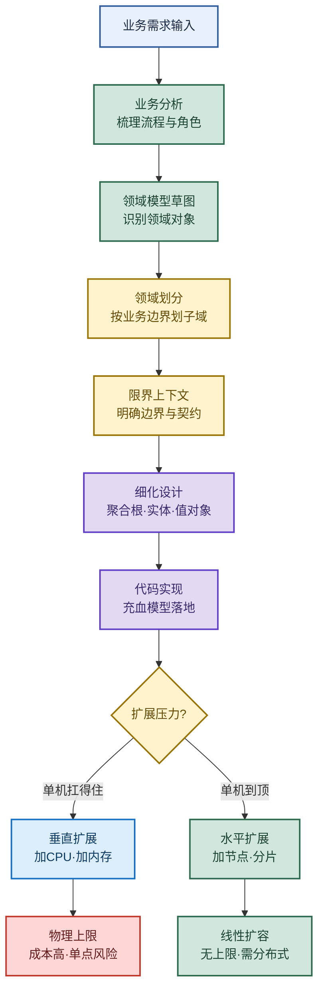

# 架构设计：DDD 与扩展策略

> 目标：不背孤立名词。遇到架构题先判断"问的是哪一层"——领域建模、对象模型、扩展方式、还是架构演进，再讲机制、取舍和落地手段。
>
> 读图顺序：先看下方"先记住这张总图"，再按问题回看各节。每节底部都有**易混点**或**速记**；先遮住解释自己讲，再对照正文。
>
> 本笔记以业务系统为主，分布式数据库、缓存集群、微服务的扩展会在对应小节标注。

## 先记住这张总图

**一句话主线：**DDD 用领域边界对齐业务 → 充血模型把行为收回领域对象 → 垂直扩展加硬件到顶 → 水平扩展加节点无限扩 → 架构从单体演进到云原生。

## 1. DDD 领域驱动设计：实现流程

> DDD 的核心是"让代码结构对齐业务结构"，先用通用语言沟通，再划边界、再写代码。

### 实现流程五步

| 步骤 | 做什么 | 关键产出 | 记忆画面 |
|---|---|---|---|
| 业务分析 | 梳理业务流程、角色、用例 | 用例图、流程图 | 先把"谁干什么"讲清楚 |
| 领域模型草图 | 识别领域对象与关系 | 概念草图 | 在白板上画圈连线 |
| 领域划分 | 按业务边界划分子域 | 子域列表 | 把大蛋糕切成几块 |
| 细化设计 | 定义聚合根、实体、值对象 | 领域模型详图 | 给每块蛋糕定主次 |
| 代码实现 | 落地充血模型与分层 | 可运行代码 | 草图变工程 |

**易混点：**DDD 不是"分层架构"，分层是技术维度（Controller/Service/Dao），DDD 是业务维度（按领域切分）。两者正交：DDD 切横，分层切纵。

**速记：**业务分析 → 模型草图 → 领域划分 → 细化设计 → 代码实现，五步从模糊到清晰。

## 2. DDD 核心概念：领域、子域、限界上下文

> 这一组概念是 DDD 的"骨架"，面试常被连问，必须能一句话讲清每个。

### 核心概念对比

| 概念 | 定义 | 作用 | 记忆画面 |
|---|---|---|---|
| 领域 | 一个业务范围/问题空间 | 圈定要解决的业务 | "电商"整个大盘 |
| 子域 | 领域内更小的业务块 | 拆分复杂业务 | 电商里的"商品、订单、支付" |
| 核心域 | 最赚钱、最关键的子域 | 投入最精锐兵力 | 电商的"交易" |
| 支撑域 | 必要但非核心的子域 | 自建或外包均可 | 电商的"物流" |
| 通用域 | 通用基础设施类子域 | 直接用现成方案 | 电商的"权限、认证" |
| 限界上下文 | 一个模型适用的明确边界 | 防止概念混淆、定义契约 | "商品"在交易上下文是 SKU，在仓储上下文是货位 |

**易混点：**子域是**问题空间**的划分（业务怎么切），限界上下文是**解决方案空间**的划分（模型边界在哪）。一个子域通常对应一个限界上下文，但不是绝对一对一。

**速记：**领域是大盘，子域是切块，核心/支撑/通用按价值分，限界上下文是模型的"国界"。

## 3. 聚合根、实体、值对象

> 这是限界上下文内部的"三级对象"，决定数据一致性和生命周期。

### 三级对象对比

| 概念 | 定义 | 有无标识 | 一致性职责 | 记忆画面 |
|---|---|---|---|---|
| 聚合根 | 聚合的入口对象，对外唯一引用点 | 有 ID | 维护聚合内**强一致性** | 订单是根，订单项归它管 |
| 实体 | 有唯一标识、有状态、可变 | 有 ID | 聚合内参与一致性 | 订单项有 ID，但要通过订单改 |
| 值对象 | 无标识、不可变、用属性判等 | 无 ID | 描述特征，无生命周期 | 地址、金额、日期 |

**关键规则：**
- 外部只能持有**聚合根的引用**，不能直接引用内部实体。
- 聚合内修改必须经过聚合根，保证一致性边界。
- 聚合间通过聚合根 ID 引用，不用对象引用。
- 一个事务只改**一个聚合**，跨聚合用领域事件最终一致。

**易混点：**实体和值对象的最大区别不是"复杂度"，而是**有没有身份标识**。`Address` 即使字段再多，只要两个地址相同就视为相等，它就是值对象；`OrderItem` 即使只有一个数量字段，只要有 ID 能区分，它就是实体。

**速记：**聚合根是门面，实体有身份证，值对象看长相。

## 4. 充血模型 vs 贫血模型

> 这是 DDD 落地的核心争议点，面试高频。记住"贫血是反模式但流行，充血是 DDD 推荐但难写"。

### 两种模型对比

| 维度 | 贫血模型 | 充血模型 |
|---|---|---|
| 数据与行为 | 对象只有数据（getter/setter），行为在 Service | 对象既有数据又有业务行为 |
| 业务逻辑位置 | 全在 Service 层 | 在领域对象内 |
| 面向对象 | 退化成数据结构 | 真正的封装 |
| 可维护性 | Service 越来越胖、难复用 | 行为内聚、易测试 |
| 适用场景 | 简单 CRUD、表驱动业务 | 复杂业务规则、领域逻辑丰富 |
| 典型框架 | 早期 Spring MVC + MyBatis | DDD 项目、Spring Data + 领域层 |

**易混点：**充血模型不是"把所有逻辑塞进对象"。**领域逻辑**（业务规则、状态变更）放领域对象；**应用逻辑**（事务编排、调用其他聚合、发事件）仍放 Application Service。充血的是领域层，不是把 Service 砍光。

**速记：**贫血=数据袋+Service 大脑；充血=对象自己有大脑，Service 只做编排。

## 5. 垂直扩展 vs 水平扩展

> 扩展是架构演进的永恒主题。记住"垂直加硬件到顶，水平加节点无限"。

### 两种扩展对比

| 维度 | 垂直扩展（Scale Up） | 水平扩展（Scale Out） |
|---|---|---|
| 做法 | 增强单机硬件：加 CPU 核数、加内存、提磁盘 IOPS、加带宽 | 增加更多服务器节点分散负载 |
| 上限 | 有物理上限（单机硬件天花板） | 理论无上限（持续加节点） |
| 成本 | 越往上越贵（顶级硬件溢价高） | 线性成本，普通机器即可 |
| 单点风险 | 高（单机故障全挂） | 低（节点故障可剔除） |
| 改造成本 | 几乎零改造 | 需要分布式改造（状态、数据分片） |
| 典型场景 | 数据库单机升级、中间件初期 | Web 服务、微服务、分布式数据库 |

### 水平扩展的典型落地

| 系统 | 水平扩展方式 | 记忆画面 |
|---|---|---|
| OceanBase | 原生分布式数据库，加节点自动分片扩容 | 加机器就自动切数据 |
| Redis Cluster | 数据分散到多节点，16384 个槽位管理 | 数据按槽位撒到多台 |
| Spring Cloud / Dubbo | 应用服务多实例，注册中心 + 负载均衡 | 同一个服务起 N 份 |

**易混点：**垂直扩展和水平扩展不是二选一，而是**先垂直后水平**。单机没到瓶颈先加硬件（便宜、零改造），到顶了再水平扩展。一上来就分布式是过度设计。

**速记：**垂直加硬件有顶，水平加节点无限；先垂直后水平，分布式有改造成本。

## 6. 架构演进：单体 → 集群 → 微服务 → 云原生

> 架构不是越先进越好，而是"匹配业务规模"。记住每一步解决什么问题、带来什么新问题。

### 架构演进四阶段

| 阶段 | 形态 | 解决的问题 | 带来的新问题 | 记忆画面 |
|---|---|---|---|---|
| 单体 | 一个 war/jar 全包 | 简单、好部署、好调试 | 单点故障、代码膨胀、扩展难 | 一间小作坊全干 |
| 集群 | 单体多实例 + 负载均衡 | 解决单点、提升吞吐 | Session 共享、状态同步 | 同一家作坊开多家分店 |
| 微服务 | 按业务边界拆分独立服务 | 独立部署、独立扩展、技术异构 | 分布式事务、链路追踪、运维复杂 | 每道工序独立车间 |
| 云原生 | 容器化 + K8s + 服务网格 + 弹性伸缩 | 自动扩缩容、资源利用率高、故障自愈 | 学习曲线陡、基础设施重 | 车间全自动化、按需开关 |

**演进触发条件：**
- 单体 → 集群：**单机扛不住流量**或**不能停机**。
- 集群 → 微服务：**团队规模变大**、**业务模块迭代节奏不一**、**需要技术异构**。
- 微服务 → 云原生：**服务数量爆炸**、**需要弹性伸缩**、**多环境部署**。

**易混点：**微服务不是"拆得越细越好"。拆分粒度要匹配**团队边界**（康威定律）和**业务边界**（限界上下文）。拆太细会导致服务间调用爆炸、分布式事务遍地、运维成本失控。

**速记：**单体简单、集群抗单点、微服务独立、云原生弹性；每步解一个问题、生一个新问题。

## 高频场景题

### "业务越来越复杂，Service 层几千行，怎么重构？"

诊断：典型**贫血模型**症状——领域逻辑全堆在 Service，对象退化成数据袋。用 DDD 思路重构：先识别聚合根和实体，把业务规则从 Service 搬回领域对象，Service 只做事务编排。

### "系统 QPS 涨了 10 倍，单机扛不住，怎么扩？"

诊断：先看瓶颈在哪。CPU/内存瓶颈先**垂直扩展**加硬件（零改造、见效快）；到顶或要抗单点再**水平扩展**。水平扩展前先解决**无状态化**（Session 外置、本地缓存改分布式），再起多实例 + 负载均衡。

### "微服务拆分怎么定边界？拆太细调用爆炸怎么办？"

诊断：用 DDD 的**限界上下文**定边界——一个限界上下文对应一个微服务。拆分粒度匹配**团队边界**（康威定律），跨服务调用尽量走领域事件异步解耦，避免同步调用链过长。

## 面试回答模板：三句话讲清一题

> **问题本质是**：架构选型没有银弹，核心是"匹配业务规模和团队能力"，过度设计和设计不足都是错。
>
> **机制是**：DDD 用领域边界对齐业务，充血模型把行为收回领域对象保证内聚；垂直扩展加硬件到顶，水平扩展加节点无限但需分布式改造；架构从单体到云原生，每一步解决一个核心矛盾。
>
> **实战中我会**：先看业务复杂度决定要不要 DDD，简单 CRUD 用贫血模型够用；扩展先垂直后水平，水平前先无状态化；微服务按限界上下文拆，粒度匹配团队，跨服务用事件解耦。

## 最后复习：闭眼回忆 8 句

1. DDD 实现五步：业务分析 → 模型草图 → 领域划分 → 细化设计 → 代码实现。
2. 子域是问题空间划分，限界上下文是解决方案空间划分，一个子域通常对应一个限界上下文。
3. 聚合根是聚合入口、对外唯一引用点、维护强一致性；外部只持有聚合根引用。
4. 实体有 ID、可变；值对象无 ID、不可变、按属性判等——区别在身份标识不在复杂度。
5. 贫血模型只有数据、行为在 Service；充血模型数据和行为都在领域对象，Service 只做编排。
6. 垂直扩展加硬件有物理上限、单点风险高；水平扩展加节点无上限、需分布式改造。
7. 水平扩展典型：OceanBase 自动分片、Redis Cluster 槽位管理、Spring Cloud 多实例。
8. 架构演进：单体（简单）→ 集群（抗单点）→ 微服务（独立）→ 云原生（弹性），每步解一题生一题。

## 怎么练才记得住

1. **白板画总图**：闭眼从业务需求画到架构演进，每个节点能讲一句话，讲不出就回去看。
2. **对比表自测**：遮住表格右半边，只看左列概念，自己讲定义、区别、适用场景，再对照。
3. **项目套用**：拿自己手上的项目，指出它用贫血还是充血、单体还是微服务、垂直还是水平扩展，并说出为什么。
4. **场景题演练**：假设 QPS 涨 10 倍、Service 几千行、微服务拆分，用三句话模板回答，录音回听是否讲清"本质-机制-实战"。
