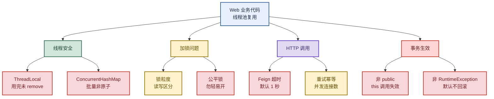

# 业务开发常见错误：线程安全、加锁、HTTP 与事务

> 目标：不背孤立坑点。遇到"线上踩坑"类题目先判断"问的是哪一类"——线程安全、加锁、HTTP 调用、还是事务失效，再讲机制、复现场景和修复手段。
>
> 读图顺序：先看下方"先记住这张总图"，再按问题回看各节。每节底部都有**易混点**或**速记**；先遮住解释自己讲，再对照正文。
>
> 本笔记聚焦 Web 服务器（Tomcat）线程池复用环境下的业务代码常见错误，覆盖 ThreadLocal、ConcurrentHashMap、锁、Feign、@Transactional 五大高频坑。

## 先记住这张总图

**一句话主线：**线程池复用是根因 → ThreadLocal 要 remove、批量操作要原子、锁要分粒度、Feign 要配超时禁重试、@Transactional 要 public 外调且抛 RuntimeException。

## 1. 线程安全：ThreadLocal 与 ConcurrentHashMap

> Web 服务器用线程池复用线程，没有显式 `new Thread` 也会有线程安全问题。

### 两个高频坑对比

| 坑点 | 触发条件 | 后果 | 修复 | 记忆画面 |
|---|---|---|---|---|
| **ThreadLocal 未 remove** | Tomcat 线程池复用线程，请求结束后 ThreadLocal 残留 | 下一个请求读到上一个请求的数据，串号/越权/内存泄漏 | `try-finally` 中显式 `threadLocal.remove()` | 住酒店退房不退钥匙，下个客人直接进你房间 |
| **ConcurrentHashMap 批量非原子** | `putAll` 等批量操作在并发下被其他线程穿插 | 批量过程非原子，部分写入被覆盖，配置不一致 | 逐 key 用 `replaceAll`/`compute` 原子方法，或显式 `synchronized` | 多人同时往同一柜子塞东西，你塞一半被人插队 |

**易混点：**`ConcurrentHashMap` 的单个 `put`/`compute` 是原子的，但 `putAll`、`先 get 后 put` 这类"复合操作"不是原子的。**线程安全容器 ≠ 所有操作都原子**。

**速记：**ThreadLocal 用完必 remove（finally 里清）；批量操作要么逐 key 原子、要么显式加锁。

## 2. 加锁问题：粒度、读写与公平锁

> 加锁不是越粗越安全，而是越精越高效；公平锁是性能毒药。

### 锁的三个维度

| 维度 | 考量点 | 选择 | 记忆画面 |
|---|---|---|---|
| **锁粒度** | 只为必要代码块加锁，降低锁范围 | 锁代码块而非整个方法 | 只锁保险箱不锁整间房 |
| **锁级别** | 共享资源是类级别（static）还是实例级别 | 类资源锁 `Class`，实例资源锁 `this` 或具体对象 | 公司公章 vs 个人工牌 |
| **读写场景** | 读写比例差异明显时 | `ReentrantReadWriteLock` 区分读写锁 | 图书馆：看书人多借书人少，借书要排队 |
| **悲观/乐观** | 访问冲突激烈还是稀疏 | 冲突激烈用悲观锁（synchronized），稀疏用乐观锁（CAS） | 早高峰地铁 vs 深夜地铁 |

**易混点：**`ReentrantLock` 和 `ReentrantReadWriteLock` 都有**公平锁**版本（构造传 `true`），但**没有明确需要时不要开启**——任务竞争强时公平锁会让性能下降**上百倍**。公平锁的"排队"代价远超想象。

**速记：**粒度小、级别对、读写分、公平锁别乱开。

## 3. HTTP 调用：Feign 超时与重试坑

> 网络不稳定，超时重试是双刃剑——重试前必须确认服务端**幂等**。

### Feign 五大坑点

| 坑点 | 默认/现象 | 修复 | 记忆画面 |
|---|---|---|---|
| **读取超时太短** | 默认 `ReadTimeout=1s`，稍慢接口就超时 | 按接口耗时调大 | 快递员只等 1 分钟就走了 |
| **超时配置不生效** | 只配 `readTimeout` 不配 `connectTimeout` 不生效 | **必须同时配连接超时和读取超时** | 两个开关要一起拧 |
| **Feign 与 Ribbon 冲突** | 同时配置时以 **Feign 为准** | 统一在 Feign 侧配置 | 两个领导发话，听 Feign 的 |
| **重试导致重复请求** | Ribbon 默认自动重试 | `MaxAutoRetriesNextServer=0` 禁止重试 | 快递送两次，你付两次钱 |
| **并发连接数瓶颈** | HttpClient/浏览器默认限制最大并发连接 | 高并发客户端调大连接池 | 高速公路只有 2 车道，车多必堵 |

**易混点：**Feign 的超时和 Ribbon 的超时是**两套配置**，同时存在时以 Feign 为准；但 Ribbon 的**重试**是独立机制，禁重试要单独设 `MaxAutoRetriesNextServer=0`。超时归 Feign，重试归 Ribbon，别混。

**速记：**超时连读一起配、以 Feign 为准、重试按需关、连接池要调大。

## 4. 事务生效：@Transactional 失效四场景

> Spring 默认用**动态代理**实现事务增强，绕过代理就失效。

### @Transactional 失效场景

| 场景 | 原因 | 修复 | 记忆画面 |
|---|---|---|---|
| **非 public 方法** | JDK 动态代理只能代理接口/public 方法，private 无法代理 | 事务方法必须 `public` | 保安只看正门，后门进来的不管 |
| **this 内部调用** | `this` 是目标对象本身，不是代理对象，绕过 AOP | 通过注入的代理 Bean 调用，或 `AopContext.currentProxy()` | 自己喊自己名字，保安听不见 |
| **CGLIB 代理 private** | CGLIB 通过继承生成子类，private 方法子类不可见 | 同上，方法改 public | 儿子继承不了爸爸的私房钱 |
| **异常被吞/非 RuntimeException** | 默认只对 `RuntimeException`/`Error` 回滚，checked 异常不回滚 | `@Transactional(rollbackFor=Exception.class)` 指定回滚异常 | 保安只认"红色警报"，黄色警报不响应 |

**易混点：**"事务生效"和"事务回滚"是两件事——**生效**看是否经过代理（public + 外部调用），**回滚**看抛的异常类型（默认只回滚 RuntimeException）。方法代理到了但抛了 checked 异常，事务生效却不回滚，照样提交。

**速记：**public + 外部调用 + 抛 RuntimeException，三件齐了事务才完整。

## 高频场景题：用一句诊断开头

### "接口偶发串号，用户 A 看到用户 B 的数据，怎么查？"

先确认是否用了 `ThreadLocal` 存用户信息且请求结束未 `remove`——Tomcat 线程池复用线程，上一个请求的用户信息残留。修复：在拦截器/过滤器的 `afterCompletion` 或 `try-finally` 中显式 `threadLocal.remove()`；压测复现可压高并发 + 短请求。

### "Feign 调用偶发超时，但服务端日志显示处理很快，怎么查？"

大概率是 Feign 默认 `ReadTimeout=1s` 太短，或只配了 `readTimeout` 没配 `connectTimeout` 导致配置不生效。先看 Feign 配置是否同时配了连接和读取超时，再看是否与 Ribbon 冲突（以 Feign 为准），最后看客户端连接池是否打满（并发连接数瓶颈）。

### "@Transactional 方法里调另一个 @Transactional 方法，内层事务没生效？"

典型 `this` 调用失效——内层方法通过 `this.xxx()` 调用，`this` 是目标对象不是代理对象，绕过了 AOP。修复：注入自身 Bean（`@Autowired private XxxService self;` 后 `self.xxx()`），或用 `AopContext.currentProxy()` 拿代理对象调用。

## 面试回答模板：三句话讲清一题

> **问题本质是……**（先说坑属于哪一类：线程安全、加锁、HTTP、还是事务）。
>
> **机制是……**（解释根因 + 关键配置/参数），因为……（为什么这样设计/默认值）。
>
> **实战中我会……**（修复手段 + 验证方式），例如……（具体场景）。

例：问"ThreadLocal 用完不 remove 会怎样"——本质是线程安全问题，根因是 Tomcat 线程池复用线程，请求结束后 ThreadLocal 数据残留；机制是 ThreadLocal 把数据存在每个线程的 `ThreadLocalMap` 里，线程不销毁数据就不清，下个请求复用该线程就读到脏数据；实战中我会在 `try-finally` 里 `remove()`，并在拦截器 `afterCompletion` 兜底，压测高并发短请求复现验证。

## 最后复习：闭眼回忆 8 句

1. **根因**：Web 服务器用线程池复用线程，没显式 `new Thread` 也会有线程安全问题。
2. **ThreadLocal**：用完必 `remove()`，放 `try-finally` 或拦截器 `afterCompletion`，否则线程复用串号。
3. **ConcurrentHashMap**：单 key 原子，`putAll`/复合操作非原子；批量要逐 key `compute` 或显式加锁。
4. **锁粒度**：只锁必要代码块；区分类级别（锁 `Class`）和实例级别（锁 `this`）；读写差异大用 `ReentrantReadWriteLock`。
5. **公平锁**：`ReentrantLock`/`ReentrantReadWriteLock` 都有公平版本，竞争强时性能下降上百倍，勿轻易开。
6. **Feign**：默认读取超时 1 秒；配超时必须连接+读取一起配；与 Ribbon 同时配以 Feign 为准；`MaxAutoRetriesNextServer=0` 禁重试。
7. **HTTP 客户端**：HttpClient/浏览器都限制最大并发连接数，高并发客户端要调大连接池，否则吞吐瓶颈。
8. **@Transactional**：public + 外部代理调用 + 抛 RuntimeException 才完整；非 public、`this` 调用、checked 异常都失效或不回滚，用 `rollbackFor=Exception.class` 兜底。

## 怎么练才记得住

别反复通读，改成主动回忆：

1. 每次只看一个坑点，遮住表格，先自己说出"触发条件 → 后果 → 修复"，再对照。
2. 用"高频场景题"的 3 道题各讲 30 秒；卡住时只回看对应小节。
3. 隔天再讲一遍，换成自己项目里的真实踩坑；能说出"当时怎么发现的、怎么修的"才算会。
4. 复习时轮流画"五大坑总图"和"@Transactional 失效四场景"；能默写出每个坑的修复代码片段才算熟。
