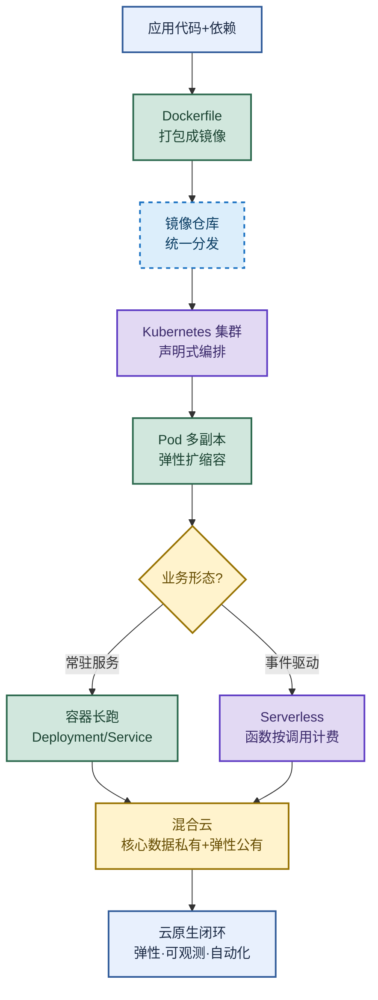

# 云原生：Docker、K8s 与 Serverless 的完整链路

> 目标：不背孤立名词。遇到云原生题目先判断"问的是哪一层"——容器化打包、K8s 编排、Serverless 执行模型、还是启动优化与混合云选型，再解释机制、取舍和落地手段。
>
> 读图顺序：先看下方"先记住这张总图"，再按问题回看各节。每节底部都有**易混点**或**速记**；先遮住解释自己讲，再对照正文。
>
> 本笔记以 Docker + Kubernetes 为主，Serverless 与混合云选型在对应小节单独标注。

## 先记住这张总图

**一句话主线：**Docker 打包应用与依赖 → K8s 声明式编排大规模容器 → Serverless 把执行也交给云 → 启动优化与混合云选型让云原生真正落地。

## 1. 什么是云原生：方法论不是工具

云原生（Cloud Native）是一套**构建和运行应用程序的方法论**，核心思想是充分利用云平台的**弹性、分布式、自动化**能力，让应用本身具备弹性、可观测性、韧性和自动化能力。

- **不是把地搬到云上**：传统应用直接塞进容器不叫云原生，那是"lift and shift"。
- **是为了云而设计**：从架构起就按云的弹性、故障常态来设计。
- **完整闭环**：容器打包 + 微服务拆分 + K8s 编排 + 声明式 API 描述期望状态。
- **终极目标**：业务开发只管写代码，弹性、容错、运维全交给平台。

| 维度 | 传统应用 | 云原生应用 | 记忆画面 |
|---|---|---|---|
| 部署单元 | 虚拟机 + 脚本 | 容器镜像 | 把"整机"换成"集装箱" |
| 扩缩容 | 手动加机器 | 声明式自动扩缩 | 自己拧螺丝 vs 自动挡 |
| 故障处理 | 人工介入 | 自愈、自动恢复 | 坏了喊人 vs 坏了自愈 |
| 运维边界 | 开发运维不分家 | 平台兜底运维 | 业务只写代码 |

**易混点：**云原生 ≠ 用了 Docker 和 K8s。用了容器但架构还是单体、扩缩容靠手动，那只是"容器化部署"，不是云原生。云原生强调**声明式 API + 弹性自愈 + 可观测**的闭环。

**速记：**容器打包、微服务拆分、K8s 编排、声明式 API——四件套缺一不可。

## 2. Docker：容器化打包平台

Docker 是容器化平台，把**应用和依赖一起打包**成镜像，镜像可在任何支持 Docker 的环境快速运行。容器之间相互隔离，启动快、占用资源少。

| 能力 | 说明 | 记忆画面 |
|---|---|---|
| 快速部署交付 | 镜像即"可执行的环境"，秒级启动 | 集装箱一吊就走 |
| 资源隔离 | 每个容器互不影响 | 一栋楼里独立户型 |
| 弹性伸缩 | 配合 K8s 大规模自动扩缩 | 楼层按需加层 |
| 环境一致 | 开发/测试/生产同镜像 | 同一份图纸盖三栋楼 |

**易混点：**容器 vs 虚拟机。虚拟机带完整客户机 OS，启动分钟级、GB 级内存开销；容器**共享宿主内核**，启动秒级、MB 级开销。但共享内核也意味着隔离性弱于虚拟机，内核漏洞影响所有容器。

### 项目中如何用 Docker

| 场景 | 用法 | 记忆画面 |
|---|---|---|
| 本地开发 | `docker-compose` 一键起数据库、缓存、消息队列 | 开发环境"一键开机" |
| 打包镜像 | 写 `Dockerfile`，应用+依赖一起打包 | 把厨房整体装箱 |
| 自动化部署 | CI/CD 流水线自动构建镜像并部署 | 流水线无人值守 |
| 多环境切换 | 不同配置文件 + 环境变量切开发/测试/生产 | 同一镜像换"剧本" |
| 服务编排 | 生产用 K8s 管多容器，高可用+弹性伸缩 | 调度员指挥车队 |

**速记：**Compose 起依赖、Dockerfile 打镜像、CI/CD 自动部署、K8s 编排生产。

## 3. Kubernetes：容器编排平台

Kubernetes（K8s）是开源的**容器编排平台**，用于自动化容器化应用的部署、扩缩容、管理和运维，帮助高效管理大规模容器集群，实现服务**高可用、弹性伸缩、自动恢复**。

| 核心能力 | 说明 | 记忆画面 |
|---|---|---|
| 声明式 API | 描述"期望状态"，系统自动趋近 | 点菜不教做法 |
| 自动调度 | 把 Pod 调度到合适节点 | 调度员派车 |
| 弹性扩缩 | HPA 按 CPU/自定义指标扩副本 | 楼层按客流加层 |
| 自愈 | 容器挂了自动重启、节点挂了自动迁移 | 坏了自愈 |
| 服务发现 | Service 提供稳定访问入口 | 总台转接 |

**易混点：**Docker vs K8s。Docker 解决"怎么打包和跑一个容器"，K8s 解决"怎么管成百上千个容器"。Docker 是单机视角，K8s 是集群视角；K8s 底层仍然跑 Docker/containerd 容器。

**易混点：**声明式 vs 命令式。命令式是"先 A 再 B 再 C"一步步教，声明式是"我要 3 个副本、版本 v2"由系统自己实现。云原生核心是**声明式**——描述期望状态，平台持续调谐。

**速记：**声明式 API 是灵魂，Pod 是最小调度单元，Service 是稳定入口，HPA 是弹性手。

## 4. Serverless：执行模型的极致托管

Serverless 是一种云计算架构模式，核心理念是**你只负责写代码，不用管服务器在哪、怎么跑、怎么扩容**。它是云原生的一种**执行模型**：开发者编写函数代码上传，云平台自动管理服务器、运行时、伸缩，按函数调用次数和资源消耗计费。

| 维度 | 传统开发 | Serverless | 记忆画面 |
|---|---|---|---|
| 服务器 | 先买服务器、装系统、配环境 | 代码交给云平台 | 自己开店 vs 进驻商场 |
| 扩容 | 手动加机器 | 平台自动分配资源 | 自己加桌 vs 商场调度 |
| 计费 | 按服务器时长 | 按调用次数+资源消耗 | 包月 vs 按件计费 |
| 感知 | 看得见服务器 | 感觉不到服务器存在 | 看得见后厨 vs 黑盒出餐 |

**易混点：**Serverless ≠ 没有服务器。服务器仍然存在，只是由云平台完全托管，开发者无感知。"无服务器"是开发者视角，不是物理视角。

**易混点：**Serverless vs 容器长跑。Serverless 适合**事件驱动、短时、突发**的场景（ webhook、定时任务、图片处理）；常驻服务、长连接、稳定流量更适合容器 + K8s。Serverless 冷启动有延迟，不适合低延迟稳态服务。

**速记：**写代码、传函数、平台跑、按调用付费——Serverless 四步。

## 5. 云原生如何优化启动速度

云原生应用通常跑在容器环境（如 K8s），具备弹性伸缩、自动恢复、按需调度等能力，**应用启动速度直接影响这些能力的发挥**。容器相比虚拟机启动快（共享内核），但镜像过大依然会拖慢速度，因此**轻量级容器镜像是云原生优化的核心方向之一**。

| 优化招 | 做法 | 原理 | 记忆画面 |
|---|---|---|---|
| 镜像瘦身 | 多阶段构建、用 Alpine/distroless 基础镜像、`.dockerignore` 排除无关文件 | 镜像越小拉取越快、启动越快 | 行李越轻走得越快 |
| 延迟加载 | 先让程序跑起来，非核心模块懒加载 | 核心路径先就绪，边跑边加载 | 先开门营业再摆货架 |
| 异步化启动 | 不在启动时做耗时操作，数据库初始化、海量配置加载改异步或预热 | 启动线程不被阻塞 | 开店先开门，盘点后台做 |
| 提前准备 | 配置、缓存、依赖提前就绪，启动时直接用 | 减少启动期 IO 和等待 | 食材昨晚备好 |

**易混点：**启动快 ≠ 运行快。启动优化解决的是"弹性伸缩响应速度"和"故障恢复时间"，不是吞吐量优化。一个启动 1 秒但 QPS 低的服务，仍需要运行期调优。

**易混点：**镜像瘦身不是越小越好。瘦到丢失运行时依赖（如 JRE、glibc）会导致容器跑不起来；要在"够用"和"最小"之间取平衡，多阶段构建是主流手段。

**速记：**瘦镜像、懒加载、异步启动、提前备——启动优化四招。

## 6. 混合云选型：为什么不全上公有云

混合云是公有云 + 私有云的组合，通过专线或 VPN 打通，兼顾合规、成本和弹性。

| 维度 | 放在哪 | 原因 | 记忆画面 |
|---|---|---|---|
| 核心数据 | 私有云 | 用户身份、财务记录等合规要求必须留本地 | 保险柜放家里 |
| 业务高峰 | 公有云 | 电商大促需要快速弹性扩容 | 高峰期租临时仓库 |
| 静态页面 | 公有云 | 非敏感内容放公有云降低成本 | 广告牌放外面 |
| 非敏感计算 | 公有云 | 成本低、弹性好 | 普通加工外包 |
| 网络打通 | 专线/VPN | 公有云与私有云互通 | 修一条专用通道 |

**易混点：**混合云 vs 多云。混合云是"公有+私有"两种部署形态组合；多云是"同时用多家公有云"。混合云解决合规与弹性矛盾，多云解决厂商锁定与择优。

**易混点：**混合云不是"临时把数据搬到公有云"。核心数据始终在私有云，公有云只承接弹性计算和非敏感任务，数据流向受合规约束，不能随意跨境/跨云。

**速记：**核心数据私有留、弹性高峰公有扛、静态内容公有放、专线 VPN 打通两云。

## 高频场景题：用一句诊断开头

### "云原生应用启动慢，弹性伸缩跟不上，怎么优化？"

先看启动瓶颈在哪一层：镜像拉取慢、启动期阻塞、还是依赖初始化慢。镜像层用多阶段构建 + Alpine 瘦身，拉取慢可配镜像预热和 P2P 分发；启动期阻塞把数据库连接、海量配置加载改异步或预热，先让健康检查端口就绪；依赖初始化用懒加载，核心路径先跑起来。目标是把启动从分钟级压到秒级，HPA 才能真正跟得上流量突增。

### "为什么选混合云而不是全公有云？"

核心矛盾是合规与弹性的取舍。用户身份、财务记录这类数据合规要求必须留在私有云，不能上公有云；但电商大促这种业务高峰需要公有云的快速弹性扩容，私有云扩容慢且闲置成本高。所以核心数据留私有云、弹性高峰和非敏感计算放公有云、静态页面也放公有云降成本，通过专线或 VPN 打通形成混合云。全公有云在合规上过不了关，全私有云在弹性上扛不住高峰。

### "Serverless 适合什么场景，什么场景不适合？"

适合**事件驱动、短时执行、突发流量**的场景：webhook 回调、定时任务、图片/视频处理、IoT 消息处理。这些场景调用频次不均匀，按调用计费比常驻服务器便宜，且无需运维。不适合**长连接、稳态高流量、超低延迟**的场景：长连接会被函数超时切断，稳态流量按调用计费反而比容器贵，冷启动延迟对低延迟服务是硬伤。这类场景用容器 + K8s 更合适。

## 面试回答模板：三句话讲清一题

> **问题本质是……**（先说云原生问的是哪一层：方法论、容器化、编排、执行模型、还是选型）。
>
> **机制是……**（解释原理 + 关键组件），因为……（为什么这样设计）。
>
> **实战中我会……**（落地手段 + 取舍），例如……（具体场景）。

例：问"什么是云原生"——本质是一套构建和运行应用的方法论，不是把地搬到云上而是为云而设计；机制是容器打包 + 微服务拆分 + K8s 编排 + 声明式 API 描述期望状态，让系统具备弹性、可观测、自愈能力；实战中我会用 Docker 打镜像、K8s 做编排和 HPA 弹性、配合可观测性组件，业务只管写代码，运维交给平台。

## 最后复习：闭眼回忆 8 句

1. **云原生**：方法论不是工具，容器+微服务+K8s+声明式 API 四件套，目标是弹性、可观测、自动化闭环。
2. **Docker**：应用+依赖打包成镜像，容器共享内核秒级启动，Compose 起依赖、Dockerfile 打镜像、CI/CD 自动部署。
3. **容器 vs 虚拟机**：容器共享内核轻量但隔离弱，虚拟机带完整 OS 重但隔离强。
4. **K8s**：容器编排平台，声明式 API 是灵魂，Pod 是最小调度单元，Service 稳定入口，HPA 弹性扩缩，自愈自动恢复。
5. **Serverless**：执行模型不是没有服务器，写函数、平台跑、按调用计费，适合事件驱动短时突发，不适合长连接稳态低延迟。
6. **启动优化**：镜像瘦身（多阶段+Alpine）、延迟加载、异步启动、提前准备——四招把启动压到秒级。
7. **混合云**：核心数据私有留合规、弹性高峰公有扛、静态内容公有放降本、专线 VPN 打通；区别于多云（多家公有云）。
8. **易混**：云原生 ≠ 用了 Docker/K8s；Serverless ≠ 没服务器；启动快 ≠ 运行快；混合云 ≠ 多云。

## 怎么练才记得住

别反复通读，改成主动回忆：

1. 每次只看一个小节，遮住表格，先自己说出"概念 → 机制 → 易混点 → 落地场景"，再对照。
2. 用"高频场景题"的 3 道题各讲 30 秒；卡住时只回看对应小节。
3. 隔天再讲一遍，换成自己的项目例子；能解释"为什么选混合云、为什么用 Serverless、启动慢怎么查"才算会。
4. 复习时轮流画"云原生总图"和"混合云选型表"；能默写出四件套和启动优化四招才算熟。
