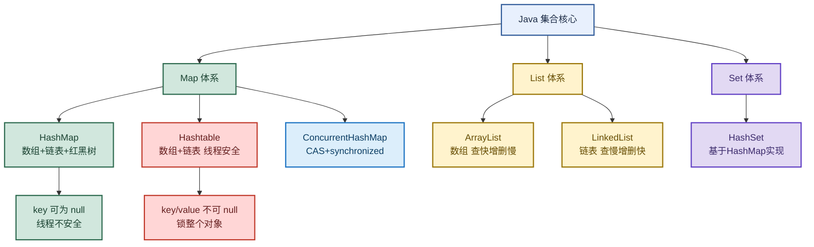

# Java 集合：从 HashMap 原理到 ArrayList/LinkedList 与 ConcurrentHashMap

> 目标：遇到集合题目先判断"问的是哪一层"——HashMap vs Hashtable、HashMap put 流程、ArrayList vs LinkedList、HashSet、ConcurrentHashMap 原理，再展开机制和实战。
>
> 读图顺序：先看下方"先记住这张总图"（Java 集合核心知识点链路），再按问题回看各节。每节底部都有**易混点**或**速记**；先遮住解释自己讲，再对照正文。
>
> 本笔记覆盖 HashMap/Hashtable 区别 + HashMap put 流程 + ArrayList/LinkedList 对比 + HashSet + ConcurrentHashMap 演进。

## 先记住这张总图

**一句话主线：**HashMap 数组+链表+红黑树（key 可 null，线程不安全）→ put 三步（算哈希、处理冲突、检查扩容）→ ArrayList 数组查快增删慢 vs LinkedList 链表查慢增删快 → HashSet 基于 HashMap → ConcurrentHashMap JDK1.7 分段锁、1.8 CAS+synchronized。

## 1. HashMap 和 Hashtable 的区别

> 核心区别：底层数据结构、null 键值支持、线程安全性。

| 维度 | HashMap | Hashtable |
|---|---|---|
| 底层结构 | 数组 + 链表 + <mark>红黑树</mark> | 数组 + 链表 |
| null 键值 | <mark>可以存储 null 键值</mark>（key 为空时哈希值为 0） | 无论 key 还是 value 都<mark>不能为 null</mark> |
| 线程安全 | <mark>线程不安全</mark> | 线程安全（修改数据时锁住整个 Hashtable，效率低） |
| 替代方案 | 并发用 ConcurrentHashMap | 已被 ConcurrentHashMap 取代 |

**为什么 HashMap 的 key 值可以为 null？**HashMap 使用 hash 方法计算 key 的哈希值，当 key 为空时，直接令 key 的哈希值为 0。

**易混点：**Hashtable 线程安全但效率低（锁整个对象），已被 ConcurrentHashMap 取代。并发场景别用 Hashtable，用 ConcurrentHashMap（JDK1.8 用 CAS + synchronized 锁头节点，粒度更细）。

## 2. HashMap 的 put 方法

> put 三步：计算哈希值确定下标 → 处理哈希冲突插入节点 → 检查容量决定是否扩容。

| 步骤 | 做什么 | 关键点 |
|---|---|---|
| 1. 计算哈希值，确定数组下标 | 用 hash 方法计算 key 哈希值，按位与确定下标 | 之所以用<mark>按位与</mark>，是因为底层数组长度总是 2 的幂，这种运算效率比取模更高 |
| 2. 处理哈希冲突，插入节点 | 拿到下标后检查这个位置有没有元素；没有直接插入；有就发生了<mark>哈希冲突</mark>，遍历链表或红黑树比较 key 是否相同，相同覆盖，没有追加链条或转换红黑树 | 链表长度 ≥ 8 且数组长度 ≥ 64 转红黑树 |
| 3. 检查容量，决定是否扩容 | 扩容阈值 = 容量 × 负载因子 | 默认负载因子 0.75，达到阈值就扩容（容量翻倍） |

**易混点：**HashMap 的按位与（`(n-1) & hash`）替代取模（`hash % n`）的前提是数组长度是 2 的幂。这是 HashMap 构造时容量会向上取整为 2 的幂的原因——为了用按位与提速。

## 3. ArrayList 和 LinkedList 区别

> 核心区别：数据结构不同导致效率差异。

| 维度 | ArrayList | LinkedList |
|---|---|---|
| 数据结构 | <mark>数组</mark>实现 | <mark>链表</mark>实现 |
| 查找效率 | 查找元素快（数组下标随机访问 O(1)） | 查找元素慢（链表需遍历 O(n)） |
| 增删效率 | 增删慢（数组要移动元素） | 增删快（链表改指针即可） |

### 容易踩坑的细节

| 场景 | 谁更快 | 原因 |
|---|---|---|
| 尾部插入，数据量较小 | LinkedList 较快 | ArrayList 要频繁扩容 |
| 尾部插入，数据量较大 | <mark>ArrayList 更快</mark> | ArrayList 扩容是当前容量 ×1.5，数据量大时不需频繁扩容；LinkedList 每次 add 都要 new 成 Node 对象，ArrayList 直接数组赋值 |
| 中间插入 | ArrayList 可能更快 | LinkedList 遍历获取插入位置是<mark>两头往中间搜</mark>，index 越往中间遍历越久 |

**易混点：**"LinkedList 增删快"不是绝对的。尾部插入大数据量时 ArrayList 更快（不频繁扩容 + 直接数组赋值 vs LinkedList 每次 new Node）；中间插入 LinkedList 要遍历到位置（两头往中间搜），ArrayList 虽然要移动元素但数组操作更快。选型看具体场景，别死记"LinkedList 增删快"。

## 4. HashSet

> HashSet 不允许重复元素，无序，基于 HashMap 实现。

| 维度 | 说明 |
|---|---|
| 核心特点 | <mark>不允许重复元素</mark>，<mark>无序</mark> |
| 底层实现 | 基于 HashMap 实现——元素都存到 HashMap 键值对的 key 上，而 value 有一个统一的 Object 对象（PRESENT） |
| 唯一性保证 | 重复对象 equals 方法返回 true；重复对象 hashCode 方法返回相同的整数 |
| 重写要求 | 如果需要根据属性判断两个对象相等，除了重写 equals 方法，还要<mark>重写 hashCode 方法</mark> |

### HashSet 和 ArrayList 的区别

| 维度 | HashSet | ArrayList |
|---|---|---|
| 重复性 | <mark>不重复</mark> | 可重复 |
| 有序性 | <mark>无序</mark> | 有序 |
| 查询效率 | 高（基于 HashMap） | 高 |
| 增删效率 | 高 | 低 |
| 线程安全 | 不安全 | 不安全 |

**易混点：**HashSet 判重靠 equals + hashCode 两个方法。只重写 equals 不重写 hashCode 会导致"逻辑相等但 hashCode 不同"的对象被当成不同对象存进去——所以两个方法必须同时重写。

## 5. ConcurrentHashMap 原理

> JDK 1.7 和 1.8 实现差异巨大，面试必问演进。

| 版本 | 锁机制 | 数据结构 | 读操作 |
|---|---|---|---|
| JDK 1.7 | <mark>分段锁 Segment 数组</mark>，每个 Segment 继承 ReentrantLock；存数据时先通过 hash 算出属于哪个 Segment，然后锁住这一小段 | Segment 数组 + HashEntry | 有锁 |
| JDK 1.8 | <mark>CAS + synchronized 锁头节点</mark> | 数组 + 链表 + 红黑树 | <mark>无锁</mark>（Node 的 val 和 next 都用 volatile 修饰） |

**JDK 1.7 分段锁原理：**把整个 Map 拆成多个 Segment（默认 16 个），每个 Segment 是一个独立的小 HashMap，自带 ReentrantLock。存数据时只锁对应的 Segment，不同 Segment 可以并发，提升吞吐量。

**JDK 1.8 改进：**抛弃 Segment 分段锁，改为 CAS + synchronized 锁头节点。锁粒度从 Segment（一段）细化到头节点（一个桶），并发度更高；数据结构加红黑树（链表 ≥8 转树）；读操作无锁（volatile 保证可见性）。

**易混点：**JDK 1.8 的 ConcurrentHashMap 用 synchronized 而不是 ReentrantLock，是因为 1.8 锁粒度细化到头节点，synchronized 经过 JVM 优化（偏向锁、轻量级锁）在低竞争场景性能不输 ReentrantLock，且内存占用更小。

## 高频场景题：用一句诊断开头

### "HashMap 和 Hashtable 区别？"

HashMap 底层数组+链表+红黑树，key 可为 null，线程不安全；Hashtable 底层数组+链表，key/value 都不能为 null，线程安全（锁整个对象，效率低）。并发场景别用 Hashtable，用 ConcurrentHashMap（1.8 用 CAS + synchronized 锁头节点，粒度更细）。

### "ConcurrentHashMap 1.7 和 1.8 区别？"

1.7 用分段锁 Segment 数组（每个 Segment 继承 ReentrantLock），锁粒度是一段；1.8 抛弃 Segment，改为 CAS + synchronized 锁头节点，锁粒度细化到一个桶，并发度更高。1.8 还加了红黑树（链表 ≥8 转树），读操作无锁（volatile 保证可见性）。

## 面试回答模板：三句话讲清一题

> **问题本质是……**（先说问的是哪一层：Map、List、Set、并发）。
>
> **机制是……**（解释原理 + 关键点），因为……（为什么这样设计）。
>
> **实战中我会……**（选型 + 场景），例如……（业务应用）。

例：问"ArrayList 和 LinkedList 怎么选"——本质是数据结构差异；机制是 ArrayList 数组随机访问 O(1) 查快但增删要移动元素，LinkedList 链表查慢 O(n) 但增删改指针快；实战中频繁随机查询用 ArrayList（绝大多数场景），频繁在头尾插入删除用 LinkedList，但大数据量尾部插入 ArrayList 反而更快（不频繁扩容 + 直接数组赋值）。

## 最后复习：闭眼回忆 8 句

1. **HashMap vs Hashtable**：HashMap 数组+链表+红黑树、key 可 null、线程不安全；Hashtable 数组+链表、不可 null、锁整个对象（已被 CHM 取代）。
2. **HashMap key 为 null**：hash 方法中 key 为空时哈希值直接为 0。
3. **HashMap put 三步**：算哈希定下标（按位与，数组长度 2 的幂）→ 处理冲突（链表/红黑树，≥8 转树）→ 检查扩容（阈值=容量×0.75）。
4. **ArrayList vs LinkedList**：数组查快增删慢 vs 链表查慢增删快；但大数据量尾部插入 ArrayList 更快（不频繁扩容）。
5. **LinkedList 中间插入慢**：遍历是两头往中间搜，index 越往中间越久。
6. **HashSet**：基于 HashMap（元素存 key，value 统一 PRESENT），不重复无序；判重靠 equals + hashCode 同时重写。
7. **ConcurrentHashMap 1.7**：分段锁 Segment（继承 ReentrantLock），锁一段。
8. **ConcurrentHashMap 1.8**：CAS + synchronized 锁头节点（锁一个桶）+ 红黑树 + 读无锁（volatile）。

## 怎么练才记得住

别反复通读，改成主动回忆：

1. 每次只看一个集合，遮住表格，先自己说出"底层结构 → 效率 → 适用场景"，再对照。
2. 用"HashMap put 三步"和"ConcurrentHashMap 1.7 vs 1.8"各讲 30 秒；卡住时只回看对应小节。
3. 隔天再讲一遍，换成自己的项目例子；能解释"为什么大数据量尾部插入 ArrayList 更快"才算会。
4. 复习时轮流画"集合体系图"和"ConcurrentHashMap 演进表"；能默写出 put 三步和 1.7/1.8 锁差异才算熟。
