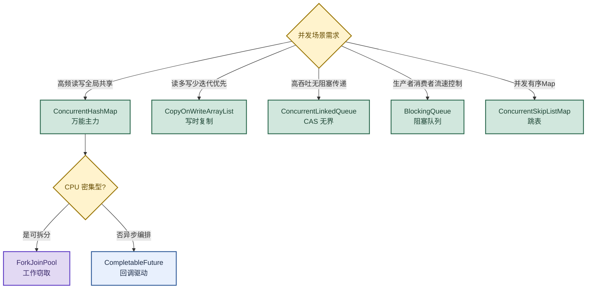

# 并发编程：从并发集合到 ForkJoinPool 与 CompletableFuture

> 目标：遇到并发编程题目先判断"问的是哪一层"——并发集合选型、ForkJoinPool、CompletableFuture，再展开机制和实战。
>
> 读图顺序：先看下方"先记住这张总图"（并发集合选型决策），再按问题回看各节。每节底部都有**易混点**或**速记**；先遮住解释自己讲，再对照正文。
>
> 本笔记覆盖 5 大并发集合选型 + ForkJoinPool 工作窃取 + FutureTask 痛点 + CompletableFuture 全能工具箱。

## 先记住这张总图

**一句话主线：**ConcurrentHashMap 万能主力、CopyOnWriteArrayList 专治读多写少、ConcurrentLinkedQueue 高吞吐传递、BlockingQueue 流速控制、ConcurrentSkipListMap 并发有序；CPU 密集型可拆分用 ForkJoinPool，异步编排用 CompletableFuture。

## 1. 并发集合选型（5 大主力）

> 一句话总结：ConcurrentHashMap 是万能主力；CopyOnWriteArrayList 专治读多写少；ConcurrentLinkedQueue 负责高吞吐传递；BlockingQueue 用于流速控制；ConcurrentSkipListMap 承包并发有序场景。

### ConcurrentHashMap：高频读写、全局共享数据

最核心的并发 Map，适合绝大多数需要多线程访问的 Map 场景。

| 维度 | 说明 |
|---|---|
| 适用场景 | 全局缓存（用户 Session、配置信息、字典数据，多线程频繁 get/put）；计数器/累加器（配合 compute()、merge() 做原子更新）；任何 HashMap 的并发替代品 |
| 不适用 | 需要对整个 Map 做原子快照或批量操作（如 putAll）且要求一致性时，需手动加锁 |

### CopyOnWriteArrayList：读多写少、迭代优先

"写时复制"——每次修改都会复制一份新数组，因此迭代器永不抛出 `ConcurrentModificationException`。

| 维度 | 说明 |
|---|---|
| 适用场景 | 监听器/回调列表（Spring 的 ApplicationListener 列表，注册后基本不变但频繁遍历）；配置白名单/黑名单（很少修改但每次请求都要遍历检查）；任何"读>>写"的场景（每秒写几次，读几万次） |
| 不适用 | 写操作频繁的场景（每次写都复制数组，成本高，会引发频繁 GC） |

### ConcurrentLinkedQueue：高吞吐、无阻塞、生产者-消费者

基于链表实现的无界非阻塞队列，使用 CAS 实现线程安全。

| 维度 | 说明 |
|---|---|
| 适用场景 | 任务队列（多个生产者提交任务，多个消费者轮询取任务）；事件流处理（日志收集、埋点数据临时缓冲，要求高吞吐且不阻塞生产者）；不需要队列大小限制的场景 |
| 不适用 | 需要阻塞等待（如队列为空时消费者挂起）的场景——这时应选 BlockingQueue；它是无界的，如果生产者快于消费者，内存会爆 |

### BlockingQueue（接口）：生产者-消费者、流量控制

阻塞队列，当队列为空时消费线程阻塞，当队列满时生产线程阻塞。是线程池（ThreadPoolExecutor）的核心组件。

| 实现 | 特点 | 场景 |
|---|---|---|
| ArrayBlockingQueue（有界） | 固定大小 | 配合线程池做流量控制，防止任务堆积过多 |
| LinkedBlockingQueue（可选有界） | Executors.newFixedThreadPool 默认使用，容量为 Integer.MAX_VALUE | 注意内存风险 |
| SynchronousQueue（容量 0） | 每个任务必须等消费者接手，否则生产者阻塞 | 用于 Executors.newCachedThreadPool，传递性场景（不做缓冲，直接转手） |
| DelayQueue | 延迟任务调度 | 订单超时关闭 |

### ConcurrentSkipListMap：并发环境下的有序 Map

基于**跳表（Skip List）**实现，线程安全且支持排序（按 Comparable 或 Comparator 自然顺序）。

| 维度 | 说明 |
|---|---|
| 适用场景 | 有序数据缓存（排行榜按分数排序、时间窗口数据按时间戳排序）；范围查询（subMap 取区间数据）；替代 ConcurrentHashMap + TreeMap 组合（既需要并发安全又需要有序性） |
| 不适用 | 如果不需要排序，ConcurrentHashMap 性能更好（跳表查找 O(log n)，HashMap 为 O(1)） |

**易混点：**ConcurrentLinkedQueue 和 BlockingQueue 都是队列，但前者无阻塞（CAS，高吞吐但无界可能爆内存），后者会阻塞（队空消费阻塞、队满生产阻塞，适合流速控制）。选型看是否需要"阻塞等待"。

## 2. ForkJoinPool

> ForkJoinPool 是专为"可拆分的计算任务"设计的 CPU 密集型并行利器，通过"工作窃取"让所有核心满载运行，但它不是万能药，遇到 I/O 阻塞会适得其反。

| 维度 | 说明 |
|---|---|
| 核心机制 | 工作窃取（Work Stealing）：每个线程有自己的双端队列，自己的任务从一端取，空闲时从其他线程队列的另一端"窃取"任务 |
| 适用场景 | 批量计算、大集合排序、递归树遍历等 CPU 密集型可拆分任务 |
| 不适用 | I/O 密集型——线程在等待 I/O 阻塞时，工作窃取无法生效，所有线程都阻塞时 CPU 闲置，甚至可能死锁 |

**易混点：**ForkJoinPool 的工作窃取是"自己队列从一端取，窃取别人从另一端取"，避免竞争同一端。这是它比普通线程池更适合可拆分任务的原因——空闲线程主动找活干，不让 CPU 闲着。

## 3. CompletableFuture

### FutureTask：异步任务的"基础载体"

它是 RunnableFuture 接口的实现，本质上是一个"可取消的异步计算任务"。

| 维度 | 说明 |
|---|---|
| 核心用法 | 通常配合 `ExecutorService.submit()` 使用，返回一个 Future 句柄 |
| 获取结果 | 必须调用阻塞的 `get()` 方法（会一直等着），或者轮询 `isDone()`（浪费 CPU） |
| 致命短板 | ① 无法手动完成：不能主动告诉它"任务完成了，这是结果"；② 无法链式调用：任务 A 完成后想自动执行任务 B，必须手动在 get() 后写代码且会阻塞主线程；③ 无法组合：无法将两个异步任务的结果合并 |

### CompletableFuture：异步编程的"全能工具箱"

它实现了 CompletionStage 接口，是 Java 8 引入的函数式异步编程利器。核心优势：**非阻塞 + 回调驱动**。

| 能力 | 方法 | 说明 |
|---|---|---|
| 手动完成 | `complete(T value)` | 可以在任意时刻主动给任务赋值 |
| 链式编排 | `thenApply()`、`thenAccept()`、`thenRun()` | 将多个异步任务串联成流水线 |
| 多任务组合 | `allOf()`（等待全部完成）、`anyOf()`（等待任一完成）、`thenCombine()`（合并两个任务结果） | 灵活编排多个异步任务 |
| 异常处理 | `exceptionally()`、`handle()` | 直接捕获链中抛出的异常，非常优雅 |

**易混点：**FutureTask 和 CompletableFuture 都是异步任务，但 FutureTask 是"基础载体"（只能阻塞 get 或轮询 isDone），CompletableFuture 是"全能工具箱"（回调驱动、链式编排、多任务组合、异常处理）。新代码用 CompletableFuture，别再用 FutureTask 的阻塞 get。

## 高频场景题：用一句诊断开头

### "并发 Map 怎么选？"

绝大多数场景用 ConcurrentHashMap（万能主力，高频读写全局共享）。如果需要并发有序（排行榜、范围查询）用 ConcurrentSkipListMap（跳表，O(log n)）。不需要排序别用 SkipListMap，ConcurrentHashMap 性能更好（O(1)）。

### "ForkJoinPool 为什么不适合 I/O 密集型？"

ForkJoinPool 靠工作窃取让所有核心满载，但线程在等待 I/O 阻塞时工作窃取无法生效——所有线程都阻塞时 CPU 闲置，甚至可能死锁。它只适合 CPU 密集型可拆分任务（批量计算、大集合排序、递归树遍历），I/O 密集型用普通线程池 + CompletableFuture 更合适。

## 面试回答模板：三句话讲清一题

> **问题本质是……**（先说问的是哪一层：集合选型、ForkJoinPool、CompletableFuture）。
>
> **机制是……**（解释原理 + 关键点），因为……（为什么这样设计）。
>
> **实战中我会……**（具体场景 + 选型），例如……（业务应用）。

例：问"并发队列怎么选"——本质看是否需要阻塞等待；机制是 ConcurrentLinkedQueue 用 CAS 无阻塞高吞吐但无界可能爆内存，BlockingQueue 队空消费阻塞、队满生产阻塞适合流速控制；实战中线程池用 ArrayBlockingQueue（有界防堆积），高吞吐事件流用 ConcurrentLinkedQueue。

## 最后复习：闭眼回忆 8 句

1. **ConcurrentHashMap**：万能主力，高频读写全局共享，配合 compute/merge 做原子更新。
2. **CopyOnWriteArrayList**：读多写少，写时复制，迭代器永不抛 ConcurrentModificationException；写频繁别用。
3. **ConcurrentLinkedQueue**：CAS 无阻塞高吞吐，无界可能爆内存；需要阻塞用 BlockingQueue。
4. **BlockingQueue**：生产者-消费者流速控制；ArrayBlockingQueue 有界、LinkedBlockingQueue 注意 Integer.MAX_VALUE、SynchronousQueue 容量 0、DelayQueue 延迟。
5. **ConcurrentSkipListMap**：跳表并发有序，O(log n)；不需要排序用 ConcurrentHashMap（O(1)）。
6. **ForkJoinPool**：工作窃取（自己一端取、窃取别人另一端），CPU 密集型可拆分任务；I/O 阻塞会适得其反。
7. **FutureTask 痛点**：无法手动完成、无法链式调用、无法组合；只能阻塞 get 或轮询 isDone。
8. **CompletableFuture**：回调驱动 + 链式编排（thenApply/thenAccept/thenRun）+ 多任务组合（allOf/anyOf/thenCombine）+ 异常处理（exceptionally/handle）。

## 怎么练才记得住

别反复通读，改成主动回忆：

1. 每次只看一个并发集合，遮住表格，先自己说出"适用场景 → 不适用 → 关键点"，再对照。
2. 用"并发 Map/队列选型"和"ForkJoinPool vs CompletableFuture"各讲 30 秒；卡住时只回看对应小节。
3. 隔天再讲一遍，换成自己的项目例子；能解释"为什么 ForkJoinPool 不适合 I/O"才算会。
4. 复习时轮流画"并发集合选型决策图"和"CompletableFuture 能力表"；能默写出 5 大集合的适用场景才算熟。
