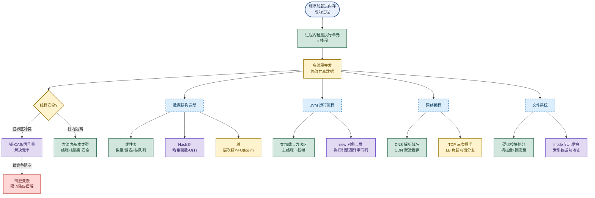

# 计算机基础：数据结构、JVM、网络与文件系统

> 目标：不背孤立名词。遇到计算机基础题先判断"问的是哪一层"——进程线程与并发（计算机原理）、数据结构选型（线性表/Hash/树）、JVM 运行流程（类加载→栈帧→堆）、网络编程（DNS/CDN/TCP/LB）、还是文件系统（硬盘/Inode/块），再讲机制、取舍和实战做法。
>
> 读图顺序：先看下方"先记住这张总图"，再按问题回看各节。每节底部都有**易混点**或**速记**；先遮住解释自己讲，再对照正文。
>
> 本笔记覆盖五大块：计算机原理（进程/线程/锁）、数据结构（线性表/Hash/树）、JVM 运行流程、网络编程（DNS/CDN/TCP/LB）、文件系统（硬盘/Inode）。

## 先记住这张总图

**一句话主线：**程序加载进内存成进程、进程内分线程，并发改共享数据要靠锁（CAS/信号量）但竞争会阻塞需限流降级；数据结构按"一对一/哈希/一对多"选线性表/Hash/树，JVM 走类加载→栈帧→堆的执行链路，网络靠 DNS/CDN/TCP/LB 把请求送到服务器，文件系统用 Inode 索引硬盘数据块。

## 1. 计算机原理：进程、线程与锁

> 程序是静态代码，加载进内存才成为进程；进程内的轻量级执行单元叫线程。多线程并发修改共享数据会出线程安全问题。

### 核心概念链路

| 概念 | 定义 | 关键点 | 记忆画面 |
|---|---|---|---|
| 程序 | 静态的代码文件 | 躺在硬盘上没执行 | 菜谱写在纸上 |
| 进程 | 程序加载进内存后的运行实例 | 有独立内存空间 | 菜谱下锅开炒了 |
| 线程 | 进程内轻量级执行单元 | 共享进程内存，切换成本低 | 一个厨房多个厨师 |
| 临界区 | 多线程并发修改共享数据的代码段 | 并发访问会出问题 | 多人抢同一口锅 |
| 锁 | 通过 CAS/信号量保证临界区互斥 | 解决竞争但会阻塞 | 锅前挂"占用中"牌 |
| 线程安全 | 多线程并发执行结果与单线程一致 | 靠隔离或加锁实现 | 各炒各的不互相干扰 |

### 锁的代价与缓解

锁能解决线程安全问题，但**锁竞争会引起线程阻塞**，导致系统响应变慢。最终需通过**分布式架构、限流、降级**等手段缓解。

| 层次 | 手段 | 解决的问题 | 记忆画面 |
|---|---|---|---|
| 单机 | CAS + 信号量 | 临界区互斥 | 门上挂锁 |
| 单机 | 线程栈隔离 | 方法内基本类型天然安全 | 各厨师自带调料盒 |
| 分布式 | 分布式锁 | 跨进程互斥 | 多厨房共用一把锁 |
| 架构 | 限流 + 降级 | 锁竞争过载、响应变慢 | 高峰期分流+关非核心 |

**易混点：**"线程安全"不是"加了锁才安全"。方法内定义的**基本类型变量**会被每个线程放入自己的**Java 栈**中，栈彼此隔离，这些变量天然线程安全，不需要加锁。需要加锁的是**多个线程共享**的数据（如堆里的对象实例、静态变量）。

**速记：**程序→进程→线程，临界区并发要加锁，锁竞争阻塞靠限流降级；栈内变量天然隔离不用锁。

## 2. 数据结构：线性表、Hash 表与树

> 数据结构按元素间关系分三类：一对一（线性表）、哈希映射（Hash 表）、一对多（树）。选型决定查找/插入/删除的复杂度。

### 2.1 线性表：一对一的存储基础

> 每个元素只有一个前驱和一个后继。数组和链表是存储基础，栈和队列是操作受限的线性表。

| 结构 | 存储方式 | 访问 | 查找 | 插入/删除 | 记忆画面 |
|---|---|---|---|---|---|
| 数组 | 内存中一块连续空间 | 随机访问 O(1) | 按值遍历 O(n) | 需移动元素 O(n) | 一排连座电影院，对号入座 |
| 链表 | 零散内存，节点含数据+指针 | 只能顺序遍历 O(n) | O(n) | 改指针 O(1) | 寻宝游戏，每张纸条指向下一张 |
| 栈 | 操作受限线性表，LIFO | 栈顶 O(1) | — | 入栈/出栈 O(1) | 弹夹后进先出，栈顶是当前方法 |
| 队列 | 操作受限线性表，FIFO | 队头 O(1) | — | 入队/出队 O(1) | 排队取号，先到先得 |

**易混点：**"数组访问 O(1)"指的是**按下标**随机访问（连续内存直接算地址），"按值查找"仍要遍历是 O(n)。链表"插入删除 O(1)"前提是**已经定位到目标节点**，定位本身是 O(n)，不能笼统说"链表插入比数组快"。

**速记：**数组连座随机访问 O(1)，链表零散插删 O(1)；栈 LIFO 服务方法调用，队列 FIFO 服务排队场景。

### 2.2 Hash 表：哈希函数把查找压到 O(1)

> 特殊结构，存取原理：计算 key 的哈希值（`hashCode`）→ 计算数组下标 → 直接访问该位置。

| 维度 | 说明 | 记忆画面 |
|---|---|---|
| 存取原理 | key → hashCode → 数组下标 → 直接访问 | 寄存柜按号码牌直接开柜 |
| 理想复杂度 | 无冲突时 O(1) | 一柜一物，秒取 |
| 哈希冲突 | 不同 key 算出相同下标 | 两个号码牌指向同一柜 |
| 链表法 | 冲突位置挂链表存多个元素 | 柜里挂一串小袋子 |
| Java 8 优化 | 链表过长转红黑树，优化到 O(log n) | 串太长改用抽屉分层 |
| 最坏情况 | 所有 key 冲突，退化成链表 O(n) | 全挤一个柜，挨个翻 |

**为什么是 O(1)？**查找过程是"计算下标 → 直接访问"，没有遍历，时间恒定。严格说是**平均 O(1)、最坏 O(n)**（所有 key 冲突退化成链表）。

**易混点：**"Hash 表查找 O(1)"是**平均**情况，不是绝对。一旦哈希函数设计差或 key 分布极端，所有 key 挤同一个下标，退化成链表遍历就是 O(n)。Java 8 加红黑树正是为了把最坏从 O(n) 拉回 O(log n)。

**速记：**哈希函数算下标直接访问，平均 O(1) 最坏 O(n)；链表法解冲突，Java 8 长链转红黑树 O(log n)。

### 2.3 树：打破一对一的层次结构

> 非线性表，每个元素可以有多个后继，用于表达层次关系和高效查找。

| 对比项 | 线性表 | 树 | 记忆画面 |
|---|---|---|---|
| 元素关系 | 一个前驱一个后继 | 一个前驱多个后继 | 线性表单行道，树分叉路 |
| 典型结构 | 数组/链表/栈/队列 | 二叉树/BST/红黑树 | 线性表一串，树一层层展开 |
| 用途 | 顺序存储、简单操作 | 层次结构、高效查找 | 线性表排队，树查家谱 |
| 查找复杂度 | 数组 O(n)、Hash O(1) | BST O(log n) | 线性表挨个找，树折半砍 |

**易混点：**"树查找 O(log n)"指的是**二叉搜索树（BST）**平衡时的情况。普通二叉树最坏退化成链表仍是 O(n)；红黑树/AVL 树通过自平衡保证 O(log n)。Hash 表 O(1) 比树 O(log n) 更快，但 Hash 表**无序**不能范围查询，树（如 BST/B+ 树）支持范围查找，这是数据库索引用 B+ 树而非 Hash 的原因。

**速记：**线性表一对一顺序存，树一对多层次查；BST 平衡 O(log n)，Hash 无序不能范围查。

## 3. JVM 原理：从 java 命令到字节码执行

> 一条 `java xxx` 命令背后：类加载 → 方法区 → 主线程 → 栈帧 → 堆分配 → 执行引擎翻译 → CPU 执行。

### JVM 启动执行流程

| 步骤 | 动作 | 关键组件 | 记忆画面 |
|---|---|---|---|
| 1 | `java xxx` 启动 | 类加载器 | 按开关通电 |
| 2 | 加载 class 存入方法区 | 方法区 | 把菜谱贴到厨房公告栏 |
| 3 | 创建主线程，分配 PC + Java 栈 | 程序计数器、Java 栈 | 主厨上岗，备好工作台 |
| 4 | 执行 main，在栈中创建栈帧 | 栈帧 | 开一道菜，铺一张案板 |
| 5 | 遇 `new` 在堆中分配内存 | 堆 | 取食材放案板旁 |
| 6 | 对象地址记录在栈帧 | 栈帧引用 | 案板上记食材存放位置 |
| 7 | 执行引擎读字节码翻译 CPU 执行 | 执行引擎 | 厨师按菜谱一步步炒 |
| 8 | 调用其他方法压入新栈帧 | 栈顶切换 | 新菜叠在旧菜上，先做新菜 |
| 9 | 方法返回栈帧出栈恢复调用者 | 栈帧出栈 | 菜做完撤案板，回上一道 |

### 从 Java 栈看线程安全

| 情形 | 是否线程安全 | 原因 | 记忆画面 |
|---|---|---|---|
| 方法内基本类型变量 | 安全 | 每个线程放入自己的栈，栈彼此隔离 | 各厨师自带调料盒 |
| 方法内创建对象，引用未离开方法 | 安全 | 对象虽在堆，但其他线程访问不到 | 食材放案板旁，别人够不着 |
| 方法内对象被返回或放入外部容器 | 不安全 | 引用逃逸出方法，多线程可访问 | 食材端上公共餐桌，多人抢 |

**易混点：**"对象在堆中"不等于"对象不安全"。关键看**引用是否逃逸出方法**：如果对象只在方法内使用、没被返回也没放进外部容器，虽然物理上在堆里，但其他线程拿不到引用，仍是线程安全的。一旦引用逃逸（返回、存入静态字段、传入其他线程），就要考虑同步。

**速记：**类加载→方法区→主线程→栈帧→堆→执行引擎；栈内变量天然隔离，引用不逃逸即安全。

## 4. 网络编程：DNS/CDN/TCP/LB 全链路

> 一次 HTTP 请求背后：DNS 找 IP → CDN 就近取缓存 → TCP 三次握手建连 → LB 分发到服务器。

### 网络分层与核心组件

| 组件 | 所在层 | 职责 | 记忆画面 |
|---|---|---|---|
| HTTP | 应用层 | 约定数据编码协议 | 双方约定用什么语言写信 |
| TCP | 传输层 | 建稳定连接，bit 流可靠传输 | 邮政专线，件件送达 |
| 网络层/链路层/物理层 | TCP 之下 | 路由、帧、物理信号 | 公路、车道、柏油路 |
| DNS | 应用层辅助 | 域名翻译成 IP | 通讯录查电话号码 |
| CDN | 应用层辅助 | 就近缓存静态资源 | 全国各地设快递中转仓 |
| LB | 数据中心入口 | 把请求分发到集群某台机器 | 大堂经理分流客人 |

### TCP 三次握手

APP 和服务器之间发**三次报文**才建立一个 TCP 连接。

| 步骤 | 方向 | 标志 | 含义 |
|---|---|---|---|
| 第一次 | 客户端 → 服务器 | SYN | 请求建立连接 |
| 第二次 | 服务器 → 客户端 | SYN+ACK | 确认并请求建立连接 |
| 第三次 | 客户端 → 服务器 | ACK | 确认，连接建立 |

### CDN 与 LB 实战（淘宝场景）

为提高访问速度、降低数据中心负载，淘宝在全国各主要运营商接入机房部署**缓存服务器**，缓存静态图片资源等，构成 **CDN**。HTTP 请求到达数据中心时，先到**负载均衡服务器**（DNS 解析出的就是 LB 的 IP），再由 LB 分发到搜索服务器集群的某台机器。

**易混点：**DNS 解析出的 IP **不一定是业务服务器**，在大型架构里往往是**负载均衡服务器**的 IP。LB 再按策略（轮询/最少连接/哈希）把请求分发到后端集群。CDN 缓存的是**静态资源**（图片、JS、CSS），动态接口仍要回源到数据中心，不能笼统说"CDN 让所有请求都变快"。

**速记：**DNS 翻译域名，CDN 就近缓存静态资源，TCP 三次握手建连，LB 把请求分发到集群某台机器。

## 5. 文件系统：硬盘、块与 Inode

> 文件系统把硬盘空间以**块**为单位划分，文件元信息记在 **Inode**，数据记在数据块，Inode 通过索引记录数据块地址。

### 硬盘类型与适用场景

| 类型 | 读写原理 | 适合存 | 记忆画面 |
|---|---|---|---|
| 机械硬盘 | 盘片高速旋转读写 | 日志文件（顺序写） | 黑胶唱片机，转着读 |
| 固态硬盘 | 颗粒进行数据读写 | 系统文件、随机读写 | 闪存芯片，随点随读 |

### 文件系统读写流程

| 步骤 | 动作 | 关键组件 | 记忆画面 |
|---|---|---|---|
| 1 | 硬盘空间按块划分 | 数据块 | 仓库划成一格格货架 |
| 2 | 文件元信息记在 Inode | Inode（文件控制块） | 货架的台账目录 |
| 3 | 文件数据记在数据块 | 数据块 | 货架上的实际货物 |
| 4 | Inode 通过索引记录数据块地址 | Inode 索引 | 台账记每件货在第几格 |
| 5 | 读文件时查 Inode 索引得数据块地址 | 查索引→访问数据 | 查台账找货位→取货 |

**易混点：****Inode 存的是文件元信息（大小、权限、数据块地址）**，**不存文件数据本身**。文件数据在数据块里。Inode 数量在文件系统创建时就定死了，Inode 耗尽时即使硬盘还有空间也无法新建文件（典型现象："No space left on device"但 `df` 显示有空间）。

**速记：**机械盘存日志，固态盘存系统和随机读写；硬盘按块划分，Inode 记元信息+索引数据块地址。

## 高频场景题

### "Hash 表为什么查找是 O(1)？最坏呢？"

诊断：查找过程是"计算 key 的 hashCode → 算出数组下标 → 直接访问"，没有遍历，时间恒定，所以平均 O(1)。最坏情况是所有 key 冲突退化成链表，变成 O(n)；Java 8 链表过长转红黑树，把最坏拉回 O(log n)。

### "数组访问 O(1) 和 Hash 查找 O(1) 一样吗？"

诊断：不一样。数组 O(1) 是**按下标**随机访问（连续内存直接算地址）；Hash O(1) 是**按 key** 经哈希函数算下标再访问。数组按值查找仍是 O(n)，Hash 按 key 查找才是 O(1)。

### "从 Java 栈角度怎么理解线程安全？"

诊断：方法内定义的基本类型变量会被每个线程放入自己的 Java 栈，栈彼此隔离，所以这些变量天然线程安全。方法内创建的对象，只要引用没逃逸出方法（没返回、没放入外部容器），虽在堆中但其他线程访问不到，也安全；一旦引用逃逸就要考虑同步。

### "DNS 解析出的 IP 一定是业务服务器吗？"

诊断：不一定。大型架构里 DNS 解析出的常是**负载均衡服务器**的 IP，LB 再把请求分发到后端集群某台机器。CDN 场景下解析出的还可能是 CDN 边缘节点的 IP，就近返回缓存静态资源。

### "Inode 满了和硬盘满了有什么区别？"

诊断：硬盘满是数据块用尽，`df` 显示空间不足；Inode 满是文件控制块耗尽，`df` 显示有空间但无法新建文件（"No space left on device"）。Inode 数量在文件系统创建时定死，大量小文件易耗尽 Inode。

## 面试回答模板：三句话讲清一题

> **问题本质是**问计算机基础的某一层——进程线程与并发、数据结构选型、JVM 运行流程、网络编程链路、还是文件系统存储，先定位"问的是哪一层"再展开。
>
> **机制是**程序加载进内存成进程、进程内分线程，并发改共享数据靠锁（CAS/信号量）但竞争会阻塞需限流降级；数据结构按一对一/哈希/一对多选线性表/Hash/树，Hash 平均 O(1) 最坏 O(n)，BST 平衡 O(log n)；JVM 走类加载→方法区→栈帧→堆→执行引擎的链路，栈内变量天然隔离；网络靠 DNS 找 IP、CDN 就近缓存、TCP 三次握手建连、LB 分发到集群；文件系统用 Inode 记元信息+索引数据块地址。
>
> **实战中我会**根据场景选型：高并发共享数据用锁+限流降级，查找密集用 Hash 表，范围查询用树，静态资源上 CDN，请求经 LB 分发，日志放机械盘、系统放固态盘，并关注 Inode 别被小文件耗尽。

## 最后复习：闭眼回忆 8 句

1. 程序是静态代码，加载进内存成进程，进程内轻量执行单元叫线程。
2. 多线程并发修改共享数据（临界区）会出线程安全问题，靠 CAS/信号量加锁解决，但锁竞争会阻塞，最终靠限流降级缓解。
3. 线性表一对一：数组连座随机访问 O(1) 按值查找 O(n)，链表零散插删 O(1) 查找 O(n)，栈 LIFO 服务方法调用，队列 FIFO 服务排队。
4. Hash 表靠哈希函数算下标直接访问，平均 O(1) 最坏 O(n)，链表法解冲突，Java 8 长链转红黑树 O(log n)。
5. 树打破一对一，一对多表达层次，BST 平衡 O(log n)，Hash 无序不能范围查询所以数据库索引用 B+ 树。
6. JVM 流程：类加载→方法区→主线程（PC+Java 栈）→main 栈帧→new 进堆→执行引擎翻译字节码→方法调用压新栈帧→返回出栈。
7. 网络链路：DNS 翻译域名、CDN 就近缓存静态资源、TCP 三次握手（SYN/SYN+ACK/ACK）建连、LB 把请求分发到集群某台机器。
8. 文件系统：机械盘存日志、固态盘存系统和随机读写，硬盘按块划分，Inode 记元信息+索引数据块地址，Inode 满了有空间也建不了文件。

## 怎么练才记得住

1. **画图法**：白纸上默画 JVM 执行流程图（类加载→方法区→栈帧→堆→执行引擎），标出每步的组件和数据流向，画错一处就重画。
2. **对比法**：把数组/链表/栈/队列/Hash/树列成对比表，遮住复杂度列凭结构反推，直到能脱口而出 O(1)/O(n)/O(log n)。
3. **场景代入法**：给每个概念举生活场景（数组连座电影院、Hash 寄存柜、栈弹夹、队列排队、Inode 台账），用画面记抽象概念。
4. **链路复述法**：闭眼从"`java xxx` 启动"讲到"方法返回栈帧出栈"，再从"浏览器输入域名"讲到"LB 分发到服务器"，卡壳处就是薄弱点。
