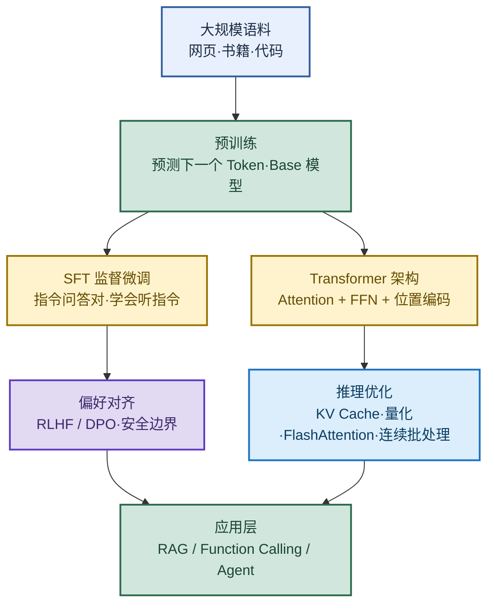

# LLM 模型核心体系：从训练到推理的完整链路

> 目标：不背孤立名词。遇到大模型题目先判断"问的是哪一层"——训练阶段、架构组件、推理优化、还是可控生成，再解释机制、取舍和工程实践。
>
> 读图顺序：先看下方"先记住这张总图"，再按问题回看各节。每节底部都有**易混点**或**速记**；先遮住解释自己讲，再对照正文。
>
> 本笔记覆盖 LLM 训练三阶段、Transformer 核心组件、推理加速、对齐与可控生成，适合面试快速串联。

## 先记住这张总图

**一句话主线：**预训练打宽地基 → SFT 打开听指令通道 → 对齐划定安全边界 → 推理优化降本提速 → 应用层接入真实世界。

## 1. 大模型 vs 任务专用模型

> 核心区别：训练规模、预训练目标、迁移方式、部署成本四个维度。

### 四维度对比

| 维度 | 大模型（LLM） | 任务专用模型 |
|---|---|---|
| 训练规模 | TB 级数据、数十亿~千亿参数 | 任务相关数据、百万~亿级参数 |
| 预训练目标 | 自监督 next-token 预测 | 任务边界内的监督目标 |
| 迁移方式 | 学到可迁移的底层能力，跨任务复用 | 只学任务边界内特征，复用有限 |
| 部署成本 | 显存高、推理慢、成本高 | 轻量、低延迟、成本低 |

### 选型决策

| 场景 | 推荐 | 原因 |
|---|---|---|
| 标签明确、追求极低延迟的分类 | 规则或小模型 | 大模型延迟高、成本不划算 |
| 路由、校验等结构化任务 | 规则或小模型 | 确定性要求高，大模型有随机性 |
| 复杂语义理解、跨任务交互 | 大模型 | 底层能力可迁移，泛化强 |
| 槽位抽取（NLU 核心） | 小模型 + 意图识别 | 结构化输出，配对使用 |

**易混点：**槽位抽取是从用户一句话里把关键参数抠出来填进预定义表格空位，是任务型对话（如客服工单）NLU 的核心环节，通常和意图识别配对使用——它不是"大模型生成"，而是"结构化抽取"。

### 为什么一个 LLM 能适配多种任务

| 层次 | 作用 | 记忆画面 |
|---|---|---|
| 预训练 | 把地基打宽：语言、知识、推理底子 | 打地基 |
| SFT | 打开"听指令干活"通道（元能力） | 装门窗 |
| 上下文 / ICL | 每次 Prompt 告诉它"今天干这个" | 贴任务牌 |

**速记：**任务差异被降维成上下文格式差异，目标函数不变；模型不是记住所有任务，而是学会从上下文推断任务的能力。同一个预训练目标提供多任务潜力，SFT 教会如何被指定任务，上下文负责这次指定哪个任务。

## 2. LLM 是怎么训练的

> 三阶段流水线：预训练 → SFT → 偏好对齐。数据量级递减、质量要求递增——对齐数据最贵。

### 三阶段对比

| 阶段 | 数据 | 目标 | 学会什么 | 记忆画面 |
|---|---|---|---|---|
| 预训练 | 大规模网页、书籍、代码 | 预测下一个 token | 只会续写 | 博学的 Base |
| SFT | 人工写的指令问答对 | 监督学习标准回答 | 遵循指令、对话 | 听话的助手 |
| 偏好对齐 | RLHF 打分 / DPO 偏好对 | 行为与安全边界 | 什么该做、什么不该做 | 有底线的助手 |

**易混点：**RAG 解决"知识不足"，微调解决"能力不足"，对齐解决"行为不合规"——三个层次不要混。RAG 是检索增强（不改模型），微调是改权重（提能力），对齐是改价值观（守边界）。

### Scaling Law（规模定律）

模型性能 Loss 与参数量、数据量、计算量之间存在可预测的幂律关系。

| 要点 | 内容 |
|---|---|
| Chinchilla 法则 | 参数和数据按约 1:20 配比（70B 模型要喂 1.4T tokens） |
| 可预测性 | 用小模型（1B）实验推算大模型（70B）表现，避免盲目烧钱 |
| 预算分配 | 固定算力下算最优参数/数据配比 |
| 能力涌现 | 规模是涌现能力的基础 |
| 推理侧延伸 | 2026 年延伸到 Test-Time Compute |

**速记：**Scaling Law = 效果和参数·数据·算力呈幂律可预测；Chinchilla 修正"只堆参数"误区，提出 1:20 配比。

## 3. Transformer 核心组件

> Attention 是取代 RNN 的关键：RNN 串行看前面，Attention 一次性全局关注，既快又准。

### Attention 机制

| 角色 | 含义 | 记忆画面 |
|---|---|---|
| Q（Query） | 当前 Token 在"查询什么信息" | 查询请求 |
| K（Key） | 序列中每个 Token 的"被查询内容" | 被查目录 |
| V（Value） | 匹配后实际取到的"价值信息" | 取到的内容 |
| √d_k | 缩放因子，防止点积过大导致 Softmax 梯度消失 | 防爆阀 |

**核心公式：**Q·K^T 算相似度 → Softmax 归一化 → 加权求和 V。Multi-Head 相当于多个专家各看一个角度，最后拼接起来。

### Position Encoding（位置编码）

Self-Attention 本质是对称操作，无法区分"猫追狗"和"狗追猫"的顺序差异，必须加位置编码。

| 方案 | 原理 | 主流度 |
|---|---|---|
| RoPE | 旋转矩阵把位置信息嵌入 Q/K，点积自动变相对位置依赖，支持长度外推 | 主流（LLaMA/Qwen/DeepSeek） |
| YaRN | RoPE 的长度扩展方法，支持比训练更长的上下文 | 长上下文场景 |

**易混点：**RoPE 嵌入的是"相对位置"不是"绝对位置"——这是它能支持长度外推的关键。

### 三种架构对比

| 架构 | 模式 | 适合任务 | 典型模型 |
|---|---|---|---|
| Decoder-only | 输入即输出前缀（续写） | 文本生成、对话 | GPT-4、LLaMA、Qwen、DeepSeek |
| Encoder-Decoder | 输入编码→独立生成 | 翻译、摘要、改写 | T5、BART、mBART |
| Encoder-only | 仅输入，无生成输出 | 分类、抽取、NER、匹配 | BERT、RoBERTa |

**Decoder-only 为什么成主流：**规模经济（一个模型做几乎所有任务，只改 Prompt）、训练简化（单一 next-token 目标）、生态统一（RLHF/Prompt/ICL 都围绕它）、部署一致（一套推理基础设施）。但 Encoder-Decoder 在专用翻译、低资源语言、极致输入输出任务（短摘要、实体抽取）仍有竞争力。

### Causal Mask（因果掩码）

在 Self-Attention 中屏蔽未来 Token，确保模型只能看到当前位置及之前的词。实现上给未来位置加负无穷大数，Softmax 后概率为 0。这是 Decoder-only 的标志性设计，也是 GPT 能一行行续写而不提前看到输出内容的原因。

### 损失函数与训练监控

LLM 预训练用**交叉熵损失**（负对数似然）：给定上文预测下一个真实 token 的概率，损失越小模型对正确 token 概率越高。Perplexity（PPL）是交叉熵的指数形式——"模型每次做选择时有多少个同样可能的选项"，PPL 越低越确定。

| Loss 现象 | 含义 | 处理 |
|---|---|---|
| 持续下降 | 正常学习 | 继续训练 |
| 降到一定值不再降 | 接近数据噪声下限 | 检查欠拟合/数据质量 |
| 突然上升 | 梯度爆炸、学习率过大 | 加梯度裁剪 |
| 训练低但验证高 | 过拟合 | 加 Dropout、增数据、早停 |

## 4. 推理加速与优化

> KV Cache 是最基础的优化，长上下文要配合 PagedAttention 和 KV 量化。

### KV Cache

自回归生成时历史 Token 的 K/V 不会变，缓存后每步只需计算新 Token 的 Q/K/V，复杂度从 O(n²) 降到 O(n)。代价是显存——长上下文场景要配合 PagedAttention 和 KV 量化。多轮对话场景靠它把单 token 生成延迟降一个数量级。

### 量化

量化 = 用更低精度数值（INT8/INT4）表示模型权重/激活，减少显存占用并加速推理。

| 方案 | 适用场景 | 精度损失 |
|---|---|---|
| AWQ | GPU 生产环境（激活感知） | <1% |
| GPTQ | 离线批量 | 较小 |
| GGUF | CPU/本地部署 | 中等 |
| W4A16 | 只量化权重不碰激活 | 小 |
| W8A8 + SmoothQuant | 极致吞吐 | 中等 |

**速记：**7B 模型 INT4 后 4GB 显存就能跑，但别忽略 KV Cache 的占用。核心原则：只量化权重不碰激活（W4A16），需要极致吞吐再上 W8A8。

### FlashAttention

I/O 感知的注意力算法：把计算拆成小方块放在 GPU SRAM 上做，避免反复从 HBM（高带宽显存）读写中间结果。

### Continuous Batching（连续批处理）

以 Token 级别细粒度动态管理批处理中的请求，而非等整批全部完成才释放资源。

| 对比 | 传统静态批处理 | 连续批处理 |
|---|---|---|
| 释放时机 | 等最慢请求完成 | 请求结束即释放 |
| GPU 利用率 | 低（长请求期间短请求空闲） | 高 |
| 新请求 | 必须等当前批次结束 | 随时插入 |

### 提示词缓存（Prompt Caching）

API 复用相同前缀的 KV Cache，跳过重复预填充计算。同一个前缀（System Prompt + 固定文档）第一次计算后 K/V 保留一段时间；后续请求只要前缀逐字节相同，直接复用缓存，只计算新增部分。长 System Prompt + 模板前缀可吃 Prompt Caching 红利。

### MoE（混合专家模型）

把 Transformer 中的 FFN 层替换成"多个专家 + 路由器"，每个 Token 只激活少数几个专家。

| 维度 | 内容 |
|---|---|
| 优势 | 同等质量下算力成本低、推理快、知识容量大、扩展性好（加专家≈加容量） |
| 适合 | 知识密集型、记忆型任务 |
| 缺点 | 显存占用高、IO 密集场景成瓶颈 |
| 代表 | DeepSeek-V3 总参 671B，单 Token 只激活 37B |

**MoE 五步过程：**①Token 隐状态向量 → ②路由器为所有专家打分归一化 → ③选 Top-K 专家 → ④专家计算 FFN → ⑤加权求和输出。

**易混点：**节省来自"稀疏激活"不是"路由打分"——路由打分成本很低，省的是避免每个 Token 都经过庞大 FFN（FFN 是 Transformer 推理主要算力消耗，约占 70%）。

## 5. 对齐与可控生成

> RLHF 和 DPO 目标一致但路径不同：选型看资源、任务类型。

### RLHF vs DPO

| 维度 | RLHF | DPO |
|---|---|---|
| 路径 | 先训奖励模型再用 PPO 优化 | 直接在偏好数据上优化 |
| 模型数量 | 维护 4 个模型 | 2 个模型 |
| 稳定性 | 训练不稳定 | 简单稳定 |
| 灵活性 | 灵活 | 数学等价 RLHF 最优解 |
| 数据要求 | 奖励模型打分 | 高质量偏好对 |
| 核心思想 | 奖励模型打分 + PPO | 让好回答概率上升、差回答下降 |

**选型：**资源有限用 DPO，追求极致用 RLHF，可验证任务考虑 GRPO。

### 幻觉治理（五层）

幻觉原因分五层：训练目标（优化"像不像人话"不是"对不对"）→ 数据噪声/矛盾/截止期 → 生成阶段自回归累积误差 + 采样随机性 → 对齐阶段过于讨好用户 → 使用层面（Prompt 诱导、RAG 噪声、长上下文丢失）。

**治理不能只靠"调低温度"**（温度不保证事实正确），得五层防御一起上：检索、提示约束、引用溯源、外部校验、人工审核。

### 偏见治理

| 手段 | 做法 |
|---|---|
| 数据平衡 | 增加少量群体数据 |
| RLHF 对齐 | 人类反馈强化学习 |
| 提示词工程 | 明确要求公平性 |
| 后处理过滤 | 检测并修正偏见输出 |

### Logit Bias 与采样控制

LLM 可控生成的最后一道防线，在 logits 上加手动偏置改变特定 token 被选中概率。

**采样控制流水线：**Logits → ①Logit Bias（手动加减特定 token 分数）→ ②Temperature（整体缩放）→ ③Top-K/Top-P/Top-A（过滤候选集）→ ④Repetition Penalty（已出现 token 降分）→ ⑤Stop Sequences（命中即终止）→ Softmax → 采样 → 输出。

| 参数 | 作用 |
|---|---|
| Temperature τ | τ<1 分布更尖锐（偏最高分），τ>1 更平坦（增随机性），τ=0 等价 greedy |
| Top-K | 固定数量 |
| Top-P | 自适应比例（最常用） |
| Top-A | 自适应绝对阈值（Anthropic 证明对不确定性更鲁棒） |

**易混点：**用 logit_bias 禁止输出某些内容"可以但不优雅"——需提前知道要禁用的 token ID。更好的方式是配合 guard-rails 或 stop sequences。

## 6. 应用层扩展

> Function Calling 是让模型从"聊天机器人"变成"智能体"的关键桥接。

### Function Calling

让 LLM 输出结构化 JSON 描述"调用哪个函数、带什么参数"，打通大模型与现实世界操作接口。

| 价值 | 说明 |
|---|---|
| 打破封闭边界 | 模型只能"说"不能"做"→ 接入搜索、数据库、API |
| 结构化交互 | JSON 输出可靠性远优于从自由文本提取参数 |
| 动态扩展 | 不用重新训练/微调，加函数定义 = 多一项能力 |

**工程陷阱：**参数类型漂移（输出字符串而非数字，需类型转换层）、幻觉参数（编造字段名，必须 Schema Validation）、函数命名不一致（OpenAI vs Anthropic vs OpenRouter，建议抽象统一适配层）、无限循环（设最大调用次数）、权限控制（敏感操作需鉴权层）。

### 对话模板（Chat Template）

把结构化消息列表转成模型训练时的输入格式，核心是角色标记和特殊 Token。不用模板会角色信息丢失、答非所问、忘记提示词。一般推理模型内置模板；长 System Prompt + 模板前缀可吃 Prompt Caching 红利。

### 灾难性遗忘（Catastrophic Forgetting）

模型微调时大幅遗忘原来已学到的通用知识。本质是为适应新数据覆盖了旧权重。

**应对三板斧：**①微调时混入 5-10% 通用预训练数据；②尽量用 LoRA 而非全量微调（冻结大部分权重天然防遗忘）；③调完后用 MMLU/GSM8K 跑一下确认通用能力没崩。

| 方案 | 原理 |
|---|---|
| EWC | 标记预训练重要参数，微调时限制其变化幅度 |
| 混合数据 | 90% 领域数据 + 10% 通用预训练数据 |
| LoRA + 低学习率 | 冻结大部分权重，只训练低秩适配矩阵 |

### 预训练数据去重

移除重复或高度相似文档，避免模型过度拟合重复内容。不去重后果：热点话题过度偏向、记住"出现 1000 次"而非知识点、训练效率低下。

| 方案 | 原理 |
|---|---|
| SimHash | 局部敏感 hash，文档指纹对比 |
| MinHash + LSH | MinHash 估计 Jaccard 相似度 + LSH 桶分组 |

**工业界标配 MinHash+LSH**：Google Gopher 用它做到 3T tokens 去重，直接减少 20% 训练数据。

## 高频场景题：用一句诊断开头

### "为什么大模型是概率模型？同样输入输出不同是 bug 吗？"

不是 bug。LLM 输出层是词表上的概率分布，解码时通过采样策略选 Token，同样输入可能输出不同是采样随机性导致的。工程上分场景：需要确定性用 T=0 + 固定 seed + 输出校验；需要多样性提高温度；需要更可靠用多次采样投票。

### "大模型为什么是无状态？多轮对话怎么记住上下文？"

模型参数不会因为一次普通请求自动更新——这就是无状态。多轮记忆是应用层做的（把历史对话拼进 Prompt 或外部存储），不是模型自己记住的。

### "大模型运行全过程是什么？"

输入一句话 → Transformer 理解它 → 模型给词表里每个 token 打原始分（Logits）→ Softmax 变概率 → 解码策略挑一个 → 拼回输入 → 重复直到选出结束符。

## 面试回答模板：三句话讲清一题

> **问题本质是……**（先说问的是哪一层：训练、架构、推理、还是应用）。
>
> **机制是……**（解释原理 + 关键技术），因为……（为什么这样设计）。
>
> **工程上……**（实践 + 选型），例如……（具体场景）。

例：问"KV Cache 为什么能加速"——本质是自回归生成时历史 Token 的 K/V 不变；机制是缓存后每步只算新 Token 的 Q/K/V，复杂度从 O(n²) 降到 O(n)；工程上代价是显存，长上下文要配合 PagedAttention 和 KV 量化，多轮对话场景靠它把单 token 延迟降一个数量级。

## 最后复习：闭眼回忆 10 句

1. **训练三阶段**：预训练（打宽地基）→ SFT（听指令）→ 对齐（安全边界）；数据量递减、质量递增。
2. **Scaling Law**：效果与参数·数据·算力呈幂律；Chinchilla 1:20 配比；可预测性省试错成本。
3. **Attention**：Q·K^T 算相似度 → Softmax → 加权 V；Multi-Head 多角度拼接；√d_k 防梯度消失。
4. **位置编码**：RoPE 嵌入相对位置，主流方案，支持长度外推；YaRN 做长度扩展。
5. **三种架构**：Decoder-only（续写，主流）、Encoder-Decoder（翻译摘要）、Encoder-only（分类抽取）。
6. **Causal Mask**：屏蔽未来 Token，Decoder-only 标志，GPT 续写的基础。
7. **KV Cache**：历史 K/V 不变，O(n²)→O(n)，代价是显存，配 PagedAttention/量化。
8. **量化**：AWQ 生产、GPTQ 离线、GGUF 本地；W4A16 只量化权重；7B INT4 后 4GB。
9. **RLHF vs DPO**：RLHF 4 模型不稳定灵活，DPO 2 模型稳定简单；资源有限用 DPO。
10. **Function Calling**：结构化 JSON 打通现实世界；工程陷阱是类型漂移、幻觉参数、无限循环、权限控制。

## 怎么练才记得住

别反复通读，改成主动回忆：

1. 每次只看一个小节，遮住表格，先自己说出"概念 → 原理 → 优缺点 → 适用场景"，再对照。
2. 用"高频场景题"的 3 道题各讲 30 秒；卡住时只回看对应小节。
3. 隔天再讲一遍，换成自己的项目例子；能解释"为什么选这个方案、为什么这样设计"才算会。
4. 复习时轮流画"训练三阶段总图"和"采样控制流水线"；能默写出关键参数和阈值才算熟。
