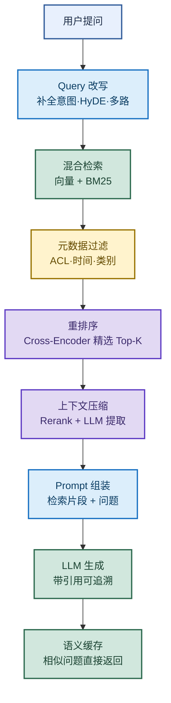
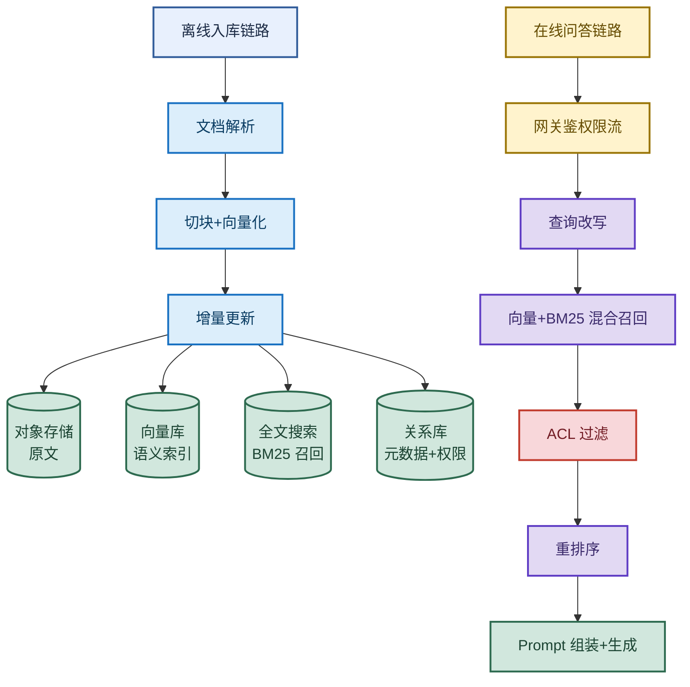
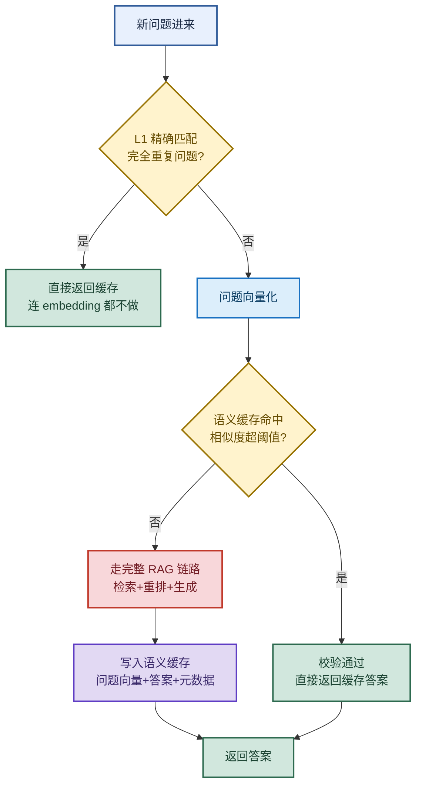
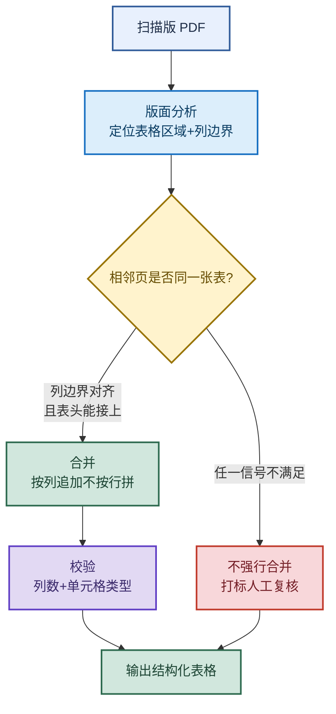

# RAG 检索增强生成：从切分到重排的完整链路

> 目标：遇到 RAG 题目先判断"问的是哪一层"——为什么用、完整流程、向量库选型、企业架构、切块、召回优化、成本、语义缓存、扫描 PDF、Query 改写、上下文压缩、Embedding 选型，再展开机制和取舍。
>
> 读图顺序：先看下方"先记住这张总图"，再按问题回看各节。每节底部都有**易混点**或**速记**；先遮住解释自己讲，再对照正文。
>
> 本笔记覆盖：RAG 动机 → 6 步流程 → 向量库选型 → 企业级架构 → Chunk 切分 → 召回优化 → 成本治理 → 语义缓存 → 扫描版 PDF → Query 改写 → 上下文压缩 → Embedding 选型。

## 先记住这张总图

**一句话主线：**Query 改写优化输入 → 混合检索召回 → 元数据过滤 + 重排提精度 → 上下文压缩降 token → LLM 生成带引用 → 语义缓存省成本。

## 1. 什么是 RAG，为什么需要 RAG

> 一句话定位：先检索相关知识，再让 LLM 基于检索内容回答，解决大模型三大痛点。

| LLM 痛点 | 不用 RAG 的表现 | RAG 怎么解决 |
|---|---|---|
| 知识过时 | 训练截止后的事不知道 | 实时检索最新文档 |
| 私有数据 | 企业内部资料没学过 | 接入私有知识库 |
| 幻觉 | 一本正经胡说八道 | 答案限定在检索范围内 |
| 可追溯性 | 答案没法验证来源 | 带引用可核查 |

**易混点：**RAG 不是"微调替代品"。微调改变模型权重、适合改风格/格式；RAG 不动权重、适合补知识、能实时更新。两者常组合：微调教风格，RAG 补知识。

> 🎤 **口述版：**简单来说，RAG 就是先检索再回答。核心解决三件事：知识过时、私有数据、幻觉。大模型训练数据有截止日期，企业内部资料它更没学过。直接让它答，它会一本正经地编。RAG 把答案限定在检索到的文档里，还能带引用可追溯。它和微调不冲突，微调教风格，RAG 补知识。

## 2. RAG 的完整流程

> 一句话定位：6 步链路——加载、切分、向量化、存储、检索、生成。

| 步骤 | 做什么 | 关键点 |
|---|---|---|
| 1. 加载 | 从 PDF/Markdown/网页读文档 | 异构数据源统一接入 |
| 2. 切分 | 切成 500-1000 tokens 的 chunk | 太小碎片化，太大不精确 |
| 3. 向量化 | Embedding 模型转成向量 | 中文首选 BGE，多语言用 M3 |
| 4. 存储 | 存入向量数据库 | 支持 ANN 索引 + 元数据 |
| 5. 检索 | 计算相似度，返回 top-k | 常做向量 + BM25 混合 |
| 6. 生成 | LLM 基于检索内容生成答案 | Prompt 组装 + 引用 |

**速记：**加载 → 切分 → 向量化 → 存储 → 检索 → 生成，"加切向存检生"六步。

> 🎤 **口述版：**核心就一条链路：加载、切分、向量化、存储、检索、生成。先把 PDF、Markdown、网页这些文档读进来。然后切成 500 到 1000 token 的小块。用 Embedding 模型把每块转成向量。存进向量数据库。用户提问时也转向量，找最相似的 top-k。最后把检索片段塞进 Prompt，让大模型生成答案。

## 3. 为什么 RAG 要用向量数据库

> 一句话定位：向量库不是"存向量"，而是把"语义检索"工程化——快、能过滤、能更新。

| 检索方式 | 擅长 | 局限 | 适用 |
|---|---|---|---|
| 关键词检索 | 字面精确匹配 | "退订服务"匹配不到"取消订阅流程" | 专有名词、代码标识 |
| 普通数据库 | 精确查询、事务 | 不擅长高维最近邻搜索 | 结构化数据 |
| 向量数据库 | 语义相似 + ANN 毫秒级 | 需要向量化、占内存 | 大规模语义检索 |

**向量数据库的工程能力：**ANN 索引（HNSW/IVF）百万级毫秒返回 + 元数据过滤 + 增删改 + 多租户 + 权限 + 持久化。

**易混点：**向量库不是唯一选择。数据小用 FAISS 或 numpy；已有 PostgreSQL 用 pgvector；ES 也支持向量检索。生产里常见**向量 + 关键词 + 元数据过滤**的混合方案，不是只靠向量库。

> 🎤 **口述版：**你可以理解为，向量库核心不是存向量，是快速找语义最相关的资料。关键词只能匹配字面，问"退订服务"匹配不到"取消订阅"。普通数据库不擅长高维最近邻。向量库有 ANN 索引，HNSW、IVF，百万级毫秒返回。但它不是唯一选择。小数据用 FAISS，已有库用 pgvector，ES 也行。生产里常做向量加关键词混合检索。

## 4. 企业级知识库问答系统架构

> 一句话定位：离线入库 + 在线问答两条链路，底层异构存储，中间 RAG 引擎，上层网关编排。

| 层次 | 组件 | 职责 |
|---|---|---|
| 底层存储 | 对象存储 / 向量库 / 全文搜索 / 关系库 | 原文 / 语义索引 / 关键词召回 / 元数据权限 |
| RAG 引擎-离线 | 解析、切块、向量化、增量更新 | 文档处理入库 |
| RAG 引擎-在线 | 查询改写、混合召回、重排、Prompt 组装、生成 | 检索生成回答 |
| 上层 | 网关 + 业务编排 | 鉴权限流统一入口 |

**企业级额外三件事：**
1. **ACL 过滤**：检索带权限，保证不越权（红节点，最关键）。
2. **RAG 评测**：不只看延迟，还看召回率、上下文精度、忠实度。
3. **成本与缓存治理**：语义缓存 + 模型路由 + Prompt 压缩。

**易混点：**企业级和 demo 的差距不在"能不能答"，而在 ACL 不越权、有评测指标、能运营成本。从"能跑"到"可运营"才是企业级。

> 🎤 **口述版：**我会按离线和在线两条链路设计。底层异构存储：对象存储放原文，向量库存语义，全文搜索做关键词，关系库存元数据和权限。中间 RAG 引擎拆两块：离线做解析切块向量化增量更新，在线做查询改写、混合召回、重排、生成。上层网关统一鉴权限流。企业级额外补三件事：检索带 ACL 防越权，建 RAG 评测指标，做成本和缓存治理。这样从能跑到可运营。

## 5. 如何选择 Chunk 大小

> 一句话定位：Chunk 大小是召回精度和语义完整性的权衡，没有标准答案，按文档类型调。

| Chunk 大小 | 优点 | 缺点 | 适用 |
|---|---|---|---|
| 小 | 检索精确 | 语义碎片化、召回一堆碎片 | 技术文档、代码 |
| 中 | 平衡 | 都不极致 | 通用文档 |
| 大 | 语义完整 | 检索不精确、token 浪费 | 长论述、政策 |

**进阶切分策略：**

| 策略 | 原理 | 优势 |
|---|---|---|
| 父子文档 | 文档先切大父块，父块再细分子块；检索子块，返回父块 | 检索精确 + 上下文完整 |
| 重叠切分 | 相邻 chunk 重叠 10-20% | 避免边界信息丢失 |
| 语义切分 | 用 embedding 聚类后切分 | 按语义边界切，不机械按字数 |

**易混点：**父子切块不是"切两层就完事"。关键是**检索用小、返回用大**——子块负责精准命中，父块负责给 LLM 完整上下文。两层的粒度要拉开差距才有意义。

> 🎤 **口述版：**Chunk 大小是精度和完整性的权衡。切太小语义碎片化，适合技术文档和代码。中等适合通用文档。切太大语义完整但检索不精确。进阶有三种策略。父子文档：检索小子块，返回大父块，精度和上下文都有了。重叠切分：相邻块重叠 10 到 20%，避免边界丢信息。语义切分：用 embedding 聚类，按语义边界切。

## 6. 如何解决检索结果不相关（Recall 质量差）

> 一句话定位：从检索、查询、过滤、重排、分块五个方向优化召回，最后用标注集评估验证。

| 优化方向 | 手段 | 效果 |
|---|---|---|
| 混合检索 | 向量 + BM25，加权融合 `0.7×Vector + 0.3×BM25` | 字面 + 语义双覆盖 |
| 查询优化 | Query 改写、多路查询、合并去重 | 问题更清晰、覆盖更多角度 |
| 元数据过滤 | 按时间、目录、类别、语言精确过滤 | 缩小范围、提精度 |
| 重排模型 | Cross-Encoder 重新排序，先召回 50 再精选 Top-5 | 真正相关的排前面 |
| 分块与向量优化 | 调 chunk 大小、换更好 Embedding（如 BGE-M3） | 召回质量根本提升 |

**Rerank 工作流：**先从向量库召回 50 个候选 → Cross-Encoder 对每个 (query, doc) 打分 → 按分排序取 Top-5。先粗筛后精排，兼顾速度和精度。

**评估验证指标：**

| 指标 | 公式 | 看什么 |
|---|---|---|
| 召回率 Recall | 召回的相关文档数 / 标注相关文档总数 | 该找到的找全没 |
| 准确率 Precision | 召回的相关文档数 / 召回文档总数 | 找回来的是不是都相关 |

**易混点：**Rerank 不是"再检索一次"。它不扩大候选集，只对已有候选重新排序。Cross-Encoder 比 Bi-Encoder 慢但准——Bi-Encoder 是 query 和 doc 分别编码再算相似度，Cross-Encoder 是把 query 和 doc 拼一起进 Transformer，能捕捉交互。

> 🎤 **口述版：**召回差从五个方向优化。第一混合检索，向量加 BM25，按 0.7 比 0.3 加权融合。第二查询优化，改写、多路查询、合并去重。第三元数据过滤，按时间类别语言精确过滤。第四重排，先召回 50 个，用 Cross-Encoder 精选 Top-5。第五优化分块和 Embedding 模型。最后用标注集算召回率和准确率验证。

## 7. 如何降低 RAG 系统的成本

> 一句话定位：五个方向省成本——缓存、压缩、路由、检索、批处理。

| 手段 | 原理 | 节省效果 |
|---|---|---|
| 语义缓存 | 相同/相似问题直接返回缓存 | 命中率 30-50% |
| Prompt 压缩 | LLMLingua 压缩检索结果 | 减少 40% Context Token |
| 模型路由 | 简单问题小模型、复杂问题大模型 | 按需付费 |
| 优化检索 | 减少 k 值（只返回 2-3 个）+ Rerank 提精度 | 减少无效 token |
| 批量处理 | 多请求合并成一个 LLM 调用 | 适合离线任务 |

**易混点：**省成本不是"换最便宜的模型"。模型路由的关键是**按问题难度分流**——简单问答用小模型省钱，复杂推理用大模型保质量。一刀切用小模型会牺牲质量，得不偿失。

> 🎤 **口述版：**降成本五个方向。第一语义缓存，相似问题直接返回缓存，命中率达 30 到 50%。第二 Prompt 压缩，用 LLMLingua 压检索结果，减 40% token。第三模型路由，简单问题小模型，复杂问题大模型。第四优化检索，减少 k 值只返回最相关的 2 到 3 个，用 Rerank 提精度。第五批量处理，多请求合并成一个调用，适合离线任务。

## 8. 语义缓存是怎么实现的

> 一句话定位：用一次便宜的 embedding + 向量搜索，换掉一次昂贵的 RAG + rerank + LLM 生成。

| 缓存层级 | 触发条件 | 省了什么 |
|---|---|---|
| L1 精确匹配 | 完全重复问题 | 连 embedding 都不做 |
| L2 语义缓存 | 换了说法的相似问题 | 省掉 RAG 检索 + rerank + 上下文组装 + LLM 生成 |

**节省的核心：**LLM 生成是延迟和成本的大头。语义缓存用"一次便宜 embedding + 向量搜索"换掉"一次昂贵 RAG + rerank + LLM 生成"。

**缓存治理（防无限增长）：**TTL 过期 + 容量上限 + 淘汰策略 + 分层存储 + 选择性缓存（只缓存高质量答案）。

**易混点：**语义缓存命中判断**仍要做 embedding 和相似度搜索**——它省的不是"找缓存"这一步，而是"找到后跳过 LLM 生成"这一步。找缓存本身有成本，但比生成便宜得多。

> 🎤 **口述版：**核心是用便宜的 embedding 加向量搜索，换掉昂贵的 LLM 生成。第一次问题走完整 RAG，然后把问题向量、答案、元数据写进缓存。第二次问题先向量化，在缓存里找相似历史问题。超阈值就返回缓存答案。很多系统还有 L1 精确匹配，完全重复的问题连 embedding 都不做。缓存不会无限增长，有 TTL、容量上限、淘汰策略。

## 9. 扫描版 PDF 跨页表格处理

> 一句话定位：根因不是 OCR 认错字，而是逐页处理让表格二维结构在分页处丢了。

| 步骤 | 做什么 | 关键信号 |
|---|---|---|
| 1. 版面分析 | 定位每页表格区域和列边界 | 几何列边界 |
| 2. 跨页判断 | 判断相邻页是否同一张表 | 几何对齐 + 语义表头接续 |
| 3. 合并 | 按列追加，**不按文本行拼接** | 保留二维结构 |
| 4. 校验 | 列数和单元格类型校验 | 异常打标人工复核 |
| 5. 评估 | TEDS 或 Cell-F1 看结构还原 | 不只看字符准确率 |

**易混点：**合并时是"按列追加"不是"按文本行拼接"。文本行拼接会把第二页第一行接到第一页最后一行后面，列对不上；按列追加是按列对齐往下续，才保留表格结构。拿不准的不要强行合并，打标人工复核比错合好。

> 🎤 **口述版：**这个问题我处理过。根因不是 OCR 认错字，是逐页处理让表格二维结构在分页处丢了。三步走：先做版面分析，定位表格区域和列边界。再判断相邻页是不是同一张表，看两个信号——列边界对齐、表头能接上，都满足才合并。合并按列追加，不按文本行拼。最后做列数和单元格类型校验。拿不准的不强行合并，打标人工复核。评估用 TEDS 或 Cell-F1 看结构还原。

## 10. 什么是 Query 改写，如何提升检索效果

> 一句话定位：Query 改写是 RAG 的前置优化，优化用户原始问题使其更适合检索，但不能改变用户意图。

| 策略 | 原理 | 优势 |
|---|---|---|
| 补充上下文 | 多轮对话时用对话历史补全指代 | 解决"它/那个"指代不清 |
| 查询扩展 | 扩展同义表达 | 覆盖更多角度 |
| HyDE 假设性文档嵌入 | LLM 先生成假设答案，用假设答案去检索 | 答案和文档库文档更相似，检索更准 |
| 多查询生成 | 生成多个视角的查询，分别检索后合并 | 覆盖全面 |

**HyDE 为什么有效：**用户问题（短、问句）和文档库文档（长、陈述句）在向量空间分布不同；假设答案是陈述句、更接近文档风格，所以用假设答案检索比用原问题检索更准。

**易混点：**Query 改写不能改变用户意图。补全、扩展、改写都是为了"把用户想问的更清楚地表达出来"，不是"替用户决定问什么"。改写后要做意图校验，跑偏了就回退原问题。

> 🎤 **口述版：**Query 改写是 RAG 的前置优化。用户问题往往模糊或缺上下文。策略有四种：补充上下文，多轮对话用历史补全指代；查询扩展，扩展同义表达；HyDE，先让 LLM 生成假设答案，用假设答案去检索，因为答案和文档更相似；多查询生成，多个视角分别检索再合并。我们项目用 HyDE，召回率从 67% 提升到 85%。改写不能改变用户意图。

## 11. 什么是上下文压缩，如何减少无效 Token

> 一句话定位：从检索结果中提取最相关片段，减少 LLM 输入，是成本优化关键。

| 压缩手段 | 原理 | 优势 | 劣势 | 适用 |
|---|---|---|---|---|
| 嵌入过滤 | 基于向量相似度快速粗筛 | 快、便宜、大规模有效 | 判别粗糙、可能误删相关 | 海量召回第一道筛选 |
| 重排 | Rerank 更精细的相关性排序 | 精度高、提升相关性 | 比过滤慢、更贵 | 中等候选集精排 |
| 大模型提取 | LLM 理解语义提取证据片段 | 灵活精准、保留关键信息 | 最贵最慢、消耗 token | 高价值场景 |

**如何评估压缩效果：**

| 指标 | 看什么 |
|---|---|
| 忠实性 | 生成是否被保留证据支持，无捏造无幻觉 |
| 召回率 | 重要证据是否被保留，覆盖关键信息 |
| Token 节省率 | 压后 token 比压前的节省比例 |
| 延迟 | 端到端出流时间是否满足业务 |
| 引用完整性 | 是否保留来源边界与编号，可追溯可核查 |

**实战数据：**Rerank + LLM 提取，从检索的 20 个文档精选 3 个，每个提取 3 句话，tokens 从 8000 降到 600，成本降低 92%，质量反而更好。

**易混点：**压缩不是"无脑删"。三种手段按规模递进：海量召回先用嵌入过滤粗筛 → 中等候选用 Rerank 精排 → 高价值场景用 LLM 提取证据。直接对海量候选上 LLM 提取，成本比不压缩还高。

> 🎤 **口述版：**上下文压缩是从检索结果提取最相关片段，减少 LLM 输入。三种手段：嵌入过滤，向量相似度粗筛，快但粗糙，适合海量第一道；重排，Rerank 精排，准但慢，适合中等候选；大模型提取，LLM 提证据，最准最贵，适合高价值场景。评估看忠实性、召回率、token 节省率、延迟、引用完整性。我们用 Rerank 加 LLM 提取，token 从 8000 降到 600，成本降 92%。

## 12. 如何选择 Embedding 模型

> 一句话定位：按七个维度评估——语言适配、检索质量、输入长度、向量维度、吞吐延迟、成本、隐私部署。

| 评估维度 | 关键点 | 选型建议 |
|---|---|---|
| 语言领域适配 | 中文首选 BGE，多语言用 M3 | 中文 BGE，多语言 M3 |
| 检索质量 | 在自身数据上评估 recall | 必须 realistic 评估 |
| 最大输入长度 | RAG 分块 512 够，长文本用 8K | 按文档长度选 |
| 向量维度 | 维度大占内存，大数据集用低维 256，小数据集高维 | 大库低维、小库高维 |
| 吞吐和延迟 | QPS 1200、单次 38ms | 高并发看吞吐 |
| 成本 | 单次调用 0.002/千 tokens，存储 1.2/百万向量 | 预算少用开源 |
| 隐私部署 | 云端 API 或本地部署，数据合规 | 敏感数据本地部署 |
| 指令格式兼容 | 查询/文档的指令格式与训练方式是否匹配 | 注意指令前缀 |

**评估流程：**

| 步骤 | 做什么 |
|---|---|
| 1. 构造查询 | 用领域标注查询集 |
| 2. 选择候选 | 多模型对比 |
| 3. 向量化检索 | 相同索引与参数 |
| 4. 评估指标 | recall 为主 |
| 5. 综合权衡 | 业务约束 + 性能 + 成本 |

**主流模型对比：**

| 模型 | 语言 | 维度 | 最大输入 | 特点 |
|---|---|---|---|---|
| BGE-large-zh | 中文 | 1024 | 512 | 中文检索强、开源免费 |
| BGE-M3 | 多语言 | 1024 | 8192 | 多语言+长文本+稠密/稀疏/多向量三合一 |
| text-embedding-3-large | 多语言 | 3072 | 8191 | OpenAI 闭源、效果好、贵 |
| m3e-base | 中文 | 768 | 512 | 中文开源、社区常用 |

**易混点：**向量维度不是越大越好。维度大表达能力强，但占内存、检索慢；百万级以上大数据集反而用低维（256）更划算。要在"表达能力"和"存储检索成本"间权衡。

> 🎤 **口述版：**选 Embedding 看七个维度：语言适配、检索质量、输入长度、向量维度、吞吐延迟、成本、隐私部署。中文首选 BGE，多语言用 M3。向量维度不是越大越好，大库用低维省内存。评估流程是构造领域标注集，多模型对比，相同参数检索，看 recall，最后综合权衡。主流里 BGE-M3 最全能，多语言加长文本加三合一。

## 最后复习：闭眼回忆 12 句

1. **RAG 动机**：先检索再生成，解决知识过时、私有数据、幻觉、可追溯性。
2. **6 步流程**：加载、切分、向量化、存储、检索、生成。
3. **向量库价值**：不是存向量，是把语义检索工程化——ANN 快、能过滤、能更新。
4. **企业架构**：离线入库 + 在线问答两条链路 + ACL 防越权 + 评测指标 + 成本治理。
5. **Chunk 大小**：小精准碎片化、大完整不精确；父子块检索小返回大。
6. **召回优化**：混合检索 + Query 改写 + 元数据过滤 + Rerank + 分块向量优化，用 recall/precision 验证。
7. **降成本**：语义缓存 + Prompt 压缩 + 模型路由 + 优化检索 + 批量处理。
8. **语义缓存**：L1 精确匹配 + L2 语义相似，省的是 LLM 生成不是找缓存。
9. **扫描 PDF 跨页表**：版面分析 → 列对齐+表头接续判断 → 按列追加合并 → TEDS 评估。
10. **Query 改写**：补全上下文、查询扩展、HyDE、多查询生成，不改变用户意图。
11. **上下文压缩**：嵌入过滤粗筛 → Rerank 精排 → LLM 提取证据，看忠实性+召回+token 节省率。
12. **Embedding 选型**：语言适配、检索质量、输入长度、向量维度、吞吐延迟、成本、隐私七维评估。

## 怎么练才记得住

1. 每次只看一个小节，遮住表格和口述版，先自己说"概念 → 机制 → 易错点"，再对照。
2. 用每节末尾的 **🎤 口述版** 各讲 30 秒；卡住时只回看对应小节。
3. 隔天再讲一遍，换成自己的项目例子；能解释"为什么选这个、为什么这样设计"才算会。
4. 复习时轮流画核心流程图（总图 + 企业架构 + 语义缓存 + 扫描 PDF 四张）；能默写出关键步骤和判断信号才算熟。
