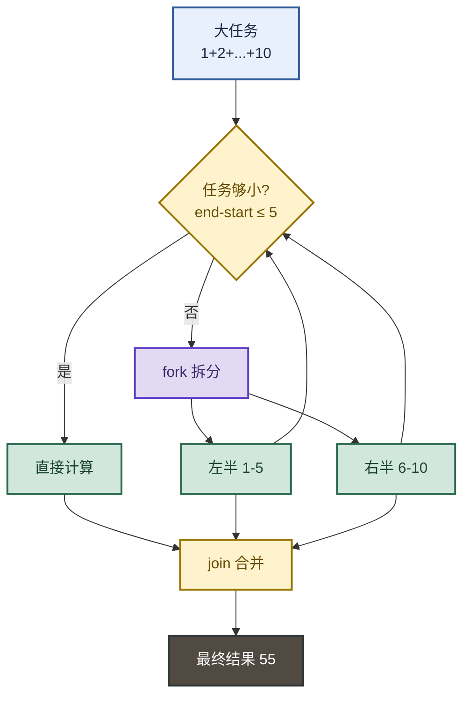
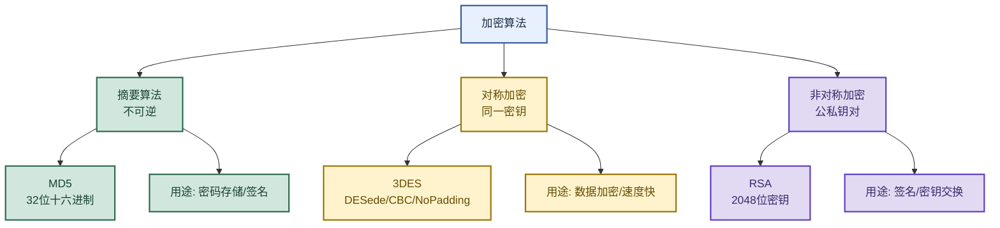

# 并发编程与加密工具：从CompletableFuture到RSA实战

> 目标：不背孤立名词。遇到"并发工具/加密算法"的题目，先判断"问的是哪一层"——是异步编排（CompletableFuture）、是分治计算（ForkJoin）、是并发集合（ConcurrentHashMap/CopyOnWrite）、是阻塞队列（LinkedBlockingQueue），还是加密算法（MD5/3DES/RSA），再用一句话主线串起 5 大并发工具 + 4 类加密算法。

**一句话主线：** FutureTask 能提交不能回调 → CompletableFuture 链式编排补全 → ForkJoinPool 工作窃取搞分治 → ConcurrentHashMap/CopyOnWrite 并发集合保安全 → LinkedBlockingQueue 阻塞队列串生产消费 → MD5/3DES/RSA 加密工具保安全。

---

## 先记住这张总图

```mermaid
flowchart TD
    A[并发与加密] --> B[异步编排]
    A --> C[分治计算]
    A --> D[并发集合]
    A --> E[阻塞队列]
    A --> F[加密工具]

    B --> B1[FutureTask<br/>能提交·不能回调]
    B --> B2[CompletableFuture<br/>链式编排·回调驱动]

    C --> C1[ForkJoinPool<br/>工作窃取]
    C --> C2[RecursiveTask<br/>分治+合并]

    D --> D1[ConcurrentHashMap<br/>分段锁/CAS]
    D --> D2[CopyOnWriteArrayList<br/>写时复制]

    E --> E1[LinkedBlockingQueue<br/>put/take 阻塞]
    E --> E2[ConcurrentLinkedQueue<br/>offer/poll 非阻塞]

    F --> F1[MD5<br/>摘要·不可逆]
    F --> F2[3DES<br/>对称·密钥加密]
    F --> F3[RSA<br/>非对称·公私钥]

    style A fill:#E8F0FD,stroke:#315C9A,stroke-width:2px,color:#1D2C46
    style B fill:#D1E7DD,stroke:#2D6A4F,stroke-width:2px,color:#1B4332
    style C fill:#FFF3CD,stroke:#997404,stroke-width:2px,color:#664D03
    style D fill:#E2D9F3,stroke:#5F3DC4,stroke-width:2px,color:#3B2A6B
    style E fill:#FFD6D6,stroke:#C0392B,stroke-width:2px,color:#641E1E
    style F fill:#514A42,stroke:#2D3436,stroke-width:2px,color:#FFFFFF
    style B1 fill:#D1E7DD,stroke:#2D6A4F,stroke-width:2px,color:#1B4332
    style B2 fill:#D1E7DD,stroke:#2D6A4F,stroke-width:2px,color:#1B4332
    style C1 fill:#FFF3CD,stroke:#997404,stroke-width:2px,color:#664D03
    style C2 fill:#FFF3CD,stroke:#997404,stroke-width:2px,color:#664D03
    style D1 fill:#E2D9F3,stroke:#5F3DC4,stroke-width:2px,color:#3B2A6B
    style D2 fill:#E2D9F3,stroke:#5F3DC4,stroke-width:2px,color:#3B2A6B
    style E1 fill:#FFD6D6,stroke:#C0392B,stroke-width:2px,color:#641E1E
    style E2 fill:#FFD6D6,stroke:#C0392B,stroke-width:2px,color:#641E1E
    style F1 fill:#514A42,stroke:#2D3436,stroke-width:2px,color:#FFFFFF
    style F2 fill:#514A42,stroke:#2D3436,stroke-width:2px,color:#FFFFFF
    style F3 fill:#514A42,stroke:#2D3436,stroke-width:2px,color:#FFFFFF
```



**速记：** 异步编排看 CompletableFuture，分治看 ForkJoin，并发集合看 ConcurrentHashMap，阻塞队列看 LinkedBlockingQueue，加密看 RSA。

---

## 1. FutureTask：异步任务的"半成品"

FutureTask 是 `Future` 的实现，能**提交任务 + 获取结果**，但有个致命缺陷：**`get()` 会阻塞，且不支持回调**。

```java
// 创建 Callable 任务
Callable<Long> callable = () -> fibonacci(30);

// 包装成 FutureTask
FutureTask<Long> futureTask = new FutureTask<>(callable);

// 提交执行
executor.execute(futureTask);

// 获取结果（阻塞等待）
long result = futureTask.get();  // 这里会一直等，主线程干不了别的
```

| 能力 | FutureTask | CompletableFuture |
|---|---|---|
| 提交任务 | ✅ | ✅ |
| 获取结果 | ✅（阻塞） | ✅（可阻塞可异步） |
| 回调通知 | ❌ | ✅ `thenAccept` |
| 链式编排 | ❌ | ✅ `thenApply` |
| 多任务组合 | ❌ | ✅ `allOf/anyOf` |
| 记忆画面 | 寄信等回信 | 快递追踪+自动通知 |

**易混点：** `FutureTask` 是"一次性"的——任务执行完就结束，不能继续接后续操作。`CompletableFuture` 是"链式"的——每个操作返回新的 `CompletableFuture`，能无限接下去。

> 📂 源码位置：`study_demo/src/main/java/com/mrhan/study_demo/java/bingfa/FutureTaskDemo.java`

---

## 2. CompletableFuture：异步编排全能工具箱（重点）

CompletableFuture 解决了 FutureTask 的痛点，支持**回调驱动 + 链式编排 + 多任务组合**，是异步编程的首选。

### 核心用法：supplyAsync + thenApply + thenAccept

```java
ExecutorService executor = Executors.newFixedThreadPool(2);

CompletableFuture<Integer> future = CompletableFuture.supplyAsync(() -> {
    System.out.println("开始执行计算任务...");
    Thread.sleep(2000);  // 模拟耗时
    System.out.println("计算任务完成，结果为：100");
    return 100;
}, executor);

// thenApply：转换结果（100 → 200）
future.thenApply(result -> {
    System.out.println("接收到结果：" + result);
    return result * 2;
})
// thenAccept：消费最终结果（不返回新值）
.thenAccept(finalResult -> {
    System.out.println("最终结果：" + finalResult);  // 输出 200
});

Integer result = future.get();  // 100（注意：thenApply 返回的是新 CF，原 CF 还是 100）
executor.shutdown();
```

### 三大回调方法对比

| 方法 | 作用 | 输入 | 输出 | 记忆画面 |
|---|---|---|---|---|
| `thenApply` | 转换结果 | 上一步结果 | 新结果 | 加工厂：原料→成品 |
| `thenAccept` | 消费结果 | 上一步结果 | 无（void） | 仓库：只收不发 |
| `thenRun` | 执行动作 | 无 | 无（void） | 通知：不管原料只干活 |
| `thenCombine` | 合并两个 CF | 两个结果 | 新结果 | 双流合并：两条河汇一条 |
| `allOf` | 等所有完成 | 多个 CF | 无 | 检票口：全员到齐才发车 |
| `anyOf` | 等任一完成 | 多个 CF | 最先完成的 | 赛跑：第一个到终点 |

### 异常处理

```java
future.exceptionally(ex -> {
    System.out.println("出错了：" + ex.getMessage());
    return -1;  // 兜底返回默认值
});
```

**速记：** `supplyAsync` 开局 → `thenApply` 转换 → `thenAccept` 收尾 → `exceptionally` 兜底。

> 📂 源码位置：`study_demo/src/main/java/com/mrhan/study_demo/java/bingfa/CompletableFutureDemo.java`

---

## 3. ForkJoinPool：工作窃取搞分治

ForkJoinPool 是**CPU 密集型任务**的利器，核心是**工作窃取算法**——每个线程有自己的双端队列，空闲时从其他线程队列尾部偷任务。

### 分治三步走



### 核心代码

```java
static class SumCalculator extends RecursiveTask<Integer> {
    private static final int THRESHOLD = 5;  // 分解阈值
    private final int[] numbers;
    private final int start;
    private final int end;

    @Override
    protected Integer compute() {
        if (end - start <= THRESHOLD) {  // 够小直接算
            int sum = 0;
            for (int i = start; i < end; i++) sum += numbers[i];
            return sum;
        } else {                          // 不够小就拆
            int middle = (start + end) / 2;
            SumCalculator leftTask = new SumCalculator(numbers, start, middle);
            SumCalculator rightTask = new SumCalculator(numbers, middle, end);
            invokeAll(leftTask, rightTask);           // 异步执行子任务
            return leftTask.join() + rightTask.join(); // 合并结果
        }
    }
}

// 使用
ForkJoinPool pool = new ForkJoinPool();
int result = pool.invoke(new SumCalculator(numbers, 0, numbers.length));
```

| 对比项 | ForkJoinPool | ThreadPoolExecutor |
|---|---|---|
| 适用场景 | CPU 密集型（分治） | IO 密集型（请求处理） |
| 队列 | 每线程一个双端队列 | 全局一个队列 |
| 窃取 | 空闲线程偷别人任务 | 不窃取 |
| 记忆画面 | 包工头带小弟各自干 | 排队取号办事 |

**易混点：** `invokeAll` 会**阻塞当前线程**直到所有子任务完成，`fork` 是**异步提交**不阻塞。分治场景用 `invokeAll` 更简洁。

> 📂 源码位置：`study_demo/src/main/java/com/mrhan/study_demo/java/bingfa/ForkJoinPoolDemo.java`

---

## 4. ConcurrentHashMap：并发安全的 Map

ConcurrentHashMap 是**并发场景下的 Map 首选**，用 100 线程并发 put 对比 HashMap 和 ConcurrentHashMap：

```java
Map<String, Integer> map = new HashMap<>();           // 非线程安全
Map<String, Integer> cmap = new ConcurrentHashMap<>(); // 线程安全

ExecutorService executor = Executors.newFixedThreadPool(100);
CountDownLatch latch = new CountDownLatch(100);

IntStream.rangeClosed(1, 100).forEach(i -> executor.submit(() -> {
    IntStream.rangeClosed(1, 10).forEach(j -> {
        map.put(Thread.currentThread().getName() + j, j);  // 可能丢数据
        cmap.put(Thread.currentThread().getName() + j, j); // 不丢
    });
    latch.countDown();
}));

latch.await();
System.out.println(map.size());   // 可能 < 1000（并发覆盖/丢失）
System.out.println(cmap.size());  // 稳定 1000
```

### 演进对比

| 版本 | 实现 | 记忆画面 |
|---|---|---|
| JDK 1.7 | `Segment[]` 分段锁，每段独立加锁 | 大仓库分小仓库，各锁各的 |
| JDK 1.8 | `Node[]` + CAS + `synchronized` 锁单个桶 | 每个货架独立锁，更细粒度 |

**易混点：** `HashMap` 多线程 put 可能**丢数据**（并发覆盖）+ **死循环**（JDK 1.7 扩容时链表成环）。`ConcurrentHashMap` 用 CAS + `synchronized` 保证线程安全，且 `size()` 准确。

> 📂 源码位置：`study_demo/src/main/java/com/mrhan/study_demo/java/bingfa/ConcurrentHashMapDemo.java`

---

## 5. CopyOnWriteArrayList：写时复制

CopyOnWriteArrayList 适合**读多写少**的场景——读不加锁，写时复制整个数组。

```java
CopyOnWriteArrayList<String> list = new CopyOnWriteArrayList<>();
list.add("Apple");
list.add("Banana");

// 主线程遍历的同时，另一个线程 add
Thread addThread = new Thread(() -> {
    Thread.sleep(1000);
    list.add("Durian");  // 写时复制，不影响正在遍历的迭代器
});
addThread.start();

Iterator<String> iterator = list.iterator();
while (iterator.hasNext()) {
    String fruit = iterator.next();
    System.out.println(fruit);  // 不会抛 ConcurrentModificationException
    Thread.sleep(2000);
}
```

| 对比项 | CopyOnWriteArrayList | Collections.synchronizedList |
|---|---|---|
| 读 | 无锁（快） | 加锁（慢） |
| 写 | 复制整个数组（慢） | 加锁（快） |
| 迭代 | 弱一致性（快照） | 强一致性 |
| 适用 | 读多写少 | 读写均衡 |
| 记忆画面 | 影印件：改原稿先复印 | 排队办事：读写都排队 |

**易混点：** CopyOnWriteArrayList 的迭代器是**快照**——遍历期间看到的是创建迭代器时的数据，即使其他线程 add 了新元素也看不到。这是"弱一致性"，不是 bug 是设计。

> 📂 源码位置：`study_demo/src/main/java/com/mrhan/study_demo/java/bingfa/CopyOnWriteArrayListDemo.java`

---

## 6. LinkedBlockingQueue vs ConcurrentLinkedQueue：阻塞 vs 非阻塞

两个并发队列，核心区别是**阻塞 vs 非阻塞**。

| 对比项 | LinkedBlockingQueue | ConcurrentLinkedQueue |
|---|---|---|
| 入队 | `put`（满则阻塞） | `offer`（满则返回 false） |
| 出队 | `take`（空则阻塞） | `poll`（空则返回 null） |
| 容量 | 可设上限 | 无上限（理论无限） |
| 适用 | 生产者-消费者（需等待） | 高并发（不需等待） |
| 记忆画面 | 仓库满了就等 | 仓库满了就拒 |

```java
// LinkedBlockingQueue：阻塞式
LinkedBlockingQueue<String> queue = new LinkedBlockingQueue<>();
queue.offer("Item-1");  // 入队（不阻塞）
String item = queue.poll();  // 出队（空则返回 null）
// queue.put("Item");  // 满则阻塞
// queue.take();       // 空则阻塞
```

**速记：** 生产者-消费者用 `LinkedBlockingQueue`（put/take 阻塞），高并发无界用 `ConcurrentLinkedQueue`（offer/poll 非阻塞）。

> 📂 源码位置：`study_demo/src/main/java/com/mrhan/study_demo/java/bingfa/LinkedBlockingQueueDemo.java`

---

## 7. 加密工具：MD5 / 3DES / RSA 实战

项目实现了 3 类加密工具，覆盖**摘要、对称、非对称**三大场景。

### 加密算法全景



### MD5：摘要算法（不可逆）

```java
public static String encrypt(String value) {
    MessageDigest md5 = MessageDigest.getInstance("MD5");
    md5.update(value.getBytes("UTF-8"));
    byte[] result = md5.digest();
    // 字节数组转 32 位十六进制字符串
    StringBuilder sb = new StringBuilder();
    for (byte b : result) {
        String hex = Integer.toHexString(b & 0xFF);
        if (hex.length() == 1) hex = '0' + hex;
        sb.append(hex);
    }
    return sb.toString();
}
```

**用途：** 密码存储（加盐）、文件校验、数字签名。**不能解密**，只能比对。

### 3DES：对称加密（同一密钥）

```java
// 加密
public static String encrypt(String plaintext, String key) throws Exception {
    byte[] keyBytes = Base64.getDecoder().decode(procKey(key));  // 密钥补齐到 32 位
    DESedeKeySpec desKeySpec = new DESedeKeySpec(keyBytes);
    SecretKey secretKey = SecretKeyFactory.getInstance("DESede").generateSecret(desKeySpec);

    plaintext = padding(plaintext);  // 填充到 8 字节倍数
    Cipher cipher = Cipher.getInstance("DESede/CBC/NoPadding");
    IvParameterSpec iv = new IvParameterSpec(myIV);  // 初始化向量
    cipher.init(Cipher.ENCRYPT_MODE, secretKey, iv);

    byte[] encryptedBytes = cipher.doFinal(plaintext.getBytes(StandardCharsets.UTF_8));
    return byteArrayToHexString(Base64.getEncoder().encode(encryptedBytes));
}
```

**关键点：** ①密钥要补齐到 32 位（`procKey`）②用 CBC 模式 + IV 向量③手动 padding 到 8 字节倍数④结果转十六进制字符串。

### RSA：非对称加密（公私钥对）

```java
// 生成密钥对
KeyPair keyPair = KeyPairGenerator.getInstance("RSA").generateKeyPair();
byte[] publicKey = keyPair.getPublic().getEncoded();   // X509 格式
byte[] privateKey = keyPair.getPrivate().getEncoded();  // PKCS8 格式

// 公钥加密
public static String encryptByPublicKey(String data, String publicKeyStr) {
    X509EncodedKeySpec spec = new X509EncodedKeySpec(Base64.getDecoder().decode(publicKeyStr));
    PublicKey publicKey = KeyFactory.getInstance("RSA").generatePublic(spec);
    Cipher cipher = Cipher.getInstance("RSA");
    cipher.init(Cipher.ENCRYPT_MODE, publicKey);
    return Base64.getEncoder().encodeToString(cipher.doFinal(data.getBytes(StandardCharsets.UTF_8)));
}

// 私钥解密
public static String decryptByPrivateKey(String encryptedData, String privateKeyStr) {
    PKCS8EncodedKeySpec spec = new PKCS8EncodedKeySpec(Base64.getDecoder().decode(privateKeyStr));
    PrivateKey privateKey = KeyFactory.getInstance("RSA").generatePrivate(spec);
    Cipher cipher = Cipher.getInstance("RSA");
    cipher.init(Cipher.DECRYPT_MODE, privateKey);
    return new String(cipher.doFinal(Base64.getDecoder().decode(encryptedData)), StandardCharsets.UTF_8);
}
```

### 三类算法对比

| 算法 | 类型 | 密钥 | 速度 | 安全性 | 典型用途 | 记忆画面 |
|---|---|---|---|---|---|---|
| MD5 | 摘要 | 无 | 最快 | 中（有碰撞） | 密码存储/校验 | 指纹：不可逆 |
| 3DES | 对称 | 1 个共享密钥 | 快 | 中 | 数据加密 | 同把钥匙开锁 |
| RSA | 非对称 | 公钥+私钥对 | 慢 | 高 | 签名/密钥交换 | 公信箱+私钥匙 |

**易混点：** RSA 加密**慢**，不适合加密大数据。实际场景：RSA 加密 3DES 的密钥，3DES 加密实际数据——这叫**混合加密**，HTTPS 就是这么干的。

**速记：** MD5 不可逆（摘要），3DES 一把钥匙（对称），RSA 两把钥匙（非对称）。大数据用 3DES，密钥用 RSA 传。

> 📂 源码位置：`study_demo/src/main/java/com/mrhan/study_demo/java/jiami/`（`Md5Util.java` + `ThreeDesUtil.java` + `RsaUtil.java` + `EncryptTest.java`）

---

## 8. 线程池工具：配置化创建

项目还封装了**配置化线程池工具**，从 properties 文件读参数，用内省（Introspector）自动映射到 `ThreadModel`。

```java
public static ExecutorService createThreadPool(String preFix) throws Exception {
    Properties config = new Properties();
    config.load(CommonThreadPoolUtil.class.getClassLoader().getResourceAsStream("properties/threadpool.properties"));

    ThreadModel threadModel = new ThreadModel();
    BeanInfo beanInfo = Introspector.getBeanInfo(threadModel.getClass());
    PropertyDescriptor[] properties = beanInfo.getPropertyDescriptors();

    for (String key : config.stringPropertyNames()) {
        if (key.startsWith(preFix)) {
            String fieldName = key.substring(preFix.length() + 1);
            for (PropertyDescriptor pd : properties) {
                if (pd.getName().equals(fieldName)) {
                    pd.getWriteMethod().invoke(threadModel, Integer.parseInt(config.getProperty(key)));
                }
            }
        }
    }

    return new ThreadPoolExecutor(
        threadModel.getMinSize(),
        threadModel.getMaxSize(),
        threadModel.getKeepAliveTime(),
        TimeUnit.SECONDS,
        new ArrayBlockingQueue<>(threadModel.getWorkQueueSize()),
        new ThreadFactoryBuilder().setNameFormat("common").build()
    );
}
```

**亮点：** 用 `Introspector` 反射设置属性，避免硬编码字段名，新增配置项只需加 properties 行 + ThreadModel 字段。

> 📂 源码位置：`javaStudy/src/main/java/cn/mrhan/java/thread/threadpoolexecutor/CommonThreadPoolUtil.java`

---

## 高频场景题：用一句诊断开头

### "CompletableFuture 相比 FutureTask 的优势？"

> 问题本质是"异步编排能力"。FutureTask 只能 `get()` 阻塞等结果，不支持回调和链式。CompletableFuture 支持 `thenApply` 转换、`thenAccept` 消费、`allOf` 等所有完成、`exceptionally` 异常兜底，是异步编程的首选。

### "ForkJoinPool 和普通线程池的区别？"

> 机制是**工作窃取**。普通线程池所有线程共享一个队列，竞争大；ForkJoinPool 每个线程有自己的双端队列，自己从头部取任务，空闲时从别人尾部偷任务，减少竞争。适合 CPU 密集型的分治任务（如归并排序、大数组求和）。

### "ConcurrentHashMap 为什么 size() 准确？"

> JDK 1.8 用 `Node[]` + CAS + `synchronized` 锁单个桶，put 操作原子且可见。`size()` 通过 `baseCount` + `CounterCell[]` 累加，即使并发 put 也能准确统计。HashMap 多线程 put 会丢数据（并发覆盖）+ 扩容时可能死循环（JDK 1.7）。

### "RSA 为什么不能加密大数据？"

> RSA 加密**慢**（大数模幂运算），且明文长度不能超过密钥长度（2048 位 RSA 最多加密 245 字节）。实际场景用**混合加密**：RSA 加密对称密钥，对称算法（3DES/AES）加密实际数据。HTTPS 的 TLS 握手就是这个流程。

---

## 面试回答模板：三句话讲清一题

> **问：讲讲你对 Java 并发工具的理解？**
> 1. 问题本质是"多线程下如何安全高效地协作"——分异步编排、分治计算、并发集合、阻塞队列四类。
> 2. 机制是"各司其职"——CompletableFuture 管异步编排（回调驱动），ForkJoinPool 管分治（工作窃取），ConcurrentHashMap 管并发 Map（CAS+锁桶），LinkedBlockingQueue 管生产消费（阻塞等待）。
> 3. 落地时看场景——IO 密集用普通线程池，CPU 密集用 ForkJoin，读多写少用 CopyOnWrite，生产消费用 BlockingQueue。

---

## 最后复习：闭眼回忆 8 句

1. FutureTask 能提交不能回调，`get()` 阻塞；CompletableFuture 支持链式编排 + 回调。
2. CompletableFuture 三板斧：`supplyAsync` 开局 → `thenApply` 转换 → `thenAccept` 收尾。
3. ForkJoinPool 工作窃取：每线程一个双端队列，空闲时从别人尾部偷任务，适合 CPU 密集分治。
4. ConcurrentHashMap JDK 1.8 用 `Node[]` + CAS + `synchronized` 锁单个桶，`size()` 准确。
5. CopyOnWriteArrayList 读无锁、写复制整个数组，迭代器是快照（弱一致性），适合读多写少。
6. LinkedBlockingQueue 阻塞（put/take），ConcurrentLinkedQueue 非阻塞（offer/poll）。
7. MD5 不可逆（摘要），3DES 一把密钥（对称），RSA 公私钥对（非对称）。
8. RSA 加密慢且明文受限，实际用混合加密：RSA 传密钥，3DES/AES 加密数据。

---

## 怎么练才记得住

1. **跑 ConcurrentHashMap 对比**：把 `ConcurrentHashMapDemo.java` 跑 10 次，观察 `map.size()` 波动 vs `cmap.size()` 稳定 1000。
2. **手写 CompletableFuture 链**：不看资料默写 `supplyAsync → thenApply → thenAccept → exceptionally`，重点写对回调顺序。
3. **改造 ForkJoin 阈值**：把 `THRESHOLD` 从 5 改成 2 和 10，观察任务拆分次数变化，体会阈值对性能的影响。
4. **跑通 RSA 加解密**：用 `EncryptTest.java` 生成自己的密钥对，加密一段文字再解密，验证公钥加密私钥解密的完整链路。
