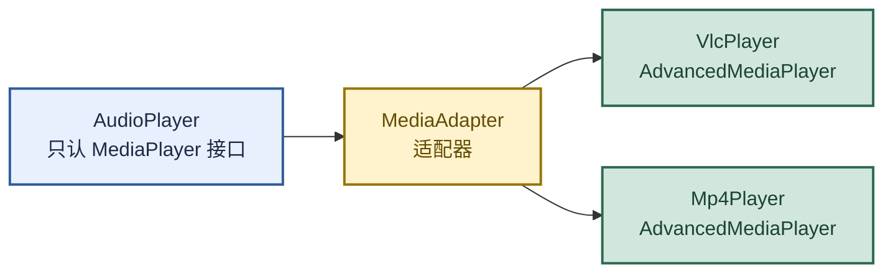
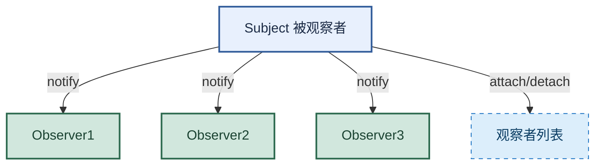
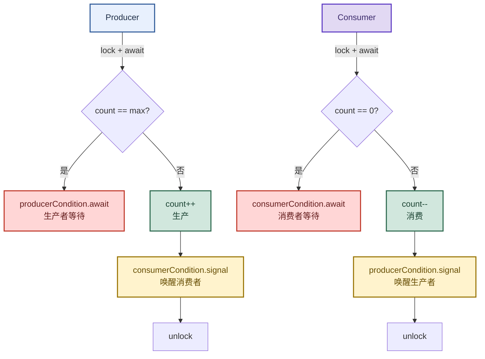
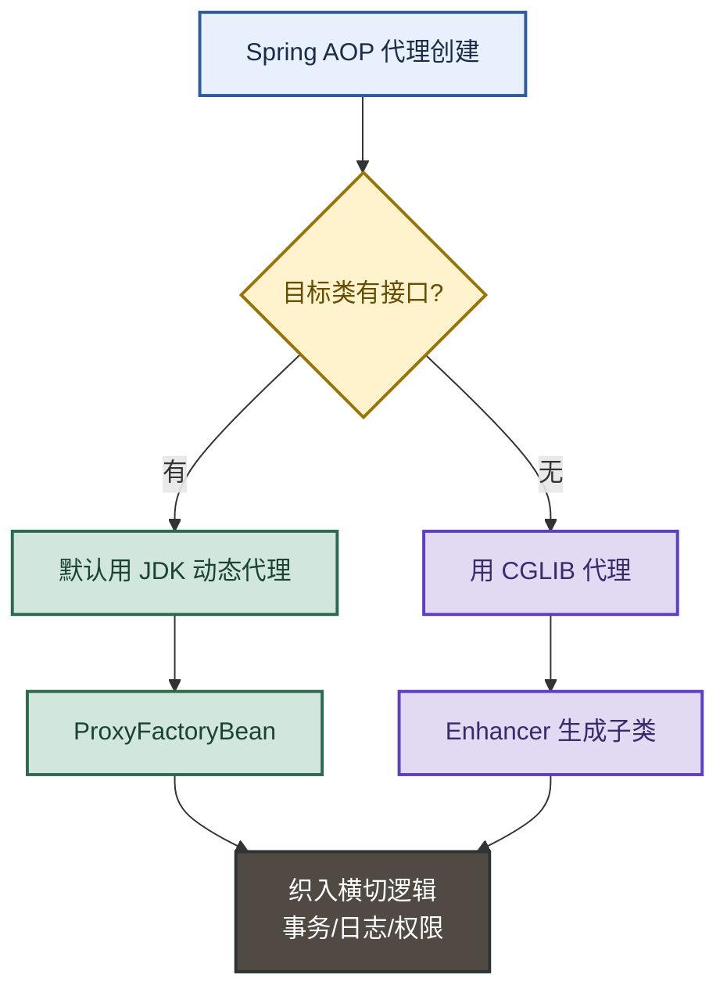

# 设计模式与AOP代理：从单例到动态代理的完整链路

> 目标：不背孤立名词。遇到设计模式题目先判断"问的是创建型/结构型/行为型哪一类"，再用一句话主线串起 7 大模式 + JDK/CGLIB 动态代理，最后落到 Spring AOP 的底层实现。

**一句话主线：** 单例管对象创建 → 工厂/建造者管对象组装 → 适配器管接口转换 → 观察者/生产消费者管对象通信 → 迭代器管遍历 → 动态代理管横切逻辑 → Spring AOP 把动态代理工业化。

---

## 先记住这张总图

```mermaid
flowchart TD
    A[设计模式与AOP] --> B[创建型]
    A --> C[结构型]
    A --> D[行为型]
    A --> E[代理体系]

    B --> B1[单例 5 种写法]
    B --> B2[工厂模式]
    B --> B3[建造者模式]

    C --> C1[适配器模式]

    D --> D1[观察者模式]
    D --> D2[生产者消费者]
    D --> D3[迭代器模式]

    E --> E1[静态代理]
    E --> E2[JDK 动态代理<br/>基于接口]
    E --> E3[CGLIB 动态代理<br/>基于继承]
    E --> E4[Spring AOP<br/>工业化封装]

    style A fill:#E8F0FD,stroke:#315C9A,stroke-width:2px,color:#1D2C46
    style B fill:#D1E7DD,stroke:#2D6A4F,stroke-width:2px,color:#1B4332
    style C fill:#FFF3CD,stroke:#997404,stroke-width:2px,color:#664D03
    style D fill:#E2D9F3,stroke:#5F3DC4,stroke-width:2px,color:#3B2A6B
    style E fill:#FFD6D6,stroke:#C0392B,stroke-width:2px,color:#641E1E
    style B1 fill:#D1E7DD,stroke:#2D6A4F,stroke-width:2px,color:#1B4332
    style B2 fill:#D1E7DD,stroke:#2D6A4F,stroke-width:2px,color:#1B4332
    style B3 fill:#D1E7DD,stroke:#2D6A4F,stroke-width:2px,color:#1B4332
    style C1 fill:#FFF3CD,stroke:#997404,stroke-width:2px,color:#664D03
    style D1 fill:#E2D9F3,stroke:#5F3DC4,stroke-width:2px,color:#3B2A6B
    style D2 fill:#E2D9F3,stroke:#5F3DC4,stroke-width:2px,color:#3B2A6B
    style D3 fill:#E2D9F3,stroke:#5F3DC4,stroke-width:2px,color:#3B2A6B
    style E1 fill:#FFD6D6,stroke:#C0392B,stroke-width:2px,color:#641E1E
    style E2 fill:#FFD6D6,stroke:#C0392B,stroke-width:2px,color:#641E1E
    style E3 fill:#FFD6D6,stroke:#C0392B,stroke-width:2px,color:#641E1E
    style E4 fill:#514A42,stroke:#2D3436,stroke-width:2px,color:#FFFFFF
```



**速记：** 创建型管"怎么 new"，结构型管"怎么组装"，行为型管"怎么通信"，代理是结构型但本质是"横切逻辑的工业化"。

---

## 1. 单例模式：5 种写法的演进

单例是面试最高频的设计模式，5 种写法对应 5 个演进阶段，核心矛盾是**线程安全 vs 性能 vs 懒加载**。

| 写法 | 线程安全 | 懒加载 | 性能 | 记忆画面 |
|---|---|---|---|---|
| 饿汉式 Singleton1 | 否 | 是 | 高 | 懒汉不锁门：第一个进来就 new，多线程会 new 多个 |
| 懒汉式 synchronized | 是 | 是 | 低 | 给门上大锁：每次进门都排队，性能差 |
| 双重校验锁 DCL | 是 | 是 | 高 | 两道门检查 + volatile 防指令重排 |
| 静态内部类 | 是 | 是 | 高 | JVM 类加载锁兜底：天然线程安全 + 懒加载 |
| 枚举 | 是 | 否 | 高 | 最简洁：枚举天然单例，防反射攻击 |

**易混点：** DCL 为什么必须加 `volatile`？因为 `instance = new Singleton()` 不是原子操作，分三步：①分配内存 ②初始化对象 ③引用指向内存。JVM 可能重排成 ①③②，另一个线程在 ③ 之后拿到未初始化的对象就崩了。`volatile` 禁止指令重排。

### 双重校验锁（DCL）核心代码

```java
public class Singleton4 {
    private volatile static Singleton4 instance;  // volatile 是关键

    public static Singleton4 getInstance() {
        if (instance == null) {                   // 第一道门：避免无谓加锁
            synchronized (Singleton4.class) {
                if (instance == null) {           // 第二道门：防止重复创建
                    instance = new Singleton4();
                }
            }
        }
        return instance;
    }
}
```

### 静态内部类（推荐写法）

```java
public class Singleton5 {
    private static class SingletonInner {
        private static final Singleton5 instance = new Singleton5();
    }
    private Singleton5() {}
    public static final Singleton5 getInstance() {
        return SingletonInner.instance;  // 用到才加载，JVM 保证线程安全
    }
}
```

**速记：** 饿汉不安全 → 懒汉加锁慢 → DCL 两道门 + volatile → 静态内部类最优雅 → 枚举防反射。

> 📂 源码位置：`javaStudy/src/main/java/cn/mrhan/patterns/singleton/Singleton1~5.java`

---

## 2. 工厂模式：简单工厂 → 工厂方法 → 抽象工厂

工厂模式三兄弟，核心是**把对象的创建逻辑从使用方剥离**，演进方向是"开闭原则"。

| 模式 | 特点 | 记忆画面 |
|---|---|---|
| 简单工厂 | 一个工厂方法 + if/else 判断 | 路边摊：老板一个人按菜单做所有菜 |
| 工厂方法 | 每个产品一个工厂类 | 连锁店：每个店只做一道菜，新增菜开新店 |
| 抽象工厂 | 一个工厂生产一族产品 | 美式快餐店 vs 中式快餐店：都卖汉堡+可乐，但风格统一 |

**易混点：** 工厂方法 vs 抽象工厂——工厂方法**一个工厂一个产品**，抽象工厂**一个工厂一族产品**。新增产品类型时，工厂方法加新工厂类（符合开闭原则），抽象工厂要改所有工厂接口（违反开闭原则）。

> 📂 源码位置：`javaStudy/src/main/java/cn/mrhan/study/demo/demos/factory/{simple,mehtod,abstrac}/`

---

## 3. 建造者模式：链式组装复杂对象

建造者模式把**复杂对象的构造过程与表示分离**，典型场景是套餐组装。

```java
// 套餐建造者：把汉堡+饮料组装成一份套餐
MealBuilder builder = new MealBuilder();
Meal vegMeal = builder.prepareVegMeal();   // 素汉堡 + 可乐
Meal nonVegMeal = builder.prepareNonVegMeal(); // 鸡腿汉堡 + 百事
```

**易混点：** 建造者 vs 工厂——工厂关注"创建单个产品"，建造者关注"按步骤组装复合产品"。Lombok 的 `@Builder` 就是建造者模式的语法糖。

> 📂 源码位置：`javaStudy/src/main/java/cn/mrhan/patterns/builder/`

---

## 4. 适配器模式：让不兼容的接口协同工作

适配器模式的核心是**转换接口**，让原本不兼容的类能一起工作。经典案例：媒体播放器只支持 MP3，要播放 MP4/VLC 就需要适配器。



**易混点：** 适配器 vs 装饰器 vs 代理——适配器**转换接口**（让不兼容的能用），装饰器**增强功能**（不改变接口），代理**控制访问**（加横切逻辑）。

> 📂 源码位置：`javaStudy/src/main/java/cn/mrhan/patterns/adapter/`

---

## 5. 观察者模式：事件驱动的基石

观察者模式定义了**一对多的依赖关系**，被观察者状态变化时，所有观察者自动收到通知。Spring 的 `ApplicationListener` 就是观察者模式的工业化实现。



### Spring ApplicationListener 实战

```java
// 1. 定义事件
public class CommonEvent extends ApplicationEvent {
    public CommonEvent(String msg) { super(msg); }
}

// 2. 定义监听器（观察者）
@Component
public class AuthApplyListener implements ApplicationListener<CommonEvent> {
    @Override
    public void onApplicationEvent(CommonEvent event) {
        // 收到通知后执行业务逻辑
    }
}

// 3. 发布事件（被观察者）
@Controller
public class Client {
    @Autowired
    private ApplicationContext applicationContext;

    @RequestMapping("/listener")
    @ResponseBody
    public void test() {
        applicationContext.publishEvent(new CommonEvent("事件内容"));
    }
}
```

**速记：** 观察者 = 发布订阅的"单机版"；Spring 事件 = 观察者 + IOC 容器自动注册监听器。

> 📂 源码位置：`javaStudy/src/main/java/cn/mrhan/patterns/observe/`（含 `applictionlistener/` Spring 实战）

---

## 6. 生产者消费者模式：Lock + Condition 精确唤醒

生产者消费者是观察者的"有状态版"——多了**缓冲区满/空**的等待逻辑。用 `synchronized + wait/notify` 只能随机唤醒，用 `ReentrantLock + Condition` 能**精确唤醒生产者或消费者**。



### 核心代码骨架

```java
ReentrantLock lock = new ReentrantLock();
Condition producerCondition = lock.newCondition();  // 生产者条件
Condition consumerCondition = lock.newCondition();  // 消费者条件

// 生产者
lock.lock();
try {
    while (count == maxNum) {
        producerCondition.await();   // 满了就等
    }
    count++;
    consumerCondition.signal();      // 唤醒消费者
} finally {
    lock.unlock();
}
```

**易混点：** `wait/notify` 必须在 `synchronized` 块里，`await/signal` 必须在 `lock.lock()` 之后。`await` 会释放锁，`signal` 只是唤醒不释放锁（要等 `unlock`）。

> 📂 源码位置：`javaStudy/src/main/java/cn/mrhan/patterns/producer/ProducerAndConsumerByLock.java`

---

## 7. 迭代器模式：统一遍历接口

迭代器模式提供一种方法**顺序访问聚合对象中的元素**，而不暴露其底层表示。Java 的 `Iterator` 接口就是标准实现。

```java
// 自定义容器 + 迭代器
public class NameRepository implements Container {
    private String[] names = {"Robert", "John", "Julie", "Lora"};

    @Override
    public Iterator getIterator() {
        return new NameIterator();
    }

    private class NameIterator implements Iterator {
        int index;
        public boolean hasNext() { return index < names.length; }
        public Object next() { return hasNext() ? names[index++] : null; }
    }
}
```

**速记：** 迭代器 = 把遍历逻辑从集合里剥离，让 `for-each` 能统一对待数组、链表、树。

> 📂 源码位置：`javaStudy/src/main/java/cn/mrhan/patterns/iterator/`

---

## 8. 动态代理：AOP 的底层基石（重点）

动态代理是面试高频考点，分两派：**JDK 动态代理**（基于接口）和 **CGLIB 动态代理**（基于继承）。

| 对比项 | JDK 动态代理 | CGLIB 动态代理 |
|---|---|---|
| 原理 | 基于接口生成代理类 | 基于继承生成子类 |
| 依赖 | 目标类必须实现接口 | 目标类不能是 final |
| 性能 | 创建快，调用稍慢 | 创建慢，调用快 |
| Spring 选用 | 有接口时默认用 | 无接口时回退用 |
| 记忆画面 | 接口插座转接头 | 子类继承加料 |

### JDK 动态代理核心代码

```java
public class LogInvocationHandler implements InvocationHandler {
    private Object obj;  // 被代理对象

    public LogInvocationHandler(Object obj) { this.obj = obj; }

    @Override
    public Object invoke(Object proxy, Method method, Object[] args) throws Throwable {
        String methodName = method.getName();
        if ("insert".equals(methodName) || "update".equals(methodName)) {
            System.out.println(methodName + "开始时间：" + System.currentTimeMillis());
            Object result = method.invoke(obj, args);  // 执行目标方法
            System.out.println(methodName + "结束时间：" + System.currentTimeMillis());
            return result;
        }
        return method.invoke(obj, args);
    }

    public static void main(String[] args) {
        Dao dao = new DaoImpl();
        Dao proxyDao = (Dao) Proxy.newProxyInstance(
            LogInvocationHandler.class.getClassLoader(),
            new Class<?>[]{Dao.class},
            new LogInvocationHandler(dao)
        );
        proxyDao.insert();  // 调用代理对象，自动进入 invoke
    }
}
```

**原理：** `Proxy.newProxyInstance` 在运行时生成代理类字节码（`ProxyGenerator.java`），反编译后代理类的方法体是 `super.h.invoke(this, m3, null)`，即把方法调用委派给 `InvocationHandler.invoke`。

### CGLIB 动态代理核心代码

```java
public class DaoProxy implements MethodInterceptor {
    @Override
    public Object intercept(Object o, Method method, Object[] objects, MethodProxy methodProxy) throws Throwable {
        String methodName = method.getName();
        if ("insert".equals(methodName) || "update".equals(methodName)) {
            System.out.println(methodName + "开始时间：" + System.currentTimeMillis());
            methodProxy.invokeSuper(o, objects);  // 调用父类（目标类）方法
            System.out.println(methodName + "结束时间：" + System.currentTimeMillis());
            return o;
        }
        return methodProxy.invokeSuper(o, objects);
    }

    public static void main(String[] args) {
        Enhancer enhancer = new Enhancer();
        enhancer.setSuperclass(DaoImpl.class);  // 设置父类（目标类）
        enhancer.setCallback(new DaoProxy());
        Dao dao = (Dao) enhancer.create();      // 生成子类代理
        dao.insert();
    }
}
```

**易混点：** JDK 代理用 `method.invoke(obj, args)`（反射调用目标对象），CGLIB 用 `methodProxy.invokeSuper(o, objects)`（调用父类方法）。CGLIB 不需要目标对象实例，因为它是生成子类。

### Spring AOP 如何选用



**速记：** JDK 代理看接口，CGLIB 代理看继承；Spring 有接口走 JDK，没接口走 CGLIB，`@EnableAspectJAutoProxy(proxyTargetClass=true)` 强制走 CGLIB。

> 📂 源码位置：`javaStudy/src/main/java/cn/mrhan/java/aop/demo2/{daili,daily/cglb}/`

---

## 高频场景题：用一句诊断开头

### "Spring AOP 为什么有时候不生效？"

> 问题本质是**代理对象没生效**。三种典型场景：①**内部方法调用**（`this.method()` 走的是原对象不是代理对象）②**private/final 方法**（CGLIB 无法代理）③**静态方法**（不属于对象）。解法：内部调用改成 `AopContext.currentProxy().method()`，或把方法拆到另一个 Bean。

### "JDK 动态代理为什么必须基于接口？"

> 机制是 `Proxy.newProxyInstance` 生成的代理类**继承 Proxy + 实现传入的接口**，Java 是单继承，所以只能通过接口多实现来补全方法。CGLIB 绕开这个限制，直接生成目标类的子类，所以不需要接口。

### "动态代理和静态代理的区别？"

> 静态代理**编译期就写好代理类**，每个目标类都要手写一个代理类，代码膨胀；动态代理**运行时生成代理类字节码**，一个 `InvocationHandler` 能代理任意接口，是 AOP 的基石。

---

## 面试回答模板：三句话讲清一题

> **问：讲讲你对设计模式的理解？**
> 1. 问题本质是"如何让代码更易扩展、易维护"——设计模式是前人总结的套路，分创建型、结构型、行为型三类。
> 2. 机制是"封装变化点"——工厂封装创建、适配器封装转换、观察者封装通知、代理封装横切逻辑。
> 3. 落地时看场景——单例用静态内部类、事件解耦用观察者、AOP 用动态代理，Spring 把这些模式工业化封装了。

---

## 最后复习：闭眼回忆 8 句

1. 单例 5 种写法：饿汉不安全 → 懒汉加锁慢 → DCL 两道门 + volatile → 静态内部类最优雅 → 枚举防反射。
2. DCL 必须加 volatile，因为 `new` 不是原子操作，防止指令重排拿到半初始化对象。
3. 工厂三兄弟：简单工厂（if/else）、工厂方法（一产品一工厂）、抽象工厂（一族产品一工厂）。
4. 适配器转换接口，装饰器增强功能，代理控制访问——三者别搞混。
5. 观察者是一对多通知，Spring ApplicationListener 是其工业化实现。
6. 生产者消费者用 `ReentrantLock + Condition` 能精确唤醒，比 `wait/notify` 更可控。
7. JDK 动态代理基于接口（`InvocationHandler.invoke`），CGLIB 基于继承（`MethodInterceptor.intercept`）。
8. Spring AOP 有接口走 JDK，没接口走 CGLIB，内部调用/self 调用会导致代理失效。

---

## 怎么练才记得住

1. **手写 DCL 单例**：不看资料默写 `volatile + synchronized + 双 if`，重点写对 volatile。
2. **对比两种代理**：把 JDK 和 CGLIB 的 main 方法并排打开，对比 `Proxy.newProxyInstance` vs `Enhancer.create`。
3. **改造观察者**：把 `patterns/observe` 下的纯 Java 观察者，改成 Spring `ApplicationListener` 版本，体会 IOC 的便利。
4. **画代理失效图**：在白板上画出 `this.method()` 为什么不走代理，标出"代理对象 vs 原对象"的分叉点。
