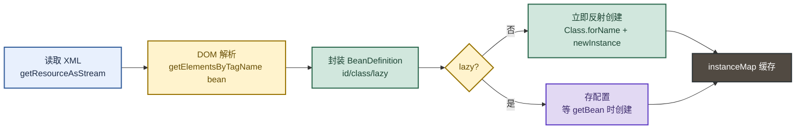
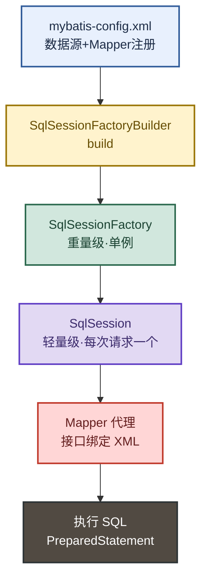
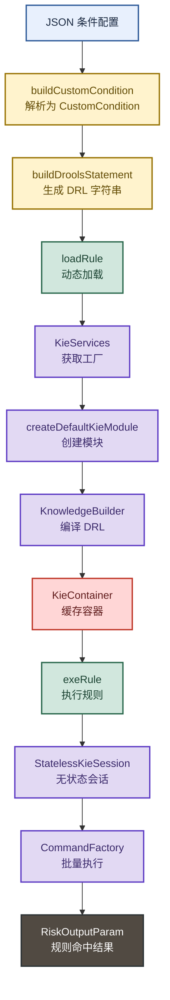

# 框架手写实现与规则引擎：从Spring IOC到Drools动态加载

> 目标：不背孤立名词。遇到"讲讲 Spring/MyBatis/Drools 原理"的题目，先判断"问的是哪一层"——是 IOC 容器、是 ORM 映射、还是规则引擎的动态加载，再用一句话主线串起手写 Spring IOC → JdbcTemplate → MyBatis → Drools 规则引擎动态加载。

**一句话主线：** Spring IOC 解析 XML + 反射创建 Bean → JdbcTemplate 模板方法消除样板代码 → MyBatis SqlSession 封装 SQL 执行 → Drools 把规则从代码剥离，运行时动态加载 DRL 实现规则热更新。

---

## 先记住这张总图

```mermaid
flowchart TD
    A[框架手写实现] --> B[Spring IOC 手写版]
    A --> C[JdbcTemplate]
    A --> D[MyBatis]
    A --> E[Drools 规则引擎]

    B --> B1[解析 XML<br/>DOM]
    B --> B2[BeanDefinition<br/>配置元数据]
    B --> B3[反射创建实例<br/>Class.forName]
    B --> B4[懒加载<br/>lazy 属性]

    C --> C1[JdbcDaoSupport]
    C --> C2[BeanPropertyRowMapper<br/>自动映射]
    C --> C3[模板方法<br/>消除 try-catch]

    D --> D1[SqlSessionFactory]
    D --> D2[SqlSession<br/>执行 SQL]
    D --> D3[Mapper 代理<br/>接口绑定]

    E --> E1[JSON 条件 → DRL]
    E --> E2[KieContainer 缓存]
    E --> E3[动态加载/卸载<br/>规则热更新]
    E --> E4[StatelessKieSession<br/>执行规则]

    style A fill:#E8F0FD,stroke:#315C9A,stroke-width:2px,color:#1D2C46
    style B fill:#D1E7DD,stroke:#2D6A4F,stroke-width:2px,color:#1B4332
    style C fill:#FFF3CD,stroke:#997404,stroke-width:2px,color:#664D03
    style D fill:#E2D9F3,stroke:#5F3DC4,stroke-width:2px,color:#3B2A6B
    style E fill:#FFD6D6,stroke:#C0392B,stroke-width:2px,color:#641E1E
    style B1 fill:#D1E7DD,stroke:#2D6A4F,stroke-width:2px,color:#1B4332
    style B2 fill:#D1E7DD,stroke:#2D6A4F,stroke-width:2px,color:#1B4332
    style B3 fill:#D1E7DD,stroke:#2D6A4F,stroke-width:2px,color:#1B4332
    style B4 fill:#D1E7DD,stroke:#2D6A4F,stroke-width:2px,color:#1B4332
    style C1 fill:#FFF3CD,stroke:#997404,stroke-width:2px,color:#664D03
    style C2 fill:#FFF3CD,stroke:#997404,stroke-width:2px,color:#664D03
    style C3 fill:#FFF3CD,stroke:#997404,stroke-width:2px,color:#664D03
    style D1 fill:#E2D9F3,stroke:#5F3DC4,stroke-width:2px,color:#3B2A6B
    style D2 fill:#E2D9F3,stroke:#5F3DC4,stroke-width:2px,color:#3B2A6B
    style D3 fill:#E2D9F3,stroke:#5F3DC4,stroke-width:2px,color:#3B2A6B
    style E1 fill:#FFD6D6,stroke:#C0392B,stroke-width:2px,color:#641E1E
    style E2 fill:#FFD6D6,stroke:#C0392B,stroke-width:2px,color:#641E1E
    style E3 fill:#FFD6D6,stroke:#C0392B,stroke-width:2px,color:#641E1E
    style E4 fill:#FFD6D6,stroke:#C0392B,stroke-width:2px,color:#641E1E
```



**速记：** IOC 管"对象从哪来"，JdbcTemplate 管"样板代码怎么消"，MyBatis 管"SQL 怎么映射"，Drools 管"规则怎么动态变"。

---

## 1. 手写 Spring IOC：XML 解析 + 反射创建 Bean

Spring IOC 的核心是**把对象的创建权交给容器**。手写版用 DOM 解析 XML，把 `<bean>` 配置封装成 `BeanDefinition`，再用反射创建实例。

### 核心数据结构

```java
// BeanDefinition：存储 bean 的配置元数据
public class BeanDefinition implements Serializable {
    private String id;          // bean 的 id
    private String pkgClass;    // 全限定类名
    private Boolean lazy = false; // 是否懒加载
}

// ClassPathXmlApplicationContext：手写 IOC 容器
public class ClassPathXmlApplicationContext {
    private Map<String, BeanDefinition> beanMap = new HashMap<>();      // 配置信息
    private Map<String, Object> instanceMap = new HashMap<>();          // 单例缓存

    public ClassPathXmlApplicationContext(String file) throws Exception {
        InputStream in = getClass().getClassLoader().getResourceAsStream(file);
        parse(in);  // 解析 XML
    }
}
```

### 三步走流程



### 反射创建实例

```java
public Object newBeanInstance(String pkgClass) throws Exception {
    Class<?> cls = Class.forName(pkgClass);
    Constructor<?> con = cls.getDeclaredConstructor();
    con.setAccessible(true);  // 突破 private 构造
    return con.newInstance();
}

public <T> T getBean(String key, Class<T> t) throws Exception {
    Object obj = instanceMap.get(key);  // 先查缓存
    if (obj != null) return (T) obj;
    obj = newBeanInstance(t.getName()); // 懒加载：没有就创建
    instanceMap.put(key, obj);
    return (T) obj;
}
```

**易混点：** 手写版只实现了**单例 + 懒加载**，真正的 Spring 还包括：①三级缓存解循环依赖 ②BeanPostProcessor 扩展点 ③`@Autowired` 注入 ④生命周期回调。手写版是"骨架"，Spring 是"血肉"。

**速记：** IOC 三步走 = 读 XML → 封 BeanDefinition → 反射 new + 缓存。

> 📂 源码位置：`javaStudy/src/main/java/cn/mrhan/frames/spring/`（`ClassPathXmlApplicationContext.java` + `BeanDefinition.java`）

---

## 2. JdbcTemplate：模板方法消除样板代码

JDBC 原生开发的痛点是**样板代码太多**——加载驱动、获取连接、创建 Statement、执行 SQL、处理 ResultSet、关闭资源、异常处理。JdbcTemplate 用**模板方法模式**把这些固定流程封装，只把"变化的 SQL + 映射逻辑"留给业务。

### JdbcDaoSupport 继承式用法

```java
@Service
public class AccountDaoImpl extends JdbcDaoSupport implements IAccountDao {

    @Override
    public Account findAccountById(Integer accountId) {
        List<Account> accounts = super.getJdbcTemplate().query(
            "select * from account where id = ?",
            new BeanPropertyRowMapper<>(Account.class),
            accountId
        );
        return accounts.isEmpty() ? null : accounts.get(0);
    }

    @Override
    public void updateAccount(Account account) {
        super.getJdbcTemplate().update(
            "update account set name=?, money=? where id=?",
            account.getName(), account.getMoney(), account.getId()
        );
    }
}
```

### 核心机制对比

| 对比项 | 原生 JDBC | JdbcTemplate |
|---|---|---|
| 连接管理 | 手动 `getConnection` + `close` | 模板自动管理 |
| 异常处理 | `try-catch SQLException` | 转成 `DataAccessException`（运行时异常） |
| 结果映射 | 手动 `rs.getString("name")` | `BeanPropertyRowMapper` 自动映射 |
| Statement | 手动创建 + 关闭 | 模板自动创建 + 关闭 |
| 记忆画面 | 炒菜从种菜开始 | 半成品加工，只管调味 |

**易混点：** `JdbcDaoSupport` 是**继承式**（需要 `extends`），现代写法推荐**注入式**（`@Autowired JdbcTemplate`），继承式耦合度高但能复用 `getJdbcTemplate()`。

> 📂 源码位置：`javaStudy/src/main/java/cn/mrhan/frames/jdbctemplate/`（`AccountDaoImpl.java` + `AccountRowMapper.java`）

---

## 3. MyBatis：SqlSession 封装 SQL 执行

MyBatis 的核心是**把 SQL 语句从 Java 代码剥离到 XML/注解**，通过 `SqlSessionFactory → SqlSession → Mapper` 三层封装 SQL 执行。

### 三层架构



### 工具类封装

```java
public class MybatisUtil {
    private static SqlSessionFactory sqlSessionFactory;

    static {  // 类加载时初始化（重量级对象，只建一次）
        String resource = "ceshi/mybatis_test.xml";
        try {
            InputStream inputStream = Resources.getResourceAsStream(resource);
            sqlSessionFactory = new SqlSessionFactoryBuilder().build(inputStream);
        } catch (IOException e) {
            e.printStackTrace();
        }
    }

    public static SqlSession openSession() {
        return sqlSessionFactory.openSession();  // 每次返回新 session
    }
}
```

### 使用流程

```java
SqlSession session = MybatisUtil.openSession();
try {
    UserDOMapper mapper = session.getMapper(UserDOMapper.class);  // 接口绑定
    UserDO user = mapper.selectById(1L);                          // 执行 SQL
    session.commit();                                             // 提交事务
} finally {
    session.close();  // 必须关闭，否则连接泄漏
}
```

| 对象 | 生命周期 | 作用 | 记忆画面 |
|---|---|---|---|
| SqlSessionFactoryBuilder | 方法局部 | 构建 Factory 后丢弃 | 建筑工：盖完楼就走 |
| SqlSessionFactory | 应用级单例 | 创建 Session | 工厂大门：一直开着 |
| SqlSession | 请求级 | 执行 SQL + 事务 | 车间门：用完就关 |
| Mapper | Session 级 | 接口绑定 SQL | 车间工位：绑定一个 session |

**易混点：** `SqlSessionFactory` 是**重量级单例**（建一次），`SqlSession` 是**轻量级非线程安全**（每次请求新建）。Spring 整合后用 `SqlSessionTemplate` 替代 `SqlSession`，自动管理线程安全。

> 📂 源码位置：`javaStudy/src/main/java/cn/mrhan/frames/mybatis/`（`MybatisUtil.java` + `mapper/` + `model/`）

---

## 4. Drools 规则引擎：动态加载实现规则热更新（重点）

Drools 是**业务规则引擎**，把规则从 Java 代码剥离到 DRL 文件，支持**运行时动态加载/卸载规则**，实现规则热更新。本项目实现了一个完整的"JSON 条件 → DRL 生成 → 动态加载 → 执行"链路。

### 核心架构



### 四步走流程

#### 第一步：JSON 条件 → CustomCondition

```java
// JSON 配置（运营在后台配的规则）
String conditionContent = "{\"classification\":\"1001\",\"logicalOperator\":\"AND\","
    + "\"conditions\":[{\"secondDimension\":{\"code\":\"0\",\"view\":\"1\"},"
    + "\"comparisonOperator\":\"NEQ\",\"classification\":7001,"
    + "\"firstDimension\":{\"code\":\"grantPartnerCount\",\"dataType\":\"1\"}}]}";

// 解析为条件对象
CustomCondition customCondition = droolsManager.buildCustomCondition(conditionContent);
```

#### 第二步：生成 DRL 规则文件

```java
RiskFundRuleBO riskFundRuleBO = new RiskFundRuleBO();
riskFundRuleBO.setRuleId(2222222);
riskFundRuleBO.setRuleName("测试规则");
riskFundRuleBO.setConditionContent(customCondition);

// 把条件对象转成 Drools 的 DRL 语法
String drl = droolsManager.buildDroolsStatement(riskFundRuleBO);
```

#### 第三步：动态加载规则（核心）

```java
public void loadRule(Integer ruleId, Long publishId, String drl) {
    KieServices kieServices = KieServices.Factory.get();
    KieRepository repository = kieServices.getRepository();
    ReleaseId releaseId = DroolsUtils.getReleaseId(ruleId, publishId);

    // 1. 创建 KieModule
    InternalKieModule kieModule = DroolsUtils.createDefaultKieModule(kieServices, releaseId);

    // 2. 编译 DRL
    KnowledgeBuilder knowledgeBuilder = kieModule.getKnowledgeBuilderForKieBase(DroolsConstants.KIE_BASE_NAME);
    knowledgeBuilder.add(ResourceFactory.newByteArrayResource(drl.getBytes()), ResourceType.DRL);

    // 3. 加锁注册到 repository（防止并发加载冲突）
    synchronized (repository) {
        repository.addKieModule(kieModule);
        // 4. 缓存 KieContainer，旧容器 dispose 释放资源
        KieContainer oldContainer = kieContainerCache.put(gaKey, kieServices.newKieContainer(releaseId));
        if (oldContainer != null) {
            oldContainer.dispose();  // 关键：释放旧规则资源
        }
    }
}
```

#### 第四步：执行规则

```java
public RiskOutputParam exeRule(Integer ruleId, Long publishId, String sequenceId,
                                Map<String, Object> riskInputParam) {
    ReleaseId releaseId = DroolsUtils.getReleaseId(ruleId, publishId);
    StatelessKieSession session = this.getKieSession(releaseId);  // 从缓存取 session

    // 把输入参数和输出对象都作为 fact 插入
    Collection<Object> facts = Arrays.asList(riskInputParam, new RiskOutputParam());
    List<Command<?>> commands = new ArrayList<>();
    commands.add(CommandFactory.newInsertElements(facts));

    // 批量执行
    session.execute(CommandFactory.newBatchExecution(commands));
    return riskOutputParam;
}
```

### 关键设计点

| 设计点 | 实现 | 为什么这么做 |
|---|---|---|
| KieContainer 缓存 | `ConcurrentMap<String, KieContainer>` | 避免每次执行都重新加载规则 |
| 版本号管理 | `ReleaseId(ruleId, publishId)` | 同一规则不同版本用版本号区分 |
| 加锁加载 | `synchronized (repository)` | 防止并发加载导致 KieModule 冲突 |
| 旧容器 dispose | `oldContainer.dispose()` | 释放旧规则占用的内存，防泄漏 |
| StatelessKieSession | 无状态会话 | 规则执行完自动清理，适合风控场景 |

**易混点：** `StatelessKieSession` vs `StatefulKieSession`——无状态会话**执行完自动清理**（适合风控规则判断），有状态会话**保留 fact 状态**（适合需要多次交互的场景，如审批流程）。

**速记：** Drools 四步走 = JSON 转 DRL → 编译加载 → 缓存 Container → StatelessSession 执行。规则热更新靠 `ReleaseId` 版本号 + 旧容器 dispose。

> 📂 源码位置：`javaStudy/src/main/java/cn/mrhan/frames/drools/`（`DroolsManagerImpl.java` + `utils/DroolsUtils.java` + `TestDrools.java`）

---

## 5. 条件表达式体系：Drools 的 DSL 封装

为了让运营人员能在后台配规则（而不是写 DRL），项目封装了一套**条件表达式体系**，把 JSON 配置翻译成 DRL。

### 表达式分类

| 表达式类型 | 类 | 用途 |
|---|---|---|
| 布尔比较 | `BooleanComparisonExpression` | 布尔值 EQ/NEQ |
| 日期比较 | `DateComparisonExpression` | 日期比较 |
| 小数比较 | `DecimalComparisonExpression` | 金额比较 |
| 整数比较 | `IntegerComparisonExpression` | 数量比较 |
| 列表比较 | `ListComparisonExpression` | 集合包含 |
| 字符串比较 | `StringComparisonExpression` | 字符串匹配 |

### 条件组合

```java
// SimpleCondition：单个条件
// MultipleCondition：多条件组合（AND/OR）
// CustomCondition：自定义条件（含逻辑运算符）
```

**速记：** 运营配 JSON → `CustomCondition` 解析 → `ComparisonExpression` 比大小 → `StatementComponent` 拼 DRL。

> 📂 源码位置：`javaStudy/src/main/java/cn/mrhan/frames/drools/{comparison,condition}/`

---

## 高频场景题：用一句诊断开头

### "Drools 规则引擎相比 if-else 的优势？"

> 问题本质是"规则与代码解耦"。if-else 把规则硬编码在 Java 代码里，改规则要发版；Drools 把规则放 DRL 文件，**运行时动态加载**，运营在后台改规则即时生效。适合风控、营销、路由等规则频繁变化的场景。

### "Drools 动态加载如何避免内存泄漏？"

> 机制是**版本号 + 旧容器 dispose**。每次加载新规则用新的 `ReleaseId`（ruleId + publishId），旧的 `KieContainer` 从缓存移除后调用 `dispose()` 释放资源。如果不 dispose，旧规则占用的内存会一直累积，最终 OOM。

### "手写 Spring IOC 和真实 Spring 的差距？"

> 手写版只实现了**XML 解析 + 反射创建 + 懒加载**，真实 Spring 还包括：①三级缓存解循环依赖 ②`BeanPostProcessor` 扩展点 ③`@Autowired` 注入 ④`BeanFactoryPostProcessor` ⑤生命周期回调 ⑥AOP 代理。手写版是骨架，理解了骨架再看 Spring 源码就不会迷路。

---

## 面试回答模板：三句话讲清一题

> **问：讲讲你对 Spring IOC 的理解？**
> 1. 问题本质是"对象创建权的转移"——IOC 把对象的创建、依赖注入交给容器，业务代码只声明需要什么。
> 2. 机制是"XML/注解配置 + 反射创建 + 单例缓存"——容器启动时解析配置，封装成 `BeanDefinition`，按需反射创建并缓存。
> 3. 落地时看扩展点——`BeanPostProcessor` 是 Spring 留给框架的扩展口，AOP、自动配置、注解注入都基于它实现。

---

## 最后复习：闭眼回忆 8 句

1. 手写 IOC 三步走：读 XML → 封 `BeanDefinition` → 反射 `new` + 缓存 `instanceMap`。
2. `BeanDefinition` 存三要素：`id`（名字）、`pkgClass`（类名）、`lazy`（是否懒加载）。
3. JdbcTemplate 用**模板方法**消除 JDBC 样板代码，`BeanPropertyRowMapper` 自动映射结果集。
4. MyBatis 三层：`SqlSessionFactoryBuilder`（用完丢）→ `SqlSessionFactory`（单例）→ `SqlSession`（每次新建）。
5. `SqlSession` 非线程安全，Spring 整合后用 `SqlSessionTemplate` 替代。
6. Drools 四步走：JSON 转 DRL → `KnowledgeBuilder` 编译 → `KieContainer` 缓存 → `StatelessKieSession` 执行。
7. Drools 规则热更新靠 `ReleaseId` 版本号 + 旧 `KieContainer.dispose()` 释放资源。
8. `StatelessKieSession` 适合风控（执行完清理），`StatefulKieSession` 适合审批（保留状态）。

---

## 怎么练才记得住

1. **手写 IOC**：照着 `ClassPathXmlApplicationContext` 默写一遍，重点写对 DOM 解析 + 反射创建 + 懒加载判断。
2. **画 Drools 流程图**：在白板上画出 JSON → DRL → KieContainer → Session 的完整链路，标出 dispose 的位置。
3. **对比 JdbcTemplate 和 MyBatis**：列出两者"谁管 SQL"的区别——JdbcTemplate SQL 在 Java 代码里，MyBatis SQL 在 XML 里。
4. **改造 Drools demo**：把 `TestDrools.java` 的 JSON 条件改成自己的业务规则（如"金额 > 10000 且用户等级 < 3"），跑通完整链路。
