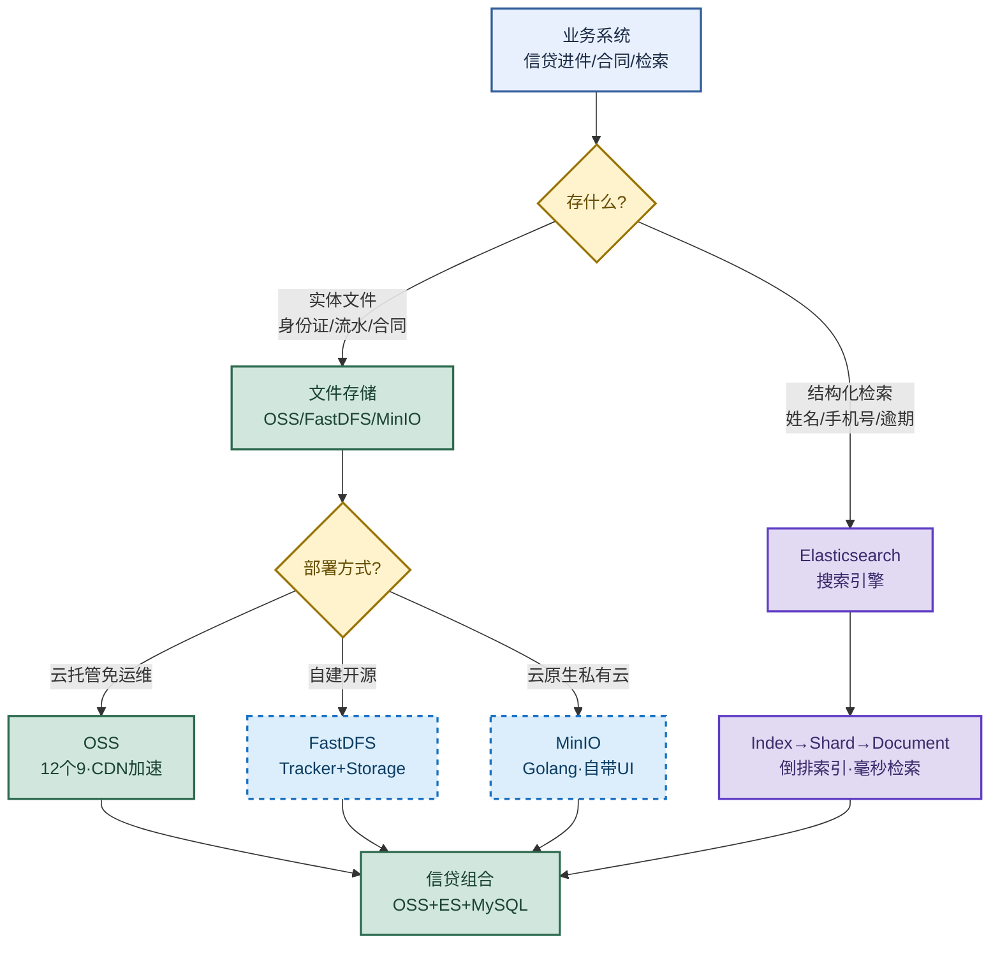

# 文件存储：OSS/FastDFS/MinIO 与 Elasticsearch

> 目标：遇到文件存储/搜索题目先判断"问的是哪一层"——存文件（OSS/FastDFS/MinIO）、查数据（Elasticsearch）、还是信贷场景选型，再展开机制和实战。
>
> 读图顺序：先看下方"先记住这张总图"（三者定位 + 信贷组合），再按问题回看各节。每节底部都有**易混点**或**速记**；先遮住解释自己讲，再对照正文。
>
> 本笔记覆盖 FastDFS/OSS/MinIO 三种文件存储对比 + Elasticsearch 核心组件 + 信贷场景选型（OSS+ES+MySQL 组合）。

## 先记住这张总图

**一句话主线：**文件存储（OSS/FastDFS/MinIO）存实体文件，Elasticsearch 做毫秒级检索；信贷场景组合用——OSS 当保险箱托管合同证件，ES 建客户索引和风控平台，底层交易数据放 MySQL/OceanBase。

## 1. 三者定位：档案室 vs 超级图书管理员

> 用信贷公司档案管理打比方：FastDFS/OSS 是档案室仓库存实体文件，Elasticsearch 是检索系统只记位置不存原件。

| 组件 | 比喻角色 | 存什么 | 典型动作 |
|---|---|---|---|
| FastDFS/OSS/MinIO | 档案室仓库 | 客户身份证扫描件、银行流水 PDF、合同照片等实体文件 | 存文件、取文件 |
| Elasticsearch | 超级图书管理员检索系统 | 不存实体文件，只记录"张三的借款合同在 A 区 3 号柜" | 输入"逾期超 30 天的北京客户"毫秒级返回档案清单，但手里没有档案原件 |

**易混点：**Elasticsearch **不存实体文件**，它存的是结构化 JSON 文档和倒排索引。问"合同 PDF 存哪"答案是 OSS/FastDFS，问"查所有逾期客户"答案才是 ES。两者职责完全不同，不能互相替代。

## 2. FastDFS：自建轻量级分布式文件系统

> 纯开源系统，适合企业自己搭建。核心是 Tracker 调度 + Storage 干活。

| 组件 | 职责 | 关键点 |
|---|---|---|
| Tracker Server | 跟踪服务器，调度中心 | 不存文件，只记录哪个 Storage 有空闲空间，给客户端指路 + 负载均衡 |
| Storage Server | 存储服务器，干活的仓库 | 真正存储文件数据和元数据；通常以 Group（分组）为单位，组内多台机器互为备份 |
| Client | 业务系统 | 通过 Client API 向 Tracker 询问地址，再直接向 Storage 上传/下载 |

**易混点：**Tracker **不存文件数据**，只存"哪个 Storage 有空位"的元信息（与 NameNode 存元数据、DataNode 存真实块的思想类似）。客户端拿到地址后**直接**与 Storage 通信上传/下载，Tracker 不做数据中转，避免成为瓶颈。

## 3. OSS：云厂商对象存储服务

> 如阿里云 OSS，云厂商提供的海量、安全、低成本的云端文件托管服务。

| 组件 | 含义 | 类比 |
|---|---|---|
| Bucket | 存储空间 | 类似文件夹的根目录，命名全局唯一 |
| Object | 对象，OSS 中存储数据的基本单元 | 由 Key（文件名）+ Data（用户数据）+ Meta（元数据）三部分组成 |
| Endpoint | 访问域名 | 不同地域 OSS 对外服务的网络地址，如 `oss-cn-hangzhou.aliyuncs.com` |

**易混点：**OSS 的 Object 三要素是 **Key + Data + Meta**。Key 是文件名（不是路径），Data 是文件内容，Meta 是元数据（如 Content-Type、自定义标签）。一个 Object 没有传统文件夹层级，所谓"目录"只是 Key 前缀的模拟。

## 4. MinIO：云原生对象存储

> 专为海量数据存储、人工智能、大数据分析而设计的对象存储系统，主要用 Golang 实现，运行在操作系统用户态空间，客户端与服务器之间采用 HTTP/HTTPS 通信协议。

| 优势点 | 说明 |
|---|---|
| 安装部署简单 | 单二进制文件启动，开箱即用 |
| 操作简单 | 自带 UI 管理界面，可视化操作 |
| 性能优秀 | 可达每秒 GB 级别读写速度 |
| 云原生支持 | 支持主流云原生容器化部署（K8s 友好） |
| 多语言 SDK | 支持主流编程语言客户端接入 |

**易混点：**MinIO 和 OSS 都是**对象存储**，API 风格兼容 S3。区别是 MinIO 是**自建私有云**（自己部署在机房或 K8s），OSS 是**公有云托管**（阿里云运维）。私有云合规强但要自己运维，公有云免运维但数据在厂商侧。

## 5. Elasticsearch：搜索与分析引擎

> 用来查数据，特别是海量数据的全文检索和复杂分析。核心是分布式 + 倒排索引。

| 组件 | 含义 | 类比 |
|---|---|---|
| Cluster / Node | 集群和节点，ES 是分布式的 | 节点有不同角色：主节点管集群状态、数据节点存数据执行查询、协调节点分发请求合并结果 |
| Index | 索引 | 类似 MySQL 中的数据库或表，是一类相似文档的集合 |
| Document | 文档 | 最小的数据单元，一条条 JSON 格式数据 |
| Shard | 分片 | 索引被拆分成多个分片分散存储在不同节点上，这是 ES 能处理 PB 级数据且查询极快的核心原因 |

**易混点：**ES 的 Index **不是** MySQL 的索引概念！ES 的 Index ≈ MySQL 的"库/表"（一类文档集合），而 ES 真正的"索引"是底层**倒排索引**（词项 → 文档 ID 列表）。Shard 是 ES 横向扩展的核心——索引分片分散到多节点，并行查询所以快。

## 6. 三者核心区别：定位与场景

| 维度 | FastDFS | OSS | Elasticsearch |
|---|---|---|---|
| 核心定位 | 自建的文件存储系统 | 云服务的文件存储系统 | 搜索与数据分析引擎 |
| 存储内容 | 图片/视频/文档等非结构化文件 | 海量非结构化文件 | 结构化的文本数据（JSON） |
| 运维成本 | 高（自己买服务器部署集群） | 极低（免运维） | 中高（集群调优有门槛） |
| 扩展性 | 良好（手动扩容） | 极强（无限弹性） | 极强（分片横向扩展） |
| 典型场景 | 中小团队自建网盘/相册/日志存储 | 网站静态资源/大数据备份/音视频点播 | 电商商品搜索/日志分析 ELK/风控检索 |

**速记：**FastDFS 自建费钱费力、OSS 上云省心弹性、ES 专攻检索分析——三者不是替代关系，而是按"自建/上云/检索"分层选型。

## 7. OSS 与 FastDFS 核心区别：六维对比

| 核心维度 | OSS（公有云托管） | FastDFS（自建开源） |
|---|---|---|
| 运维成本 | 极低，免运维 | 极高，自己买服务器部署集群 |
| 可靠性 | 极高，12 个 9 数据持久性，自带跨机房跨区域容灾备份 | 依赖自身能力，组内副本冗余；机房出大问题数据风险高 |
| 扩展性 | 无限弹性，用多少买多少 | 需手动扩容，采购新机器加入集群 |
| 访问速度 | 公网极快，天然结合 CDN 加速 | 内网快、公网慢 |
| 功能生态 | 丰富，自带图片处理/视频截帧/生命周期管理 | 基础，仅核心文件存取，高级功能需自己写代码 |
| 计费模式 | 按量付费 | 自购硬件，前期一次性投入 |

**易混点：**OSS 的"12 个 9"指**数据持久性**（`99.9999999999%`，即一万亿个对象平均丢不到 1 个），不是"可用性"。可用性是服务能不能访问，持久性是数据会不会丢——信贷核心资产看的是持久性。

## 8. 信贷公司选型：OSS + ES + MySQL 组合

> 现代化信贷公司组合使用：OSS 像保险箱托管合同证件，ES 建客户索引和风控平台，底层业务交易数据放 MySQL/OceanBase。

| 场景 | 选型 | 理由 |
|---|---|---|
| 客户资质与合同文件 | **首选 OSS** | 信贷资料是核心资产绝对不能丢，OSS 提供 12 个 9 持久性 + 跨区域容灾 + ACL 权限控制 + 数据加密 |
| 客户资质与合同文件 | **备选 FastDFS** | 仅当公司有极强合规要求，规定所有数据必须存本地私有机房、严禁上公有云时 |
| 客户信息与风控检索 | **必选 Elasticsearch** | 极速进件检索（信审输入姓名/手机号毫秒级返回 + 高亮）+ 复杂风控画像（聚合统计近一月某地区逾期率飙升）+ 日志审计合规（ELK 实时监控异常操作） |
| 底层业务交易数据 | **MySQL/OceanBase** | 强事务交易数据，与 OSS/ES 互补 |

**易混点：**信贷选型不是"三选一"而是"组合拳"。OSS 存文件原件、ES 做检索分析、MySQL 存交易数据——三者各司其职。文件存 OSS 后，**文件元信息（如客户 ID、文件 URL、合同编号）会同步到 ES/MySQL**，检索时先查 ES 拿到 URL，再去 OSS 取原件。

## 高频场景题：用一句诊断开头

### "信贷公司文件存储怎么选？"

先看合规要求：无强制本地化要求 → **首选 OSS**（12 个 9 持久性 + 跨区域容灾 + ACL + 加密，核心资产不丢）；有极强合规要求必须本地机房 → **备选 FastDFS**（自建可控但运维成本高）。检索层**必选 ES**（毫秒级进件检索 + 风控聚合 + ELK 日志审计），底层交易数据放 MySQL/OceanBase。组合拳：OSS 当保险箱、ES 当检索引擎、MySQL 当账本。

### "OSS 和 FastDFS 到底差在哪？"

本质是**公有云托管 vs 自建开源**。六维对比：运维（OSS 免运维 vs FastDFS 极高）、可靠性（OSS 12 个 9 跨区域容灾 vs FastDFS 组内副本机房风险）、扩展性（OSS 无限弹性 vs FastDFS 手动扩容）、速度（OSS 公网快+CDN vs FastDFS 内网快公网慢）、功能（OSS 丰富图片处理/视频截帧 vs FastDFS 基础）、计费（OSS 按量 vs FastDFS 一次性投入）。除非合规强制本地化，否则 OSS 综合更优。

### "Elasticsearch 为什么查得快？"

核心是**分布式 + 倒排索引 + 分片并行**。索引被拆成多个 Shard 分散到不同 Node，查询时协调节点分发到各分片并行检索，再合并结果。底层倒排索引把"词项 → 文档 ID 列表"建好，输入关键词直接命中文档，不用全表扫描。所以 PB 级数据也能毫秒级返回。

## 面试回答模板：三句话讲清一题

> **问题本质是……**（先说问的是哪一层：存文件、查数据、还是选型）。
>
> **机制是……**（解释定位 + 关键组件），因为……（为什么这样设计）。
>
> **实战中我会……**（具体选型 + 场景），例如……（业务例子）。

例：问"信贷公司怎么选文件存储和检索"——本质是存文件（OSS/FastDFS）和查数据（ES）两层职责不同；机制是 OSS 提供 12 个 9 持久性 + 跨区域容灾托管合同原件，ES 用倒排索引 + 分片并行做毫秒级检索，底层交易数据放 MySQL；实战中客户身份证/流水/合同存 OSS，文件元信息同步到 ES 建索引，信审输入姓名手机号 ES 毫秒级返回匹配客户 + 高亮，风控用 ES 聚合统计某地区逾期率飙升，操作日志接 ELK 满足金融合规审计。

## 最后复习：闭眼回忆 8 句

1. **三者定位**：FastDFS/OSS/MinIO 是档案室存实体文件，ES 是检索系统只记位置不存原件——职责不同不能互替。
2. **FastDFS 组件**：Tracker 调度指路（不存文件）+ Storage 干活存储（Group 组内备份）+ Client 直接与 Storage 通信。
3. **OSS 三要素**：Bucket（存储空间）+ Object（Key+Data+Meta）+ Endpoint（访问域名）；12 个 9 是数据持久性不是可用性。
4. **MinIO 特点**：Golang 实现 + HTTP/HTTPS 通信 + 自带 UI + GB/s 读写 + 云原生 K8s 友好 + S3 兼容，私有云自建对象存储。
5. **ES 组件**：Cluster/Node（主/数据/协调角色）+ Index（≈库表）+ Document（JSON）+ Shard（分片横向扩展，PB 级快的核心）。
6. **三者区别**：FastDFS 自建运维高、OSS 上云免运维弹性强、ES 专攻检索分析；按"自建/上云/检索"分层选型。
7. **OSS vs FastDFS 六维**：运维（免运维 vs 极高）、可靠性（12 个 9 vs 副本）、扩展（弹性 vs 手动）、速度（CDN vs 内网）、功能（丰富 vs 基础）、计费（按量 vs 一次性）。
8. **信贷组合**：OSS 存合同证件（保险箱）+ ES 建客户索引和风控平台（毫秒检索+聚合+ELK）+ MySQL/OceanBase 存交易数据；合规强制本地化才备选 FastDFS。

## 怎么练才记得住

别反复通读，改成主动回忆：

1. 每次只看一个主题，遮住表格，先自己说出"定位 → 组件 → 场景"，再对照。
2. 用"信贷选型/OSS vs FastDFS/ES 为什么快"三道题各讲 30 秒；卡住时只回看对应小节。
3. 隔天再讲一遍，换成自己的业务例子；能解释"ES 的 Index 不是 MySQL 的索引"才算会。
4. 复习时轮流画"三者定位总图"和"信贷 OSS+ES+MySQL 组合图"；能默写出 OSS 三要素和 ES 四组件才算熟。
