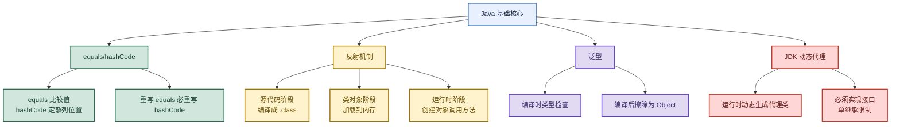

# Java 基础：从 equals/hashCode 到反射、泛型与动态代理

> 目标：遇到 Java 基础题先判断"问的是哪一层"——equals 与 hashCode 的关系、反射机制三阶段、泛型擦除、JDK 动态代理为什么必须接口，再展开机制和实战。
>
> 读图顺序：先看下方"先记住这张总图"（Java 基础核心链路），再按问题回看各节。每节底部都有**易混点**或**速记**；先遮住解释自己讲，再对照正文。
>
> 本笔记覆盖 equals/hashCode 重写 + 反射三阶段 + 泛型擦除 + JDK 动态代理原理。

## 先记住这张总图

**一句话主线：**equals 比较值 hashCode 定散列位置（重写 equals 必重写 hashCode）→ 反射三阶段（源代码/类对象/运行时）→ 泛型编译时检查编译后擦除 → JDK 动态代理运行时生成代理类（单继承所以必须接口）。

## 1. equals 方法为什么必须重写 hashCode

> 核心关系：equals 判值相等，hashCode 定散列存储位置，二者必须协同。

| 维度 | 说明 |
|---|---|
| equals 默认行为 | Object 的 equals 默认用 `==` 比较对象**地址**，想比较值必须重写 |
| hashCode 作用 | 主要用于提升查询效率，确定对象在散列结构（HashMap/HashSet）中的存储位置 |
| 协同规则 | 重写 equals 必须重写 hashCode，二者参与计算的属性字段应该相同 |
| 散列校验标准 | hash 结构添加元素时先比 hashCode，后判断 equals |
| 等价关系 | equals 相等 → hashCode 一定相等；hashCode 相同 ≠ 对象相同（只是散列到同一桶） |

**易混点：**"hashCode 相同代表对象相同"是错的。hashCode 相同只说明两个对象在散列结构中落在同一个数组桶里（哈希冲突），是否真的相等还要靠 equals 判断。反过来，equals 相等则 hashCode 必须相等——否则两个"相等"的对象散列到不同桶，HashMap 里就会存两份。

## 2. 反射机制

> 反射：把类的各个部分封装成对象，运行时动态获取类信息并调用方法。

**Java 代码三个阶段：**

| 阶段 | 发生什么 | 关键产物 |
|---|---|---|
| 源代码阶段 | java 文件编译生成字节码文件 | Student.class（在硬盘） |
| 类对象阶段 | 类加载器把 class 的成员变量/构造方法/成员方法加载到内存 | Class 对象 |
| 运行时阶段 | 创建对象、调用方法 | 实例对象 |

**反射的典型使用：**FileUtil 读取文件设置集合对象；Dubbo 泛化调用——把接口全路径、方法名、参数类型配置在数据库表，通过 `GenericService.$invoke` 动态执行，底层就是 `Class.forName()` 加载类 + `Method.invoke()` 执行方法。新增下游接口只需在配置表插一条记录，无需改代码重新发布。

**易混点：**反射的"类对象阶段"是把类的**结构信息**（字段、方法、构造器）加载成 Class 对象，不是创建实例。实例是在"运行时阶段"通过 Class 对象的 `newInstance()` 或构造器创建的。Class 对象每个类只有一个，实例可以有多个。

## 3. 泛型

> 泛型：Java5 引入，允许定义类/接口/方法时使用类型参数，实现代码复用和类型安全。

| 核心作用 | 说明 |
|---|---|
| 编译时类型安全 | 编译期就能发现类型错误，避免运行时 ClassCastException |
| 消除强制类型转换 | 使用时无需手动转型，代码更简洁 |
| 代码复用 | 一套代码适用于多种数据类型 |
| 泛型擦除 | 编译时做类型检查，编译后把泛型参数擦除替换成 Object，编译器自动插入强转代码 |

**易混点：**泛型是**编译期**机制，运行时不存在。编译后泛型参数被擦除（替换成 Object 或上界），所以 `List<String>` 和 `List<Integer>` 在运行时是同一个 Class（`List`）。这也是为什么不能用 `instanceof List<String>` 的原因——运行时拿不到泛型参数。

## 4. JDK 动态代理

> 原理：运行时在内存中动态构建一个代理类（实现接口），编译执行，JVM 停止代理类就消失。

**代理类构建四步：**

| 步骤 | 做什么 |
|---|---|
| 1. 实现接口 | 代理类实现被代理的业务接口 |
| 2. 静态块反射方法 | 通过静态块反射业务接口的方法，得到 Method 对象 |
| 3. 调用父类构造器 | 调用父类 Proxy 构造器，传入 InvocationHandler 参数 |
| 4. 重写接口方法 | 重写接口方法时调用父类 Proxy 的 `h.invoke` 方法 |

**为什么动态代理必须有接口？**通过父类 Proxy 的构造方法保存了创建代理对象时传入的 InvocationHandler 实例。因为 Java 是**单继承**的，代理类 `$Proxy0` 继承了 Proxy 后，只能通过**实现接口**的方式来扩展方法。没有接口就没有方法可以代理重写。

**易混点：**JDK 动态代理只能代理**接口**（因为单继承已占用 extends Proxy），这是它和 CGLIB 的核心区别——CGLIB 通过**继承目标类**生成子类代理，所以能代理普通类但不能代理 final 类/方法。Spring AOP 默认：有接口用 JDK 动态代理，无接口用 CGLIB。

## 高频场景题：用一句诊断开头

### "equals 重写后为什么必须重写 hashCode？"

本质是散列结构的校验标准问题。HashMap 添加元素先比 hashCode 定桶，再比 equals 判相等。如果两个对象 equals 相等但 hashCode 不同，就会散列到不同桶，HashMap 里存两份"相等"的对象，破坏语义。所以重写 equals 必须重写 hashCode，且用相同字段计算。

### "JDK 动态代理为什么必须接口？"

本质是 Java 单继承限制。代理类 `$Proxy0` 已经继承了 Proxy 类来复用 InvocationHandler 逻辑，而 Java 单继承不允许再 extends 一个类，只能通过 implements 接口来获得可被代理的方法。所以 JDK 动态代理只能代理接口方法，代理普通类要用 CGLIB（继承生成子类）。

## 面试回答模板：三句话讲清一题

> **问题本质是……**（先说问的是哪一层：对象相等、反射、泛型、代理）。
>
> **机制是……**（解释原理 + 关键点），因为……（为什么这样设计）。
>
> **实战中我会……**（选型 + 场景），例如……（业务应用）。

例：问"反射用在哪"——本质是运行时动态获取类信息并调用；机制是 Class 对象承载类结构，`Method.invoke()` 调用方法；实战中 Dubbo 泛化调用把接口信息配置在数据库，通过反射动态执行，新增接口零代码改动。

## 最后复习：闭眼回忆 8 句

1. **equals 默认比地址**：Object 的 equals 用 `==`，比值要重写。
2. **hashCode 定散列位置**：hash 结构先比 hashCode 定桶，再比 equals 判相等。
3. **重写 equals 必重写 hashCode**：用相同字段计算，否则相等对象散列到不同桶。
4. **hashCode 相同 ≠ 对象相同**：只是哈希冲突落同桶，是否相等靠 equals。
5. **反射三阶段**：源代码（.class）→ 类对象（Class）→ 运行时（实例）。
6. **泛型擦除**：编译时检查，编译后擦除为 Object，运行时无泛型。
7. **JDK 动态代理四步**：实现接口 → 静态块反射方法 → 父类构造器传 InvocationHandler → 重写方法调 h.invoke。
8. **动态代理必须接口**：单继承已占 extends Proxy，只能 implements 接口扩展方法；代理普通类用 CGLIB。

## 怎么练才记得住

别反复通读，改成主动回忆：

1. 每次只看一个知识点，遮住表格，先自己说出"原理 → 关键点 → 场景"，再对照。
2. 用"equals/hashCode 协同"和"JDK 动态代理为什么必须接口"各讲 30 秒；卡住时只回看对应小节。
3. 隔天再讲一遍，换成自己的项目例子；能解释"为什么 hashCode 相同不代表对象相同"才算会。
4. 复习时画"反射三阶段图"和"动态代理四步流程"；能默写出 equals/hashCode 协同规则和泛型擦除才算熟。
