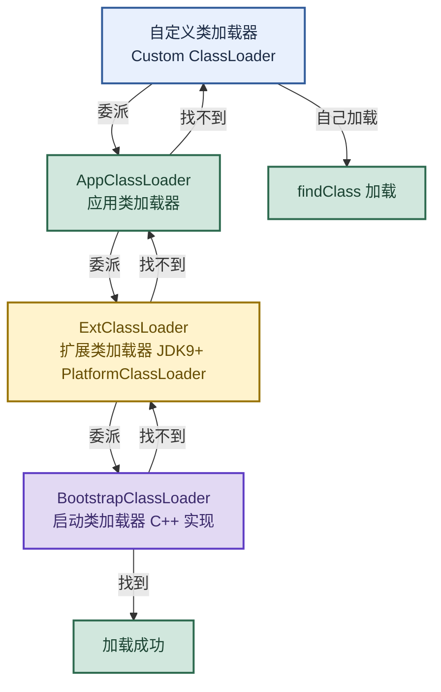

# JVM 类加载：从类加载器层级到双亲委派与打破

> 目标：遇到类加载题目先判断"问的是哪一层"——类加载器层级、双亲委派机制、资源加载流程、打破双亲委派（SPI/Tomcat），再展开机制和实战。
>
> 读图顺序：先看下方"先记住这张总图"（类加载器层级与双亲委派），再按问题回看各节。每节底部都有**易混点**或**速记**；先遮住解释自己讲，再对照正文。
>
> 本笔记覆盖类加载器 4 层结构 + 双亲委派机制 + 资源加载流程 + 类加载时机 + 打破双亲委派。

## 先记住这张总图

**一句话主线：**类加载器 4 层（Bootstrap → Ext/Platform → App → Custom）+ 双亲委派（先委派父加载，父找不到才自己加载）+ 资源加载同样走委派链 + SPI/Tomcat 打破双亲委派实现灵活加载。

## 1. 类加载机制与类加载器类型

> ClassLoader 的作用是将 class 文件加载到 JVM 虚拟机中，程序就可以正确运行。但 JVM 启动时并不会一次性加载所有 class 文件，而是根据需要动态加载。

| 类加载器 | 层级 | 加载范围 | 实现语言 |
|---|---|---|---|
| BootstrapClassLoader | 最顶层 | 核心类库（`lib` 下的 Jar 包和 class 文件） | C++ 实现 |
| ExtentionClassLoader | 第二层 | `%JAVA_HOME%/lib/ext` 下的 jar 包和 class 类 | Java |
| AppClassLoader（SystemAppClass） | 第三层 | 当前应用的 classpath 的所有类 | Java |
| 自定义类加载器 | 第四层 | 开发者自定义加载路径 | Java |

**易混点：**JDK 9+ 把 ExtClassLoader 改名为 **PlatformClassLoader**（平台类加载器），加载范围也调整了。面试时如果提到 JDK 9 模块化，要说"ExtClassLoader 在 JDK 9 后变成 PlatformClassLoader"。

## 2. 双亲委派机制

> 核心原则：**遇到加载请求，先把这个请求交给父加载器加载，只有父类加载器找不到 class 文件，子类才可以加载。**

主要体现在 ClassLoader 的 `loadClass()` 方法中：
1. 先检查是否已经被加载过。
2. 若没有加载则调用父类加载器的 `loadClass()` 方法。
3. 若父类加载器为空则默认使用启动类加载器作为父类加载器。
4. 如果父类加载器加载失败，抛出 `ClassNotFoundException` 异常后，调用自己的 `findClass()` 方法进行加载。

**双亲委派的作用：**
- **安全**：防止核心类被恶意替换（自定义 `java.lang.String` 会被 Bootstrap 加载真正的 String）。
- **唯一性**：同一个类只会被加载一次，避免类的重复加载。

**易混点：**双亲委派是"逻辑上的父子关系"，不是"继承关系"。类加载器通过 `parent` 字段持有父加载器引用，`loadClass()` 先委托 parent 加载，不是通过 extends 继承。

## 3. 资源加载的委派流程（getResourceAsStream）

> 以 `ParseKeyUtils.class.getClassLoader().getResourceAsStream("config/private.key")` 为例。

| 步骤 | 发生什么 |
|---|---|
| 1. 发起请求 | ParseKeyUtils 类由 AppClassLoader 加载，所以这次资源查找请求也是由 AppClassLoader 发起 |
| 2. 向上委托（第一步） | AppClassLoader 收到请求后，不会立刻去 classpath 里找。它先把请求委托给它的父加载器 PlatformClassLoader（JDK 9 以前是 ExtClassLoader） |
| 3. 继续向上（第二步） | PlatformClassLoader 收到请求后，也不会自己去找，而是继续向上委托给自己的父加载器——BootstrapClassLoader |
| 4. 父加载器查找（第三步） | BootstrapClassLoader 检查自己负责的路径（JVM 核心库 rt.jar 等），看有没有 `config/private.key` 这个资源。因为配置文件在项目的 classpath 下，不在 JVM 核心库里，所以它找不到，返回 null |
| 5. 逐级向下查找（第四步） | BootstrapClassLoader 返回 null 后，PlatformClassLoader 收到结果，也在它自己的负责路径（Java 核心扩展库）里找一遍，也找不到，返回 null。最终，请求回到 AppClassLoader，它去自己的负责路径（即项目的 classpath，也就是 target/classes 或 JAR 包内）查找，成功找到 `config/private.key` 并返回文件流 |

**速记：**资源加载和类加载走同一条委派链——子加载器发起 → 一路向上委托到 Bootstrap → 逐级向下查找，找到就返回，找不到返回 null。

## 4. 类加载的时机

> JVM 不会一次性加载所有类，而是按需动态加载。

| 触发时机 | 说明 |
|---|---|
| 实例化 | `new` 创建对象实例时 |
| 静态访问 | 访问类的静态字段（非 final）或调用静态方法 |
| 反射 | 通过反射访问类（`Class.forName`） |
| 初始化子类 | 初始化类时如果父类还没初始化，先初始化父类 |
| 主类 | JVM 启动时加载包含 main 方法的类 |

**易混点：**类加载分为加载、链接（验证、准备、解析）、初始化五个阶段。"类加载的时机"指的是**初始化**时机，不是加载时机——加载可以提前，但初始化必须等到真正使用时。

## 5. 打破双亲委派机制

> 双亲委派不是强制的，某些场景需要打破它实现灵活加载。

| 场景 | 如何打破 | 原因 |
|---|---|---|
| SPI 机制（JDBC） | 用线程上下文类加载器（Thread Context ClassLoader） | Bootstrap 加载 SPI 接口（如 `java.sql.Driver`），但实现类在 classpath 下，Bootstrap 看不到，需要用 AppClassLoader 反向加载 |
| Tomcat | 每个 Web 应用有自己的 WebAppClassLoader，先自己加载再委派父 | 同一 Tomcat 部署多个 Web 应用，可能依赖同一个库的不同版本，必须隔离 |
| 热部署 | 自定义类加载器，重写 `loadClass()` | 每次修改类后用新类加载器重新加载，实现不重启更新 |
| OSGi | 网状类加载结构 | 模块化，每个模块有自己的类加载器，互相独立 |

**易混点：**打破双亲委派不是"不用双亲委派"，而是"在特定场景下调整加载顺序"。Tomcat 的 WebAppClassLoader 对自己 Web 应用内的类先自己加载（打破），但对 JDK 核心类仍然委派给 Bootstrap（保留）——是"部分打破"。

## 高频场景题：用一句诊断开头

### "双亲委派机制是什么？为什么要有？"

双亲委派是类加载时先委托父加载器加载，父加载器找不到子加载器才自己加载。体现在 `loadClass()` 方法中：先检查是否已加载 → 委托父加载器 → 父加载失败才调用自己的 `findClass()`。作用是安全（防止核心类被替换，自定义 `java.lang.String` 会被 Bootstrap 加载真正的）和唯一性（同一类只加载一次）。

### "为什么要打破双亲委派？举例说明。"

某些场景需要灵活加载。SPI 机制（如 JDBC）：Bootstrap 加载 `java.sql.Driver` 接口，但实现类（MySQL Driver）在 classpath 下，Bootstrap 看不到，用线程上下文类加载器（AppClassLoader）反向加载实现类。Tomcat：每个 Web 应用有自己的 WebAppClassLoader，先自己加载再委派父，实现多应用依赖隔离（同一库不同版本）。

## 面试回答模板：三句话讲清一题

> **问题本质是……**（先说问的是哪一层：层级、委派、资源、打破）。
>
> **机制是……**（解释原理 + 流程），因为……（为什么这样设计）。
>
> **实战中……**（举例 + 场景），例如……（具体应用）。

例：问"双亲委派怎么工作"——本质是类加载的委托机制；机制是 `loadClass()` 先检查是否已加载，再委托父加载器加载，父加载失败抛 `ClassNotFoundException` 后才调用自己的 `findClass()`；因为这样能保证核心类不被替换（安全）和同一类只加载一次（唯一性）。

## 最后复习：闭眼回忆 8 句

1. **4 层加载器**：Bootstrap（C++，lib 核心）→ Ext/Platform（lib/ext）→ App（classpath）→ 自定义。
2. **JDK 9 变化**：ExtClassLoader 改名 PlatformClassLoader。
3. **双亲委派**：先委托父加载，父找不到子才自己加载；体现在 `loadClass()` 方法。
4. **作用**：安全（核心类不被替换）+ 唯一性（同一类只加载一次）。
5. **资源加载**：`getResourceAsStream` 走同一条委派链——子发起 → 向上到 Bootstrap → 逐级向下查找。
6. **类加载时机**：new、静态访问、反射、初始化子类先父类、主类——指的是初始化时机。
7. **打破场景**：SPI（线程上下文类加载器）、Tomcat（WebAppClassLoader 先自己加载）、热部署、OSGi。
8. **易混**：双亲委派是逻辑父子（parent 字段）不是继承；打破是"部分打破"，核心类仍委派 Bootstrap。

## 怎么练才记得住

别反复通读，改成主动回忆：

1. 每次只看一层加载器，遮住表格，先自己说出"加载器 → 加载范围 → 实现语言"，再对照。
2. 用"双亲委派流程"和"打破场景"各讲 30 秒；卡住时只回看对应小节。
3. 隔天再讲一遍，换成自己的项目例子；能解释"为什么 Tomcat 要打破双亲委派"才算会。
4. 复习时轮流画"类加载器层级图"和"资源加载委派流程"；能默写出 `loadClass()` 四步才算熟。
