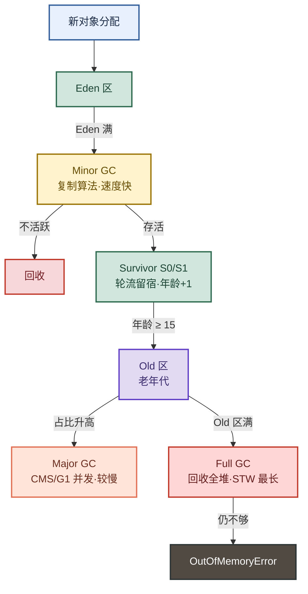
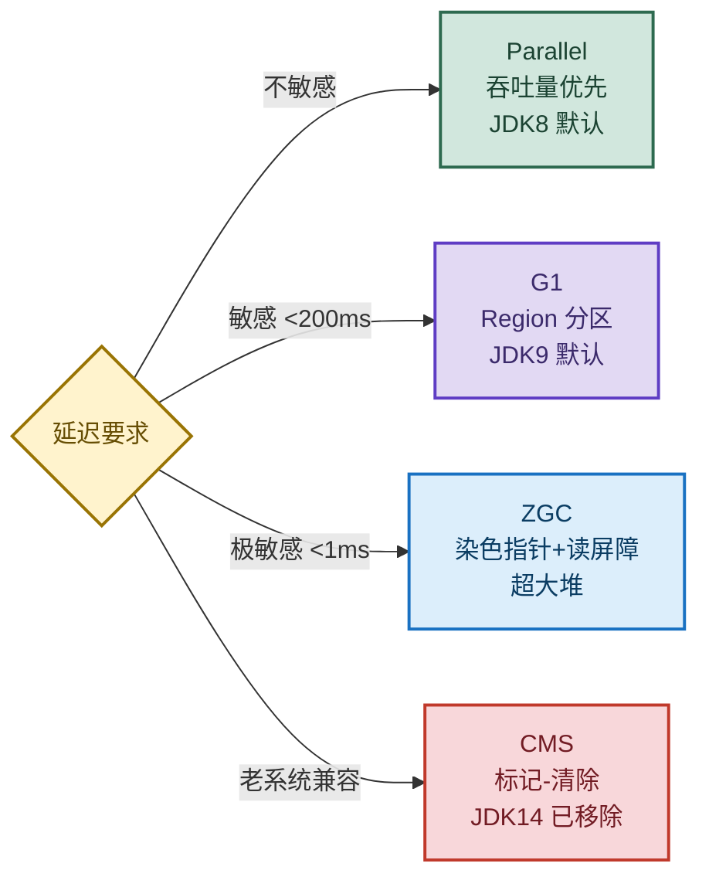

# JVM 垃圾回收：从判活到收集器选型的完整链路

> 目标：不背孤立名词。遇到 GC 题目先判断"问的是哪一层"——判活、算法、分代流程、还是收集器选型，再解释机制、取舍和调优手段。
>
> 读图顺序：先看下方"先记住这张总图"，再按问题回看各节。每节底部都有**易混点**或**速记**；先遮住解释自己讲，再对照正文。
>
> 本笔记以 JDK8/11 为主，JDK9+ 的 ZGC、G1 默认变化会在对应小节标注。

## 先记住这张总图

**一句话主线：**可达性分析判死活 → 新生代复制、老年代标记整理 → G1 分区控暂停、ZGC 染色读屏障超低延迟。

## 1. 为什么要做垃圾回收

GC 的两个核心职责：**分配**新对象内存 + **回收**不再被引用的对象内存。

- **分配**：为新对象找空间，保证程序能持续创建对象。
- **回收**：把不再被引用的对象内存还给堆，防止内存耗尽导致 OOM。
- **底线约束**：被引用的对象绝不能被错误回收——这是 GC 安全性的红线。

**易混点：**GC 不是"自动优化"。它保证内存可回收，但不保证程序正确；内存泄漏（对象不该存活却被引用）是代码问题，GC 救不了。

## 2. 如何判断对象需要回收

> 两种算法对比，记住"引用计数因循环引用已废弃，JVM 唯一用可达性分析"。

### 两种算法对比

| 算法 | 原理 | 优点 | 致命缺陷 | 记忆画面 |
|---|---|---|---|---|
| 计数法 | 被引用 +1，失效 -1，为 0 回收 | 简单、实时 | 循环引用（A 引 B、B 引 A）计数器永不为 0 | 计数器像"引用计数牌"，但两人互相举牌谁都不放下 |
| 可达性分析 | 从 GC Roots 出发，能到达的存活，否则回收 | 解决循环引用 | 需要 STW 标记 | 从根节点"走亲戚"，走不到的就是垃圾 |

JVM 唯一使用**可达性分析**，引用计数法已废弃。

### GC Roots 包含哪些

| 类型 | 来源 | 记忆钩子 |
|---|---|---|
| 栈帧本地变量 | 虚拟机栈（栈帧中的本地变量表） | 方法里的局部变量 |
| 静态属性 | 方法区中 static 字段 | 类级别的"全局变量" |
| 常量 | 方法区中的常量引用 | 字符串常量池、final static |
| JNI 引用 | 本地方法栈中 JNI 引用的对象 | C/C++ 代码持有的 Java 对象 |
| 活跃线程 | Thread 对象本身 | 每个线程都是根 |

**速记：**栈帧变量、静态属性、常量、JNI 引用、活跃线程——"栈、静、常、JNI、线程"五类。

**补充：**GC Roots 还可包含同步锁（synchronized）持有的对象，以及 JVM 内部引用（基本类型对应的 Class 对象、常驻异常对象、类加载器等）。面试答出前五类即可，补充项是加分项。

## 3. 四种垃圾回收算法

> 核心口诀：**新生代复制快，老年代标记整理稳，CMS 标记清除有碎片。**

### 四种算法对比

| 算法 | 核心逻辑 | 优点 | 缺点 | 记忆画面 |
|---|---|---|---|---|
| 标记-清除 | 标记存活 → 清除未标记 | 简单 | 内存碎片、效率不稳定 | 大扫除后留下碎纸屑 |
| 复制算法 | 内存分两块，存活对象复制到另一块，整块清理 | 无碎片、效率高 | 内存利用率只有 50% | 搬家：只搬活人，老房子整片拆 |
| 标记-整理 | 标记存活 → 存活对象向一端移动 → 清理边界外 | 无碎片 | 移动对象开销大 | 排队：所有人都往左挪，右边空出来 |
| 分代收集 | 不同区域用不同算法（新生代复制 + 老年代标记整理/清除） | 扬长避短 | 实现复杂 | 分班管理：新生班搬家，老生班排队 |

### 为什么新生代用复制、老年代用标记整理

| 区域 | 对象特征 | 选复制算法的原因 | 选标记整理的原因 |
|---|---|---|---|
| 新生代 | 对象朝生夕死（98% 活不过第一次 GC） | 存活对象少，复制成本低，50% 利用率可接受 | — |
| 老年代 | 对象存活率高 | — | 存活对象多，复制开销太大；且老年代空间大，利用率要拉满 |

**易混点：**复制算法不是"浪费一半内存"。新生代 `Eden:S0:S1` 默认 `8:1:1`（`-XX:SurvivorRatio=8`），实际可用 8/10 = 80%，S0/S1 轮流用，不是同时占满。

## 4. 分代回收完整流程

> 7 步走完对象一生：Eden → Survivor 轮换 → 年龄达标晋升 Old → Major GC → Full GC → OOM。

### 7 步流程

| 步骤 | 发生什么 | 关键参数 |
|---|---|---|
| 1 | 新对象 → Eden 区 | — |
| 2 | Eden 满 → Minor GC，存活 → S0 | — |
| 3 | Eden 再满 → Minor GC，Eden 存活 → S1，S0 存活 → S1 | S1 放不下 → 提前晋升 Old |
| 4 | S0/S1 轮流"留宿"，每熬过一次 GC 年龄 +1 | 阈值默认 15（`-XX:MaxTenuringThreshold`），CMS 为 6 |
| 5 | Old 区占比升高 → Major GC（只回收 Old，CMS/G1 并发） | — |
| 6 | Old 区满 → Full GC（回收全堆，STW 最长） | — |
| 7 | Full GC 后仍不够 → OutOfMemoryError | — |

### 容易混淆的概念

| 概念 | 范围 | 频率 | 速度 |
|---|---|---|---|
| Minor GC | 新生代 | 频繁 | 快 |
| Major GC | 老年代（CMS/G1 并发） | 较少 | 较慢 |
| Full GC | 整个堆 | 最少 | 最慢，STW 最长 |

**补充参数：**
- `Eden:Survivor0:Survivor1 = 8:1:1`，由 `-XX:SurvivorRatio` 控制。
- 晋升年龄由 `-XX:MaxTenuringThreshold` 控制（默认 15，CMS 为 6）。
- 大对象直接进入 Old 区（`-XX:PretenureSizeThreshold`），不经过 Eden。
- 动态年龄判定：Survivor 中相同年龄对象总和大于一半 Survivor 空间，大于等于该年龄的对象直接晋升。

## 5. 垃圾收集器怎么选

> 选型主线：**吞吐量优先 → Parallel；低延迟优先 → CMS → G1 → ZGC（越来越低）。** JDK8 默认 Parallel，JDK9+ 默认 G1。

### 收集器速查

| 收集器 | 线程模式 | 核心特点 | 暂停时间 | 适用场景 | 记忆画面 |
|---|---|---|---|---|---|
| Serial | 单线程 | 简单高效，Client 默认 | STW 较长 | 单核 CPU、内存小 | 一个人干活，慢但简单 |
| Parallel (PS+PO) | 多线程 | 吞吐量优先，Server 默认（JDK8） | STW 较长 | 离线批处理、后台任务 | 一群人埋头算，不管停顿 |
| CMS | 多线程并发 | 标记-清除，低延迟，有碎片 | STW 较短 | 中等堆、对延迟敏感 | 边工作边打扫，但留碎屑 |
| G1 | 多线程并发 | Region 分区，可预测停顿（默认 200ms） | STW 可控（50~200ms） | 高并发在线交易（4~64GB 堆） | 把堆切成格子，先扫最脏的 |
| ZGC | 多线程并发 | 染色指针 + 读屏障，超低延迟（<1ms） | STW 亚毫秒 | 金融交易、超大堆（>64GB） | 给内存"染色"，并发搬人 |

### 选型决策

| 场景线索 | 优先考虑 | 为什么 |
|---|---|---|
| 离线批处理、吞吐量第一 | Parallel | 不管停顿，算得快就行 |
| 高并发在线、延迟敏感（<200ms） | G1 | 可预测停顿，Region 分区灵活 |
| 超大堆（>64GB）、金融级低延迟（<1ms） | ZGC | 染色指针 + 读屏障，并发移动对象 |
| 老系统、中等堆、已稳定 | CMS | 历史默认，但 JDK14 已移除，新系统别用 |

**易混点：**CMS 在 JDK9 被标记 deprecated，JDK14 移除。新项目直接上 G1 或 ZGC，别再用 CMS。G1 不是"更好的 CMS"，它是不同架构（Region 分区 vs 连续老年代）。

## 6. 关键概念补充

| 概念 | 说明 | 为什么重要 |
|---|---|---|
| STW (Stop The World) | GC 时暂停所有用户线程 | 是延迟的根源，调优核心指标 |
| 吞吐量 | 业务代码时间 / (业务代码时间 + GC 时间) | Parallel 优化目标 |
| 内存泄漏 | 对象不再使用，但 GC Roots 仍持有引用 | OOM 常见根因，GC 救不了 |
| 空间分配担保 | Minor GC 前检查老年代剩余空间是否够容纳晋升对象，不够则提前触发 Full GC | 防止 Minor GC 后老年代放不下晋升对象 |

**速记：**STW 是延迟根源，吞吐量是 Parallel 目标，内存泄漏是 OOM 根因，空间分配担保是 Minor GC 前的"安检"。

## 高频场景题：用一句诊断开头

### "Full GC 频繁但内存没降，怎么查？"

先 `jstat -gcutil <PID> 1000` 看 O 区是否维持 90%+ 且 FGC 快速上涨——是的话大概率内存泄漏或 `-Xmx` 给小了。用 `jmap -dump:live,format=b,file=heap.hprof <PID>` 导出 Dump（注意 STW），MAT 打开看 Leak Suspects → Dominator Tree 找最大对象 → Path to GC Roots（排除弱/软引用）定位到具体代码行。

### "应用启动后 CPU 飙高，GC 日志正常，怎么查？"

GC 正常说明不是 GC 问题。用 `top -Hp <PID>` 找高 CPU 线程 ID（十进制）→ `printf "%x\n" <tid>` 转十六进制 → `jstack <PID>` 搜索该 nid，定位到具体代码行。大概率是死循环或密集计算。

### "线上接口超时，怀疑死锁，怎么确认？"

`jstack -l <PID>` 连续打 3~5 次，间隔几秒，对比输出。如果某两个线程反复处于 BLOCKED 且互相等待对方持有的锁，jstack 会在末尾直接打印 `Found one Java-level deadlock:`。

## 面试回答模板：三句话讲清一题

> **问题本质是……**（先说 GC 发生在哪一层：判活、算法、流程、还是收集器）。
>
> **机制是……**（解释原理 + 关键参数），因为……（为什么这样设计）。
>
> **调优时看……**（指标 + 工具），例如……（具体场景）。

例：问"为什么新生代用复制算法"——本质是对象朝生夕死，98% 活不过第一次 GC，存活对象少所以复制成本低；机制是 Eden 满触发 Minor GC，存活对象复制到 S0/S1，整块清理无碎片；参数上 `Eden:S0:S1=8:1:1`（`-XX:SurvivorRatio=8`），实际可用 80% 不是 50%。

## 最后复习：闭眼回忆 8 句

1. **判活**：JVM 唯一用可达性分析，从 GC Roots 出发，走不到的回收；引用计数因循环引用已废弃。
2. **GC Roots**：栈帧变量、静态属性、常量、JNI 引用、活跃线程——"栈、静、常、JNI、线程"。
3. **算法**：新生代复制（无碎片但费空间），老年代标记整理（无碎片但移动开销），CMS 标记清除（有碎片）。
4. **分代**：Eden → S0/S1 轮换 → 年龄 ≥15 晋升 Old → Major GC → Full GC → OOM。
5. **参数**：`SurvivorRatio=8`（Eden:S0:S1=8:1:1），`MaxTenuringThreshold=15`（CMS 为 6）。
6. **收集器**：Parallel 吞吐量优先（JDK8 默认），G1 控暂停 200ms（JDK9 默认），ZGC 亚毫秒（超大堆）。
7. **易混**：Minor GC 新生代快，Major GC 老年代慢，Full GC 全堆最慢 STW 最长；CMS JDK14 移除。
8. **调优**：`jstat` 看 GC 频率，`jmap` 导出 Dump，MAT 分析泄漏；关注 FGC 次数和 STW 时长。

## 怎么练才记得住

别反复通读，改成主动回忆：

1. 每次只看一个小节，遮住表格，先自己说出"算法 → 原理 → 优缺点 → 适用场景"，再对照。
2. 用"高频场景题"的 3 道题各讲 30 秒；卡住时只回看对应小节。
3. 隔天再讲一遍，换成自己的项目例子；能解释"为什么选这个收集器、为什么参数这么设"才算会。
4. 复习时轮流画"分代回收 7 步流程"和"收集器选型决策表"；能默写出参数和阈值才算熟。
