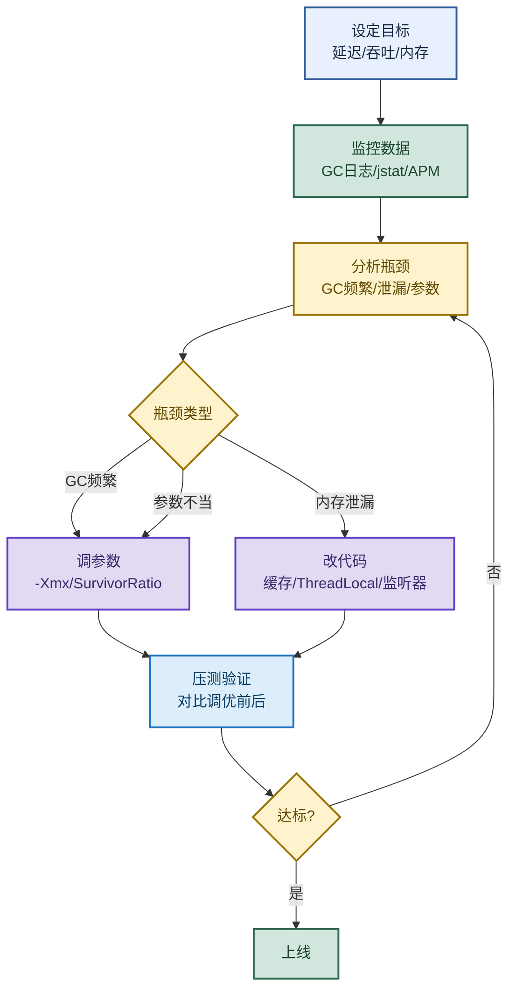

# JVM 面试深度追问：从 G1/ZGC 原理到线上故障排查

> 目标：不背孤立名词。遇到 JVM 深度追问先判断"问的是哪一层"——底层原理（G1/ZGC/晋升/JIT）、故障排查（CPU/OOM/Full GC）、工具链（Arthas/MAT）、参数选型，再展开机制和实战。
>
> 读图顺序：先看下方"先记住这张总图"（JVM 调优工程化闭环），再按问题回看各节。每节底部都有**易混点**或**速记**；先遮住解释自己讲，再对照正文。
>
> 本笔记覆盖 G1/ZGC 原理 + 对象晋升 + JIT 逃逸分析 + OOM 定位 + MAT 四步 + Arthas 命令 + 收集器选型。

## 先记住这张总图

**一句话主线：**G1 Region 分区垃圾优先控停顿，ZGC 染色指针读屏障亚毫秒；对象晋升看年龄/大对象/Survivor/动态年龄；调优走工程化闭环——设目标→监控→分析→调参/改码→压测验证。

## 1. G1 收集器工作原理

> 记忆口诀：**Region 分块，垃圾优先，时间一到，立马停手。**

| 核心设计 | 说明 | 面试关键词 |
|---|---|---|
| Region 划分 | 堆分为约 2048 个等大小 Region（1~32MB），不再有连续年轻代/老年代 | Region、分区 |
| 可预测停顿 | 每次只选垃圾最多的 Region 清理（Garbage-First），时间到了就停 | Garbage-First、MaxGCPauseMillis |
| 停顿模型 | 用户设定 `-XX:MaxGCPauseMillis`（默认 200ms），JVM 动态调整 | 软实时、目标暂停 |

**易混点：**G1 不是"更好的 CMS"。CMS 是连续老年代 + 标记清除（有碎片），G1 是 Region 分区 + 标记整理（无碎片），架构完全不同。G1 通过"只扫最脏的 Region"实现可预测停顿，不是"扫得更快"。

## 2. ZGC 超低延迟原理

> 记忆口诀：**有色指针贴标签，读屏障自动导航，用户不停顿，移动无感知。**

| 核心设计 | 说明 | 面试关键词 |
|---|---|---|
| 染色指针 | 对象引用中编码额外状态信息（标记、重定位等） | 染色指针、Colored Pointers |
| 读屏障 | 用户线程读对象时，如果对象被移动了，自动重定向到新地址 | Load Barrier、并发移动 |
| 并发整理 | 标记、移动、重定位全部与用户线程并发执行 | STW < 1ms、亚毫秒级 |

**易混点：**ZGC 的"亚毫秒级停顿"靠的是染色指针 + 读屏障实现并发移动对象，不是"GC 跑得更快"。读屏障在用户线程读对象时自动修正指针，所以用户线程几乎不感知移动。代价是读屏障有微小开销，适合超大堆（>64GB）场景。

## 3. 对象晋升机制

> 记忆口诀：**年龄到、对象大、放不下、同龄过半**——4 种提前进老年代的情况。

| 晋升方式 | 触发条件 | 关键参数 |
|---|---|---|
| 年龄阈值 | 熬过 15 次 Minor GC | `-XX:MaxTenuringThreshold=15` |
| 大对象直接分配 | 对象大小超过阈值 | `-XX:PretenureSizeThreshold`（仅 Serial/ParNew）；G1 中为 G1HeapRegionSize 的一半 |
| Survivor 空间不足 | Minor GC 后存活对象放不下 Survivor | 空间分配担保失败 → Promotion failed |
| 动态年龄判定 | Survivor 中同龄对象总大小 ≥ Survivor 区一半 | 此年龄及以上对象全部晋升 |

**易混点：**动态年龄判定不是"年龄到 15 才晋升"。Survivor 中相同年龄对象总和大于一半 Survivor 空间，大于等于该年龄的对象直接晋升——所以可能 3 岁就全部晋升了，不用等到 15。

## 4. JIT 编译与逃逸分析

| 概念 | 说明 | 面试关键词 |
|---|---|---|
| JIT 编译器 | 热点代码编译为本地机器码并缓存，避免重复解释执行 | C1（快速编译）、C2（激进优化）、分层编译 |
| 逃逸分析 | 分析对象是否逃逸出方法或线程 | 不逃逸、方法逃逸、线程逃逸 |
| 栈上分配（效果） | 不逃逸对象直接在栈上分配，方法结束即销毁 | 减轻 GC 压力 |
| 标量替换（核心） | 将对象字段拆解为独立标量，在栈/寄存器中直接使用 | 替代栈上分配、`-XX:+DoEscapeAnalysis`（JDK8 默认开启） |

**易混点（面试陷阱）：**HotSpot **没有独立实现栈上分配**，而是通过**标量替换**达到类似效果！说"栈上分配"时要补一句"实际是标量替换实现的"，否则面试官会追问。

## 5. OOM 精准定位

> 不同 OOM 类型对应不同根因，先看异常消息关键字再选工具。

| OOM 类型 | 异常消息关键字 | 诊断工具 | 典型根因 |
|---|---|---|---|
| 堆溢出 | `Java heap space` | `jstat -gcutil` 看 E/O 区满 | 内存泄漏、大对象过多 |
| 元空间溢出 | `Metaspace` | `jstat` 看 MU 接近 100% | 动态类加载泄漏（CGLIB/热部署） |
| 直接缓冲区溢出 | `Direct buffer memory` | `jcmd NMT` 或 Arthas | Netty/DirectByteBuffer 未释放 |
| GC 开销超限 | `GC overhead limit exceeded` | 堆快满时的保护机制 | GC 回收效率极低 |

**速记：**`Java heap space` 看堆，`Metaspace` 看元空间，`Direct buffer` 看堆外，`GC overhead` 是保护机制——四种 OOM 四种根因。

## 6. MAT 定位内存泄漏 · 4 步走

| 步骤 | 工具 | 做什么 |
|---|---|---|
| ① | Leak Suspects Report | 看自动报告，找可疑大对象 |
| ② | Dominator Tree | 按 Retained Heap 排序，找最大对象 |
| ③ | Histogram + Path to GC Roots | 排除弱/软引用，追到持有强引用的代码 |
| ④ | OQL 精确查询 | `SELECT * FROM byte[] WHERE length > 1MB` |

**常见泄漏场景：**HashMap/ArrayList 无界缓存、ThreadLocal 未 remove、监听器未注销。

**易混点：**Path to GC Roots 必须**排除弱/软/虚引用**，只看强引用链。弱/软/虚引用会被 GC 正常回收，不是泄漏根因；只有强引用链持有才是真正的泄漏。

## 7. Arthas 核心命令速查

> 记忆口诀：**watch 看现场，trace 找瓶颈，tt 回放，thread 抓热点。**

| 命令 | 作用 | 示例 |
|---|---|---|
| `watch` | 观测方法入参/返回值/异常 | `watch com.xxx.Service method "{params, returnObj}" -x 2 -e` |
| `trace` | 跟踪调用链路耗时 | `trace com.xxx.Service method 'cost>100'` |
| `tt` | 记录并回放调用 | `tt -t Service.method` → `tt -i <index> -p` |
| `thread -n 5` | 查看最忙的 5 个线程 | `thread -n 5` |
| `dashboard` | 实时总览（CPU/内存/线程） | `dashboard` |

## 8. 垃圾收集器选型策略

| 业务场景 | 首选收集器 | 备选 | 核心目标 |
|---|---|---|---|
| 离线批处理 | Parallel GC | G1（大堆） | 吞吐量优先，允许秒级暂停 |
| 高并发在线交易 | G1 | ZGC（超大堆） | 暂停 < 200ms |
| 金融敏感接口 | ZGC / Shenandoah | G1（JDK8） | 暂停 < 10ms，甚至 < 1ms |

**易混点：**离线批处理用 Parallel 保吞吐量（允许秒级暂停），高并发在线用 G1 控暂停（200ms），金融敏感用 ZGC 追亚毫秒——选型看业务对延迟的敏感度，不是"越新越好"。

## 高频场景题：用一句诊断开头

### "Full GC 频繁怎么排查？"

先 `jstat -gcutil <PID> 1s 10` 看 FGC 增长速度和 FGCT 占比，`jmap -histo:live <PID> | head -20` 看存活对象分布（注意会触发 FGC），再 `jmap -dump:live,format=b,file=heap.hprof` 导出 Dump。判断类型：老年代不降是内存泄漏（修缓存/ThreadLocal/监听器），老年代降大部分是 Survivor 太小（调 `-XX:SurvivorRatio`），元空间不动是类加载器泄漏（查热部署/CGLIB），FGC 频繁但老年代不高是 System.gc()（加 `-XX:+DisableExplicitGC`）。

### "为什么 -Xms = -Xmx？"

动态扩容有隐患：扩容带来内存申请、缺页中断、GC 暂停增加；缩容带来内存重分配、对象移动、CPU 额外消耗；堆大小变化还导致 GC 日志难解读、问题难复现。生产原则是宁可"浪费"一点内存，也不要不可预测的性能抖动。

## 面试回答模板：三句话讲清一题

> **问题本质是……**（先说问的是哪一层：原理、排查、工具、选型）。
>
> **机制是……**（解释原理 + 关键参数），因为……（为什么这样设计）。
>
> **实战中我会……**（工具 + 动作 + 看什么指标），例如……（具体场景）。

例：问"G1 为什么能控停顿"——本质是 Region 分区 + Garbage-First 策略；机制是堆分约 2048 个 Region，每次只选垃圾最多的 Region 清理，用户设定 `-XX:MaxGCPauseMillis`（默认 200ms），时间到了就停；实战中高并发在线交易用 G1 控暂停，离线批处理用 Parallel 保吞吐量，金融敏感接口用 ZGC 追亚毫秒。

## 最后复习：闭眼回忆 8 句

1. **G1 原理**：Region 分区（约 2048 个，1~32MB）+ Garbage-First（只扫最脏的）+ MaxGCPauseMillis（默认 200ms）。
2. **ZGC 原理**：染色指针（编码状态）+ 读屏障（自动重定向）+ 并发整理，STW < 1ms。
3. **对象晋升**：年龄到 15、大对象直接进、Survivor 放不下、同龄过半——4 种提前进老年代。
4. **JIT 逃逸分析**：HotSpot 没有独立栈上分配，靠标量替换实现；`-XX:+DoEscapeAnalysis` JDK8 默认开启。
5. **OOM 四类**：Java heap space（堆）、Metaspace（元空间）、Direct buffer（堆外）、GC overhead（保护机制）。
6. **MAT 四步**：Leak Suspects → Dominator Tree → Path to GC Roots（排除弱/软引用）→ OQL。
7. **Arthas 口诀**：watch 看现场，trace 找瓶颈，tt 回放，thread 抓热点。
8. **选型**：Parallel 吞吐量、G1 控 200ms、ZGC 亚毫秒；-Xms=-Xmx 避免动态扩容。

## 怎么练才记得住

别反复通读，改成主动回忆：

1. 每次只看一个收集器，遮住表格，先自己说出"原理 → 关键参数 → 适用场景"，再对照。
2. 用"OOM 四类"和"Full GC 排查"各讲 30 秒；卡住时只回看对应小节。
3. 隔天再讲一遍，换成自己的线上事故例子；能解释"为什么 G1 不是更好的 CMS"才算会。
4. 复习时轮流画"调优工程化闭环图"和"收集器选型表"；能默写出每个收集器的暂停目标才算熟。
