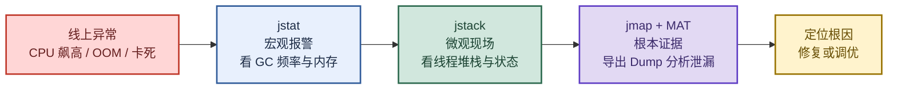
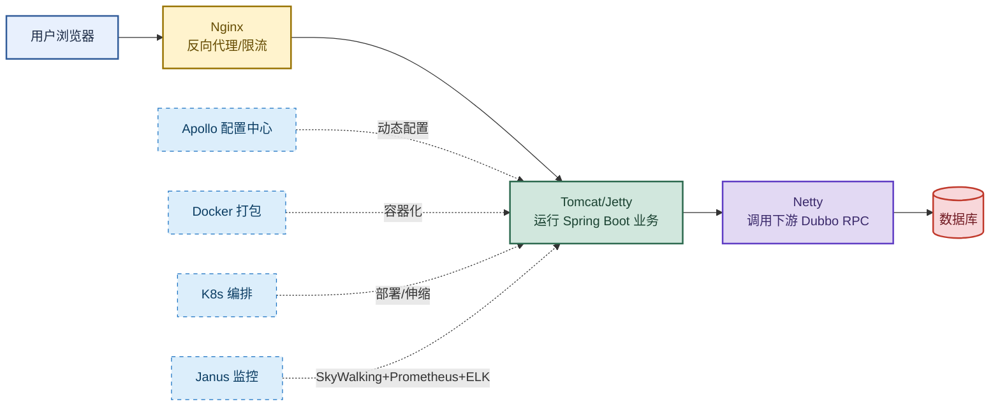

# JVM 排障工具与微服务全链路：从宏观报警到根本证据

> 目标：遇到线上问题先判断"该用哪个工具、看什么指标、定位到哪一层"，再解释机制和根因。
>
> 读图顺序：先看下方"先记住这张总图"（排障思路三剑客），再按问题回看各节。每节底部都有**易混点**或**速记**；先遮住解释自己讲，再对照正文。
>
> 本笔记覆盖 JVM 四大排障工具（jstat/jmap/jstack/MAT）+ Arthas 在线诊断 + 微服务全链路架构（Apollo/Docker/K8s/Nginx/Tomcat/Netty/Janus）。

## 先记住这张总图



**一句话主线：**jstat 宏观报警 → jstack 微观现场 → jmap 导出 Dump 用 MAT 分析 → 定位根因。Arthas 是不重启应用的在线诊断利器，整合了前三者功能。

## 1. 四大排障工具分工

> 每个工具有明确分工：jstat 看板、jmap 快照、jstack 线程、MAT 分析。先选对工具再动手。

| 工具 | 角色 | 核心能力 | 典型命令 | 记忆画面 |
|---|---|---|---|---|
| jstat | 实时看板 | 监控 GC、类加载、JIT 编译 | `jstat -gcutil <PID> 5000 100` | 仪表盘：实时看水位 |
| jmap | 内存快照 | 导出 Heap Dump（触发 STW） | `jmap -dump:live,format=b,file=heap.hprof <PID>` | X 光片：拍一张堆的"照片" |
| jstack | 线程堆栈 | 打印 Thread Dump，查死锁/CPU/卡死 | `jstack -l <PID> > dump.txt` | 线程 X 光机：看每个线程在哪一行 |
| MAT | 堆分析 | 分析 .hprof，定位内存泄漏 | GUI 打开 .hprof | 法医：解剖找"死因" |

**易混点：**jmap 导出 Dump 会触发 STW（暂停应用），生产环境慎用；Arthas 的 `heapdump` 命令也是类似效果。优先用 jstat + jstack 做非侵入式诊断，最后才用 jmap 导出 Dump。

## 2. jstat：实时看板怎么读

> 核心：看 FGC 频率、O 区水位、M 区水位三个关键指标。

### 典型命令与输出

```bash
jstat -gcutil 25048 5000 100
# 每 5 秒输出一次，共 100 次
S0     S1     E      O      M     CCS    YGC     YGCT    FGC    FGCT     GCT
0.00  67.08  32.43  80.15  93.55  87.09  691    4.923   397  10.099  15.022
```

### 各列含义

| 列 | 含义 | 关注点 |
|---|---|---|
| S0 / S1 | 两个 Survivor 区使用率 | Minor GC 后其中一个应清零 |
| E | Eden 区使用率 | 快速增长是正常分配 |
| O | 老年代使用率 | **关键**：是否维持 90%+ 不降 |
| M | 元空间使用率 | **关键**：是否逼近 100% |
| CCS | 压缩类空间使用率 | 同 M，类元数据 |
| YGC / YGCT | Young GC 次数 / 累计耗时 | 频率高但单次快是正常的 |
| FGC / FGCT | Full GC 次数 / 累计耗时 | **关键**：FGC 频繁且 FGCT 增长快 = 危险信号 |
| GCT | GC 总耗时 | 整体 GC 开销 |

### 三个异常信号

| 信号 | 现象 | 根因 | 处置 |
|---|---|---|---|
| FGC 频繁 | FGC 列快速上涨，FGCT 增长快 | 堆分配极快，老年代无法有效回收 | 先 jmap 导出 Dump 分析，别盲目调参 |
| O 区不降 | O 回收后降一点又回升 | 老年代有大量无法回收对象（泄漏嫌疑） | MAT 分析找泄漏 |
| M 区逼近 100% | M 列持续 98~100%，FGC 频繁但降不下来 | 动态类加载泄漏（CGLib/Groovy/JSP） | 调大 `-XX:MaxMetaspaceSize` 或排查类加载器 |

**速记：**看 jstat 就盯三个数——**FGC 频率、O 区水位、M 区水位**。三个都异常 = 内存泄漏，先导出 Dump。

## 3. jstack：线程堆栈三大场景

> 三个场景：CPU 飙高、应用卡死、怀疑死锁。每个场景有固定操作套路。

### 场景一：线上 CPU 飙高

| 步骤 | 操作 | 说明 |
|---|---|---|
| 1 | `top -Hp <PID>` | 找高 CPU 线程 ID（十进制） |
| 2 | `printf "%x\n" <tid>` | 转十六进制 |
| 3 | `jstack <PID>` | 在输出中搜索该十六进制 nid |
| 4 | 定位代码行 | 大概率死循环或密集计算 |

### 场景二：应用卡死 / 接口超时

| 步骤 | 操作 | 说明 |
|---|---|---|
| 1 | `jstack <PID> > dump1.txt` | 连续打 3~5 次，间隔几秒 |
| 2 | 对比多次输出 | 哪些线程始终存在且状态不变 |
| 3 | 看 BLOCKED / WAITING | 大量线程等同一把锁 = 锁竞争或死锁 |

### 场景三：怀疑死锁

| 步骤 | 操作 | 说明 |
|---|---|---|
| 1 | `jstack -l <PID>` | `-l` 打印锁信息 |
| 2 | 看输出末尾 | 若死锁，直接打印 `Found one Java-level deadlock:` |
| 3 | 定位互等线程 | jstack 帮你圈出哪两个线程在互相等待 |

**补充：**线程 ID 十进制转十六进制用 `printf "%x\n" <tid>`；jstack 输出中线程的 `nid` 字段就是十六进制线程 ID。

## 4. jmap + MAT：内存泄漏定位三板斧

> jmap 拍"X 光片"，MAT 做"法医解剖"。三板斧：Leak Suspects → Dominator Tree → Path to GC Roots。

### 导出 Dump

```bash
jmap -dump:live,format=b,file=heap.hprof <PID>
# 注意：-dump:live 会先触发一次 Full GC，只导出存活对象
# 导出过程会 STW（暂停应用），生产环境谨慎
```

### MAT 三板斧

| 步骤 | 工具 | 做什么 | 看什么 |
|---|---|---|---|
| 1 | Leak Suspects Report | 整体印象 | MAT 自动分析的泄漏嫌疑 |
| 2 | Histogram / Dominator Tree | 找"大对象"或"多对象" | 占用内存最大的对象是什么 |
| 3 | Path to GC Roots | 顺引用链找代码位置 | 排除弱/软/虚引用，只看强引用链 |

**Path to GC Roots 原理：**展示对象到 GC Roots 的引用链。若本应回收的对象可经此路径到达 GC Roots，说明被**强引用链**持有，无法回收 → 内存泄漏。操作：在 Dominator Tree 中右键怀疑对象 → Merge Shortest Paths to GC Roots → 勾选 exclude all phantom/weak/soft etc. references。

## 5. Arthas：在线救火队长

> 不重启应用，整合 jstat/jstack/jmap 功能，交互式诊断。生产环境首选。

### 经典案例：CPU 飙高排查

| 步骤 | 命令 | 发现 |
|---|---|---|
| 1 | `dashboard` | `pool-7-thread-1` CPU 持续 90%+ |
| 2 | `thread <线程ID>` | 卡在 `java.util.regex.Pattern` 正则匹配 |
| 3 | `watch com.example.aop.LogAspect cutMethod '{params}'` | 100KB 超长字符串触发**正则回溯爆炸** |

**优势：**
- 不重启应用，线上实时诊断。
- 整合 jstat/jstack/jmap 功能，`thread -n5`、`dashboard` 等命令无需记忆参数和线程 ID 转换。
- 轻量敏捷，下载 `arthas-boot.jar` 即可运行，只有终端权限的生产服务器也能用。

## 6. 微服务全链路架构

> 一个标准微服务架构的流量路径：浏览器 → Nginx → Tomcat/Jetty → Netty → 数据库。配置用 Apollo，打包用 Docker，编排用 K8s，监控用 Janus。

### 流量入口与 Web 容器

| 组件 | 语言 | 职责 | 特点 | 记忆画面 |
|---|---|---|---|---|
| Nginx | C | 反向代理、负载均衡、限流熔断 | NIO 事件驱动，并发强、内存极低 | 大门保安：挡恶意流量、分发给后厨 |
| Apache | C | Web 服务器、反向代理 | 进程/线程驱动，功能丰富但高并发耗资源 | 老牌餐厅：功能全但人手多 |
| Tomcat | Java | 标准 Servlet 容器 | Spring Boot 默认内嵌 | 后厨：真正做菜（跑业务） |
| Jetty | Java | Servlet 容器 | 更轻量、启动极快，适合嵌入式 | 快闪店：开得快、关得快 |
| Netty | Java | 高性能 NIO 网络框架 | 可自定义 TCP/UDP/HTTP/WebSocket 协议 | 内部专线：服务间高速通信 |

### 微服务协同链路



### 配置与容器编排

| 组件 | 职责 | 核心机制 | 记忆画面 |
|---|---|---|---|
| Apollo | 分布式配置中心 | 长连接推送 + 定时拉取兜底 + 本地文件缓存 | 配置"快递"：改了实时送达，快递站（本地缓存）兜底 |
| Docker | 容器引擎 | 镜像（打包）→ 容器（运行）→ 仓库（分发） | 集装箱：统一打包，到哪都能跑 |
| K8s | 容器编排 | 自动化部署、弹性伸缩、负载均衡、服务发现、故障自愈 | 港口调度：管多个集装箱的进出、堆放、补货 |

### Janus 统一监控

| 维度 | 技术 | 存什么 |
|---|---|---|
| 链路追踪 | SkyWalking | 请求在微服务间的流向（trace） |
| 指标监控 | Prometheus / InfluxDB | 时序数据（QPS/RT/错误率） |
| 日志分析 | ELK（Elasticsearch + Logstash + Kibana） | 日志采集、检索、分析 |

## 排障场景速查表

> 线上出问题，先对号入座：看现象 → 选工具 → 执行动作 → 定位根因。

| 异常现象 | 第一反应工具 | 核心排查动作 | 最终定位依据 | 经典根因 |
|---|---|---|---|---|
| CPU 持续飙高（100%） | `top -Hp` + `jstack`（或 Arthas `thread -n5`） | top -Hp 找线程 ID → 转十六进制 → jstack 搜索 | 找到 runnable 线程，定位到具体代码行 | 死循环 / 正则回溯爆炸 |
| 内存不断增长直到 OOM | `jmap` + MAT | jmap 导出 Dump → MAT 看 Leak Suspects | Dominator Tree 找最大对象，Path to GC Roots（排除弱/软引用） | 内存泄漏（HashMap 持有关闭资源、ThreadLocal 未 remove） |
| 应用卡死 / 接口超时 | `jstack -l`（连续 3~5 次） | 连续多次打印线程栈，对比哪些线程始终存在 | 大量线程 BLOCKED / WAITING，等同一把锁 | 死锁或活锁 |
| Full GC 频繁但内存没降 | `jstat -gcutil` | 看 FGC 列快速上涨，O 回收后几乎不降 | 老年代维持 90%+，YGC 后大量对象直接升代 | 内存泄漏（大对象无法回收）或堆分配不足（-Xmx 给小了） |
| 元空间（Metaspace）报警 | `jstat -gcutil`（看 M 列） | M 列持续 98~100%，FGC 频繁但降不下来 | 检查是否动态生成大量类（CGLib/Groovy/JSP） | 动态类加载泄漏（类加载器未卸载） |

## 高频场景题：用一句诊断开头

### "线上 CPU 飙高到 100%，怎么查？"

先 `top -Hp <PID>` 找高 CPU 线程 ID（十进制），`printf "%x\n" <tid>` 转十六进制，`jstack <PID>` 搜索该 nid 定位到具体代码行。大概率死循环或密集计算。生产环境如果不想多次执行 jstack，直接上 Arthas `dashboard` → `thread -n5` 看最忙线程 → `thread <ID>` 看堆栈。

### "内存持续增长直到 OOM，怎么定位？"

`jmap -dump:live,format=b,file=heap.hprof <PID>` 导出 Dump（注意 STW），MAT 打开看 Leak Suspects Report → Dominator Tree 找最大对象 → Path to GC Roots（排除弱/软引用）定位到具体代码行。常见根因：HashMap/List 持有已关闭资源、ThreadLocal 未 remove、静态集合无限增长。

### "应用卡死、接口全部超时，怎么确认是不是死锁？"

`jstack -l <PID>` 连续打 3~5 次，间隔几秒，对比输出。若某两个线程反复 BLOCKED 且互相等待对方持有的锁，jstack 末尾会直接打印 `Found one Java-level deadlock:`，并圈出互等线程。

## 面试回答模板：三句话讲清一题

> **问题现象是……**（先说症状：CPU/OOM/卡死/GC 频繁）。
>
> **我的排查路径是……**（工具 + 动作 + 看什么指标），因为……（为什么这个工具适合这个场景）。
>
> **根因是……**，修复方案是……（代码修复 / 参数调优 / 架构调整）。

例：问"Full GC 频繁怎么排查"——现象是 FGC 列快速上涨、O 区维持 90%+ 不降；排查路径是先 jstat 确认宏观报警，再 jmap 导出 Dump 用 MAT 分析，因为 FGC 频繁且 O 不降大概率是内存泄漏而非参数问题；根因可能是 HashMap 持有已关闭连接导致对象无法回收，修复方案是排查代码中资源未关闭的问题，而非盲目调大 -Xmx。

## 最后复习：闭眼回忆 8 句

1. **四工具分工**：jstat 看板（GC/类加载/JIT）、jmap 快照（Heap Dump，STW）、jstack 线程（Thread Dump）、MAT 分析（.hprof 泄漏定位）。
2. **jstat 三看**：FGC 频率、O 区水位、M 区水位。三个都异常 = 内存泄漏。
3. **jstack 三场景**：CPU 飙高（top -Hp → 转十六进制 → 搜索）、卡死（连续 3~5 次对比）、死锁（-l 自动检测，Found one Java-level deadlock）。
4. **MAT 三板斧**：Leak Suspects 看全局 → Dominator Tree 找大对象 → Path to GC Roots（排除弱/软引用）追到代码行。
5. **Arthas 优势**：不重启应用、整合 jstat/jstack/jmap、交互式、arthas-boot.jar 即用。
6. **排障主线**：jstat 宏观报警 → jstack 微观现场 → jmap+MAT 根本证据。
7. **微服务链路**：浏览器 → Nginx（限流）→ Tomcat（业务）→ Netty（RPC）→ DB；Apollo 配置、Docker 打包、K8s 编排、Janus 监控。
8. **易混**：jmap 导出 Dump 会 STW，生产慎用；优先 jstat+jstack 非侵入式诊断；Arthas 是生产首选（不重启）。

## 怎么练才记得住

别反复通读，改成主动回忆：

1. 每次只看一个工具，遮住表格，先自己说出"工具 → 命令 → 看什么指标 → 异常信号"，再对照。
2. 用"排障场景速查表"的 5 个场景各讲 30 秒；卡住时只回看对应小节。
3. 隔天再讲一遍，换成自己的线上事故例子；能解释"为什么先用 jstat 而不是直接 jmap"才算会。
4. 复习时轮流画"排障三剑客"流程图和"微服务链路图"；能默写出每个工具的核心命令和看什么列才算熟。
