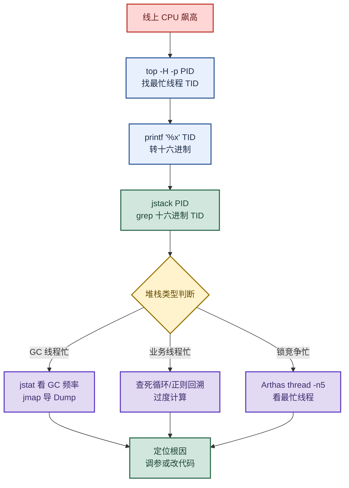

# JVM 调优：从 CPU 飙升定位到内存模型与参数调优

> 目标：遇到性能问题先判断"是哪一类元凶"——代码、并发、IO、配置、流量，再选工具、看指标、定根因。
>
> 读图顺序：先看下方"先记住这张总图"（CPU 飙升 5 步定位法），再按问题回看各节。每节底部都有**易混点**或**速记**；先遮住解释自己讲，再对照正文。
>
> 本笔记覆盖 CPU 飙升 5 大元凶 + 5 步定位法 + JVM 参数调优 + 问题类型判断 + JVM 内存模型。

## 先记住这张总图

**一句话主线：**CPU 飙高先 top 找进程 → top -H 找线程 → 转十六进制 → jstack 定位代码行 → 按堆栈类型对症下药；调优看 GC 现象猜根因，参数上 `-Xms=-Xmx` 避免动态扩容。

## 1. CPU 飙升的 5 大元凶

> 记忆口诀：**码线多外配**——码（代码逻辑）、线（线程并发）、多（流量激增）、外（外部 IO）、配（JVM 配置）。

| 类别 | 典型场景 | 一句话根因 |
|---|---|---|
| ① 代码逻辑问题 | `while(true)` 死循环、正则灾难性回溯、频繁创建临时对象引发 GC | 线程在疯狂运算或频繁 GC，CPU 全被吃掉 |
| ② 多线程并发问题 | CAS 自旋锁反复失败、线程池过大导致频繁上下文切换 | 线程在空转等待或频繁切换，CPU 空耗 |
| ③ 外部资源调用 | 日志打印过多、频繁磁盘 IO/网络 IO | 频繁用户态↔内核态切换，系统调用开销大 |
| ④ JVM 配置问题 | 堆内存太小频繁 GC、栈内存太小、JIT 编译过热 | GC 线程占用大量 CPU，或 JIT 编译过热 |
| ⑤ 流量激增 | 秒杀/大促流量暴涨、监控工具/日志轮转脚本抢占 CPU | 请求量过大，工作线程飙升，超出系统承载 |

**易混点：**CPU 飙高不一定是业务代码问题。GC 线程忙（堆太小）、锁竞争空转（线程池过大）、系统进程抢占（监控脚本）都会让 CPU 飙高。先 `top` 看是 java 进程自身占高还是系统进程，再决定排查方向。

## 2. CPU 飙升 · 5 步定位法

> 记忆口诀：**进→线→转→栈→判**（进程→线程→转 16 进制→堆栈→判断）。

| 步骤 | 命令 | 做什么 |
|---|---|---|
| 1 | `top` / `htop` | 找出高 CPU 进程 PID |
| 2 | `top -H -p <PID>` | 找出该进程内高 CPU 线程 TID |
| 3 | `printf "%x\n" <TID>` | 线程 ID 转十六进制 |
| 4 | `jstack <PID> \| grep -A 30 <十六进制TID>` | 定位该线程正在执行的代码行 |
| 5 | 按堆栈类型判断 | GC 线程→jstat；业务线程→查死循环；锁竞争→Arthas |

**速记：**`top -H -p` 找线程，`printf "%x"` 转十六进制，`jstack | grep` 定位代码行，三步锁定元凶。

## 3. JVM 优化核心命令

> 面试必问：`-Xms`/`-Xmx` 区别、`-XX:+DisableExplicitGC` 作用、jstat/jmap/jstack 分工。

### 常用参数速查

| 命令/参数 | 作用 | 示例 |
|---|---|---|
| `java -X` | 查看非标准参数列表 | `java -X` |
| `-Xms` / `-Xmx` | 堆内存初始值 / 最大值 | `java -Xms512m -Xmx2048m TestJVM` |
| `-XX:+DisableExplicitGC` | 禁用 `System.gc()` 调用（防止人为触发 FGC） | `-XX:+DisableExplicitGC` |
| `jstat -gcutil` | 实时查看 GC 状态 | `jstat -gcutil 25048 5000 100` |
| `jmap -dump` | 导出堆内存快照（会 STW） | `jmap -dump:live,format=b,file=heap.hprof 25048` |

### 堆内存参数调优原则

| 参数 | 建议值 | 原因 |
|---|---|---|
| `-Xms` = `-Xmx` | 设为相同 | 避免运行时动态扩容/缩容带来的性能损耗 |
| `-Xmx` | 物理内存的 60%~70% | 留出空间给元空间、栈内存、操作系统 |
| 新生代占比 | 堆的 1/3 ~ 1/4 | 避免新生代太大导致 YGC 时间过长 |

**易混点：**`-Xms` 和 `-Xmx` 设为相同不是"浪费内存"，而是避免堆动态扩容时的内存申请、缺页中断、GC 暂停增加。生产环境宁可"浪费"一点内存，也不要不可预测的性能抖动。

## 4. 问题类型快速判断

> 记忆口诀：**泄不降，快降半，元不动，频不高**——对应四种 GC 现象。

| 观察现象 | 根因 | 应对策略 |
|---|---|---|
| 老年代持续增长，FGC 后几乎不降 | 内存泄漏（强引用链未断开） | 导出 Heap Dump → MAT 找 GC Roots |
| 老年代增长快，FGC 后回收大部分 | 临时对象晋升过快 / Survivor 区太小 | 调大新生代或 Survivor 区比例 |
| 元空间持续增长，FGC 无法回收 | 类加载器泄漏（动态生成类未卸载） | 检查 CGLib 代理/热部署场景 |
| FGC 频繁，但老年代占用不高 | 代码中调用了 `System.gc()` | 加 `-XX:+DisableExplicitGC` 禁用 |

**易混点：**"FGC 后老年代不降"是内存泄漏，"FGC 后老年代降大部分"是晋升过快——前者要查代码找泄漏，后者要调 Survivor 比例，方向完全不同。

## 5. JVM 内存模型

> 结构速记：线程私有（程序计数器、虚拟机栈）+ 线程共享（堆、方法区）。

### 线程私有（随线程生灭）

| 区域 | 作用 |
|---|---|
| 程序计数器 | 记录当前线程执行到哪一行字节码 |
| 虚拟机栈 | 执行 Java 方法，每个方法对应一个栈帧（含局部变量表、操作数栈等） |

### 线程共享（所有线程共用）

| 区域 | 作用 | 关键点 |
|---|---|---|
| Java 堆（Heap） | 存放几乎所有对象实例和数组 | GC 主要发生地，分新生代和老年代 |
| 方法区 | 存储类信息、常量、静态变量、Class 对象 | JDK8 后改为元空间（Metaspace），使用本地内存 |

### 内存模型演进（面试高频考点）

| 版本 | 堆内存结构 | 方法区位置 |
|---|---|---|
| JDK 7 及以前 | 新生代 + 老年代 + 永久代 | 永久代（堆内，`-XX:MaxPermSize` 限定） |
| JDK 8 及以后 | 新生代 + 老年代 | 元空间（移出堆，使用本地内存） |

**为什么要移出堆？**永久代大小固定（`-XX:MaxPermSize`），容易 OOM；元空间使用本地内存，默认几乎无限，动态加载类时更灵活。

**易混点：**方法区是 JVM 规范定义的逻辑区域，永久代和元空间都是它的实现。JDK8 把实现从"堆内的永久代"换成"本地内存的元空间"，不是"取消方法区"。

## 高频场景题：用一句诊断开头

### "线上 CPU 飙高到 100%，怎么查？"

先 `top -H -p <PID>` 找高 CPU 线程 ID（十进制），`printf "%x\n" <tid>` 转十六进制，`jstack <PID>` 搜索该 nid 定位到具体代码行。看堆栈类型：GC 线程忙就 `jstat` 看 GC 频率再 `jmap` 导 Dump；业务线程忙就查死循环/正则回溯；锁竞争忙就 Arthas `thread -n 5`。

### "Full GC 频繁但老年代占用不高，什么原因？"

大概率是代码里显式调用了 `System.gc()`。用 `jstat -gcutil` 确认 FGC 频繁但 O 区不高，加 `-XX:+DisableExplicitGC` 禁用人为触发即可。如果老年代持续增长且 FGC 后不降，才是内存泄漏，方向不同。

## 面试回答模板：三句话讲清一题

> **问题现象是……**（先说症状：CPU 飙高 / GC 频繁 / OOM）。
>
> **我的排查路径是……**（工具 + 动作 + 看什么指标），因为……（为什么这个工具适合这个场景）。
>
> **根因是……**，修复方案是……（代码修复 / 参数调优 / 架构调整）。

例：问"CPU 飙高怎么排查"——现象是 top 看到 java 进程 CPU 100%；排查路径是 `top -H -p` 找线程 → 转十六进制 → `jstack` 定位代码行，因为这是从进程到线程到代码行的标准链路；根因可能是死循环或正则回溯，修复方案是改代码；如果是 GC 线程忙，则 `jstat` 看 GC 频率，调大 `-Xmx` 并让 `-Xms=-Xmx` 避免动态扩容。

## 最后复习：闭眼回忆 8 句

1. **5 大元凶**：代码逻辑、线程并发、外部 IO、JVM 配置、流量激增——"码线多外配"。
2. **5 步定位**：top 找进程 → top -H 找线程 → printf 转十六进制 → jstack 定位 → 按堆栈类型判断——"进线转栈判"。
3. **参数**：`-Xms`=`-Xmx` 避免动态扩容，`-Xmx` 取物理内存 60%~70%，`-XX:+DisableExplicitGC` 禁用 System.gc()。
4. **问题判断**：老年代不降=泄漏，降大部分=晋升过快，元空间不降=类加载器泄漏，FGC 频繁但老年代不高=System.gc()。
5. **内存模型**：线程私有（程序计数器、虚拟机栈）+ 线程共享（堆、方法区）。
6. **方法区演进**：JDK7 永久代（堆内）→ JDK8 元空间（本地内存），避免 OOM 更灵活。
7. **工具分工**：jstat 看板、jmap 快照（STW）、jstack 线程、MAT 分析。
8. **易混**：CPU 飙高不一定是业务代码，GC 线程忙、锁竞争空转、系统进程抢占都会导致。

## 怎么练才记得住

别反复通读，改成主动回忆：

1. 每次只看一个元凶类别，遮住表格，先自己说出"类别 → 典型场景 → 根因"，再对照。
2. 用"5 步定位法"默写一遍命令链路；卡住时只回看对应小节。
3. 隔天再讲一遍，换成自己的线上事故例子；能解释"为什么先 top -H 而不是直接 jstack"才算会。
4. 复习时轮流画"CPU 飙升 5 步流程图"和"问题类型判断表"；能默写出每个命令和看什么指标才算熟。
