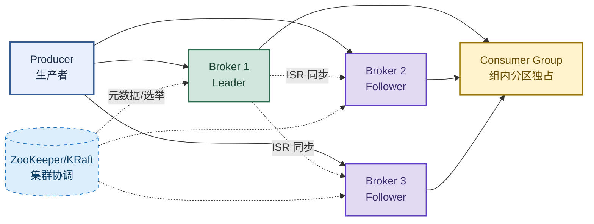

# Kafka：从架构组件到消息可靠性、顺序性与选型

> 目标：遇到 Kafka 题目先判断"问的是哪一层"——架构组件、可靠性（不丢失）、顺序性、重复消费、选型，再展开机制和实战。
>
> 读图顺序：先看下方"先记住这张总图"（Kafka 核心链路），再按问题回看各节。每节底部都有**易混点**或**速记**；先遮住解释自己讲，再对照正文。
>
> 本笔记覆盖 Kafka 架构 + 7 大核心组件 + ACK 机制 + 消息不丢失/不重复/顺序性 + Leader 选举 + 与 RocketMQ 对比。

## 先记住这张总图

**一句话主线：**Broker 存消息 → Topic 分区存 + 副本保高可 → Producer 写 + Consumer 拉（管理 Offset）→ 顺序靠同 Key 进同分区 → 可靠性靠 acks=all + 幂等性 + 先处理再提交。

## 1. Kafka 是什么

> 一句话定位：分布式消息队列，核心能力是高吞吐、低延迟的数据流处理。可以理解为一个消息缓冲池——生产者往里写，消费者从里读。

| 核心场景 | 具体说明 |
|---|---|
| 解耦系统 | 上下游通过 Kafka 通信，互不直接依赖 |
| 削峰填谷 | 突发流量先写入 Kafka，消费者按能力慢慢消费 |
| 日志收集 | 应用日志实时汇入 Kafka，供监控/分析系统消费 |
| 流处理 | 配合 Kafka Streams / Flink 做实时计算 |

## 2. 核心组件（7 个核心概念）

> 记忆口诀：**Broker 存数据，Topic 分类别，Partition 分片存，Replica 保高可，Offset 记进度，Group 管消费。**

| 组件 | 一句话解释 | 关键点 |
|---|---|---|
| Broker | Kafka 集群中的一台服务器 | 多个 Broker 组成集群，负责存储消息和处理请求 |
| Topic | 消息的逻辑分类（类似文件夹） | 生产者发往 Topic，消费者从 Topic 拉取 |
| Partition（分区） | Topic 的物理分片 | 每个 Partition 内部严格有序，是 Kafka 高吞吐的基石 |
| Replica（副本） | Partition 的冗余备份 | Leader 负责读写，Follower 只同步（ISR 机制） |
| Offset（偏移量） | 消息在 Partition 中的唯一序号 | 消费者通过 Offset 记录消费进度，重启不丢 |
| Producer / Consumer | 生产者和消费者 | Producer 写，Consumer 读 |
| Consumer Group | 多个消费者的集合 | 组内一个分区只能被一个消费者消费，实现水平扩展 |
| ZooKeeper / KRaft | 集群的"大脑" | 管理 Broker 元数据、Leader 选举；2.8+ 逐步用 KRaft 替代 ZK |

**易混点：**Topic 是逻辑分类，Partition 是物理分片。一个 Topic 可以有多个 Partition，每个 Partition 是独立的物理日志文件。Kafka 的高吞吐靠 Partition 分片并行，不是单机性能强。

## 3. 消费模式：Pull（拉取）模式

| 优点 | 缺点 |
|---|---|
| ✅ 消费者自主控制速度，不会被洪流压垮 | ❌ 分区没数据时，消费者空轮询造成资源浪费 |
| ✅ 自主管理 Offset，宕机重启也能断点续传 | 可通过 `fetch.min.bytes` / `fetch.max.wait.ms` 优化 |

**易混点：**Kafka 用 Pull（拉取）不是 Push（推送）。Pull 让消费者自主控制速度，避免被生产者洪流压垮；缺点是空轮询，用 `fetch.min.bytes` 配合 `fetch.max.wait.ms` 让消费者阻塞等待数据再拉。

## 4. 消息可靠性 · ACK 机制详解

| ACK 值 | 含义 | 可靠性 | 适用场景 |
|---|---|---|---|
| `acks=0` | 发送出去就认为成功 | ❌ 最低，可能丢失 | 日志收集（允许丢少量） |
| `acks=1`（默认） | Leader 写入成功即返回 | ⚠️ 中等，Follower 未同步时 Leader 宕机 → 丢失 | 一般业务场景 |
| `acks=all`（或 `-1`） | Leader 等待 ISR 所有副本确认 | ✅ 最高，不丢失 | 支付/交易等核心场景 |

**生产者最佳实践配置：**`acks=all` + `retries=3` + `enable.idempotence=true`（开启幂等性，防止重复）。

**易混点：**`acks=1` 不是"可靠"。Leader 写入成功就返回，但 Follower 还没同步，此时 Leader 宕机就会丢消息。核心业务必须用 `acks=all`，等 ISR 所有副本都确认才算成功。

## 5. 如何保证消息不丢失（三端全链路）

| 端 | 风险点 | 解决方案 |
|---|---|---|
| 生产者端 | 发送失败但不知道 | `acks=all` + `retries` 重试 + 幂等性 |
| Broker 端 | Leader 切换导致数据未同步 | 禁止不同步副本参与 Leader 选举（`unclean.leader.election.enable=false`） |
| 消费者端 | 先提交 Offset 再处理业务，业务失败 → 丢失 | 关闭自动提交（`enable.auto.commit=false`），先处理业务，成功后再手动提交 Offset |

**速记：**生产端 acks=all + 重试，Broker 端禁脏选举，消费端先处理再提交——三端全链路防丢失。

## 6. 如何保证消息不被重复消费（幂等性）

> 重复消费的根因：Consumer 处理完业务，但在提交 Offset 前宕机了，重启后从旧 Offset 拉取 → 重复消费。

**解决方案（二选一或组合）：**
- ① 消费端幂等：业务接口支持幂等（如用订单号 + 消息 ID 做唯一键防重）。
- ② 生产者幂等：开启 `enable.idempotence=true`，Kafka 保证同分区内不重复。

**面试标准答案：**"重复消费不可避免，关键是消费端做好幂等性，通过唯一键或状态机保证多次处理结果一致。"

## 7. 如何保证消息顺序（分区有序）

> 核心原则：**Kafka 只保证同一分区内有序，跨分区不保证。**

| 端 | 保证顺序的方式 |
|---|---|
| 生产者端 | 相同 Key → 同一分区 → 保证顺序（按 key 哈希取模分配分区）；全局顺序（不推荐）= Topic 分区数设为 1 |
| Broker 端 | 天然保证同一分区写入顺序 = 存储顺序 = Offset 递增 |
| 消费者端 | 一个分区在同一个消费组内只能被一个消费者消费（单线程串行）；`max.in.flight.requests.per.connection=1` 防止重试乱序 |

**面试标准答案：**"Kafka 只保证分区内有序。要全局有序，生产端用相同 Key 进同一分区，消费端单线程串行消费，同时开启幂等性或限制 `max.in.flight.requests.per.connection=1`。"

**易混点：**"全局顺序"和"分区顺序"是两回事。全局顺序要 Topic 分区数=1，彻底放弃并发，性能极差，一般不推荐；分区顺序靠相同 Key 进同一分区，既保顺序又保并发，是实际方案。

## 8. Leader 选举机制

| 版本 | 选举方式 | 关键机制 |
|---|---|---|
| 旧版（ZooKeeper） | Broker 竞争在 ZK 上创建 `/controller` 临时节点 | 首个成功创建的成为 Leader |
| 新版（KRaft） | 基于 Raft 共识算法 | 获得半数以上选票的节点成为 Active Controller |

**ISR（In-Sync Replicas）同步副本集合：**
- 与 Leader 保持实时同步的副本集合。
- 决定 `acks=all` 时哪些副本写成功才算数。
- 决定 Leader 宕机后谁能接管。
- 通过 `replica.lag.time.max.ms` 动态维护。

**易混点：**生产环境必须禁止从 ISR 之外选举 Leader（`unclean.leader.election.enable=false`）。否则一个没同步完的副本当 Leader，会丢消息——可靠性比可用性更重要。

## 9. 消息重试与延迟机制

| 概念 | 作用 | 典型场景 |
|---|---|---|
| 死信队列（DLQ） | 存放多次消费失败的消息 | 消息重试达到上限后转入，待人工处理 |
| 延时队列 | 存放指定时间后才可消费的消息 | 订单超时关闭、定时任务、重试间隔控制 |

## 10. 日志收集场景下 Kafka 的作用

> 应用日志 → Kafka → 下游多个系统同时消费。

| 价值 | 说明 |
|---|---|
| 实时监控大屏 | 应用每笔请求日志 → Kafka → Grafana/SkyWalking → 实时计算接口平均耗时、错误率 → 耗时飙升 → 大屏变红 → 告警通知 |
| 用户行为分析 | 用户点击/滑动/浏览/加购 → Kafka → 实时推荐系统（用户刚看"手机"→ 下一秒推荐配件）+ 离线数据仓库（每天凌晨生成"热销 Top10"报表） |

**本质区别：**磁盘日志 → "尸检"（机器宕机后查原因）；Kafka 日志 → "实时体检"（系统运行时动态诊断）。

## 高频场景题：用一句诊断开头

### "Kafka 怎么保证消息不丢失？"

三端全链路：生产端 `acks=all` + `retries` 重试 + 幂等性；Broker 端 `unclean.leader.election.enable=false` 禁止脏副本当 Leader；消费端关闭自动提交（`enable.auto.commit=false`），先处理业务再手动提交 Offset。核心业务必须 `acks=all`，等 ISR 所有副本确认才算成功。

### "Kafka 怎么保证消息顺序？"

Kafka 只保证分区内有序。生产端用相同 Key 进同一分区（按 key 哈希取模），消费端一个分区在同一个消费组内只能被一个消费者消费（单线程串行），同时 `max.in.flight.requests.per.connection=1` 防止重试乱序。全局顺序要分区数=1，性能差，一般不推荐。

## 面试回答模板：三句话讲清一题

> **问题本质是……**（先说问的是哪一层：架构、可靠性、顺序、选型）。
>
> **机制是……**（解释原理 + 关键参数），因为……（为什么这样设计）。
>
> **实战中我会……**（具体配置 + 场景），例如……（业务例子）。

例：问"Kafka 怎么保证不丢消息"——本质是三端全链路可靠性；机制是生产端 `acks=all` 等 ISR 所有副本确认，Broker 端禁止脏选举，消费端先处理再提交 Offset；实战中支付场景用 `acks=all` + `retries=3` + `enable.idempotence=true`，消费端关闭自动提交手动确认。

## 最后复习：闭眼回忆 8 句

1. **定位**：分布式消息队列，高吞吐低延迟，核心场景是解耦、削峰、日志收集、流处理。
2. **7 大组件**：Broker 存、Topic 分类、Partition 分片有序、Replica 副本（Leader 读写/Follower 同步）、Offset 记进度、Consumer Group 组内分区独占、ZK/KRaft 协调。
3. **消费模式**：Pull 拉取，消费者自主控速 + 管理 Offset，空轮询用 `fetch.min.bytes` 优化。
4. **ACK**：`acks=0` 最低、`acks=1` 中等（默认）、`acks=all` 最高（等 ISR 所有副本确认）。
5. **不丢失**：生产端 acks=all + 重试 + 幂等，Broker 端禁脏选举，消费端先处理再提交。
6. **不重复**：重复消费不可避免，消费端做幂等（唯一键/状态机），生产端 `enable.idempotence=true`。
7. **顺序性**：只保证分区内有序；同 Key 进同分区 + 单线程消费 + `max.in.flight.requests.per.connection=1`。
8. **选型**：日志收集/大数据用 Kafka（百万级 TPS），订单/交易/支付用 RocketMQ（金融级可靠性）。

## 怎么练才记得住

别反复通读，改成主动回忆：

1. 每次只看一个组件，遮住表格，先自己说出"组件 → 作用 → 关键点"，再对照。
2. 用"不丢失/不重复/顺序性"三道题各讲 30 秒；卡住时只回看对应小节。
3. 隔天再讲一遍，换成自己的业务例子；能解释"为什么 acks=1 不算可靠"才算会。
4. 复习时轮流画"Kafka 核心链路图"和"ACK 机制表"；能默写出三端防丢失方案才算熟。
