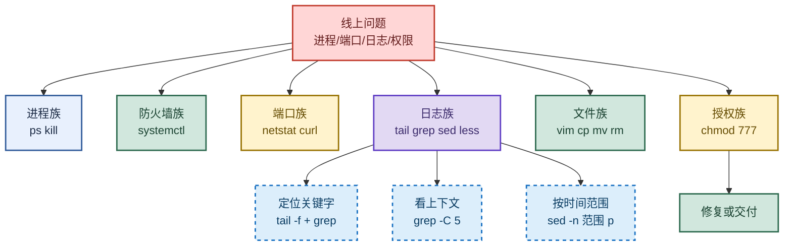

# Linux：常用命令与日志排查实战

> 目标：不背孤立命令。遇到线上问题先判断"问的是哪一类操作"——进程/防火墙/端口/日志/文件/授权，再选对应命令。
>
> 读图顺序：先看下方"先记住这张总图"（六大命令族 + 日志排查链路），再按问题回看各节。每节底部都有**易混点**或**速记**；先遮住解释自己讲，再对照正文。
>
> 本笔记覆盖 Linux 常用命令（进程/防火墙/端口/软件）+ 常见目录 + 6 大查日志技巧 + 文件操作 + chmod 授权。

## 先记住这张总图

**一句话主线：**线上问题先分类——进程用 `ps/kill`、防火墙用 `systemctl`、端口用 `netstat/curl`、日志用 `tail/grep/sed/less`、文件用 `vim/cp/mv/rm`、授权用 `chmod`，按族选命令不背单条。

## 1. 常用命令：六大族速查

> Linux 命令不是一盘散沙，按"做什么"分成六族：进程、防火墙、端口、软件、目录、文件。先认族再记命令。

| 族 | 命令 | 作用 | 记忆画面 |
|---|---|---|---|
| 进程 | `ps -ef \| grep ssh` | 查看进程 | 户籍警：列出所有住户 |
| 进程 | `kill -9 7143` | 强杀进程 | 暴力拆迁：-9 不给善后 |
| 防火墙 | `systemctl status firewalld` | 查防火墙状态 | 门卫查岗：看在不在岗 |
| 防火墙 | `systemctl stop firewalld` | 关防火墙 | 门卫下班 |
| 防火墙 | `systemctl start firewalld` | 开防火墙 | 门卫上班 |
| 端口 | `netstat -tlunp` | 查看监听端口 | 港口调度：看哪些码头在用 |
| 端口 | `curl http://www.baidu.com` | 模拟发送请求 | 试探电话：拨一下看通不通 |
| 软件 | `rpm -qa \| grep java` | 查软件安装路径 | 查仓库账本：装了哪些货 |
| 软件 | `which java` | 查命令所在路径 | 问路：java 可执行文件在哪 |
| 系统 | `poweroff` / `reboot` | 关机 / 重启 | 总闸：拉电 vs 重启 |
| 编辑 | `vi` / `vim` | 编辑文件 | 老牌编辑器：i 进编辑，ESC 退 |

**易混点：**`kill -9` 是**强制终止**（SIGKILL，进程来不及清理资源），`kill -15`（默认）是**优雅终止**（SIGTERM，进程可做善后）。生产环境优先用 `kill -15`，只有进程卡死无响应才上 `kill -9`。

**速记：**进程 `ps -ef` + `kill -9`；防火墙 `systemctl status/stop/start firewalld`；端口 `netstat -tlunp` + `curl`；软件 `rpm -qa` + `which`。

## 2. 常见目录：七个关键文件夹

> Linux 一切皆文件，目录有固定职责。记住七个关键目录，找配置/命令/软件不迷路。

| 目录 | 作用 | 记忆画面 |
|---|---|---|
| `/root` | 系统管理员 Home 目录 | 老板办公室：root 的家 |
| `/bin` | 经常使用的命令 | 工具箱：常用工具随手拿 |
| `/boot` | 启动 Linux 时的核心文件 | 引擎舱：开机要用的核心 |
| `/etc` | 系统管理配置文件和子目录 | 配置档案室：所有配置在这 |
| `/home` | 普通用户 Home 目录 | 员工宿舍：普通用户的家 |
| `/usr` | 默认安装软件的目录 | 默认仓库：软件默认装这 |
| `/opt` | 主机额外安装软件的目录 | 额外仓库：第三方软件装这 |

**易混点：**`/usr` 是**系统自带软件**默认安装目录（如 yum 装的），`/opt` 是**用户额外安装**的第三方软件目录（如自己解压的 JDK/Tomcat）。自己装的软件放 `/opt`，包管理器装的在 `/usr`。

**速记：**root 管理员家、bin 工具箱、boot 引擎、etc 配置室、home 普通家、usr 默认仓、opt 额外仓。

## 3. 六大查日志技巧：日志排查核心

> 日志排查是后端最高频操作。六个技巧按"实时/上下文/时间范围/翻页/统计/动态"分类，遇到问题对号入座。

| 编号 | 场景 | 命令 | 记忆画面 |
|---|---|---|---|
| ① | 实时看关键字 | `tail -fn 10 clp-riskroute.log \| grep 关键字` | 监听电台：实时跟新 |
| ② | 关键字附近几行 | `cat clp-riskroute.log \| grep -C 5 关键字` | 看上下文：前后 5 行 |
| ③ | 时间范围内关键字 | `sed -n '/2023-04-24 14:59:05,914/,/2023-04-24 14:59:07,548/p' clp-riskroute.log \| grep 关键字` | 时间切片：只看这一段 |
| ④ | less 翻页搜索 | `less clp-riskroute.log` → `shift+G` 到尾部 → `?关键字` 向上 / `/关键字` 向下，按 `n` 继续 | 翻书：跳到尾，前后搜 |
| ⑤ | 统计关键字数量 | `zgrep 关键字 clp-riskroute.2023-04-24.69.log.zip \| wc -l` | 数人头：报错出现几次 |
| ⑥ | 动态/翻页/行号 | `tail -f a.txt` 动态显示 / `more a.txt` 翻页 / `nl a.txt` 带行号 | 三种看法：跟/翻/编号 |

**易混点：**
- `tail -f` 是**实时跟踪**（文件增长就显示），`more` 是**一次性翻页**（不能实时）；查实时日志用 `tail -f`，看历史大文件用 `more` 或 `less`。
- `grep -C 5` 显示**前后各 5 行**，`grep -A 5` 只显示**后 5 行**，`grep -B 5` 只显示**前 5 行**。C = Context（上下文），A = After，B = Before。
- `less` 里 `?关键字` 是**向上**搜，`/关键字` 是**向下**搜，方向别搞反。
- `zgrep` 直接搜**压缩包**里的内容，不用先解压；普通 `grep` 搜不了 `.zip/.gz`。

**速记：**实时 `tail -f`、上下文 `grep -C`、时间范围 `sed -n`、翻页 `less`、统计 `zgrep + wc -l`、动态 `tail -f`/`more`/`nl`。

## 4. 基本命令：路径与用户

> 日常导航命令：查 IP、切用户、看路径、列文件。看似简单，组合起来就是日常操作。

| 命令 | 作用 | 记忆画面 |
|---|---|---|
| `ipconfig` | 查看 IP 地址 | 查门牌号 |
| `su` | 更换用户 | 换身份：su 切到别人 |
| `pwd` | 打印当前路径 | 我在哪：报当前坐标 |
| `cd ..` | 返回上级文件夹 | 退一层 |
| `cd /` | 返回根路径 | 回到根 |
| `ll` / `ls` | 打印所有路径 | 列清单 |
| `ls -al` | 含隐藏文件全部列出 | 透视：连隐藏的也看 |

**易混点：**`ll` 是 `ls -l` 的别名（部分发行版），显示**详细信息**（权限/属主/大小/时间）；`ls` 只列**文件名**。`ls -al` 的 `-a` 显示**隐藏文件**（以 `.` 开头），`-l` 显示**长格式**。Linux 查 IP 实际多用 `ip addr` 或 `ifconfig`，原文 `ipconfig` 是 Windows 命令。

**速记：**`pwd` 报坐标、`cd ..` 退一层、`cd /` 回根、`ll` 详细列、`ls -al` 连隐藏一起列。

## 5. 文件夹与文件操作：增删改移拷

> 文件操作五件套：建文件夹、建文件、移动、删除、拷贝。`rm -rf` 是最危险的命令，没有之一。

| 操作 | 命令 | 作用 | 记忆画面 |
|---|---|---|---|
| 建文件夹 | `mkdir demo` | 创建文件夹 | 盖新房 |
| 建文件 | `touch a.txt` | 新建空文件 | 拿张白纸 |
| 移动 | `mv a.txt /usr/local/test/` | 移动文件 | 搬家 |
| 删文件 | `rm a.txt` | 删除文件 | 扔掉 |
| 删文件夹 | `rm -r` | 递归删文件夹 | 连锅端 |
| 强制删 | `rm -rf` | 强制递归删 | 推土机：不问直接推 |
| 拷贝 | `cp a.txt /usr/local/demo` | 复制文件 | 复印一份 |

**易混点：**
- `rm -r` 是**递归删**（会逐个问确认），`rm -rf` 是**强制递归删**（`-f` 不问直接删）。`-r` = recursive，`-f` = force。
- `mv` 既能**移动**也能**重命名**：`mv a.txt b.txt` 就是把 a.txt 改名成 b.txt（同目录下）。
- **绝对禁忌**：`rm -rf /` 会删整个系统，生产环境永远先 `pwd` 确认路径再执行 `rm -rf`，最好用绝对路径且 Tab 补全避免误删。

**速记：**`mkdir` 建、`touch` 摸出空文件、`mv` 搬/改名、`rm -rf` 推土机、`cp` 复印。

## 6. vim 编辑器：三模式与常用快捷键

> vim 有三个模式：一般模式、编辑模式、底行模式。模式切换是 vim 入门第一关，搞错模式所有按键都乱套。

| 模式 | 进入方式 | 作用 | 记忆画面 |
|---|---|---|---|
| 一般模式 | `vim a.txt` 默认进入 | 移动/复制/粘贴/删除 | 待命状态 |
| 编辑模式 | 一般模式按 `i` | 输入文字 | 动笔写 |
| 底行模式 | 编辑模式按 `ESC` 再按 `:` | 保存/退出/定位/设置 | 下指令 |

**保存退出四件套：**

| 命令 | 作用 |
|---|---|
| `:wq` | 保存并退出 |
| `:q!` | 不保存强制退出 |
| `:set number` | 显示行数 |
| `:n` | 定位到第 n 行 |

**一般模式快捷键：**

| 快捷键 | 作用 |
|---|---|
| `yy` | 复制一行 |
| `p` | 粘贴 |
| `gg` | 跳到第一行 |
| `G` | 跳到最后一行 |
| `u` | 撤销（编辑模式下） |
| `ctrl+r` | 反撤销（编辑模式下） |

**易混点：**
- `:wq` 是**保存退出**，`:q!` 是**不保存强制退出**（改动丢弃），`:q` 是**未改动时退出**（有改动会报错）。改错了想丢弃用 `:q!`，想保留用 `:wq`。
- `i` 是在**光标前**插入，`a` 是在**光标后**插入，`o` 是**下方新开一行**插入，`O` 是**上方新开一行**。最常用 `i`。
- `gg` 是**第一行**（两个 g），`G` 是**最后一行**（大写 G），大小写含义不同别按错。

**速记：**三模式——一般（默认）/编辑（按 i）/底行（ESC 再 :）；`:wq` 存退、`:q!` 弃退；`yy` 复制 `p` 粘贴、`gg` 头 `G` 尾、`u` 撤 `ctrl+r` 反撤。

## 7. chmod 授权：三位数字读懂权限

> chmod 用三位数字表示权限：所有者/同组/其他各一位，每位是 r(4)+w(2)+x(1) 的和。看懂数字就懂权限。

| 命令 | 数字拆解 | 含义 | 记忆画面 |
|---|---|---|---|
| `chmod 700 文件名` | 7=4+2+1 / 0 / 0 | 当前用户读写执行，同组和其他无任何权限 | 私人保险箱：只有自己能开 |
| `chmod 666 文件名` | 6=4+2 / 6 / 6 | 所有组均有读写权限，无执行 | 公告栏：都能看能写不能跑 |
| `chmod 777 文件名` | 7 / 7 / 7 | 最高权限，所有人读写执行 | 大门敞开：谁都能进 |
| `chmod -R 777 目录` | 递归 | 同时授予目录下所有子文件 | 全楼授权：每间房都开 |

**权限数字对照：**

| 数字 | rwx | 含义 |
|---|---|---|
| 7 | rwx | 读+写+执行 |
| 6 | rw- | 读+写 |
| 5 | r-x | 读+执行 |
| 4 | r-- | 只读 |
| 0 | --- | 无任何权限 |

**易混点：**
- `r=4`、`w=2`、`x=1`，权限数字是**三者相加**：7=4+2+1（全开）、6=4+2（读写）、5=4+1（读执行）、0=无。
- 三位数字顺序是**所有者/同组用户/其他用户**，不是"读/写/执行"。`700` = 所有者全开、同组无、其他无。
- `-R` 是**递归**（大写 R），对目录下所有子文件子目录都生效；不加 `-R` 只改当前目录本身。
- **生产禁忌**：`chmod 777` 是最大权限，安全隐患极大，生产环境绝不用；按需给最小权限（如 `750`）。

**速记：**r=4 w=2 x=1 相加；三位=所有者/同组/其他；`700` 私人、`666` 共享读写、`777` 全开（慎用）、`-R` 递归。

## 高频场景题：用一句诊断开头

### "线上日志报错，怎么快速定位？"

先 `tail -fn 200 app.log | grep ERROR` 实时跟关键字；要上下文用 `grep -C 10 ERROR app.log` 看前后 10 行；要按时间范围用 `sed -n '/开始时间/,/结束时间/p' app.log | grep 关键字` 切片；大文件用 `less` 翻页，`shift+G` 跳尾部，`?关键字` 向上 `/关键字` 向下搜；要统计报错次数用 `zgrep ERROR app.log.zip | wc -l`（压缩包直接搜）。

### "端口被占用，怎么查是谁占的？"

`netstat -tlunp | grep 端口号` 查看该端口被哪个进程占用（最后一列是 PID/程序名），再用 `ps -ef | grep PID` 确认进程详情，确认无用后 `kill -9 PID` 释放。`-t` TCP、`-l` 监听、`-u` UDP、`-n` 显示数字端口、`-p` 显示进程。

### "防火墙挡了服务访问，怎么排查？"

先 `systemctl status firewalld` 看防火墙是否在运行；在运行则 `systemctl stop firewalld` 临时关闭验证是否防火墙问题；确认后用 `curl http://目标IP:端口` 测试连通性。生产环境不建议直接关防火墙，应放行指定端口（`firewall-cmd --add-port=8080/tcp --permanent` + `--reload`）。

## 面试回答模板：三句话讲清一题

> **问题本质是……**（先说场景：日志排查/端口占用/防火墙/权限）。
>
> **我的排查路径是……**（命令 + 动作 + 看什么），因为……（为什么这个命令适合这个场景）。
>
> **根因是……**，处理方案是……（命令修复 / 配置调整 / 权限收敛）。

例：问"线上日志怎么查"——本质是从海量日志里快速定位关键字；排查路径是先 `tail -f | grep` 实时跟，要上下文用 `grep -C`，要时间范围用 `sed -n` 切片，因为不同场景用不同工具效率最高；根因定位后处理方案是修代码或调配置，日志只是证据不是终点。

## 最后复习：闭眼回忆 8 句

1. **六大命令族**：进程（`ps -ef`/`kill -9`）、防火墙（`systemctl status/stop/start firewalld`）、端口（`netstat -tlunp`/`curl`）、软件（`rpm -qa`/`which`）、目录、文件。
2. **七个关键目录**：`/root` 管理员家、`/bin` 命令、`/boot` 启动核心、`/etc` 配置、`/home` 普通家、`/usr` 默认软件、`/opt` 额外软件。
3. **六大查日志**：实时 `tail -f`、上下文 `grep -C`、时间范围 `sed -n`、翻页 `less`、统计 `zgrep + wc -l`、动态/翻页/行号 `tail -f`/`more`/`nl`。
4. **less 搜索方向**：`?关键字` 向上、`/关键字` 向下、`n` 继续、`shift+G` 跳尾部。
5. **文件操作五件套**：`mkdir` 建、`touch` 建文件、`mv` 搬/改名、`rm -rf` 推土机（慎用）、`cp` 拷贝。
6. **vim 三模式**：一般（默认）/编辑（按 i）/底行（ESC 再 :）；`:wq` 存退、`:q!` 弃退；`yy` 复制 `p` 粘贴、`gg` 头 `G` 尾、`u` 撤 `ctrl+r` 反撤。
7. **chmod 数字**：r=4 w=2 x=1 相加；三位=所有者/同组/其他；`700` 私人、`666` 共享读写、`777` 全开（慎用）、`-R` 递归。
8. **易混**：`kill -9` 强杀 vs `kill -15` 优雅；`/usr` 自带软件 vs `/opt` 第三方；`grep -C/A/B` 上下/后/前；`rm -rf /` 绝对禁忌。

## 怎么练才记得住

别反复通读，改成主动回忆：

1. 每次只练一族命令，遮住表格，先自己说出"族 → 命令 → 作用 → 易混点"，再对照。
2. 用"六大查日志技巧"各讲 30 秒；卡住时只回看对应小节，重点练 `sed -n` 时间范围切片（最易忘）。
3. 隔天在真实 Linux 环境敲一遍：建文件夹 → 建文件 → vim 编辑 → chmod 授权 → 查日志；能闭眼默写 `chmod` 数字拆解才算会。
4. 复习时轮流画"六大命令族总图"和"日志排查链路图"；能默写出 `tail -f | grep`、`grep -C 5`、`sed -n` 三条核心命令才算熟。
