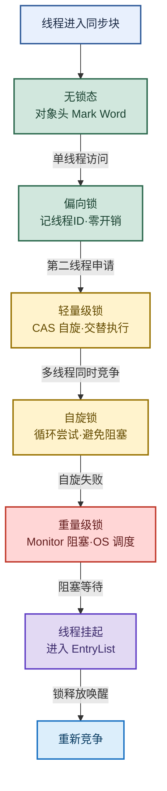

# 锁机制：synchronized 锁升级与 MySQL 锁

> 目标：不背孤立名词。遇到锁题目先判断"问的是哪一层"——synchronized 原理、锁升级四阶段、MySQL 行/表锁、还是 ReentrantLock 与 AQS，再解释机制、取舍和实战选型。
>
> 读图顺序：先看下方"先记住这张总图"，再按问题回看各节。每节底部都有**易混点**或**速记**；先遮住解释自己讲，再对照正文。
>
> 本笔记以 JDK8/11 为主，偏向锁在 JDK15 后默认关闭、JDK18 逐步废弃的变化会在对应小节标注。

## 先记住这张总图

**一句话主线：**synchronized 底层靠 Monitor，锁升级无锁→偏向→轻量级→重量级逐级加重；MySQL 行锁并发高开销大、表锁反之；ReentrantLock 基于 AQS 用 state 实现可重入。

## 1. synchronized 原理：Monitor 是底层基石

synchronized 底层依赖 JVM **Monitor**（管程/监视器）锁机制。字节码层面，同步块通过 `monitorenter` 和 `monitorexit` 两条指令实现（同步方法靠 ACC_SYNCHRONIZED 标志位）。

- **每个 Java 对象**都关联一个 Monitor，对象头 Mark Word 存锁状态。
- 线程通过尝试获取 Monitor **持有权**来获取锁：成功进入同步块，失败阻塞。
- `monitorexit` 出现两次（正常退出 + 异常退出），保证锁一定释放。

**易混点：**`monitorenter`/`monitorexit` 是同步块的指令；同步方法没有这两条指令，而是在方法表 flags 里设 `ACC_SYNCHRONIZED` 标志，JVM 调用时自动加锁解锁。

**速记：**对象即 Monitor，`monitorenter` 进、`monitorexit` 出（两次：正常 + 异常）。

## 2. synchronized 锁升级：四阶段逐级加重

> 核心口诀：**无锁→偏向→轻量级→重量级，竞争越激烈锁越重。** 升级不可逆。

### 四阶段对比

| 阶段 | 触发条件 | 实现机制 | 性能 | 记忆画面 |
|---|---|---|---|---|
| 无锁 | 初始状态 | 对象头无锁标记 | 最快 | 空房间没人占 |
| 偏向锁 | 单线程访问 | Mark Word 记线程 ID，下次该线程零开销进入 | 极快 | 房间门牌写你名字，你直接进 |
| 轻量级锁 | 第二线程申请（非同时竞争） | CAS 自旋 + 栈帧锁记录 | 快 | 两人一前一后来，敲门没人就进 |
| 重量级锁 | 多线程同时竞争且自旋失败 | Monitor 阻塞，OS 调度唤醒 | 慢 | 排队取号，叫号才进 |

**易混点：**轻量级锁的触发是"第二个线程申请锁"，但**不是两个线程同时竞争**——可以一前一后交替执行同步块；只有多线程**同时**抢锁且自旋失败才升重量级。自旋锁不是独立阶段，是轻量级→重量级之间的过渡策略。

**补充：**JDK15 起偏向锁默认关闭（`-XX:-UseBiasedLocking`），JDK18 逐步废弃，因为现代 JVM 优化后偏向锁收益下降且维护成本高。面试答出"四阶段 + 偏向锁已逐步废弃"即可。

**速记：**无锁→偏向（单线程）→轻量级（CAS 自旋）→重量级（Monitor 阻塞），升级单向不可逆。

## 3. MySQL 锁：行锁与表锁的取舍

> 核心口诀：**行锁并发高开销大，表锁并发低开销小。** InnoDB 默认行锁，MyISAM 只有表锁。

### 行锁 vs 表锁

| 维度 | 行锁 | 表锁 | 记忆画面 |
|---|---|---|---|
| 锁定粒度 | 整行数据 | 整张表 | 行锁锁一排座位，表锁锁整个放映厅 |
| 开销 | 大 | 小 | 行锁要定位具体行，表锁一把抓 |
| 加锁速度 | 慢 | 快 | 行锁要找行，表锁直接锁表头 |
| 锁冲突概率 | 最低 | 最高 | 行锁只冲突同行，表锁冲突所有操作 |
| 并发度 | 最高 | 最低 | 行锁让不同行并行，表锁串行 |
| 引擎支持 | InnoDB | MyISAM / InnoDB | MyISAM 只支持表锁 |

**易混点：**InnoDB **既支持行锁也支持表锁**，不是只有行锁。InnoDB 默认走行锁，但**未走索引**的查询会退化为表锁（行锁基于索引实现）。MyISAM 只支持表锁，不支持行锁。

### 悲观锁 vs 乐观锁

| 维度 | 悲观锁 | 乐观锁 | 记忆画面 |
|---|---|---|---|
| 思路 | 拿数据就上锁，别人 block | 拿数据不上锁，更新时校验 | 悲观=先占座；乐观=先不占，提交时看有没有人改 |
| 实现 | `SELECT ... FOR UPDATE` | 版本号 / CAS 机制 | 悲观靠数据库锁，乐观靠应用层判断 |
| 冲突假设 | 假设冲突频繁 | 假设冲突稀少 | 悲观适合写多，乐观适合读多 |
| 性能 | 冲突多时稳 | 冲突少时高 | 高并发写乐观会大量重试 |

**易混点：****共享锁（S 锁）**是悲观锁的一种——多个事务对同一资源共享同一把锁（读锁），允许并发读但阻塞写。乐观锁不是"不加锁"，而是"延迟到更新时校验"，本质是应用层策略而非数据库锁机制。

**速记：**行锁开销大并发高（InnoDB 默认），表锁开销小并发低（MyISAM）；悲观先锁，乐观靠版本号。

## 4. 公平锁与非公平锁：顺序 vs 吞吐

> 核心口诀：**公平按 FIFO 排队，非公平插队抢吞吐。**

| 维度 | 公平锁 | 非公平锁 | 记忆画面 |
|---|---|---|---|
| 获取顺序 | 按线程等待顺序，FIFO 队头取 | 不管等待顺序，每个线程获取概率相等 | 公平=排队取号；非公平=谁手快谁得 |
| 性能 | 低，大量时间花在线程调度 | 高，响应速度快 | 公平要切换线程，非公平可连续获取 |
| 饥饿 | 不会饿死 | 可能饿死等待久的线程 | 公平保底，非公平看运气 |
| 默认 | ReentrantLock 默认非公平 | ReentrantLock 默认非公平 | `new ReentrantLock(true)` 才是公平 |

**易混点：**`synchronized` 是**非公平锁**且不可配置；`ReentrantLock` 默认非公平，但可通过构造参数 `new ReentrantLock(true)` 切换为公平。非公平锁吞吐高是因为允许"刚释放锁的线程立即再抢"，减少线程切换开销。

**速记：**公平 FIFO 不饿但慢，非公平插队快但可能饿死；synchronized 永远非公平。

## 5. 可重入锁与 ReentrantLock：state 计数实现重入

> 核心口诀：**可重入靠 state 累加，同一线程多次获取不死锁。**

### 可重入锁原理

可重入锁通过 **state 变量**记录锁持有次数，并记录当前持有锁的**线程 ID**。同一线程可多次获取同一把锁，每次 state +1；解锁时 state -1，减到 0 才完全释放。

| 机制 | 作用 | 记忆画面 |
|---|---|---|
| state 计数 | 记录重入次数 | 计数器：进一次 +1，出一次 -1 |
| 线程 ID 记录 | 判断是否同一线程 | 门牌记住户，住户可反复进出 |
| state > 0 | 锁仍被持有 | 计数器没归零，门还锁着 |
| state = 0 | 完全释放 | 计数器归零，门开了 |

### ReentrantLock 与 AQS

`ReentrantLock` 基于 **AQS**（AbstractQueuedSynchronizer）实现：

- **加锁**：通过 `currentThread == exclusiveOwnerThread` 判断可重入性，是同一线程则 state 累加，否则入队等待。
- **解锁**：state 减到 0 才完全释放，此前 state > 0 锁仍被持有。
- **手动释放**：必须在 `finally` 块中调用 `unlock()`，否则死锁。

**易混点：**`synchronized` 是**JVM 层面**自动释放（`monitorexit`），`ReentrantLock` 是**API 层面**手动释放，忘记 `unlock()` 会死锁。两者都是可重入锁。`ReentrantLock` 比 `synchronized` 多了：可中断（`lockInterruptibly`）、可超时（`tryLock`）、可公平、多条件变量（`Condition`）。

**速记：**可重入靠 state +1/-1，归零才释放；ReentrantLock 基于 AQS，必须 `finally` 手动 unlock。

## 高频场景题：用一句诊断开头

### "synchronized 和 ReentrantLock 怎么选？"

先看是否需要高级特性——需要可中断、超时、公平、多 Condition 选 `ReentrantLock`；简单互斥选 `synchronized`（JVM 自动释放、锁升级优化、JDK6 后性能差距很小）。`synchronized` 用法简单不会忘释放，`ReentrantLock` 灵活但易漏 `unlock`。

### "InnoDB 行锁为什么有时变表锁？"

先看 SQL 是否走了索引——InnoDB 行锁基于**索引**实现，`WHERE` 条件未命中索引（或类型不匹配导致索引失效）时，行锁退化为表锁。排查：`EXPLAIN` 看是否 `type=ALL` 全表扫描，是的话加合适索引即可恢复行锁。

### "偏向锁为什么 JDK15 后默认关闭？"

先看收益与成本——偏向锁对单线程场景收益大，但现代应用多线程竞争普遍，偏向锁在竞争时撤销开销高（STW），且维护复杂。JDK15+ 优化后轻量级锁 CAS 足够快，偏向锁收益下降，故默认关闭。

## 面试回答模板：三句话讲清一题

> **问题本质是……**（先说锁属于哪一层：synchronized 原理、锁升级、MySQL 锁、还是 AQS）。
>
> **机制是……**（解释原理 + 关键变量/指令），因为……（为什么这样设计）。
>
> **实战中我会……**（选型 + 注意点），例如……（具体场景）。

例：问"synchronized 锁升级过程"——本质是 JVM 根据竞争激烈程度自动选择锁级别；机制是无锁→偏向（单线程记 ID）→轻量级（CAS 自旋）→重量级（Monitor 阻塞），升级不可逆；实战中 JDK6 后 synchronized 性能已优化，简单互斥优先用它，注意偏向锁 JDK15 默认关闭。

## 最后复习：闭眼回忆 8 句

1. **原理**：synchronized 底层靠 Monitor，同步块用 `monitorenter`/`monitorexit`，同步方法用 `ACC_SYNCHRONIZED` 标志。
2. **升级**：无锁→偏向（单线程）→轻量级（CAS 自旋）→重量级（Monitor 阻塞），单向不可逆。
3. **易混**：轻量级是"第二线程申请"非"同时竞争"；自旋锁是轻量级到重量级的过渡，不是独立阶段。
4. **MySQL 行/表锁**：行锁开销大并发高（InnoDB 默认），表锁开销小并发低（MyISAM）；InnoDB 未走索引退化为表锁。
5. **悲观/乐观**：悲观先锁（`FOR UPDATE`），乐观靠版本号校验；共享锁是悲观锁的一种。
6. **公平/非公平**：公平 FIFO 不饿但慢，非公平插队快但可能饿死；synchronized 永远非公平，ReentrantLock 默认非公平可配置。
7. **可重入**：靠 state +1/-1 计数 + 线程 ID 判断，归零才完全释放；synchronized 和 ReentrantLock 都可重入。
8. **AQS**：ReentrantLock 基于 AQS，`currentThread==exclusiveOwnerThread` 判重入，必须 `finally` 手动 `unlock`。

## 怎么练才记得住

别反复通读，改成主动回忆：

1. 每次只看一个小节，遮住表格，先自己说出"阶段/类型 → 触发条件 → 机制 → 优缺点"，再对照。
2. 用"高频场景题"的 3 道题各讲 30 秒；卡住时只回看对应小节。
3. 隔天再讲一遍，换成自己的项目例子；能解释"为什么选 synchronized 还是 ReentrantLock、为什么行锁变表锁"才算会。
4. 复习时轮流画"锁升级四阶段流程"和"MySQL 锁分类表"；能默写出 state 计数和 AQS 判断逻辑才算熟。
