# MongoDB：文档型 NoSQL 与 ES 对比

> 目标：不背孤立名词。遇到 MongoDB 题先判断"问的是哪一层"——是 NoSQL 的定位与场景，还是 BSON 文档模型，还是 B+树索引与 ES 倒排索引的选型，还是 Spring Data MongoDB 怎么用。
> 目标：把 NoSQL 四类、MongoDB 逻辑结构、vs MySQL、vs ES、分片与聚合、Spring Data MongoDB 串成一条主线，能三句话讲清一题。
> 目标：每个易混点都能用一句话区分，比如"MongoDB 擅长点查范围查，ES 擅长全文搜索；MongoDB 用 B+树，ES 用倒排索引"。

## 先记住这张总图

```mermaid
flowchart TD
    A([MongoDB 核心体系]) --> B[NoSQL 定位<br/>灵活模型·水平扩展]
    A --> C[逻辑结构<br/>DB·Collection·Document]
    A --> D[索引引擎<br/>B+树·点查范围查]
    A --> E[分片与聚合<br/>分片键·聚合管道]
    A --> F[Java 接入<br/>Spring Data MongoDB]

    B --> B1[文档·键值·列族·图]
    B --> B2[日志·埋点·物联网]
    C --> C1["BSON(二进制 JSON)"]
    C --> C2[无 Schema·灵活字段]
    D --> D1[二级索引]
    D --> D2[vs ES 倒排索引]
    E --> E1[分片键设计]
    E --> E2[聚合管道 stage]
    F --> F1["@Document 实体"]
    F --> F2["MongoTemplate/Repository"]

    style A fill:#E8F0FD,stroke:#315C9A,stroke-width:2px,color:#1D2C46
    style B fill:#D1E7DD,stroke:#2D6A4F,stroke-width:2px,color:#1B4332
    style C fill:#FFF3CD,stroke:#997404,stroke-width:2px,color:#664D03
    style D fill:#E2D9F3,stroke:#5F3DC4,stroke-width:2px,color:#3B2A6B
    style E fill:#DCEEFB,stroke:#1971C2,stroke-width:2px,stroke-dasharray:5,color:#0B3D63
    style F fill:#D1E7DD,stroke:#2D6A4F,stroke-width:2px,color:#1B4332
    style B1 fill:#D1E7DD,stroke:#2D6A4F,stroke-width:2px,color:#1B4332
    style B2 fill:#D1E7DD,stroke:#2D6A4F,stroke-width:2px,color:#1B4332
    style C1 fill:#FFF3CD,stroke:#997404,stroke-width:2px,color:#664D03
    style C2 fill:#FFF3CD,stroke:#997404,stroke-width:2px,color:#664D03
    style D1 fill:#E2D9F3,stroke:#5F3DC4,stroke-width:2px,color:#3B2A6B
    style D2 fill:#FFD6D6,stroke:#C0392B,stroke-width:2px,color:#641E1E
    style E1 fill:#DCEEFB,stroke:#1971C2,stroke-width:2px,stroke-dasharray:5,color:#0B3D63
    style E2 fill:#DCEEFB,stroke:#1971C2,stroke-width:2px,stroke-dasharray:5,color:#0B3D63
    style F1 fill:#D1E7DD,stroke:#2D6A4F,stroke-width:2px,color:#1B4332
    style F2 fill:#D1E7DD,stroke:#2D6A4F,stroke-width:2px,color:#1B4332
```

**一句话主线：**MongoDB 是文档型 NoSQL，用 BSON 存无 Schema 文档，靠 B+树索引擅长点查范围查与聚合，水平扩展靠原生分片，Java 侧用 Spring Data MongoDB 像 JPA 一样操作。

## 1. NoSQL 是什么：四类与适用场景

一句话：**NoSQL 不强制固定表结构，支持灵活数据模型，核心优势是高可扩展、高并发读写、灵活数据结构**。

| NoSQL 类型 | 数据模型 | 典型代表 | 适用场景 | 记忆画面 |
|---|---|---|---|---|
| 文档型 | 键值对文档（BSON/JSON） | MongoDB | 结构多变、快速迭代 | 文档型像"活页夹"，每页可不同 |
| 键值型 | 简单 Key-Value | Redis | 高并发缓存、会话 | 键值型像"字典"，查字最快 |
| 列族型 | 按列族存储 | HBase、Cassandra | 海量数据宽表写入 | 列族型像"账本按列记" |
| 图型 | 节点与关系 | Neo4j | 社交关系、推荐路径 | 图型像"关系网"，专攻连边 |

**易混点**：**NoSQL ≠ 不要 SQL**，而是"Not Only SQL"——不强制关系型表结构，但很多 NoSQL（含 MongoDB）也支持类 SQL 查询和聚合。别答成"完全不用 SQL"。

**易混点**：**NoSQL 适合"海量数据、高并发、结构多变、强水平扩展"场景**（互联网日志、社交关系、实时推荐、物联网数据），但**不适合复杂事务和强一致性场景**——银行转账这种多表强一致仍要靠关系型数据库。

**速记：**文档 Mongo、键值 Redis、列族 HBase、图 Neo4j；海量高并发多变用它，强事务别用它。

## 2. MongoDB 简介与主要特点

一句话：**MongoDB 是文档型 NoSQL，用 BSON 二进制 JSON 存数据，无固定 Schema，一个集合里可以有不同结构的文档**。

| 维度 | 说明 | 记忆画面 |
|---|---|---|
| 是什么 | 文档型 NoSQL 数据库，用 BSON 存数据，无固定 Schema | MongoDB 是"无固定模板的活页夹" |
| 数据模型 | 一个 Collection 里可以有不同结构的 Document | 同一集合文档可"长得不一样" |
| 优点 | 灵活数据模型、高并发读写、水平扩展方便、原生分片、二级索引、聚合管道 | 快速迭代友好 |
| 场景 | 日志存储、用户行为埋点、电商商品订单结构多变、物联网数据 | 结构常变用它 |
| 不适合 | 复杂事务、强一致性场景 | 转账别用它 |

**主要特点**：1）面向文档存储，操作简单容易；2）可对任意属性建索引实现更快排序；3）支持丰富的查询表达式；4）允许在服务端执行脚本；5）支持多种编程语言。

**易混点**：**"无 Schema"不是"没结构"**——MongoDB 不强制预定义表结构，但单个文档内部仍是 JSON 结构（字段名 + 值），只是不同文档字段可以不同。无 Schema 指"集合级不预定义"，不是"文档级随便乱写"。

**速记：**BSON 存文档，无 Schema 灵活，日志埋点物联网，复杂事务别用它。

## 3. 逻辑结构：DB/Collection/Document 与 MySQL 对比

一句话：**MongoDB 逻辑结构是实例 → Database → Collection → Document，对应 MySQL 的实例 → 数据库 → 表 → 行**。

| MongoDB | MySQL | 说明 | 记忆画面 |
|---|---|---|---|
| Database | 数据库 | 一个实例下多个 Database | 同名同义 |
| Collection | 表 | 一个 Database 下多个 Collection | Collection=表 |
| Document | 行 | 一个 Collection 里多个 Document，用 BSON 表示 | Document=行 |
| Field | 列 | Document 里的字段 | Field=列 |

**核心区别**：**Collection 不需要预定义表结构，不同 Document 可以有完全不同的字段**，非常灵活；MySQL 表必须先 `CREATE TABLE` 定义列结构，所有行遵循同一 schema。

**易混点**：**MongoDB 的 Collection ≠ MySQL 的表**——表是"刚性 schema"，所有行列固定；Collection 是"柔性 schema"，文档字段可不同。所以 MongoDB 适合结构多变的业务（商品 SKU 字段差异大），MySQL 适合结构稳定的业务。

**速记：**DB 对数据库，Collection 对表，Document 对行，Field 对列；区别在 Collection 无需预定义 schema。

## 4. 索引引擎：B+树 vs ES 倒排索引

一句话：**MongoDB 基于 B+树索引擅长单点查询、范围查询和复杂聚合；ES 基于倒排索引加 Segment 文件天然擅长全文搜索**。

| 维度 | MongoDB | ES（Elasticsearch） | 记忆画面 |
|---|---|---|---|
| 索引结构 | B+树索引 | 倒排索引 + Segment 文件 | Mongo 是"目录树"，ES 是"字词典" |
| 擅长查询 | 单点查询、范围查询、复杂聚合 | 全文搜索、模糊匹配、相关性排序 | Mongo 点查范围查，ES 全文搜 |
| 数据模型 | 文档型 NoSQL（BSON） | 文档型搜索（JSON） | 两者都文档，定位不同 |
| 一致性 | 强一致（单文档事务） | 准实时（近实时 NRT） | Mongo 更一致，ES 有延迟 |
| 典型场景 | 业务数据存储与查询 | 日志检索、全文搜索、分析 | Mongo 当主存，ES 当搜索引擎 |

**易混点**：**MongoDB 和 ES 都是文档型，但定位不同**——MongoDB 是"主数据存储"，负责业务数据落地与点查范围查；ES 是"搜索引擎"，负责全文检索与相关性排序。生产中常见组合：**MongoDB 存主数据，同步到 ES 做搜索**，而不是二选一。

**易混点**：**B+树 vs 倒排索引**——B+树按字段值排序建树，擅长等值和范围查（`age > 18`）；倒排索引按"词 → 文档列表"建表，擅长全文匹配（`content: "Java"`）。所以全文搜索 ES 强，结构化点查 Mongo 强。

**速记：**Mongo B+树点查范围查，ES 倒排索引全文搜；主存用 Mongo，搜索用 ES，常组合用。

## 5. 分片与聚合管道：水平扩展与复杂分析

一句话：**分片解决水平扩展，分片键决定数据分布；聚合管道用 stage 串联做复杂分析**。

| 机制 | 解决问题 | 关键点 | 记忆画面 |
|---|---|---|---|
| 分片 Sharding | 单机容量/性能瓶颈，水平扩展 | 选分片键决定数据分布到哪个 shard | 分片键是"分班依据" |
| 分片键设计 | 数据均匀分布、避免热点 | 选基数高、写分布均匀、查询常用的字段 | 别选自增 ID 易热点 |
| 聚合管道 | 复杂分组统计与分析 | 多个 stage 串联：`$match`→`$group`→`$sort` | 管道像"流水线筛货" |

**易混点**：**分片键选错会热点**——选自增 ID 或时间戳，新数据总落到最后一个 shard，造成写热点；应选基数高、写分布均匀的字段（如 `userId` 哈希分片）。范围分片适合范围查但易热点，哈希分片分布均匀但不利于范围查。

**易混点**：**聚合管道 ≠ SQL 的 JOIN**——聚合管道是"文档流过多个 stage 逐步变换"，每个 stage 接收上一步输出；SQL 的 JOIN 是多表关联。MongoDB 聚合更像是"流水线加工"，不是"多表连接"。

**速记：**分片键选高基数均匀字段避热点，聚合管道 stage 串联像流水线，不是 JOIN。

## 6. Java 怎么用：Spring Data MongoDB

一句话：**Spring Boot 项目用 Spring Data MongoDB，`@Document` 注解实体类，用 `MongoTemplate` 或 `MongoRepository` 操作数据库，和 Spring Data JPA 用法非常类似**。

| 方式 | 特点 | 适用场景 | 记忆画面 |
|---|---|---|---|
| `@Document` 注解 | 标注实体类对应哪个 Collection | 所有实体类必加 | 像 JPA 的 `@Entity` |
| `MongoRepository` | 接口继承即用，方法名派生查询 | 简单 CRUD、方法名查询 | 像 JPA 的 `JpaRepository` |
| `MongoTemplate` | 模板类直接操作，灵活 | 复杂查询、聚合管道、动态条件 | 像 JPA 的 `EntityManager` |

**典型用法**：实体类加 `@Document(collection="user")`，字段加 `@Id` 标主键；Repository 接口继承 `MongoRepository<User, String>`，方法名如 `findByNameAndAge` 自动派生查询；复杂聚合用 `MongoTemplate.aggregate(pipeline, "user", User.class)`。

**易混点**：**`MongoRepository` 和 `MongoTemplate` 不是二选一**——简单 CRUD 用 Repository 省事，复杂聚合/动态查询用 Template 灵活，生产中常同时注入两者。和 JPA 里 `JpaRepository` + `EntityManager` 共存一个道理。

**速记：**`@Document` 标实体，Repository 简单 CRUD，Template 复杂聚合，和 JPA 一个套路。

## 高频场景题

### "MongoDB 和 MySQL 怎么选？什么场景用 MongoDB？"

诊断：先看数据结构是否多变和是否需要强事务。结构稳定、强事务、多表关联用 MySQL；结构多变（商品 SKU 字段差异大）、快速迭代、海量高并发读写、水平扩展需求强用 MongoDB。日志、埋点、物联网、电商商品订单结构多变是 MongoDB 典型场景。

### "MongoDB 和 ES 都做搜索，怎么选？"

诊断：先看是"结构化点查范围查"还是"全文搜索"。MongoDB 基于 B+树擅长单点查询、范围查询、复杂聚合，是主数据存储；ES 基于倒排索引加 Segment 文件擅长全文搜索、模糊匹配、相关性排序，是搜索引擎。生产中常见组合：MongoDB 存主数据，同步到 ES 做全文搜索，而不是二选一。

### "MongoDB 的分片键怎么设计？"

诊断：分片键决定数据分布，选错会热点。原则：基数高（取值多）、写分布均匀（避免新数据集中到一个 shard）、查询常用（带分片键的查询能路由到单 shard）。避免选自增 ID 或时间戳做范围分片（写热点），可改哈希分片分布均匀。范围分片利于范围查但易热点，哈希分片分布均匀但不利于范围查，按业务权衡。

## 面试回答模板：三句话讲清一题

> **问题本质是**：MongoDB 是文档型 NoSQL，核心矛盾是"灵活无 Schema 模型 vs 关系型强事务"和"B+树点查 vs ES 倒排全文搜"的选型。
>
> **机制是**：MongoDB 用 BSON 存无 Schema 文档，Collection 不预定义结构，靠 B+树索引擅长点查范围查与聚合，水平扩展靠原生分片（分片键决定数据分布），Java 侧用 Spring Data MongoDB 的 `@Document` + `MongoRepository`/`MongoTemplate` 像 JPA 一样操作。
>
> **实战中我会**：结构多变、海量高并发、强水平扩展场景（日志/埋点/物联网/电商商品）选 MongoDB；强事务多表关联选 MySQL；全文搜索选 ES，常组合 MongoDB 存主数据 + ES 做搜索；分片键选高基数均匀字段避热点。

## 最后复习：闭眼回忆 8 句

1. NoSQL 四类：文档 Mongo、键值 Redis、列族 HBase、图 Neo4j；Not Only SQL 不是不要 SQL。
2. NoSQL 适合海量高并发结构多变强水平扩展，不适合复杂事务强一致性。
3. MongoDB 是文档型 NoSQL，用 BSON 二进制 JSON 存数据，无固定 Schema，一个集合文档可不同结构。
4. 逻辑结构：Database 对数据库，Collection 对表，Document 对行，Field 对列；Collection 无需预定义 schema。
5. MongoDB 基于 B+树擅长点查范围查复杂聚合，ES 基于倒排索引加 Segment 擅长全文搜索。
6. MongoDB 是主数据存储，ES 是搜索引擎，生产常组合 Mongo 存主数据 + ES 做搜索。
7. 分片键选高基数均匀字段避热点，避免自增 ID/时间戳范围分片；聚合管道 stage 串联像流水线不是 JOIN。
8. Spring Data MongoDB：`@Document` 标实体，`MongoRepository` 简单 CRUD，`MongoTemplate` 复杂聚合，和 JPA 一个套路。

## 怎么练才记得住

1. **画一张总图**：闭眼默写五大模块（NoSQL 定位/逻辑结构/索引引擎/分片聚合/Java 接入），每个模块下挂 2~3 个关键词，画不出就回去重看。
2. **对比口述**：对着空气把"MongoDB vs MySQL""MongoDB vs ES"用一句话各自讲清，讲混了就重背。
3. **场景代入**：假设面试官问"电商商品结构多变怎么存"，逼自己说出为什么选 MongoDB 而不是 MySQL，把无 Schema 和水平扩展套进去。
4. **易混点自测**：把"Collection vs 表""B+树 vs 倒排索引""分片 vs 副本""Repository vs Template"四组易混点写在卡片上，随机抽一张默答区别。
