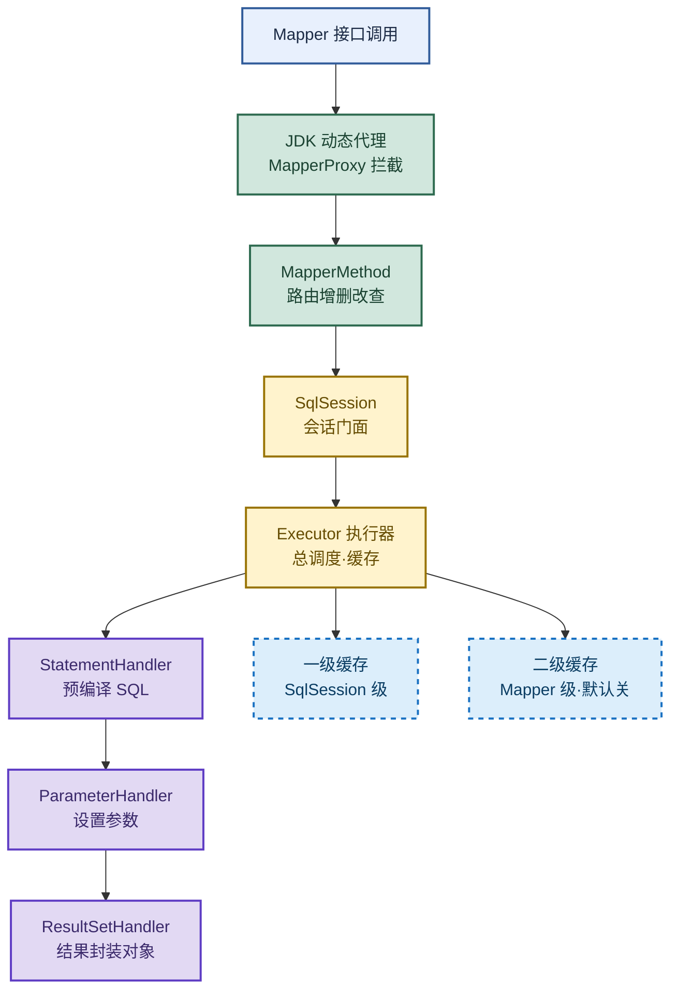

# MyBatis：运行原理与缓存机制

> 目标：遇到 MyBatis 题目先判断"问的是哪一环"——字段映射、批量插入、主键回填、运行四环节、一二级缓存，再展开机制和实战。
>
> 读图顺序：先看下方"先记住这张总图"（MyBatis 运行链路 + 缓存层级），再按问题回看各节。每节底部都有**易混点**或**速记**；先遮住解释自己讲，再对照正文。
>
> 本笔记覆盖 resultMap 映射 + 批量插入 + 主键回填 + 运行四环节（解析/代理/执行/封装）+ 一二级缓存 + `#{}` 与 `${}` 区别。

## 先记住这张总图



**一句话主线：**接口调用 → 动态代理拦截 → MapperMethod 路由 → SqlSession 交给 Executor → 协调三大 Handler（Statement/Parameter/ResultSet）完成 SQL 执行与结果封装，缓存分一二级兜底提速。

## 1. 字段名与属性名不一致：resultMap 映射

> 实体类属性名和表字段名对不上时，查询结果会丢值。两种解法，优先用 resultMap。

| 方式 | 写法 | 优点 | 缺点 |
|---|---|---|---|
| 方式 1：SQL 别名 | `SELECT user_name AS userName FROM t_user` | 零配置，改 SQL 即可 | SQL 与映射耦合，多表复用差 |
| 方式 2：resultMap | `<resultMap>` 标签显式映射列与属性 | 解耦、可复用、支持多表关联 | 需额外写映射配置 |

resultMap 核心写法：

```xml
<resultMap id="userMap" type="User">
  <id column="user_id" property="userId"/>
  <result column="user_name" property="userName"/>
</resultMap>
<select id="findById" resultMap="userMap">
  SELECT user_id, user_name FROM t_user WHERE user_id = #{id}
</select>
```

**易混点：**`resultType` 和 `resultMap` 二选一，不能同时用。`resultType` 适合字段名与属性名一致（或别名后一致）的简单场景；`resultMap` 适合字段名不一致、多表关联、一对多/多对多复杂映射。**别用 `resultType=Map`** 凑合——丢失类型信息且字段名大小写敏感。

**速记：**别名改 SQL、resultMap 改映射；简单用 type，复杂用 map。

## 2. 结果封装：反射创建对象并赋值

> MyBatis 把 ResultSet 转成 Java 对象，靠的是 resultMap + 反射。

| 步骤 | 做什么 | 关键组件 |
|---|---|---|
| 1 | 读取 resultMap 中列与属性的映射关系 | ResultSetHandler |
| 2 | 通过**反射**调用无参构造创建目标对象 | `Class.newInstance()` / Constructor |
| 3 | 遍历 ResultSet 列，按映射用**反射**给属性赋值 | `Field.set()` / setter |
| 4 | 处理关联对象（association/collection）递归封装 | 嵌套 resultMap |

**核心机制：**`ResultSetHandler.handleResultSets()` 根据 resultMap 的元数据，用反射创建对象、用反射给属性赋值，把数据库行 → Java 对象。这就是"为什么属性名要和列名对应"——反射按 property 名找 setter/field。

**易混点：**反射赋值走的是 setter 方法（如果存在），不是直接 set field；没有 setter 时才走 field 反射（需 `autoMapping` 或 `accessField` 配置）。所以实体类要么提供无参构造 + setter，要么用 `@Builder` + 默认构造。

**速记：**resultMap 定义映射 → 反射 new 对象 → 反射 set 属性 → 关联递归。

## 3. 批量插入：foreach 拼接 SQL

> 单条 insert 循环太慢，用 `<foreach>` 一次拼多条 VALUES。

| 标签/属性 | 作用 | 记忆画面 |
|---|---|---|
| `<insert>` | 定义插入语句 | 装数据的箱子 |
| `parameterType="java.util.List"` | 声明参数是 List | 进货清单 |
| `<foreach>` | 遍历集合拼 SQL | 流水线逐件打包 |
| `collection="list"` | 集合名（List 默认 list） | 取哪摞货 |
| `index="i"` | 下标 | 第几件 |
| `item="u"` | 当前元素别名 | 这件货叫 u |
| `separator=","` | 元素间分隔符 | 货之间隔开 |
| `<include refid="cols"/>` | 引用 sql 片段 | 复用同款包装 |

批量插入写法：

```xml
<insert id="batchInsert" parameterType="java.util.List">
  INSERT INTO t_user (user_name, age) VALUES
  <foreach collection="list" item="u" separator=",">
    (#{u.userName}, #{u.age})
  </foreach>
</insert>
```

**易混点：**批量插入有两种拼法——① `VALUES (...),(...),(...)` 一条 SQL 多行（推荐，一次网络往返）；② `separator=";"` 拼多条 `INSERT` 语句（需 JDBC URL 加 `allowMultiQueries=true`，有 SQL 注入风险，不推荐）。**优先用第一种单条多行 VALUES**。

**速记：**foreach 遍历 list，item 取元素，separator 逗号拼 VALUES。

## 4. 主键回填：useGeneratedKeys

> 自增主键插入后，把生成的主键塞回参数对象，供后续逻辑使用。

| 配置 | 作用 | 适用 |
|---|---|---|
| `useGeneratedKeys="true"` | 开启自增主键回填 | 仅自增长策略 |
| `keyProperty="id"` | 回填到参数对象的哪个属性 | 实体类主键字段 |
| `<selectKey>` 标签 | 自定义取主键 SQL（如序列、UUID） | 非自增主键 |

写法：

```xml
<insert id="insert" useGeneratedKeys="true" keyProperty="id">
  INSERT INTO t_user (user_name) VALUES (#{userName})
</insert>
```

执行后 `user.getId()` 即可拿到回填的主键值。

**易混点：**`useGeneratedKeys` 只对**自增长**主键有效；Oracle 序列、UUID 等非自增主键要用 `<selectKey>` 标签自定义取值（如 `SELECT SEQ_USER.NEXTVAL FROM DUAL`）。`keyProperty` 是实体属性名，不是列名。

**速记：**自增用 useGeneratedKeys + keyProperty；非自增用 selectKey。

## 5. 运行原理四环节：解析 → 代理 → 执行 → 封装

> MyBatis 从接口调用到结果返回的完整链路，分四个环节。

| 环节 | 时机 | 做什么 | 核心组件 |
|---|---|---|---|
| 1. 解析 | 启动时 | 读取所有 XML 配置文件，把 SQL 和参数配置封装到 Configuration 全局对象 | XMLConfigBuilder |
| 2. 代理 | 运行时 | JDK 动态代理为 Mapper 接口生成代理对象，调用方法时代理拦截转交 MapperMethod 处理，按操作类型路由到 SqlSession 对应方法 | MapperProxy / MapperMethod |
| 3. 执行 | 运行时 | SqlSession 把任务交给 Executor 执行器（总调度者） | Executor |
| 4. 封装 | 运行时 | Executor 协调三个核心 Handler 完成预编译、设参、结果封装 | StatementHandler / ParameterHandler / ResultSetHandler |

三大 Handler 职责：

| Handler | 职责 | 记忆画面 |
|---|---|---|
| StatementHandler | 预编译 SQL、创建 Statement | 厨师备锅 |
| ParameterHandler | 给 SQL 设置参数 | 厨师下料 |
| ResultSetHandler | 把查询结果封装成 Java 对象 | 厨师装盘上菜 |

**完整链路：**接口调用 → MapperProxy 拦截 → MapperMethod 路由 → SqlSession 对应方法 → Executor 调度 → StatementHandler 预编译 → ParameterHandler 设参 → 执行 SQL → ResultSetHandler 封装结果 → 返回。

**易混点：**Executor 才是"总调度者"，SqlSession 只是门面（Facade）。Executor 有三种实现：SimpleExecutor（默认，每次新建 Statement）、ReuseExecutor（复用 Statement）、BatchExecutor（批处理）。**缓存挂在 Executor 上**，不是挂在 SqlSession 上。

**速记：**解析 Configuration → 代理 MapperProxy → 执行 Executor → 封装三 Handler。

## 6. 一级缓存与二级缓存

> MyBatis 自带两级缓存，提速查询。一级默认开，二级默认关。

| 对比维度 | 一级缓存 | 二级缓存 |
|---|---|---|
| 作用范围 | SqlSession 级别 | Mapper（namespace）级别 |
| 默认状态 | 默认开启 | 默认关闭，需手动开启 |
| 跨 SqlSession | 互不影响（各自独立） | 跨 SqlSession 共享 |
| 失效时机 | SqlSession 关闭/commit/rollback/执行 update | 执行该 namespace 的 insert/update/delete |
| 存储位置 | Executor 内部 HashMap | 跨 SqlSession 的装饰器层 |
| 开启方式 | 无需配置 | `<cache/>` + 实体类 Serializable |

二级缓存开启：

```xml
<!-- Mapper.xml 中加一行 -->
<cache/>
<!-- 实体类需实现 Serializable -->
```

查询顺序：**二级缓存 → 一级缓存 → 数据库**。二级缓存命中直接返回；未命中查一级缓存；仍未命中查数据库，结果回填一级再回填二级。

**易混点：**一级缓存是 SqlSession 级，不同 SqlSession 之间数据互不影响——这就是为什么 A 会话 update 后，B 会话还能查到旧数据（脏读）。二级缓存是 Mapper 级跨会话共享，但**只要该 namespace 执行了任意 insert/update/delete，整个 namespace 的二级缓存全部清空**（粒度粗，容易误清）。分布式环境下二级缓存不共享，需换 Redis 等分布式缓存。

**速记：**一级 SqlSession 默认开，二级 Mapper 默认关；查询顺序二→一→库。

## 7. `#{}` 与 `${}` 的区别

> 补充高频考点：两种占位符机制完全不同，用错有 SQL 注入风险。

| 对比维度 | `#{}` | `${}` |
|---|---|---|
| 底层机制 | PreparedStatement 占位符 `?` + 参数设置 | 字符串直接拼接进 SQL |
| SQL 注入 | 安全（预编译转义） | 有注入风险 |
| 参数类型 | 自动类型处理 | 纯字符串替换 |
| 适用场景 | 传值（where 条件、insert 值） | 动态表名、列名、排序字段 |
| 引号 | 自动加引号 | 不加引号 |

**易混点：**`#{}` 是预编译占位符（`?`），安全但**不能用于表名/列名/ORDER BY 字段**（预编译不支持结构化元素）；`${}` 是字符串拼接，能用于动态表名/列名但有注入风险，**必须先校验白名单**再用。日常传值一律用 `#{}`，只有动态表名/排序字段才用 `${}` 且要严格校验。

**速记：**`#{}` 预编译安全传值，`${}` 拼接有风险用于结构。

## 高频场景题：用一句诊断开头

### "MyBatis 运行原理讲一下？"

四环节：启动时 XMLConfigBuilder 读所有 XML 把 SQL 和参数封装到 Configuration 全局对象（解析）；运行时 JDK 动态代理为 Mapper 接口生成代理对象，调用方法时拦截转交 MapperMethod，按操作类型路由到 SqlSession 对应方法（代理）；SqlSession 把任务交给 Executor 总调度（执行）；Executor 协调 StatementHandler 预编译 SQL、ParameterHandler 设参、ResultSetHandler 封装结果返回（封装）。这就是从接口调用到 SQL 执行再到结果返回的完整链路。

### "一级缓存和二级缓存区别？"

一级缓存 SqlSession 级别默认开启，不同 SqlSession 之间缓存数据互不影响；二级缓存 Mapper 级别默认关闭可以开启，跨 SqlSession 共享。查询顺序是二级 → 一级 → 数据库。二级缓存只要该 namespace 执行了 insert/update/delete 就全部清空，粒度粗；分布式环境不共享，需换 Redis。

### "实体类属性名和表字段名不一致怎么办？"

两种方式：方式 1 在 SQL 语句中用 `AS` 设置字段别名；方式 2 用 `<resultMap>` 标签定义列与属性的映射关系。优先用 resultMap，解耦可复用，还支持多表关联。MyBatis 封装结果时通过 resultMap 用反射创建对象、用反射给属性赋值。

## 面试回答模板：三句话讲清一题

> **问题本质是……**（先说问的是哪一环：映射、批量、主键、运行原理、缓存）。
>
> **机制是……**（解释原理 + 关键组件），因为……（为什么这样设计）。
>
> **实战中我会……**（具体场景 + 例子），例如……（业务应用）。

例：问"MyBatis 运行原理"——本质是接口调用到 SQL 执行的完整链路；机制是四环节（解析 Configuration → 动态代理 MapperProxy → Executor 调度 → 三大 Handler 预编译/设参/封装），因为 MyBatis 把 SQL 写在 XML 里用动态代理屏蔽 JDBC 细节；实战中我调 `userMapper.findById(1)`，背后走 MapperProxy → SqlSession → Executor → StatementHandler 预编译 → ResultSetHandler 反射封装成 User 对象返回。

## 最后复习：闭眼回忆 8 句

1. **字段映射**：属性名与列名不一致，方式 1 SQL 别名、方式 2 resultMap；优先 resultMap，解耦可复用。
2. **结果封装**：ResultSetHandler 按 resultMap 用反射创建对象、用反射给属性赋值，关联对象递归封装。
3. **批量插入**：`<foreach>` 遍历 list，item 取元素，separator 逗号拼单条多行 VALUES（推荐，非 separator 分号拼多条）。
4. **主键回填**：自增用 `useGeneratedKeys="true"` + `keyProperty="id"`；非自增（序列/UUID）用 `<selectKey>`。
5. **运行四环节**：解析（XMLConfigBuilder → Configuration）→ 代理（MapperProxy → MapperMethod）→ 执行（Executor 总调度）→ 封装（三大 Handler）。
6. **三大 Handler**：StatementHandler 预编译、ParameterHandler 设参、ResultSetHandler 封装结果。
7. **缓存**：一级 SqlSession 级默认开（跨会话互不影响），二级 Mapper 级默认关（跨会话共享，namespace 任意更新全清空）；查询顺序二→一→库。
8. **`#{}` 与 `${}`**：`#{}` 预编译占位符安全传值，`${}` 字符串拼接用于动态表名/列名但有注入风险需白名单校验。

## 怎么练才记得住

别反复通读，改成主动回忆：

1. 每次只看一个主题，遮住表格，先自己说出"机制 → 关键组件 → 场景"，再对照。
2. 用"运行四环节链路"和"一二级缓存区别"各讲 30 秒；卡住时只回看对应小节。
3. 隔天再讲一遍，换成自己的项目例子；能解释"为什么二级缓存粒度粗、为什么 `#{}` 不能用于表名"才算会。
4. 复习时轮流画"运行四环节流程图"和"三大 Handler 职责表"；能默写出批量插入 foreach 写法才算熟。
