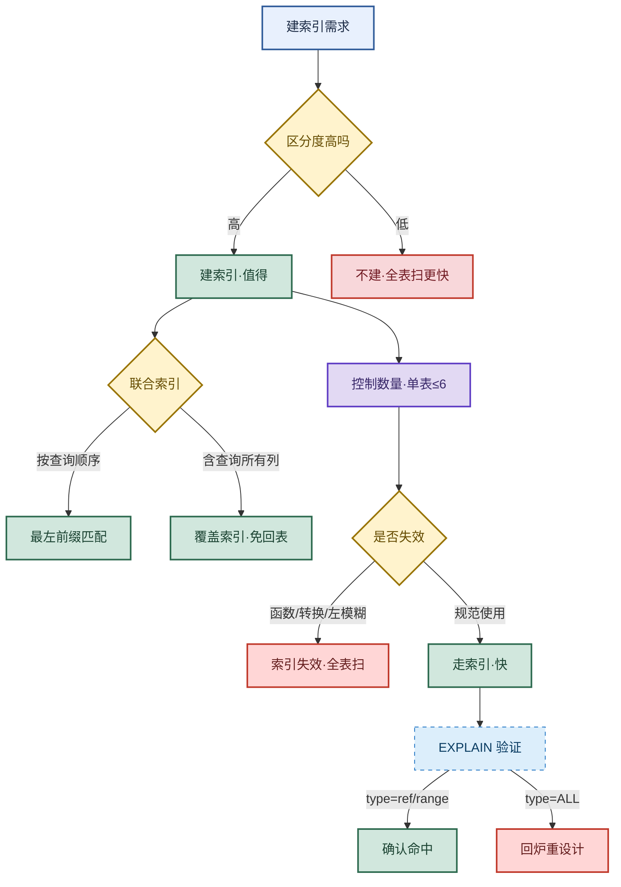

# MySQL 索引：设计原则与失效场景

> 目标：不背孤立规则。遇到索引题先判断"问的是设计还是失效"——设计看选择性/最左前缀/覆盖索引，失效看函数/隐式转换/左模糊，最后用 EXPLAIN 验证。
>
> 读图顺序：先看下方"先记住这张总图"，再按问题回看各节。每节底部都有**易混点**或**速记**；先遮住解释自己讲，再对照正文。
>
> 本笔记以 InnoDB + B+ 树索引为主，MySQL 5.7/8.0 通用。

## 先记住这张总图

**一句话主线：**区分度高才建索引 → 联合索引守最左前缀 → 覆盖索引免回表 → 控数量避失效 → EXPLAIN 验证 type 不是 ALL。

## 1. 索引底层：B+ 树为什么快

> 索引不是"附加列表"，而是把列值排进 B+ 树，靠有序 + 多路降低树高。

InnoDB 的索引是 **B+ 树**：所有数据都存在**叶子节点**，非叶子节点只存索引键 + 子节点指针，叶子节点之间用**双向链表**连接。

| 特征 | 说明 | 记忆画面 |
|---|---|---|
| 多路平衡 | 树高通常 3~4 层 | 大楼的楼层索引，3 层就能定位到房间 |
| 叶子存数据 | 真实行数据只在叶子 | 仓库货架在最底层，楼上只放目录牌 |
| 叶子链表 | 叶子节点双向链表 | 字典页码连成一条线，范围翻页快 |
| 3 层存 2000 万行 | 单节点 16KB，可放约 1000 个键，1000³ ≈ 10 亿 | 三级目录管千万行，三次磁盘 IO 搞定 |

**易混点：****聚簇索引**（主键索引，叶子存整行数据）和**二级索引**（非主键索引，叶子存主键值，需回表）不是同一种结构用途。二级索引查到主键后还要去聚簇索引取整行，这就是"回表"。

**速记：**B+ 树 = 多路 + 叶子存数据 + 叶子链表；3 层管 2000 万行，IO 次数 = 树高。

## 2. 选择性原则：区分度决定要不要建

> 一句话：**区分度越高，索引越值；区分度低，建了也白建。**

区分度 = `count(distinct col) / count(*)`，越接近 1 越适合建索引。

| 区分度 | 典型列 | 是否建索引 | 记忆画面 |
|---|---|---|---|
| 接近 1 | 身份证号、订单号、UUID | ✅ 强烈推荐 | 一人一个号，一查就中 |
| 0.5~0.9 | 用户名、手机号 | ✅ 推荐 | 大多数不重复 |
| 0.1~0.3 | 性别、状态、是否删除 | ❌ 不推荐 | 全表一半都是男，索引筛不掉多少 |
| 接近 0 | 布尔标志、固定枚举 | ❌ 不建 | 翻完索引还得翻大半张表 |

**易混点：**区分度低不是"绝对不能建"，而是单独建没意义；但如果是**联合索引的最后一列**，配合高区分度列做覆盖，仍可能有用。判断标准是"过滤后还剩多少行"，不是单看列本身。

**速记：**性别状态不建索引，订单号手机号必建；区分度低于 0.3 要三思。

## 3. 最左前缀原则：联合索引的匹配规则

> 联合索引 `(a, b, c)` 按 a → b → c 顺序排好，查询必须从最左列开始，不能跳过中间列。

| 查询条件 | 是否走索引 | 原因 | 记忆画面 |
|---|---|---|---|
| `where a=1` | ✅ 用到 a | 从最左列开始 | 查字典先翻首字母 |
| `where a=1 and b=2` | ✅ 用到 a,b | 连续匹配 | 首字母 + 第二字母 |
| `where a=1 and b=2 and c=3` | ✅ 全用 | 完整匹配 | 三级目录全命中 |
| `where b=2` | ❌ 不走 | 跳过 a | 直接翻第二字母，目录失效 |
| `where a=1 and c=3` | ⚠️ 只用 a | 跳过 b，c 失效 | 中间隔一层，c 用不上 |
| `where a=1 and b>2 and c=3` | ⚠️ 用 a,b | b 是范围，c 失效 | 范围之后目录断了 |

**易混点：****"最左前缀"指索引列的顺序，不是 SQL 中 WHERE 的书写顺序**。`where b=2 and a=1` 优化器会自动调整为 a、b 顺序，仍能走索引。但跳过中间列（如 a、c 跳过 b）则无法补齐。

**速记：**从左到右连续匹配，遇到范围查询（`> < between like 'x%'`）就断，之后的列失效。

## 4. 覆盖索引：免回表就是快

> 一句话：**查询的列全在索引里，就不用回表，直接从索引树返回。**

| 场景 | 索引 | 是否回表 | 性能 |
|---|---|---|---|
| `select * from t where a=1` | `(a)` | ✅ 回表 | 慢：索引查到主键 → 再查聚簇索引 |
| `select a,b from t where a=1` | `(a,b)` | ❌ 不回表 | 快：索引里就有 a、b |
| `select a,b,c from t where a=1` | `(a,b,c)` | ❌ 不回表 | 快：覆盖索引 |
| `select a,b,c,d from t where a=1` | `(a,b,c)` | ✅ 回表 | 慢：d 不在索引里 |

**易混点：**覆盖索引不是一种"索引类型"，而是"查询恰好被索引覆盖"的**使用状态**。EXPLAIN 里看到 `Extra: Using index` 就说明走了覆盖索引，不需要回表。

**速记：**`select` 的列 ⊆ 索引列 → `Using index` → 免回表。所以联合索引要把高频查询的列都包进去。

## 5. 控制索引数量：不是越多越好

> 索引是空间换时间，但每次写入都要维护所有索引树，多了拖垮写性能。

| 影响维度 | 说明 | 记忆画面 |
|---|---|---|
| 写入变慢 | insert/update/delete 要同步更新所有索引 | 每加一本书要更新 N 个目录 |
| 占用空间 | 每个索引一棵 B+ 树 | 目录本身也占书架 |
| 优化器选择困难 | 多个可用索引时选错 | 路太多反而迷路 |
| 单表建议 | 5~6 个以内 | 一本书 5~6 个目录够用了 |

**易混点：**"单表 5~6 个"是经验值不是硬上限。核心判断是**每个索引都要有高频查询对应**，没人查的索引就是纯负担。建索引前先看慢查询日志，确认这列真的被频繁过滤。

**速记：**索引有维护成本，建一个就要有一个查询用得上；冗余索引及时删。

## 6. 索引失效场景：七大杀手

> 一句话：**索引列上一旦被"加工"（函数、转换、模糊、运算），优化器就用不上索引了。**

| 失效场景 | 错误写法 | 正确写法 | 记忆画面 |
|---|---|---|---|
| 左模糊 | `like '%abc'` | `like 'abc%'` | 字典从后往前翻，目录废了 |
| 函数操作 | `where year(t)=2024` | `where t between '2024-01-01' and '2024-12-31'` | 先加工再查，索引认不出 |
| 隐式类型转换 | `where phone=13800138000`（phone 是 varchar） | `where phone='13800138000'` | 数字对字符串，被转成函数 |
| 违反最左前缀 | 联合索引 `(a,b,c)` 查 `where b=2` | `where a=1 and b=2` | 跳过最左列，目录失效 |
| 范围后列失效 | `where a=1 and b>2 and c=3` | 把范围列放最后 | 范围之后断链 |
| `!=` / `NOT IN` | `where status != 1` | 改用 `in (2,3,4)` 或拆分 | 否定条件优化器难走索引 |
| OR 两侧未都有索引 | `where a=1 or b=2`（b 无索引） | 给 b 也建索引，或拆成 union | 一边没索引就退化全表扫 |

**易混点：**
- **`!=` 不是绝对失效**，区分度高时仍可能走索引，但优化器通常判断"过滤后行数仍多"而放弃。
- **`OR` 不是绝对失效**，只有当 OR 两侧**至少有一列无索引**时才退化全表扫；两侧都有索引时走 `index_merge`。
- **`like 'abc%'`（右模糊）能走索引**，只有左模糊 `%abc` 和全模糊 `%abc%` 才失效。

**速记：**左模糊、函数、隐式转换、跳最左、范围后断、否定条件、OR 单边——七大杀手记全。

## 7. EXPLAIN 验证：用执行计划说话

> 设计完索引别凭感觉，跑一遍 `EXPLAIN` 看执行计划，确认索引真的被用上。

| 列 | 关注点 | 好信号 | 坏信号 |
|---|---|---|---|
| `type` | 访问类型 | `const` / `eq_ref` / `ref` / `range` | `ALL`（全表扫） |
| `key` | 实际用的索引 | 命中预期索引 | `NULL`（没用索引） |
| `rows` | 预估扫描行数 | 越小越好 | 接近全表行数 |
| `Extra` | 附加信息 | `Using index`（覆盖索引） | `Using filesort` / `Using temporary` |

**type 从好到差排序：**`const` > `eq_ref` > `ref` > `range` > `index` > `ALL`

**易混点：**`type=index` 看起来像走索引，其实是**扫描整棵索引树**（比 ALL 稍好但仍是全扫），通常出现在 `select count(*)` 或查询列全在索引里但无 where 过滤时。真正"用索引定位"是 `ref`/`range` 及以上。

**速记：**看 type 不是 ALL、key 不是 NULL、Extra 有 Using index 就基本稳了。

## 高频场景题

### "查询突然变慢，怎么判断是不是索引失效？"

诊断：先 `EXPLAIN` 看 `type` 是否退化成 `ALL`、`key` 是否变 `NULL`，再对照 SQL 检查七大失效场景（左模糊、函数、隐式转换、跳最左、范围后断、否定条件、OR 单边）。

### "联合索引 (a,b,c)，where a=1 and c=3 走索引吗？"

诊断：只走 a，c 用不上。因为跳过了 b，B+ 树在 a 之后无法直接定位 c。要么改成 `a=1 and b=? and c=3`，要么把 c 单独建索引，或调整联合索引顺序为 `(a,c,b)`。

### "性别字段要不要建索引？"

诊断：单独建没意义——区分度太低，过滤后仍剩一半行，优化器宁可全表扫。但如果是联合索引 `(status, user_id)` 配合高区分度列做覆盖，仍可能有用。判断标准是"过滤后还剩多少行"。

### "为什么 select * 慢，select 指定列快？"

诊断：`select *` 必然回表（聚簇索引取整行），而 `select` 指定列若被索引覆盖则 `Using index` 免回表。所以高频查询要建覆盖索引，把查询列都包进联合索引。

## 面试回答模板：三句话讲清一题

> **问题本质是**索引设计要在"查询加速"和"写入维护成本"之间找平衡，不是越多越好，也不是有索引就一定快。
>
> **机制是**InnoDB 用 B+ 树存索引，3 层可管 2000 万行；联合索引按最左前缀匹配，覆盖索引可免回表；但函数、隐式转换、左模糊等会让索引失效退化为全表扫。
>
> **实战中我会**先按区分度选列、按查询顺序排联合索引、用覆盖索引减少回表、控制单表索引 5~6 个以内，最后用 EXPLAIN 验证 `type` 不是 `ALL`、`Extra` 有 `Using index`，确保索引真的被用上。

## 最后复习：闭眼回忆 8 句

1. InnoDB 索引是 B+ 树，叶子存数据 + 双向链表，3 层管 2000 万行。
2. 聚簇索引叶子存整行，二级索引叶子存主键，二级索引查完要回表。
3. 选择性原则：区分度接近 1 才建索引，性别状态这种低区分度列不单独建。
4. 最左前缀：联合索引从左到右连续匹配，跳过中间列则后续列失效。
5. 覆盖索引：查询列全在索引里就免回表，EXPLAIN 显示 `Using index`。
6. 控制数量：单表 5~6 个以内，每个索引都要有高频查询对应。
7. 七大失效：左模糊、函数、隐式转换、跳最左、范围后断、否定条件、OR 单边无索引。
8. EXPLAIN 验证：看 `type` 不是 `ALL`、`key` 不是 `NULL`、`Extra` 有 `Using index`。

## 怎么练才记得住

1. **造一张 100 万行的表**，建不同区分度的列，对比 `where` 查询的 EXPLAIN `type` 和 `rows`，亲手感受"区分度低 = 全表扫"。
2. **写 7 条故意失效的 SQL**（左模糊、函数、隐式转换各一条），每条跑 EXPLAIN 确认 `type=ALL`，再改成正确写法对比。
3. **联合索引实验**：建 `(a,b,c)`，跑 `where a` / `where a,b` / `where a,c` / `where b` / `where a=1 and b>2 and c=3` 五种，记录 `key_len` 看用了几列。
4. **遮住解释讲一遍**：对着总图，从"建索引需求"到"EXPLAIN 验证"完整讲一遍，卡住的地方就是没记住的，回去重看对应小节。
