# MySQL核心：InnoDB、B+树、MVCC与2PC

> 目标：不背孤立名词。遇到 MySQL 题先判断"问的是哪一层"——是存储引擎选型，还是索引结构，还是事务隔离，还是分布式一致性。
> 目标：把 InnoDB/MyISAM、聚簇/二级索引、Redo/Undo、MVCC 四级隔离、2PC 与 XA、SQL 执行流程、范式、索引优化串成一条主线，能三句话讲清一题。
> 目标：每个易混点都能用一句话区分，比如"聚簇索引存整行，二级索引存主键要回表"。

## 先记住这张总图

```mermaid
flowchart TD
    A([MySQL 核心体系]) --> B[存储引擎<br/>InnoDB vs MyISAM]
    A --> C[索引结构<br/>B+树·聚簇/二级]
    A --> D[事务日志<br/>Redo 持久·Undo 回滚]
    A --> E[MVCC 隔离<br/>RU·RC·RR·SR]
    A --> F[2PC 与 XA<br/>binlog 与 redo 对账]
    A --> G[SQL 执行流程<br/>连分优执存]

    B --> B1["事务行锁 InnoDB"]
    B --> B2["MyISAM 只读快"]
    C --> C1["聚簇索引 存整行"]
    C --> C2["二级索引 存主键"]
    D --> D1["Redo 重做不丢"]
    D --> D2["Undo 回滚+MVCC"]
    E --> E1["RC 每次新快照"]
    E --> E2["RR 复用防幻读"]
    F --> F1["Prepare 写双日志"]
    F --> F2["Commit 记 XID"]

    style A fill:#E8F0FD,stroke:#315C9A,stroke-width:2px,color:#1D2C46
    style B fill:#D1E7DD,stroke:#2D6A4F,stroke-width:2px,color:#1B4332
    style C fill:#FFF3CD,stroke:#997404,stroke-width:2px,color:#664D03
    style D fill:#E2D9F3,stroke:#5F3DC4,stroke-width:2px,color:#3B2A6B
    style E fill:#FFD6D6,stroke:#C0392B,stroke-width:2px,color:#641E1E
    style F fill:#DCEEFB,stroke:#1971C2,stroke-width:2px,stroke-dasharray:5,color:#0B3D63
    style G fill:#D1E7DD,stroke:#2D6A4F,stroke-width:2px,color:#1B4332
    style B1 fill:#D1E7DD,stroke:#2D6A4F,stroke-width:2px,color:#1B4332
    style B2 fill:#F8D7DA,stroke:#C0392B,stroke-width:2px,color:#721C24
    style C1 fill:#FFF3CD,stroke:#997404,stroke-width:2px,color:#664D03
    style C2 fill:#FFF3CD,stroke:#997404,stroke-width:2px,color:#664D03
    style D1 fill:#E2D9F3,stroke:#5F3DC4,stroke-width:2px,color:#3B2A6B
    style D2 fill:#E2D9F3,stroke:#5F3DC4,stroke-width:2px,color:#3B2A6B
    style E1 fill:#FFD6D6,stroke:#C0392B,stroke-width:2px,color:#641E1E
    style E2 fill:#FFD6D6,stroke:#C0392B,stroke-width:2px,color:#641E1E
    style F1 fill:#DCEEFB,stroke:#1971C2,stroke-width:2px,stroke-dasharray:5,color:#0B3D63
    style F2 fill:#DCEEFB,stroke:#1971C2,stroke-width:2px,stroke-dasharray:5,color:#0B3D63
```

**一句话主线：**MySQL 面试围绕"存储引擎选型、B+树索引、Redo/Undo 日志、MVCC 四级隔离、2PC 与 XA 一致性、SQL 执行流程、范式与索引优化"七条线展开，核心是 InnoDB 的事务与索引体系。

## 1. InnoDB vs MyISAM：怎么选存储引擎

一句话：**要事务行锁高并发写用 InnoDB，只读快历史归档用 MyISAM**。

| 维度 | InnoDB | MyISAM | 记忆画面 |
|---|---|---|---|
| 事务 | 支持 | 不支持 | InnoDB 是"银行"，MyISAM 是"账本" |
| 锁粒度 | 行级锁 | 表级锁 | InnoDB 锁一行，MyISAM 锁整张表 |
| 聚簇索引 | 主键索引存整行 | 索引存数据指针 | InnoDB 数据按主键排，MyISAM 索引指地址 |
| `COUNT(*)` | 全表扫描 | 直接返回计数器 | MyISAM 自带"计数器" |
| 适用场景 | 高并发写、需要事务 | 读多写少、历史归档 | 写多用 InnoDB，只读用 MyISAM |

**易混点**：**InnoDB 的 `COUNT(*)` 慢不是缺陷**——因为 MVCC 下不同事务看到的行数不同，没法维护一个全局计数器；MyISAM 没有事务没有 MVCC，所以能直接返回计数器。别答成"InnoDB 实现差"。

**速记：**事务行锁 InnoDB，MyISAM 只读快，count 全扫 vs 直接取，并发写入 InnoDB 强。

## 2. B+树索引：聚簇索引 vs 二级索引

一句话：**聚簇索引叶子存整行，二级索引叶子存主键要回表**。

| 维度 | 聚簇索引 | 二级索引（非聚簇） | 记忆画面 |
|---|---|---|---|
| 叶子节点 | 完整行数据 | 主键值 | 聚簇是"正文"，二级是"目录" |
| 物理存储 | 按主键顺序组织 | 索引与数据分开 | 聚簇数据即索引 |
| 查询路径 | 主键查询直达 | 先查二级拿主键再回表 | 二级多一次 IO |
| 数量限制 | 一张表只能一个 | 可以有多个 | 聚簇独一份 |
| 优势场景 | 主键查询、范围查询、返回多列 | 覆盖索引、频繁插入非自增主键 | 覆盖索引免回表 |

**易混点**：**回表不是必须的**——如果查询的列全在二级索引里（覆盖索引），比如 `SELECT name FROM user WHERE name='李四'`，二级索引叶子已有 `name` 和主键，直接返回不用回表。只有要查的列不在索引里才回表。

**易混点**：**InnoDB 没有显式主键时**——它会选第一个不包含 NULL 的唯一索引作聚簇索引；如果也没有，自动生成隐式 `ROW_ID`。所以建表最好显式定义自增主键，避免隐式 `ROW_ID` 带来的页分裂。

**速记：**聚簇存整行主键查极快，二级存主键要回表，覆盖索引免回表，3 层 B+树存 2000 万行。

## 3. Redo Log 与 Undo Log：持久性与一致性

一句话：**Redo 保证提交不丢（重做），Undo 支持回滚和 MVCC 快照读**。

| 维度 | Redo Log | Undo Log | 记忆画面 |
|---|---|---|---|
| 日志类型 | 物理日志（页做了什么修改） | 逻辑日志（修改前的旧值） | Redo 记"新值"，Undo 记"旧值" |
| 存储位置 | redo log file | 回滚段 Rollback Segment | Redo 落盘文件，Undo 在回滚段 |
| 核心作用 | 崩溃后重做，保证已提交不丢 | 事务回滚 + 为 MVCC 提供旧版本 | Redo 往前补，Undo 往后退 |
| 刷盘策略 | `innodb_flush_log_at_trx_commit` 每秒刷或每次提交刷 | 随事务产生 | Redo 控持久性 |
| 一致性目标 | 持久性（durability） | 原子性 + MVCC | Redo 保 D，Undo 保 A |

**易混点**：**Redo Log ≠ Binlog**——Redo Log 是 InnoDB 引擎层的物理日志（循环写，crash-safe），Binlog 是 Server 层的逻辑日志（追加写，主从复制）。两者通过 2PC 保证一致，别混成一回事。

**易混点**：**Undo Log 不只是回滚**——它还承担 MVCC 的旧版本链，快照读靠 Undo 重建历史版本。说 Undo 只管回滚是不完整的。

**速记：**Redo 物理日志保持久重做，Undo 逻辑日志保回滚和 MVCC，刷盘看 `innodb_flush_log_at_trx_commit`。

## 4. MVCC 与四级隔离级别

一句话：**RU 脏读、RC 每次新快照、RR 复用快照防幻读、SR 全锁串行**。

| 隔离级别 | 快照机制 | 脏读 | 不可重复读 | 幻读 | 记忆画面 |
|---|---|---|---|---|---|
| 读未提交 RU | 不用，直接读最新 | 有 | 有 | 有 | 不戴眼镜看脏数据 |
| 读已提交 RC | 每次 `SELECT` 生成新 ReadView | 无 | 有 | 有 | 每次重新拍照 |
| 可重复读 RR | 事务内复用同一 ReadView | 无 | 无 | InnoDB 用间隙锁解决 | 一张照片用到底 |
| 串行化 SR | 不用快照，加锁串行 | 无 | 无 | 无 | 排队一个一个来 |

**易混点**：**不可重复读 vs 幻读**——不可重复读是同一事务两次读**同一条数据**结果不同（别人修改并提交了）；幻读是同一事务两次执行**相同查询**返回**行数**不同（别人插入或删除了行）。前者是"内容变了"，后者是"行数变了"。

**易混点**：**RR 防幻读靠间隙锁（Gap Lock）**——锁住索引范围之间的空隙，阻止其他事务在范围内插入。但间隙锁只在 RR 级别有，RC 没有间隙锁所以仍有幻读。

**速记：**RU 未提交脏，RC 每次新快照，RR 复用防幻读间隙锁，串行化全锁串行跑。

## 5. 二阶段提交 2PC 与 MySQL 内部 XA

一句话：**分布式 2PC 先准备后提交有阻塞，MySQL 内部 2PC 用 XID 对账保 binlog 与 redo 一致**。

| 维度 | 分布式 2PC | 3PC 改进 | MySQL 内部 XA | 记忆画面 |
|---|---|---|---|---|
| 阶段 | Prepare + Commit | CanCommit + PreCommit + DoCommit | Prepare + Commit | 2PC 两步，3PC 三步 |
| Prepare | 冻结资源、锁定 | 加询问阶段 + 超时 | InnoDB 写 Redo 标 PREPARED 记 XID | 先"占座" |
| Commit | 全 OK 正式提交，任一失败回滚 | 等不到指令超时自动提交 | Server 写 Binlog 带 XID 刷盘，通知 InnoDB 提交 | 再"确认入座" |
| 缺点 | 同步阻塞、单点故障、极少不一致 | 仍可能不一致 | 崩溃后对账恢复 | 2PC 钱被锁住 |
| 崩溃恢复 | 协调者崩了全卡死 | 超时自动提交 | 扫 Redo 找 PREPARED，去 Binlog 找 XID，有则提交无则回滚 | 对账：binlog 有就提交 |

**易混点**：**MySQL 内部 2PC ≠ 分布式 2PC**——分布式 2PC 是跨多个数据库/资源管理器的一致性协议（有协调者单点问题）；MySQL 内部 2PC 是 InnoDB 引擎层 Redo Log 与 Server 层 Binlog 之间的一致性，用 XID 关联，崩溃后对账。两者都叫 2PC 但作用域不同。

**易混点**：**3PC 不是 2PC 的替代品**——3PC 加了询问阶段和超时，参与者等不到最终指令会超时自动提交，避免无限阻塞，但**仍可能不一致**（网络分区时），实际生产用得少。

**速记：**两阶段先准备写双日志记 XID，崩了重启对个账，binlog 有就提交没有就回滚。

## 6. MySQL 8.0 关键新特性（对比 5.7）

一句话：**8.0 加了隐藏/降序/函数索引、窗口函数、事务型数据字典，认证方式也变了**。

| 特性 | 作用 | 5.7 对比 | 记忆画面 |
|---|---|---|---|
| 隐藏索引 | 可临时禁用索引测试效果，避免删了重建 | 无 | 索引"开关"可试 |
| 降序索引 | `ORDER BY DESC` 直接走索引倒序 | 仅语法支持无优化 | 倒着排也走索引 |
| 函数索引 | 索引表达式如 `UPPER(name)`，加速计算字段 | 无 | JSON 查询快 8 倍 |
| 事务型数据字典 | 系统表用 InnoDB，原子 DDL，无 `.frm` 文件 | 有 `.frm` | 系统表也事务化 |
| 窗口函数 | `ROW_NUMBER`/`RANK` 简化分组统计 | 无 | 排名一行搞定 |
| 认证方式 | 默认 `caching_sha2_password` | 默认 `mysql_native_password` | 8.0 更安全 |

**易混点**：**升级 8.0 三要点**——测试所有 SQL（尤其 `GROUP BY` 和窗口函数行为变了）、认证方式默认变了老客户端可能连不上、评估执行计划变化。新项目直接上 8.0，JSON/文档存储/GIS 都更强。

**速记：**隐藏降序函数索引，窗口函数事务字典，认证默认 caching_sha2。

## 7. SQL 执行流程：连分优执存

一句话：**一条 SQL 走"连接器→分析器→优化器→执行器→存储引擎"，日志三宝 undo/redo/binlog 协作**。

| 阶段 | 职责 | 关键点 | 记忆画面 |
|---|---|---|---|
| 连接器 | 身份认证、连接管理 | 长连接内存占用注意 | 门卫查身份 |
| 分析器 | 词法分析、语法分析 | 解析成解析树 | 拆句子看对错 |
| 优化器 | 选择最优执行计划 | 可用 `FORCE INDEX` 纠正选错 | 选最快路线 |
| 执行器 | 调用存储引擎接口操作 B+树 | Buffer Pool 没有则触发磁盘 IO | 调度干活 |
| 存储引擎 | 真正读写数据 | InnoDB 操作 B+树 | 仓库管理员 |

**易混点**：**MySQL 8.0 移除了查询缓存（Query Cache）**——命中率太低（表一更新缓存全失效），8.0 直接砍掉。别在面试里说"先查缓存"，那是老版本。

**易混点**：**优化器可能选错索引**——统计信息不准时优化器会选错执行计划，实战用 `FORCE INDEX(idx_xxx)` 强制指定索引纠正。

**速记：**连分优执存五步走，日志三宝 undo 回滚、redo 重做、binlog 复制，8.0 砍了查询缓存。

## 8. 数据库范式：1NF 到 5NF

一句话：**1NF 列不可分，2NF 全依赖主键，3NF 无传递，4NF 拆多值，5NF 极少用**。

| 范式 | 要求 | 反例 | 记忆画面 |
|---|---|---|---|
| 1NF | 列不可分 | 电话列存两个号码 | 一格只放一个值 |
| 2NF | 非主键列完全依赖整个主键 | 联合主键（订单ID,商品ID）中商品名只依赖商品ID | 别"部分依赖" |
| 3NF | 非主键列不依赖其他非主键列 | 订单表有客户ID又有客户姓名（姓名依赖客户ID） | 别"传递依赖" |
| 4NF | 消除多值依赖 | 课程表同时多教师多教材，拆两张表 | 多值拆开存 |
| 5NF | 处理连接依赖 | 拆到不能再拆 | 极少使用 |

**易混点**：**范式不是越高越好**——3NF 通常够用，过度范式化会导致多表 JOIN 性能下降。实际业务常做**适度反范式**（冗余几列）换取查询性能，结合实际场景取舍。

**速记：**1NF 列不可分，2NF 全依赖主键，3NF 无传递，4NF 拆多值，范式不是越高越好。

## 9. 索引优化：设计原则与失效场景

一句话：**等值列放最左、范围列放右边、覆盖索引少回表，左模糊/函数/类型错/OR 缺索引都失效**。

| 原则/场景 | 说明 | 记忆画面 |
|---|---|---|
| 等值列放最左 | 等值条件列放在联合索引最左 | 等值是"门面" |
| 范围列放右边 | 范围条件列放在等值列之后 | 范围"收尾" |
| 覆盖索引 | 索引包含查询所需全部列，免回表 | 索引即答案 |
| 左模糊失效 | `LIKE '%abc'` 走不了索引 | 前面没线索 |
| 函数操作失效 | `WHERE UPPER(name)='JOHN'` 走不了 | 函数包住列 |
| 隐式类型转换 | `WHERE phone=123`（phone 是 varchar）走不了 | 类型不匹配 |
| 违反最左前缀 | 跳过索引第一列，索引失效 | 第一列不能跳 |
| 范围后列失效 | `WHERE age>20 AND name='张三'` 只有 age 走索引 | 范围之后断 |
| 不等号/OR | `NOT IN`、OR 两侧没都有索引则失效 | 不等难走索引 |

**易混点**：**`LIKE 'abc%'` 能走索引，`LIKE '%abc'` 不能**——最左前缀原则：前缀确定才能用索引树比较，左模糊（前面是 `%`）等于没有起点，只能全表扫描。

**易混点**：**OR 不是一定失效**——只有 OR 两侧的列**都有索引**时才能走索引合并；任一侧没索引就退化为全表扫描。别一刀切说"OR 必失效"。

**速记：**等值左范围右覆盖索引少回表，左模糊函数类型错 OR 缺索引都失效。

## 高频场景题

### "查 7 天内 status=APPLYING 的数据按 id 倒序，怎么优化索引？"

诊断：先看数据特征——7 天 100 万条，其中 `APPLYING` 只有 100 条。推荐建联合索引 `INDEX idx_status_created_at(status, created_at)`：`status` 等值过滤后只剩 100 条，即使有 filesort 排序开销也极小。把高区分度且等值过滤的列放最左。

### "InnoDB 的聚簇索引和二级索引有什么区别？"

诊断：聚簇索引叶子节点存完整行数据，表本身按主键顺序组织，一张表只能一个；二级索引叶子节点存主键值，查询时通常要先查二级拿主键再回表到聚簇索引，多一次 IO。覆盖索引（查询列全在二级索引里）可免回表。

### "RR 级别下 InnoDB 怎么防止幻读？"

诊断：RR 在事务内复用同一个 ReadView 解决不可重复读，再用**间隙锁（Gap Lock）**锁住索引范围之间的空隙，阻止其他事务在范围内插入新行，从而防止幻读。RC 没有间隙锁所以仍有幻读。

## 面试回答模板：三句话讲清一题

> **问题本质是**：MySQL 的一致性靠"Redo/Undo 日志 + MVCC 快照 + 2PC 对账"三层保证，核心矛盾是"高并发下既要性能又要正确"。
>
> **机制是**：Redo Log 物理日志保持久性，Undo Log 逻辑日志保回滚和 MVCC 旧版本；MVCC 用 ReadView 在 RC 每次新建、RR 事务内复用，配合间隙锁防幻读；2PC 用 XID 关联 binlog 与 redo，崩溃后对账保证主从不丢数据。
>
> **实战中我会**：建表显式定义自增主键避免页分裂，索引按"等值左范围右覆盖索引"设计，慢查询用 `FORCE INDEX` 纠正优化器选错，分页用 `WHERE id > ? LIMIT ?` 替代大 `OFFSET`。

## 最后复习：闭眼回忆 8 句

1. InnoDB 要事务行锁，MyISAM 只读快 count；`COUNT(*)` InnoDB 全扫是 MVCC 的锅不是缺陷。
2. B+树聚簇索引存整行主键查极快，二级索引存主键要回表，3 层可存 2000 万行。
3. 覆盖索引（查询列全在索引里）免回表；InnoDB 无显式主键选唯一索引或隐式 `ROW_ID`。
4. Redo 物理日志保持久重做，Undo 逻辑日志保回滚和 MVCC 旧版本，刷盘看 `innodb_flush_log_at_trx_commit`。
5. MVCC 四级隔离：RU 脏读、RC 每次新快照、RR 复用快照+间隙锁防幻读、SR 全锁串行。
6. 不可重复读是同条数据内容变，幻读是行数变；RR 靠间隙锁（Gap Lock）防幻读。
7. 2PC 先 Prepare 写双日志记 XID，Commit 写 binlog 带 XID；崩了重启对账，binlog 有就提交没有就回滚。
8. 索引优化：等值左范围右覆盖索引少回表，左模糊/函数/类型错/违反最左前缀/OR 缺索引都失效。

## 怎么练才记得住

1. **画一张总图**：闭眼默写七大模块（引擎/索引/日志/MVCC/2PC/执行流程/范式优化），每个模块下挂 2~3 个关键词，画不出就回去重看。
2. **对比口述**：对着空气把"聚簇 vs 二级""Redo vs Undo""RC vs RR""分布式 2PC vs MySQL XA"四组易混点用一句话各自讲清，讲混了就重背。
3. **场景代入**：假设面试官问"7 天 100 万条数据查 100 条 APPLYING 怎么建索引"，逼自己说出为什么 `idx_status_created_at` 把 `status` 放最左，把区分度和等值过滤套进去。
4. **易混点自测**：把"不可重复读 vs 幻读""`LIKE 'abc%'` vs `LIKE '%abc'`""binlog vs redo log"三组易混点写在卡片上，随机抽一张默答区别。
