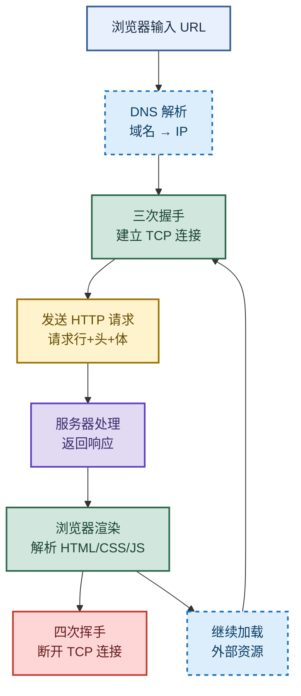

# 网络传输：TCP/UDP、握手挥手与跨域

> 目标：不背孤立名词。遇到网络题先判断"问的是哪一层"——传输层选型（TCP/UDP）、连接生命周期（握手挥手）、可靠性机制（序号/确认/重传/滑动窗口）、应用层跨域、还是全链路流程，再讲机制、取舍和实战做法。
>
> 读图顺序：先看下方"先记住这张总图"，再按问题回看各节。每节底部都有**易混点**或**速记**；先遮住解释自己讲，再对照正文。
>
> 本笔记以 HTTP/1.1 为主，HTTPS、HTTP/2 的差异会在对应小节标注。

## 先记住这张总图

**一句话主线：**TCP 面向连接可靠有序靠握手挥手+序号确认+滑动窗口，UDP 无连接轻量高效靠一往无前；跨域在网关层统一解决，浏览器输入 URL 走 DNS→握手→请求→渲染→挥手全链路。

## 1. TCP 与 UDP 的区别和使用场景

> 传输层两兄弟：TCP 像打电话先拨号确认对方在再说话，UDP 像寄明信片扔出去就不管了。

### 核心对比

| 维度 | TCP | UDP | 记忆画面 |
|---|---|---|---|
| 连接 | 面向连接，需三次握手建立 | 无连接，直接发起 | TCP 打电话先拨号，UDP 寄明信片 |
| 可靠性 | 有 ACK 确认 + 超时重传，可靠 | 不确认不重传，不可靠 | TCP 收货签字，UDP 扔门口就走 |
| 有序性 | 序列号排序，按序到达 | 无序，可能乱序 | TCP 排队入场，UDP 谁先到谁先上 |
| 数据形式 | 面向字节流 | 面向报文 | TCP 水流连续，UDP 一个一个包裹 |
| 流量控制 | 有滑动窗口 | 无 | TCP 看对方脸色发，UDP 闷头狂发 |
| 头部开销 | 20 字节起 | 8 字节 | TCP 行李多，UDP 轻装 |
| 传输效率 | 较低 | 较高 | TCP 稳但慢，UDP 快但糙 |

### 应用场景

| 协议 | 适用场景 | 典型应用 | 选择理由 |
|---|---|---|---|
| TCP | 效率低、准确性高 | 文件传输、收发邮件、远程登录 | 数据不能丢，丢了要重传 |
| UDP | 效率高、准确性低 | QQ 聊天、视频直播、DNS、游戏 | 实时性优先，丢几帧无所谓 |

**易混点：**"TCP 面向字节流"不是"TCP 一次发一个字节"，而是发送方写多少由应用决定，TCP 把数据当连续字节流切包发送，接收方读到的边界和发送方写入边界可能不一致；UDP 面向报文则是应用给一个完整报文，UDP 原样发出去，边界保留。

**速记：**TCP 可靠有序有连接有流控，UDP 轻快无序无连接无流控——"可靠换效率"。

## 2. 三次握手与四次挥手

> 建连要三次（双方都要确认收发能力），断连要四次（TCP 全双工，两端各自关一次）。

### 三次握手详细步骤

| 步骤 | 方向 | 报文 | 序号/标志 | 状态变化 | 含义 |
|---|---|---|---|---|---|
| 第一次 | 客户端 → 服务端 | SYN | seq=x, SYN=1 | 客户端 SYN_SENT | "我想连你" |
| 第二次 | 服务端 → 客户端 | SYN+ACK | seq=y, ack=x+1, SYN=1,ACK=1 | 服务端 SYN_RCVD | "我收到了，也想连你" |
| 第三次 | 客户端 → 服务端 | ACK | seq=x+1, ack=y+1, ACK=1 | 双方 ESTABLISHED | "我收到你的确认，连接建立" |

**为什么是三次不是两次？**两次握手无法防止**历史连接**（旧的 SYN 延迟到达服务端，服务端误以为是新连接直接开资源，浪费）。第三次 ACK 让客户端有机会发现"这是旧连接"并发 RST 重置。

### 四次挥手详细步骤

| 步骤 | 方向 | 报文 | 状态变化 | 含义 |
|---|---|---|---|---|
| 第一次 | 主动方 → 被动方 | FIN | 主动方 FIN_WAIT_1 | "我没数据发了，想断" |
| 第二次 | 被动方 → 主动方 | ACK | 主动方 FIN_WAIT_2，被动方 CLOSE_WAIT | "收到，但我可能还有数据要发" |
| 第三次 | 被动方 → 主动方 | FIN | 被动方 LAST_ACK | "我也发完了，可以断了" |
| 第四次 | 主动方 → 被动方 | ACK | 主动方 TIME_WAIT→CLOSED | "收到，再见" |

**为什么断连要四次？**TCP 是**全双工**，主动方不发数据不代表被动方也没数据发。所以被动方收到 FIN 先回 ACK（半关闭），等自己数据发完再单独发 FIN，需要四步。

### TIME_WAIT 为什么存在

主动关闭方发完最后一个 ACK 后要等 **2MSL**（最大报文生存时间）才进 CLOSED，原因有二：

- **保证最后一个 ACK 到达**：若被动方没收到 ACK 会重发 FIN，主动方留在 TIME_WAIT 才能重发 ACK。
- **防止旧报文干扰新连接**：等 2MSL 让本次连接的所有报文都消失，避免和同四元组的新连接混淆。

**易混点：**CLOSE_WAIT 是**被动方**收到 FIN 后、还没发自己 FIN 时的状态，大量 CLOSE_WAIT 说明**应用代码没调用 close()**（连接泄漏）；TIME_WAIT 是**主动方**发完 ACK 后的等待状态，大量 TIME_WAIT 是**主动频繁断连**导致，可用连接池或 `SO_REUSEADDR` 缓解。两者方向相反，排查方向也相反。

**速记：**握手三次确认收发能力，挥手四次因全双工；TIME_WAIT 等 2MSL 保 ACK 到位防旧报文。

## 3. TCP 如何保证可靠性

> 三大机制撑起 TCP 的"可靠"招牌：数据必达、数据正确、双方处理能力匹配。

### 三大可靠性机制

| 机制 | 组成 | 解决的问题 | 记忆画面 |
|---|---|---|---|
| 数据必达 | 序号 + 确认 + 超时重传 | 丢包、乱序 | 寄快递有单号，签收有回执，超时补发 |
| 数据正确 | 重新排序 + 丢弃重复 | 乱序、重复包 | 收到包裹按单号排好，重复的扔掉 |
| 流量匹配 | 滑动窗口（流量控制） | 接收方处理不过来 | 仓库满了告诉发货方"慢点发" |

### 滑动窗口机制

**滑动窗口**是 TCP 流量控制的核心：接收方在 ACK 报文里带上**窗口大小（rwnd）**，告诉发送方"我还能收多少字节"。发送方据此调整发送速度，窗口向前"滑动"。

- **窗口 = 0**：接收方缓冲区满，发送方暂停发送，定期发**窗口探测**报文问"能收了吗"。
- **窗口 > 0**：发送方在窗口内连续发多个包，不必等每个包的 ACK（提升效率）。
- **窗口滑动**：收到 ACK 确认的数据移出窗口，窗口前沿向前推，新数据可继续发。

**易混点：**滑动窗口（流量控制）和**拥塞窗口**（拥塞控制）是两回事。滑动窗口是**接收方**告诉发送方"我能收多少"（防压垮接收方）；拥塞窗口是**发送方**自己根据网络拥塞程度估算"网络能扛多少"（防压垮网络）。实际发送窗口 = min(滑动窗口, 拥塞窗口)。

**速记：**序号确认重传保必达，重排去重保正确，滑动窗口保匹配——三者共同构成 TCP 可靠传输。

## 4. 跨域问题与网关层解决

> 跨域是浏览器的**同源策略**限制：协议、域名、端口任一不同即跨域，脚本访问会被拦。

### 跨域的本质

| 概念 | 说明 | 记忆画面 |
|---|---|---|
| 同源策略 | 浏览器限制脚本跨源访问资源的安全机制 | 不同小区的门禁，外人进不来 |
| 跨域判定 | 协议 + 域名 + 端口三者全相同才同源 | 三要素对齐才算一家人 |
| 简单请求 | GET/POST/HEAD + 常见头 + 特定 Content-Type | 直接发，浏览器带 Origin 头 |
| 非简单请求 | PUT/DELETE 或自定义头等 | 先发 OPTIONS 预检，通过才发真请求 |

### 网关层统一解决（信贷业务实战）

我们信贷业务是**中间层中台架构**：前端 → 入向网关 → 开放平台 → 应用。跨域问题在**网关层统一解决**，业务应用本身不需要配置。

网关层处理要点：

- **处理 OPTIONS 预检**：非简单请求浏览器会先发 OPTIONS，网关直接返回 CORS 响应头放行。
- **响应头配置**：`Access-Control-Allow-Origin`（允许的源）、`Access-Control-Allow-Methods`（允许的方法）、`Access-Control-Allow-Headers`（允许的头）。
- **关键坑**：`allowCredentials=true`（允许带 Cookie）时，`allowedOrigins` **不能**用通配符 `*`，必须指定具体域名，否则浏览器拒绝。

**易混点：**跨域是**浏览器**的限制，不是服务器的限制——服务器照样收到请求并响应，是浏览器拿到响应后看 CORS 头不对才拦截、不给脚本。所以用 Postman/curl 永远不跨域，只有浏览器才跨域。

**速记：**跨域在网关层统一解决，业务应用不配置；OPTIONS 预检要处理，带 Cookie 时不能用通配符。

## 5. 浏览器输入 URL 全流程

> 一句话：DNS 找 IP → 三次握手建连 → 发 HTTP 请求 → 服务器处理返回 → 浏览器渲染 → 四次挥手断开 → 继续加载外部资源。

### 全链路步骤

| 步骤 | 动作 | 关键点 | 记忆画面 |
|---|---|---|---|
| 1 | DNS 解析 | 域名 → IP，先查浏览器/系统缓存，再查本地 DNS，再递归查询 | 查通讯录找电话号码 |
| 2 | 三次握手 | 客户端与服务端建立 TCP 连接 | 拨号确认对方在 |
| 3 | 发 HTTP 请求 | 请求行（方法+URL+版本）+ 请求头 + 请求体 | 写信装信封寄出 |
| 4 | 服务器处理 | 路由分发 → 业务逻辑 → 查库 → 生成响应 | 收信人拆信处理 |
| 5 | 浏览器渲染 | 解析 HTML 建 DOM，解析 CSS 建 CSSOM，合成渲染树，布局，绘制 | 按图纸搭房子刷墙 |
| 6 | 四次挥手 | 断开 TCP 连接（HTTP/1.1 默认 keep-alive 可复用） | 挂电话 |
| 7 | 加载外部资源 | JS、图片、CSS 等按优先级加载，可能触发新连接 | 装修买家具 |

**易混点：**DNS 解析顺序是**浏览器缓存 → 系统缓存（hosts）→ 本地 DNS 服务器 → 根/顶级/权威 DNS 递归查询**，不是直接问根服务器。另外 HTTP/1.1 默认 `Connection: keep-alive`，连接会复用，不一定每次请求都四次挥手；HTTP/2 多路复用更进一步，一个连接跑多个请求。

**速记：**DNS→握手→请求→处理→渲染→挥手→加载资源，七步走完整条链。

## 高频场景题

### "为什么 TCP 建连要三次，断连要四次？"

诊断：建连只需确认双方收发能力（三次够），断连因全双工两端各自关闭（需四次）。

### "TIME_WAIT 太多怎么排查？"

诊断：TIME_WAIT 是**主动关闭方**的等待状态，多说明应用**频繁主动断连**（如短连接、未用连接池）。排查方向：看是哪个服务主动关、能否改长连接或连接池、必要时调 `tcp_tw_reuse`。

### "跨域问题怎么解决？你们怎么做的？"

诊断：跨域是浏览器同源策略限制，我们在网关层统一加 CORS 响应头解决，业务应用不配置；注意带 Cookie 时不能用通配符。

### "TCP 怎么保证可靠传输？"

诊断：三大机制——序号+确认+超时重传保必达，重排+去重保正确，滑动窗口保双方处理能力匹配。

## 面试回答模板：三句话讲清一题

> **问题本质是**问 TCP 与 UDP 的传输层选型差异，背后是"可靠性"与"效率"的取舍。
>
> **机制是**TCP 面向连接，靠三次握手建连、四次挥手断连，靠序号+确认+超时重传保证数据必达，靠滑动窗口做流量控制匹配双方处理能力；UDP 无连接、不确认不重传，轻量高效但不可靠。
>
> **实战中我会**根据场景选型：文件传输、邮件、远程登录等准确性要求高的用 TCP；视频直播、即时通讯、DNS 查询等实时性要求高的用 UDP；跨域问题在网关层统一加 CORS 头解决，业务应用不重复配置。

## 最后复习：闭眼回忆 8 句

1. TCP 面向连接可靠有序有流控，UDP 无连接轻快无序无流控——可靠换效率。
2. 三次握手：SYN → SYN+ACK → ACK，确认双方收发能力，防历史连接。
3. 四次挥手：FIN → ACK → FIN → ACK，因 TCP 全双工两端各自关闭。
4. TIME_WAIT 等 2MSL：保最后一个 ACK 到位 + 防旧报文干扰新连接。
5. CLOSE_WAIT 多是应用没调 close()（连接泄漏），TIME_WAIT 多是频繁主动断连。
6. TCP 可靠性三机制：序号确认重传保必达，重排去重保正确，滑动窗口保匹配。
7. 滑动窗口是接收方告诉发送方"能收多少"（流控），拥塞窗口是发送方估算"网络能扛多少"（拥塞控制）。
8. 跨域在网关层统一解决，处理 OPTIONS 预检，带 Cookie 时 allowedOrigins 不能用通配符。

## 怎么练才记得住

1. **画图法**：白纸上默画三次握手、四次挥手的时序图，标出每步的 seq/ack 和状态变化，画错一处就重画。
2. **对比法**：把 TCP 和 UDP 列成两列对比表，遮住一列凭另一列反推，直到能脱口而出。
3. **场景代入法**：给每个协议举一个生活场景（TCP 打电话、UDP 寄明信片、滑动窗口 仓库发货），用画面记概念。
4. **链路复述法**：闭眼从"输入 URL"讲到"页面渲染完成"，每一步说出关键动作和涉及的协议层，卡壳处就是薄弱点。
