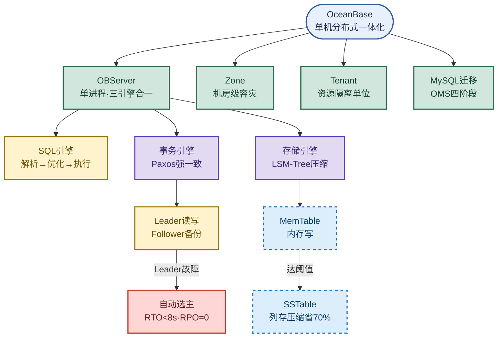

# OceanBase：原生分布式数据库与 MySQL 迁移

> 目标：不背孤立名词。遇到 OceanBase 题目先判断"问的是哪一层"——架构组件、Paxos 强一致、LSM-Tree 存储、还是 MySQL 迁移四阶段，再讲机制、取舍和实战要点。
>
> 读图顺序：先看下方"先记住这张总图"，再按问题回看各节。每节底部都有**易混点**或**速记**；先遮住解释自己讲，再对照正文。
>
> 本笔记以 OceanBase 兼容 MySQL 模式为主，Oracle 模式仅在兼容性小节标注。

## 先记住这张总图

**一句话主线：**单机分布式一体化内核 → OBServer/Zone/Tenant 三组件 → Paxos 多副本强一致 + LSM-Tree 高压缩存储 → 高度兼容 MySQL，OMS 四阶段平滑迁移。

## 1. OceanBase 是什么：单机分布式一体化

OceanBase 是蚂蚁集团 2010 年自研的**原生分布式数据库**，核心设计理念是**单机分布式一体化**——一套内核代码同时支持集中式单机和分布式集群部署。

- **诞生背景**：经历淘宝双十一超大规模并发和金融行业核心系统考验。
- **独特之处**：打破传统"集中式或分布式二选一"的界限，可从小规模单机起步，业务增长后**无需修改代码**平滑扩容成分布式集群。
- **能力定位**：高可靠、高性能、线性扩展的企业级分布式数据库，一套系统同时处理事务处理（TP）、实时分析（AP）甚至 AI 应用。

**易混点：**"单机分布式一体化"不是"单机和分布式两套代码"，而是**同一套内核**两种部署形态；也不是"分布式中间件"那种在 MySQL 上加代理层的方案，OB 是原生分布式数据库。

**速记：**蚂蚁自研、单机分布式一套内核、TP+AP+AI 一套系统、从小到大平滑扩容。

## 2. 核心组件与架构：三大组件 + Shared-Nothing

OceanBase 采用**单进程设计**，组件分工明确。一个集群由多个 **Zone** 组成，每个 Zone 内运行多个 **OBServer** 节点，集群内可划分多个 **Tenant**。

### 三大核心组件

| 组件 | 定位 | 核心职责 | 记忆画面 |
|---|---|---|---|
| **OBServer** | 最核心进程 | 每台服务器一个 `observer` 进程，集成 SQL 引擎、事务引擎、存储引擎，负责节点间通信和负载均衡 | 一台机器一个"全能员工"，啥都能干 |
| **Zone** | 可用区（逻辑概念） | 通常对应一个机房或一个可用区，一个集群多 Zone，数据副本分布在不同 Zone 实现机房级容灾 | 一个机房一个"仓库区"，跨区容灾 |
| **Tenant** | 租户（资源隔离单位） | 逻辑上是一个独立数据库实例，拥有独立 CPU/内存/IO，多租户整合小库提升资源利用率 | 一栋楼分租给多个公司，互不打扰 |

### 系统架构四层

| 层 | 机制 | 关键能力 | 记忆画面 |
|---|---|---|---|
| 整体架构 | **Shared-Nothing** 无共享 | 节点间完全对等，无单点瓶颈 | 每人自备干粮，谁挂都不影响别人 |
| 存储层 | **LSM-Tree** | 数据先写内存 MemTable，达阈值转储为只读 SSTable，列存编码 + 通用压缩，存储成本省 70%~90% | 先在草稿纸写，攒够再归档压缩 |
| 复制层 | **Paxos 共识协议** | 多副本同步 Redo 日志，每分区一个 Leader 读写 + 多个 Follower 备份，Leader 故障 RTO<8s 自动选主、RPO=0 | 三人投票表决，挂一个立刻补上 |
| SQL 层 | 解析→优化→执行 | Parser→Resolver→Transformer→Optimizer→代码生成→Executor，支持本地/远程/分布式三种执行计划，带 Plan Cache | 流水线六道工序，常用图纸缓存复用 |

**易混点：**
- **Zone vs Tenant**：Zone 是**物理/机房维度**的容灾单元，Tenant 是**逻辑/资源维度**的隔离单元，二者正交——一个 Tenant 的数据副本会分布在多个 Zone。
- **Leader/Follower vs MySQL 主从**：OB 的 Follower 通过 Paxos 强一致同步，Leader 故障自动选主且 RPO=0；MySQL 从库是异步/半同步复制，主库故障可能丢数据、需人工切换。
- **MemTable vs SSTable**：MemTable 在内存可写，SSTable 在磁盘只读，转储后不可修改，靠合并（Compaction）清理旧版本。

**速记：**三大组件 OBServer/Zone/Tenant；四层架构 Shared-Nothing + LSM-Tree + Paxos + SQL 六段流水线。

## 3. 相比 MySQL 的六大优点

OceanBase 原生分布式架构，在扩展性、高可用、HTAP、存储成本、多租户、兼容性上全面优于 MySQL。

### OB vs MySQL 对比

| 维度 | OceanBase | MySQL | 记忆画面 |
|---|---|---|---|
| 架构 | 原生分布式，水平扩展对应用透明 | 集中式，大规模扩展靠分库分表，对应用不透明、运维复杂 | OB 像可拉伸的橡皮筋，MySQL 像固定大小的盒子 |
| 高可用 | Paxos 原生多副本，**RPO=0、RTO<8s**，支持城市级故障自动恢复 | 依赖主从复制 + 故障切换，通常需人工介入，存在数据丢失风险 | OB 自动换岗不丢数据，MySQL 出事要人救 |
| 混合负载 | **HTAP** 一套系统同时支持高并发 TP 和复杂实时 AP，无需数据搬迁 | 分析能力弱，通常需同步到单独 AP 系统 | OB 一锅炖 TP+AP，MySQL 要分两口锅 |
| 存储成本 | LSM-Tree + 高效压缩，存储成本降 **70%~90%** | InnoDB 压缩比相对较低，存储成本更高 | OB 像真空压缩袋，MySQL 像普通收纳箱 |
| 多租户 | 原生支持，资源隔离好，可整合多个数据库实例 | 无原生多租户概念 | OB 一栋楼分租，MySQL 一户一栋 |
| 兼容性 | 高度兼容 MySQL 5.7/8.0 语法和协议，迁移改造成本低 | — | OB 会说 MySQL 的"方言" |

**易混点：**
- **"水平扩展对应用透明"**：OB 应用层无感扩容，分库分表中间件（如 ShardingSphere）虽然也能扩展，但**对应用不透明**，需关心分片键、跨片事务。
- **RPO=0 vs RTO<8s**：RPO 是"丢多少数据"（0=零丢失），RTO 是"停服多久"（<8s=8 秒内恢复），两个指标衡量不同维度，别混为一谈。
- **HTAP 不是"TP+AP 简单拼接"**：OB 是一套引擎一套数据同时跑 TP 和 AP，不是把 TP 库的数据同步到 AP 库那种 ETL 方案。

**速记：**架构透明扩展、高可用 RPO=0/RTO<8s、HTAP 一套系统、存储省 70%~90%、原生多租户、高度兼容 MySQL。

## 4. 如何从 MySQL 迁移到 OceanBase：OMS 四阶段

核心工具是 **OceanBase 迁移服务（OMS）**，支持不停机或极短停机的平滑迁移。迁移分四个阶段，**应用层只改配置不改业务代码**。

### 迁移四阶段

| 阶段 | 名称 | 关键动作 | 易踩坑点 | 记忆画面 |
|---|---|---|---|---|
| 一 | 前期评估与准备 | 检查表结构（**每表必须有显式主键**，无主键表必须补上否则性能急剧下降）；梳理视图/触发器/存储过程/外键；确认 `utf8mb4` 和 `sql_mode` 一致 | 无主键表性能暴跌 | 出发前体检，缺主键先补 |
| 二 | 应用层最小化改造 | 仅改配置，不修改 Java 业务逻辑和 SQL；替换 JDBC 驱动（方案 A 推荐 `mysql-connector-java`，方案 B 官方 `oceanbase-client`）；改连接 URL 和用户名格式 | 用户名格式特殊 | 换个驱动贴个新标签 |
| 三 | 数据迁移实操 | 中小规模停机迁移用 `mysqldump` 导出 + `obclient` 导入；海量数据或零停机用 OMS 全量迁移 + 增量同步 + 无缝切换 | 选错工具导致停机过长 | 小件走快递，大件走搬家公司 |
| 四 | 验证与上线 | 数据一致性校验、业务回归测试、正式上线切换连接地址 | 跳过校验直接上线 | 新房验收再入住 |

### 连接配置改造细节

| 项 | MySQL 原配置 | OB 配置（方案 A·沿用 MySQL 驱动） | OB 配置（方案 B·官方驱动） |
|---|---|---|---|
| JDBC 驱动 | `mysql-connector-java` | `mysql-connector-java`（不变） | `oceanbase-client` |
| URL 前缀 | `jdbc:mysql://` | `jdbc:mysql://`（不变） | `jdbc:oceanbase://` |
| 用户名 | `root` | `root@my_tenant#obtest` | `root@my_tenant#obtest` |

用户名格式：`用户名@租户名#集群名`，如 `root@my_tenant#obtest`。

**易混点：**
- **方案 A vs 方案 B**：方案 A 沿用 MySQL 驱动、URL 不变，**改造成本最低**，推荐；方案 B 用官方驱动性能更优但需改 URL 前缀。两者用户名格式都一样。
- **"无主键表必须补主键"**：不是 OB 限制不能建表，而是无主键表在分布式环境下**性能急剧下降**（无法做行级定位、复制效率低），必须迁移前补上。
- **mysqldump vs OMS**：`mysqldump` 适合中小规模**停机**迁移；OMS 适合海量数据或**零停机**（全量+增量+无缝切换），别用错场景。

**速记：**四阶段——评估补主键、改驱动配置、数据迁移（dump 或 OMS）、校验上线；用户名 `用户名@租户名#集群名`。

## 高频场景题

### "OceanBase 比 MySQL 强在哪？我们为什么要迁移？"

诊断：从架构、高可用、HTAP、存储、多租户、兼容性六个维度对比，落到业务痛点（扩展难、故障丢数据、TP/AP 两套库、存储贵）。

### "MySQL 表没有主键，迁 OceanBase 有问题吗？"

诊断：有问题且很严重。OB 强烈要求每表有显式主键，无主键表在分布式环境下性能急剧下降，迁移前必须补主键。

### "Paxos 怎么保证 RPO=0？Leader 挂了多久能恢复？"

诊断：Paxos 多副本同步 Redo 日志，多数派写入成功才返回客户端提交；Leader 故障时剩余副本自动选新 Leader，RTO<8s 且 RPO=0（已提交日志不丢）。

### "迁移 OceanBase 要改 Java 代码吗？"

诊断：不用改业务逻辑和 SQL，只改配置——换 JDBC 驱动、改连接 URL 和用户名格式（`用户名@租户名#集群名`），方案 A 甚至 URL 前缀都不变。

## 面试回答模板：三句话讲清一题

> **问题本质是**：OceanBase 是蚂蚁自研的原生分布式数据库，采用单机分布式一体化架构，高度兼容 MySQL 和 Oracle，一套系统同时支持 TP 和 AP。
>
> **机制是**：三大组件 OBServer/Zone/Tenant + Shared-Nothing 架构，存储用 LSM-Tree 高压缩（省 70%~90%），复制用 Paxos 多副本强一致（RPO=0、RTO<8s 自动选主）。
>
> **实战中我会**：从 MySQL 迁移走 OMS 四阶段——前期补主键、应用层只改驱动配置、数据用 mysqldump 或 OMS 迁移、最后校验上线，业务代码零修改。

## 最后复习：闭眼回忆 8 句

1. OceanBase 是蚂蚁 2010 年自研的原生分布式数据库，核心理念是**单机分布式一体化**，一套内核两种部署。
2. 三大组件：**OBServer**（单进程三引擎合一）、**Zone**（机房级容灾）、**Tenant**（资源隔离单位）。
3. 架构是 **Shared-Nothing**，节点完全对等；存储用 **LSM-Tree**，MemTable 转 SSTable，压缩省 70%~90%。
4. 复制用 **Paxos**，每分区一个 Leader 读写 + 多个 Follower 备份，Leader 故障 **RTO<8s、RPO=0**。
5. SQL 层六段流水线：Parser→Resolver→Transformer→Optimizer→代码生成→Executor，带 Plan Cache。
6. vs MySQL 六大优势：架构透明扩展、高可用 RPO=0/RTO<8s、HTAP 一套系统、存储省 70%~90%、原生多租户、高度兼容 MySQL。
7. 迁移四阶段：前期评估（**补主键**）→ 应用层改配置（换驱动、改 URL/用户名）→ 数据迁移（mysqldump 或 OMS）→ 校验上线。
8. 用户名格式 `用户名@租户名#集群名`，如 `root@my_tenant#obtest`；方案 A 沿用 MySQL 驱动 URL 不变，推荐。

## 怎么练才记得住

1. **画总图**：闭眼默画"OBServer/Zone/Tenant → 四层架构 → 迁移四阶段"主干图，画不出就回看再画一遍。
2. **对比表口述**：对着 OB vs MySQL 六维对比表，遮住右列自己讲，讲不全重看。
3. **场景代入**：假设领导让你把一个无主键的 MySQL 表迁 OB，口述你会怎么处理（补主键→选驱动→选工具→校验）。
4. **指标背诵**：RPO=0、RTO<8s、存储省 70%~90% 三个数字必须张口就来，配合"Paxos 强一致、自动选主、LSM-Tree 压缩"一起说。
