# Redis：分布式锁、持久化与缓存三大问题

> 目标：不背孤立名词。遇到 Redis 题先判断"问的是哪一层"——是分布式锁的可靠性，还是持久化的取舍，还是缓存的三大失效问题。
> 目标：把 Jedis/Redisson、RDB/AOF、穿透/击穿/雪崩、过期策略、主从哨兵串成一条主线，能三句话讲清一题。
> 目标：每个易混点都能用一句话区分，比如"穿透是查不存在的，击穿是查存在的热点，雪崩是集体失效"。

## 先记住这张总图

```mermaid
flowchart TD
    A([Redis 核心体系]) --> B[分布式锁<br/>Jedis vs Redisson]
    A --> C[持久化<br/>RDB vs AOF]
    A --> D[缓存三大问题<br/>穿透·击穿·雪崩]
    A --> E[过期策略<br/>惰性·定期]
    A --> F[高可用<br/>主从·哨兵]

    B --> B1[setNx 四大坑]
    B --> B2[Redisson 看门狗]
    C --> C1["RDB 快照(可能丢)"]
    C --> C2["AOF 日志(更安全)"]
    D --> D1[穿透·不存在]
    D --> D2[击穿·热点失效]
    D --> D3[雪崩·集体失效]
    F --> F1[主从复制 sync]
    F --> F2[哨兵故障转移]

    style A fill:#E8F0FD,stroke:#315C9A,stroke-width:2px,color:#1D2C46
    style B fill:#D1E7DD,stroke:#2D6A4F,stroke-width:2px,color:#1B4332
    style C fill:#FFF3CD,stroke:#997404,stroke-width:2px,color:#664D03
    style D fill:#FFD6D6,stroke:#C0392B,stroke-width:2px,color:#641E1E
    style E fill:#E2D9F3,stroke:#5F3DC4,stroke-width:2px,color:#3B2A6B
    style F fill:#DCEEFB,stroke:#1971C2,stroke-width:2px,stroke-dasharray:5,color:#0B3D63
    style B1 fill:#F8D7DA,stroke:#C0392B,stroke-width:2px,color:#721C24
    style B2 fill:#D1E7DD,stroke:#2D6A4F,stroke-width:2px,color:#1B4332
    style C1 fill:#FFF3CD,stroke:#997404,stroke-width:2px,color:#664D03
    style C2 fill:#D1E7DD,stroke:#2D6A4F,stroke-width:2px,color:#1B4332
    style D1 fill:#FFD6D6,stroke:#C0392B,stroke-width:2px,color:#641E1E
    style D2 fill:#FFD6D6,stroke:#C0392B,stroke-width:2px,color:#641E1E
    style D3 fill:#FFD6D6,stroke:#C0392B,stroke-width:2px,color:#641E1E
    style F1 fill:#DCEEFB,stroke:#1971C2,stroke-width:2px,stroke-dasharray:5,color:#0B3D63
    style F2 fill:#DCEEFB,stroke:#1971C2,stroke-width:2px,stroke-dasharray:5,color:#0B3D63
```

**一句话主线：**Redis 是基于内存的高性能 KV 库，面试围绕"锁的可靠性、持久化取舍、缓存失效三连、过期与高可用"五条线展开。

## 1. Jedis vs Redisson：怎么选客户端

一句话：**轻量基本命令用 Jedis，分布式协调用 Redisson**。

| 维度 | Jedis | Redisson | 记忆画面 |
|---|---|---|---|
| 定位 | 轻量 Redis 客户端 | 分布式 Java 数据结构框架 | Jedis 是"裸命令"，Redisson 是"工具箱" |
| 适用场景 | 只需 `SET/GET` 等基本命令、对延迟敏感 | 需分布式锁协调多节点、把 Redis 当 Java Map/List/Queue 用 | Jedis 像手动挡，Redisson 像自动挡 |
| 连接管理 | 连接池管理，需自己保证线程安全 | 内置连接池，API 天然线程安全 | Jedis 要自己拧螺丝 |
| 分布式锁 | 手写 `setNx` 脚本 | `RLock` 开箱即用，带看门狗/可重入 | Redisson 锁是"成品" |
| 命令脚本 | 手动维护 Lua 脚本 | 封装好常用数据结构，免写脚本 | Redisson 省心 |

**易混点**：**Jedis 不是不能用分布式锁**，而是要自己写 `setNx` + Lua + 续期脚本，生产级可靠性难保证；**Redisson 也不是万能**，极轻量场景引入它反而增加依赖负担。低并发非核心业务、锁操作极短可用 Jedis `setNx`；高并发核心业务（订单/扣库存）生产级可靠性用 Redisson。

**速记：**轻量命令 Jedis，分布式协调 Redisson；核心业务上 Redisson。

## 2. setNx 四大问题与 Redisson 解法

一句话：**裸 `setNx` 有四个坑，Redisson 用看门狗 + 计数器 + 等待超时 + 集群策略逐一填平**。

| 问题 | 现象 | Redisson 解法 | 记忆画面 |
|---|---|---|---|
| ① 锁过期并发 | 线程超过锁过期时间还在跑，锁已释放，另一线程拿到锁 | 看门狗自动续期 | 看门狗定时给锁"续命" |
| ② 无法自动续期 | 任务执行中锁到期不能延续 | 看门狗定时任务周期续期 | 后台线程定时喂狗 |
| ③ 不可重入 | 同一线程在方法 A 拿锁调用方法 B 再拿同一把锁，被自己阻塞死锁 | 内部计数器，同线程可多次加锁 | 锁记"自己人"，可重入 |
| ④ 主从切换丢锁 | 主节点宕机，从节点升级时锁数据可能丢失，两客户端同时持锁 | 集群模式多种策略应对主从切换 | 多节点共识防丢锁 |

**易混点**：**"锁过期并发"和"不可重入"是两类不同的坑**——前者是"锁没了但人还在跑"（跨线程风险），后者是"自己锁自己"（同线程死锁）。看门狗解决前者，计数器解决后者，别混为一谈。

**易混点**：**看门狗不是无限续期**——它依赖业务线程存活，若业务线程本身卡死（如死循环），看门狗也会一直续期导致锁永不释放，所以仍要给业务设超时兜底。

**速记：**过期续期看门狗，重入靠计数器，等待设超时，集群多策略。

## 3. RDB vs AOF：两种持久化怎么取舍

一句话：**RDB 是全量快照可能丢数据，AOF 是追加写命令日志更安全**。

| 维度 | RDB | AOF | 记忆画面 |
|---|---|---|---|
| 原理 | 整个拷贝内存快照 | 把写操作命令持续写到日志文件 | RDB 是"拍照"，AOF 是"录像" |
| 数据安全 | 可能损失一部分数据（两次快照间的写入） | 几乎不丢（按刷盘策略） | RDB 丢一截，AOF 丢一行 |
| 文件体积 | 小（压缩二进制） | 大（命令文本） | RDB 省空间 |
| 恢复速度 | 快（直接载入） | 慢（重放命令） | RDB 恢复快 |
| 适用场景 | 容忍少量丢失、追求恢复速度 | 数据安全要求高 | 备份用 RDB，安全用 AOF |

**易混点**：**Redis 的 RDB/AOF ≠ MySQL 的 redo/undo log**。redo log 记变更后的新数据实现持久性，undo log 记变更前的旧数据实现原子性和 MVCC，二者属于 InnoDB 事务日志；而 RDB/AOF 是 Redis 本身为重启恢复做的持久化，**不是事务日志**，别在面试里混着答。

**速记：**RDB 拍照丢一截恢复快，AOF 录像更安全恢复慢；和 redo/undo 不是一回事。

## 4. 缓存三大问题：穿透、击穿、雪崩

一句话：**穿透是查不存在的，击穿是查存在的热点失效，雪崩是集体失效**。

| 问题 | 触发原因 | 危害 | 解决方案 | 记忆画面 |
|---|---|---|---|---|
| 缓存穿透 | 黑客故意请求缓存中不存在的数据 | 所有请求打到数据库 | 接口层校验 / 布隆过滤器 / 维护合法 Key | 穿透=查"假"数据，用布隆过滤器挡 |
| 缓存击穿 | 热点 Key 被高并发访问突然失效 | 失效瞬间冲击数据库 | 互斥锁 / 热点数据不过期 / 本地缓存 | 击穿=热点"爆"了，加锁或不过期 |
| 缓存雪崩 | 缓存统一时间大面积失效 | 数据库瞬时压力陡增 | 给失效时间加随机值避免集体失效 | 雪崩=集体"塌"了，加随机值错峰 |

**易混点**：**穿透 vs 击穿**——穿透是数据**根本不存在**（缓存和库都没有），击穿是数据**存在但缓存刚好失效**（库里有）。一句话：穿透查的是"假"，击穿查的是"真但失效"。

**易混点**：**击穿 vs 雪崩**——击穿是**单个热点 Key** 失效，雪崩是**大面积 Key 集体**失效。击穿用互斥锁/不过期，雪崩用随机过期时间错峰，解法不同。

**速记：**穿透查假用布隆，击穿热点加锁不过期，雪崩集体加随机值。

## 5. 过期键删除策略：惰性 vs 定期

一句话：**惰性过期省 CPU 但费内存，定期过期折中清理**。

| 策略 | 时机 | 优点 | 缺点 | 记忆画面 |
|---|---|---|---|---|
| 惰性过期 | 访问 Key 时才判断是否过期 | 节省 CPU | 对内存不友好，可能大量过期 Key 占用内存 | 懒汉：用到才清 |
| 定期过期 | 每隔一段时间扫描一定数量 Key 清除已过期的 | 折中，主动回收内存 | 有扫描开销 | 勤快人：定时扫 |

**易混点**：**惰性过期不是"不删除"**——它只是"延迟到访问时删"，如果某个 Key 永远不被访问，它就一直占内存，所以 Redis 实际是**惰性 + 定期组合使用**，别答成单一策略。

**速记：**惰性用到才删省 CPU，定期定时扫描省内存，Redis 两者组合用。

## 6. 主从复制与哨兵：高可用两件套

一句话：**主从复制解决读写分离与备份，哨兵解决主节点宕机自动转移**。

| 机制 | 解决问题 | 工作流程 | 记忆画面 |
|---|---|---|---|
| 主从复制 | 数据备份 + 读写分离 | slave 向 master 发 `sync` → master 后台子进程把数据快照保存到数据文件发给 slave → slave 接收 `.rdb` 保存到本地载入内存完成同步 | slave 跟着 master"抄作业" |
| 哨兵 Sentinel | 主节点宕机自动故障转移 | 不断监控主从节点运行状态，主不能工作时将一个从升级为新主；通过配置文件发现主服务器，再通过 `info` 发现从服务器 | 哨兵是"值班长"，自动换岗 |

**易混点**：**主从复制 ≠ 哨兵**——主从复制只是"数据同步"，主挂了不会自动切换；哨兵才是"自动故障转移"的指挥官。没有哨兵的主从，主挂了要人工介入。

**易混点**：**哨兵发现从服务器靠 `info` 命令**，不是直接配置——哨兵先通过配置文件找到主服务器，再对主服务器发 `info` 拿到从服务器列表，这是面试常考的细节。

**速记：**主从 sync 抄 rdb，哨兵监控自动换岗，发现从服务器靠 info。

## 高频场景题

### "分布式锁用 setNx 还是 Redisson？怎么选？"

诊断：先看业务并发量与可靠性要求，再选客户端。低并发非核心、锁操作极短可用 Jedis `setNx`；高并发核心业务（订单/扣库存）必须上 Redisson，靠看门狗续期 + 可重入 + 集群策略保证生产级可靠。

### "缓存雪崩和缓存击穿有啥区别？怎么解决？"

诊断：先区分"单个热点"还是"集体失效"。击穿是单个热点 Key 突然失效，用互斥锁或热点数据不过期；雪崩是大面积 Key 集体失效，给过期时间加随机值错峰，避免同一时刻一起失效。

### "Redis 的 RDB 和 MySQL 的 redo log 是一回事吗？"

诊断：不是。RDB 是 Redis 为重启恢复做的全量内存快照持久化；redo log 是 InnoDB 事务日志，记变更后的新数据实现持久性。两者作用层不同，Redis 的 RDB/AOF 不是事务日志。

## 面试回答模板：三句话讲清一题

> **问题本质是**：Redis 分布式锁的可靠性，核心矛盾是"锁过期但任务没跑完"和"主从切换丢锁"。
>
> **机制是**：Redisson 用看门狗定时续期解决锁过期，用内部计数器实现可重入，用集群多策略应对主从切换；裸 `setNx` 这四点都得自己写脚本，生产级难保证。
>
> **实战中我会**：核心业务（订单/扣库存）直接上 Redisson `RLock`，配合理业务超时兜底；非核心轻量场景才用 Jedis `setNx`，并自己加 Lua 脚本保证原子性。

## 最后复习：闭眼回忆 8 句

1. Jedis 轻量基本命令，Redisson 分布式协调，核心业务上 Redisson。
2. `setNx` 四大坑：锁过期并发、无法续期、不可重入、主从切换丢锁。
3. Redisson 解法：看门狗续期、计数器可重入、等待超时、集群多策略。
4. RDB 全量快照可能丢数据恢复快，AOF 追加命令日志更安全恢复慢。
5. Redis 的 RDB/AOF 不是事务日志，和 InnoDB 的 redo/undo 不是一回事。
6. 穿透查假用布隆过滤器，击穿热点加锁或不过期，雪崩集体加随机过期值。
7. 过期策略惰性 + 定期组合用，单用惰性会内存堆积。
8. 主从复制 `sync` 抄 `.rdb`，哨兵监控自动故障转移，发现从服务器靠 `info`。

## 怎么练才记得住

1. **画一张总图**：闭眼默写五大模块（锁/持久化/缓存/过期/高可用），每个模块下挂 2~3 个关键词，画不出就回去重看。
2. **对比口述**：对着空气把"穿透 vs 击穿 vs 雪崩"用一句话各自讲清，讲混了就重背。
3. **场景代入**：假设面试官问"秒杀扣库存怎么加锁"，逼自己说出为什么选 Redisson 而不是 `setNx`，把四大坑套进去。
4. **易混点自测**：把"RDB vs redo log""主从 vs 哨兵""惰性 vs 定期"三组易混点写在卡片上，随机抽一张默答区别。
