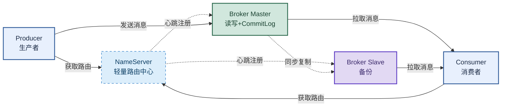

# RocketMQ：从架构到事务消息、顺序性与金融级可靠性

> 目标：遇到 RocketMQ 题目先判断"问的是哪一层"——架构组件、消息不丢失、顺序性、事务消息、与 Kafka 对比、性能原理，再展开机制和实战。
>
> 读图顺序：先看下方"先记住这张总图"（RocketMQ 核心链路），再按问题回看各节。每节底部都有**易混点**或**速记**；先遮住解释自己讲，再对照正文。
>
> 本笔记覆盖 RocketMQ 架构 + 消息不丢失 + 顺序性 + 事务消息 + 死信队列 + 与 Kafka 对比 + 性能原理 + 消息堆积处理。

## 先记住这张总图

**一句话主线：**NameServer 轻量路由 → Broker Master 顺序写 CommitLog + 同步复制 Slave → Producer 同步发送 + 事务消息 → Consumer 手动 ACK + 幂等；金融级靠同步刷盘 + 同步复制 + 事务消息。

## 1. 核心组件

| 组件 | 职责 | 关键点 |
|---|---|---|
| NameServer | 轻量级路由中心 | 对等集群，节点间无数据同步；Broker 通过心跳（30s 一次）注册，超时（120s）剔除 |
| Broker | 消息存储与转发的核心 | 主从架构，Master 负责读写，Slave 作为备份；通过 CommitLog 顺序写入消息 |
| Producer | 消息生产者 | 从 NameServer 获取路由后与 Master 建立长连接；支持同步、异步、单向三种发送方式 |
| Consumer | 消息消费者 | 从 NameServer 获取路由后与 Broker 建立长连接拉取消息；支持推（Push）和拉（Pull）两种模式 |

**易混点：**RocketMQ 的 NameServer 是对等集群，节点间**不数据同步**（与 ZK 不同）；Broker 30s 心跳注册，NameServer 120s 超时剔除。这是 RocketMQ 比 Kafka 轻量的原因——不依赖 ZK 的强一致。

## 2. 核心工作流程

| 步骤 | 发生什么 |
|---|---|
| 1 | Broker 启动注册：向所有 NameServer 节点注册自己的信息（IP、端口、Topic 等） |
| 2 | Producer/Consumer 获取路由：从 NameServer 拉取最新 Broker 路由信息并缓存到本地 |
| 3 | Producer 发送消息：根据路由与目标 Broker 的 Master 节点建立长连接，发送消息 |
| 4 | Broker 存储消息：Master 收到消息后顺序写入 CommitLog 文件，并同步给 Slave 节点 |
| 5 | Consumer 消费消息：根据路由与 Broker 的 Master 或 Slave 建立长连接，拉取消息消费 |

## 3. 如何保证消息不丢失

> 三端全链路：生产者同步发送 + 事务消息，Broker 同步刷盘 + 同步复制，消费者手动 ACK。

| 端 | 风险点 | 解决方案 |
|---|---|---|
| 生产者端 | 网络抖动导致发送失败 | 同步发送（阻塞等待确认，返回 SEND_OK 才成功）+ 失败重试（`producer.setRetryTimesWhenSendFailed(3)`）+ 事务消息（支付/订单等核心场景） |
| Broker 端 | 内存数据断电丢失 | 同步刷盘（`flushDiskType=SYNC_FLUSH`，写磁盘才返回成功）+ 同步复制（`brokerRole=SYNC_MASTER`，Master 等 Slave 同步完才确认） |
| 消费者端 | 先提交 Offset 再处理业务，业务失败 → 丢失 | 手动 ACK（关闭自动提交，业务成功后返回 `CONSUME_SUCCESS`）+ 消费失败重试（返回 `RECONSUME_LATER`，默认重试 16 次后进死信队列）+ 幂等性处理 |

**生产环境黄金组合：**`SYNC_MASTER` + `SYNC_FLUSH`，实现消息零丢失。

**易混点：**同步刷盘和同步复制是两个维度。同步刷盘防 Broker 宕机断电（单机），同步复制防 Master 宕机（集群）。两者都开才是金融级零丢失。

## 4. 事务消息机制（核心高频题）

> 核心设计：**两阶段提交（2PC）+ 事务补偿（回查）**，通过异步解耦避免传统 XA 事务锁资源、性能差的问题。

| 步骤 | 发生什么 |
|---|---|
| 1 | 生产者向 RocketMQ 发送一条**半消息**，Broker 收到后回复 ACK，标记消息为暂不能投递 |
| 2 | 生产者得到 ACK 后执行**本地事务** |
| 3 | 本地事务执行后向 Broker 发送**二次确认**（提交或回滚）；收到提交，Broker 将半消息标记为可投递 |
| 4 | **事务回查机制**：如果生产者执行完本地事务还没来得及发送二次确认就崩溃，Broker 通过定时任务主动扫描长时间处于半事务状态的消息；开发者需在生产者端实现回查逻辑（查数据库状态），根据结果返回提交或回滚 |

**易混点：**事务消息不是"消息发送和本地事务同时成功"。它是先发半消息（不投递）→ 执行本地事务 → 二次确认投递；如果二次确认丢失，Broker 回查补确认。本质是"最终一致性"，不是强一致。

## 5. 如何保证消息顺序

> 核心原则：**分区有序**——生产者按业务 ID 选同一队列，消费者串行消费。

| 端 | 保证顺序的方式 |
|---|---|
| 生产者端 | 通过 MessageQueueSelector 将相同业务 Key（如订单号）的消息路由到同一个 MessageQueue |
| Broker 端 | 将消息按顺序存入选定的 MessageQueue，不进行任何重排，只保证存储顺序与发送顺序一致 |
| 消费者端 | 通过 MessageListenerOrderly 对同一队列进行串行消费 |

**全局顺序**：将队列数设为 1，但会极大影响性能，一般不推荐。

**易混点：**RocketMQ 的顺序性是"用并发度的牺牲换取局部顺序"。全局顺序（队列数=1）性能极差，实际用分区顺序——同业务 Key 进同队列 + 串行消费。

## 6. RocketMQ 与 Kafka 的 Topic 区别

> 最大的区别是**物理存储模型**不同。

| 维度 | Kafka | RocketMQ |
|---|---|---|
| Topic 存储 | Topic 直接拆分为 Partition，每个 Partition 是独立物理日志文件 | Topic 是纯逻辑概念，所有 Queue 的消息合并写入同一个全局 CommitLog |
| 读写方式 | 读写直接操作 Partition | 通过 ConsumeQueue 索引区分 Topic 和 Queue |
| 优势 | 简单直接 | 顺序写入 CommitLog，极大提升单机吞吐量（避免随机写多个文件） |

## 7. RocketMQ 与 Kafka 优缺点对比

| 对比维度 | Kafka 的优点 | RocketMQ 的优点 |
|---|---|---|
| 吞吐量与性能 | 吞吐量极高，单机可达百万级 TPS | 吞吐量也很高，通常为十万级 TPS |
| 消息与功能 | 功能相对精简，专注于核心消息传输 | 功能非常丰富，原生支持事务消息、严格顺序消息、死信队列、消息重试和定时消息 |
| 可靠性与一致性 | 多副本保证高可用，但数据一致性不如 RocketMQ 严格；消费后可能重复 | 金融级可靠性，同步双写 + Raft 协议，数据一致性更高，消息丢失概率极低 |
| 运维与生态 | 生态强大，与 Flink/Spark 无缝集成；原生不带管理控制台 | 自带功能完善的管理控制台；国内（阿里生态）应用广泛，中文文档丰富 |

**选型结论：**
- 日志收集、用户行为追踪、大数据分析、实时数据管道 + 极致吞吐量 + 对丢失/重复不敏感 → **Kafka**。
- 订单、交易、支付、库存管理 + 顺序、一致性、可靠性严苛要求 → **RocketMQ**。

## 8. RocketMQ 为什么性能高

> 三大支柱：顺序写 + 零拷贝 + 索引与数据分离。

| 支柱 | 原理 | 效果 |
|---|---|---|
| 顺序写 | 消息全部顺序追加到 CommitLog 文件 | 磁盘顺序写的性能非常接近内存随机写，大大减少 IO 开销 |
| 零拷贝 | 使用 mmap + write 的 transferTo 方法，数据从 PageCache 直接发送到 Socket 缓冲区 | 避免内核态到用户态的数据拷贝，显著降低 CPU 占用 |
| 索引与数据分离 | ConsumeQueue 存储轻量索引（仅 20 字节/条），消费者先读索引定位物理偏移，再读 CommitLog | 大多数索引常驻内存，只有真实消息才触发磁盘 IO |

**速记：**顺序写接近内存、零拷贝省 CPU、索引分离省 IO——三点组合使 RocketMQ 单机达十万级 TPS 并保持低延迟。

## 9. 死信队列与消息堆积处理

### 死信队列

> 消费失败且重试次数达到上限 → 死信队列。

流程：初次消费失败 → 进入重试队列 → 重复重试次数耗尽 → 死信队列。

**注意：**对于顺序消息产生的死信，官方文档明确指出不支持从死信队列重新发送，通常需要导出后自行处理。

### 消息堆积处理

> 先扩容消费者止损，再排查消费者慢或卡住的原因，最后用监控和优化预防复发。

| 可能原因 | 排查方法 | 解决方案 |
|---|---|---|
| 消费者能力不足 | 看消费者机器 CPU/内存/网络 IO 是否跑满；看消费 TPS 是否远低于生产 TPS | 增加消费者实例或优化消费代码性能 |
| 下游依赖变慢 | 消费者调用的数据库、API 接口响应时间（RT）突然升高 | 优化下游接口性能；增加缓存；同步改异步 |
| 某条消息处理极慢 | 查看消费日志，是否有某条消息处理时间远超平均水平 | 优化这条消息的处理逻辑，或路由到专门的重试队列 |
| 消费者被阻塞 | 消费者线程池满、死锁或频繁 Full GC | 分析堆栈（jstack），找出阻塞点，修复代码或增加线程池大小 |
| 生产者发送过快 | 业务高峰期（如大促）流量暴增 | 正常的流量削峰场景，消费者能力可动态扩容即良性积压 |

**线上实用技能：**堆积时如何在不重启服务的情况下临时跳过"卡住"的坏消息？利用 RocketMQ 的 Skip 死信机制（或重置消费点位），将消费者消费点位（Offset）手动向前移动 1 位，跳过那条一直处理失败的消息，让它进入死信队列（DLQ），等业务高峰期过了再从死信队列捞出来人工补处理。

## 10. 定时消息（注意版本差异）

> 核心原理：将消息的"立即投递"转变为"指定时间戳投递"。消息发送到服务端后先持久化存储，等待设定时间到达后再重新投递到正常消息队列。

| 版本 | 支持方式 | 代码 |
|---|---|---|
| RocketMQ 4.x | 只支持 18 个固定级别（1s/5s/10s/30s...） | `message.setDelayTimeLevel(3)` |
| RocketMQ 5.0 | 支持任意时间延迟 | `messageBuilder.setDeliveryTimestamp(System.currentTimeMillis() + 10 * 60 * 1000)` |

**面试话术：**"如果是 4.x 版本，我们只能用 `message.setDelayTimeLevel(3)` 这种固定等级；如果是 5.0，才能用 `setDeliveryTimestamp` 指定任意时间戳。我们线上目前是 4.x，所以超时关单用的是延迟级别，没法自定义精准时间。"

**易混点（保命认知）：**RocketMQ 和 Kafka 在异常情况下**都会产生重复消息**。RocketMQ 只是概率比 Kafka 的 Rebalance 触发得低，但绝对不是"不会重复"。业务端做幂等（唯一业务 ID + Redis 或 DB 唯一键）是必须的，绝对不能依赖 MQ 来保证不重复。

## 高频场景题：用一句诊断开头

### "RocketMQ 怎么保证消息不丢失？"

三端全链路：生产端同步发送（返回 SEND_OK 才成功）+ 失败重试 + 事务消息（核心场景）；Broker 端同步刷盘（`SYNC_FLUSH`）+ 同步复制（`SYNC_MASTER`）；消费端手动 ACK（业务成功后返回 `CONSUME_SUCCESS`）+ 失败重试（`RECONSUME_LATER`，16 次后进死信队列）+ 幂等处理。生产环境黄金组合是 `SYNC_MASTER` + `SYNC_FLUSH`。

### "RocketMQ 事务消息原理？"

两阶段提交 + 事务回查。先发半消息（Broker 标记暂不投递）→ 执行本地事务 → 二次确认（提交则投递，回滚则丢弃）；如果二次确认丢失，Broker 定时任务扫描半消息，回调生产者的回查逻辑（查数据库状态）决定提交或回滚。本质是最终一致性，不是强一致。

## 面试回答模板：三句话讲清一题

> **问题本质是……**（先说问的是哪一层：架构、可靠性、顺序、事务、选型）。
>
> **机制是……**（解释原理 + 关键参数），因为……（为什么这样设计）。
>
> **实战中我会……**（具体配置 + 场景），例如……（业务例子）。

例：问"为什么用 RocketMQ 而不是 Kafka"——本质是金融核心交易对数据一致性要求极高；机制是 RocketMQ 同步刷盘 + 同步复制保证 Broker 宕机零丢消息，事务消息保证本地事务和消息发送的原子性；实战中处理"会员退款并撤销权益"时，先发半消息，本地扣款成功后再 Commit，本地扣款失败就 Rollback，彻底杜绝"钱退了但权益没收回"的资损风险。

## 最后复习：闭眼回忆 8 句

1. **架构**：NameServer 轻量路由（对等不同步，30s 心跳 120s 剔除）+ Broker Master/Slave（CommitLog 顺序写）+ Producer（同步/异步/单向）+ Consumer（Push/Pull）。
2. **不丢失**：生产端同步发送 + 事务消息，Broker 端同步刷盘 + 同步复制，消费端手动 ACK + 幂等；黄金组合 SYNC_MASTER + SYNC_FLUSH。
3. **事务消息**：半消息 → 本地事务 → 二次确认 → 回查补确认；本质是最终一致性。
4. **顺序性**：分区有序，MessageQueueSelector 按 Key 选同队列 + MessageListenerOrderly 串行消费；全局顺序队列数=1 性能差。
5. **与 Kafka 区别**：Kafka Partition 独立物理日志，RocketMQ 所有 Queue 合并写 CommitLog + ConsumeQueue 索引。
6. **性能三大支柱**：顺序写（接近内存）+ 零拷贝（mmap+write）+ 索引分离（ConsumeQueue 20 字节/条）。
7. **堆积处理**：先扩容消费者止损 → 排查消费者慢/卡（CPU/下游/慢消息/阻塞）→ 监控优化预防；可重置 Offset 跳过坏消息。
8. **定时消息**：4.x 只支持 18 个固定级别，5.0 支持任意时间戳；RocketMQ 也会重复消费，业务端必须幂等。

## 怎么练才记得住

别反复通读，改成主动回忆：

1. 每次只看一个主题，遮住表格，先自己说出"机制 → 参数 → 场景"，再对照。
2. 用"不丢失/事务消息/顺序性"三道题各讲 30 秒；卡住时只回看对应小节。
3. 隔天再讲一遍，换成自己的金融业务例子；能解释"为什么 RocketMQ 也会重复消费"才算会。
4. 复习时轮流画"RocketMQ 核心链路图"和"与 Kafka 对比表"；能默写出事务消息四步流程才算熟。
