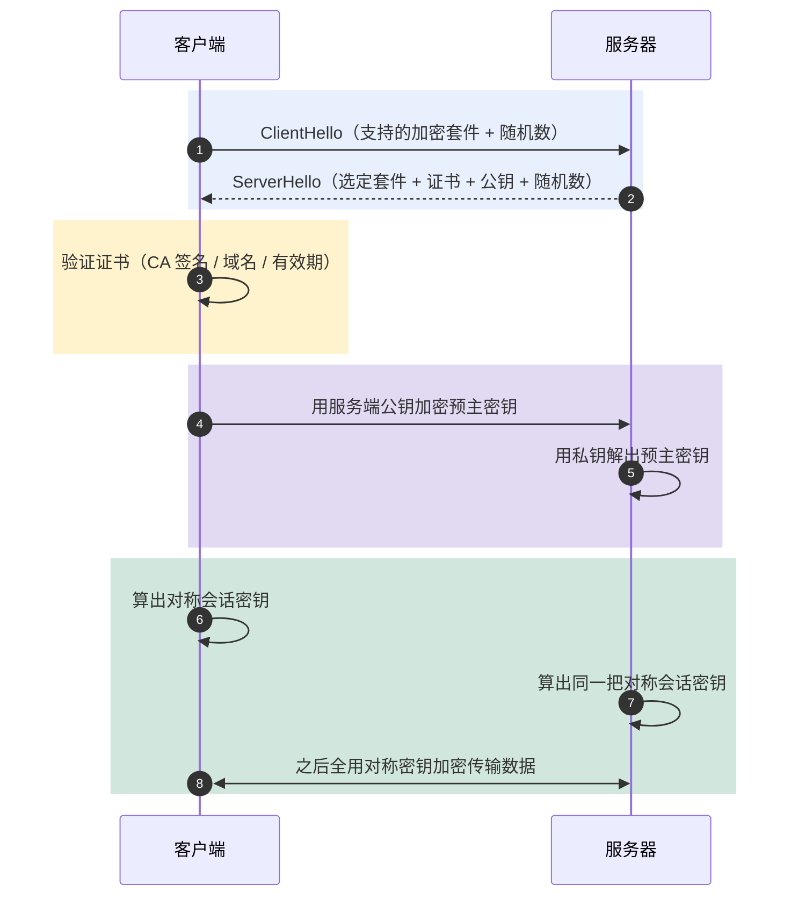

# 安全：加密算法、防火墙与 DDoS 防御

> 目标：不背孤立名词。遇到安全题先判断"问的是哪一层"——加密算法选型、防火墙功能、还是 DDoS 防御，再解释机制、取舍和实战手段。
>
> 读图顺序：先看下方"先记住这张总图"，再按问题回看各节。每节底部都有**易混点**或**速记**；先遮住解释自己讲，再对照正文。
>
> 本笔记以常见面试口径为主，对称/非对称、HTTPS 握手、SYN 洪水防御是高频考点。

## 先记住这张总图

**一句话主线：**对称加密快但密钥分发难，非对称加密慢但解决密钥协商，HTTPS 用非对称换对称密钥、再用对称加密数据；防火墙做访问控制+包检查+NAT 三件事；DDoS 靠高防 IP/CDN/限频/监控兜底。

## 1. 常用加密算法：对称、非对称、摘要三分天下

> 加密算法按"密钥数量"分三类：对称一把钥匙、非对称两把钥匙、摘要没有钥匙（不可逆）。

### 六大算法速查

| 算法 | 类型 | 密钥长度 | 安全性 | 速度 | 现状 | 记忆画面 |
|---|---|---|---|---|---|---|
| DES | 对称 | 56 位 | 已被破解 | 快 | 已淘汰 | 老式挂锁，钥匙太短能暴力撬 |
| 3DES | 对称 | 168 位（3×56） | 较高 | 慢 | 逐步淘汰 | 三道挂锁叠一起，安全但费劲 |
| AES | 对称 | 128/192/256 位 | 高 | 快 | 主流 | 新式电子锁，又快又牢 |
| SM4 | 对称 | 128 位 | 高 | 快 | 国密标准 | 国产电子锁，自主可控 |
| RSA | 非对称 | 1024/2048 位 | 高 | 慢 | 主流 | 信箱：公钥投信，私钥取信 |
| MD5 | 摘要 | 无密钥 | 已不推荐 | 极快 | 仅做校验 | 指纹机：压一下出定长指纹 |

**易混点：**MD5 不是"加密算法"，是**摘要算法**——有损压缩、不可逆，不能解密还原原文。说"MD5 加密密码"是口语化错误，准确说法是"MD5 摘要存密码"（且应加盐）。

### 对称 vs 非对称

| 维度 | 对称加密 | 非对称加密 |
|---|---|---|
| 密钥数量 | 1 把（加解密共用） | 2 把（公钥加密、私钥解密） |
| 速度 | 快（适合大数据量） | 慢（比对称慢 100~1000 倍） |
| 密钥分发 | 难（如何安全把钥匙给对方？） | 易（公钥可公开，私钥自己留） |
| 典型算法 | AES、DES、SM4 | RSA、ECC、SM2 |
| 适用场景 | 数据加密 | 密钥协商、数字签名 |

**速记：**对称快但分发难，非对称慢但分发易——所以 HTTPS 让非对称"送钥匙"，让对称"锁数据"。

**易混点：**"公钥加密、私钥解密"用于**保密通信**；"私钥签名、公钥验签"用于**身份认证**。同一对密钥，用法相反，别搞反。

## 2. HTTPS 如何结合对称+非对称

> HTTPS = HTTP + TLS。核心思路：**用非对称加密协商出对称密钥，之后全用对称加密传数据**——既解决密钥分发，又保证传输速度。

### 握手流程（简化版）

| 步骤 | 动作 | 用什么 |
|---|---|---|
| 1 | 客户端发起连接，带上自己支持的加密套件 | — |
| 2 | 服务端返回选定的加密套件 + 证书（含公钥） | 非对称（RSA/ECDHE） |
| 3 | 客户端验证证书（CA 签名、域名、有效期） | 数字签名 |
| 4 | 客户端生成随机数，用服务端公钥加密发回 | 非对称 |
| 5 | 双方用该随机数算出**对称会话密钥** | — |
| 6 | 之后所有数据用对称密钥加密传输 | 对称（AES） |

**易混点：**非对称加密只在握手阶段用一次（协商密钥），握手完成后全部走对称加密。如果全程用 RSA 加密数据，性能会崩——这是 HTTPS 设计的精髓。

**补充：**现代 TLS 1.3 用 ECDHE 做密钥协商（前向安全：即使私钥泄露，历史流量也无法解密），RSA 只用于签名验证，不再用于密钥交换。

## 3. 加密算法选型建议

| 场景 | 推荐算法 | 原因 |
|---|---|---|
| 大数据量加密（接口/存储） | AES-256 / SM4 | 对称快、安全足够 |
| 密钥协商、数字签名 | RSA-2048 / SM2 | 非对称解决分发 |
| 密码存储 | bcrypt / Argon2（加盐） | 慢哈希防彩虹表，MD5/SHA 已不推荐 |
| 完整性校验 | SHA-256 / HMAC | MD5 有碰撞，仅做非安全校验可用 |
| 国密合规场景 | SM2 + SM3 + SM4 | 金融/政务强制要求 |

**易混点：**"加密"和"哈希"不是一回事。加密可逆（能解密），哈希不可逆（不能还原）。密码要存哈希（不可逆），不能存加密（能被解出来）。

**速记：**数据加密选 AES/SM4，密钥协商选 RSA/SM2，密码存储选 bcrypt，完整性校验选 SHA-256。

## 4. 防火墙基本原理及功能

> 防火墙是网络边界的"门卫"，检查进出网络的每个数据包，按规则放行或拦截。

### 三大核心功能

| 功能 | 作用 | 典型配置 | 记忆画面 |
|---|---|---|---|
| 访问控制 | 只允许特定 IP/端口访问 | 放行 80/443，拦截其他 | 门卫查白名单，不在名单不让进 |
| 数据包检查 | 检测病毒、木马、攻击特征 | 匹配特征库拦截恶意包 | 安检机：包里有违禁品就扣下 |
| 地址转换（NAT） | 内网私有 IP ↔ 公网 IP | 多台内网共用一个公网 IP 出网 | 前台代收快递：对外只露前台地址 |

**易混点：**NAT 不只是"省公网 IP"，更重要的是**隐藏内网真实地址**——外部只能看到公网出口 IP，无法直接访问内网服务器，相当于一层天然防护。

**速记：**防火墙三件事——**访问控制**（谁能进）、**包检查**（带没带违禁品）、**NAT**（对外藏内网）。

**补充：**防火墙分网络层（包过滤，看 IP/端口）和应用层（WAF，看 HTTP 内容防 SQL 注入/XSS）。面试提一句 WAF 是加分项。

## 5. DDoS 攻击原理与防御

> DDoS（分布式拒绝服务）不偷数据、不破密码，只干一件事——**用海量请求耗尽系统资源，让正常用户用不了服务**。难缠在于攻击流量和正常流量难区分。

### SYN 洪水攻击（最经典）

| 步骤 | 正常连接 | SYN 洪水攻击 |
|---|---|---|
| 1 | 客户端发 SYN | 攻击者发 SYN（伪造源 IP） |
| 2 | 服务端回 SYN-ACK，等客户端 ACK | 服务端回 SYN-ACK，等一个永远不来的 ACK |
| 3 | 客户端回 ACK，连接建立 | 半连接队列被占满，正常用户无法建连 |
| 4 | 数据传输 | 服务资源耗尽，服务不可用 |

**易混点：**SYN 洪水打的是**半连接队列**（服务端发了 SYN-ACK 还没收到 ACK 的连接），不是带宽。所以防御重点在"半连接管理"，不是单纯加带宽。

### 防御措施

| 措施 | 作用 | 记忆画面 |
|---|---|---|
| 高防 IP / 清洗设备 | 流量先过清洗中心，过滤攻击流量再回源 | 门口设安检门，可疑人员先筛掉 |
| CDN 分散流量 | 内容分发到多节点，单点被打不影响全局 | 多开几个分店，砸一家还有其他家 |
| 防火墙限频 | 限制单 IP 连接速率/并发数 | 一个人一分钟只能进一次 |
| SYN Cookie | 不分配资源就响应 SYN，ACK 回来才建连 | 先发"预约号"，确认了才安排座位 |
| 监控+应急响应 | 实时监控流量异常，触发应急预案 | 装监控+保安巡逻，出事马上响应 |

**速记：**DDoS 防御四件套——**高防清洗**（过滤）、**CDN 分散**（多节点）、**限频限连**（卡单 IP）、**监控应急**（早发现早处理）。最关键是监控和应急响应，别等被打瘫了才发现。

**易混点：**DDoS 是"耗资源"，DoS 是单点攻击。DDoS 难防就难在"分布式"——攻击源成千上万，封 IP 封不过来，必须靠清洗设备和 CDN 这种"基础设施级"防御。

## 高频场景题：用一句诊断开头

### "接口被刷爆，服务挂了，怎么判断是不是 DDoS？"

先看监控——流量是否在短时间内暴涨数倍、来源 IP 是否极度分散（成千上万不同 IP）、半连接数是否飙升。如果三者同时出现，基本就是 DDoS。再看是带宽打满（流量型）还是资源耗尽（SYN 洪水型）：带宽打满看出口流量，资源耗尽看 `netstat -an | grep SYN_RECV` 半连接数。

### "为什么 MD5 存密码不安全？该怎么存？"

MD5 的问题不是"能被解密"（它不可逆），而是**太快 + 有彩虹表**——攻击者拿到 MD5 值后，可以用预计算的彩虹表反查出常见密码。正确做法是用 **bcrypt / Argon2** 这类慢哈希算法 + **加盐**（每个用户随机盐），让暴力破解成本高到不划算。

### "HTTPS 既然非对称加密安全，为什么不全用非对称？"

非对称加密（RSA）比对称加密慢 100~1000 倍，全用非对称传数据性能会崩。所以 HTTPS 只在握手阶段用非对称协商出对称密钥，之后全用对称加密（AES）传数据——既解决密钥分发问题，又保证传输性能。

## 面试回答模板：三句话讲清一题

> **问题本质是……**（先说是哪一层：加密选型、防火墙功能、还是 DDoS 防御）。
>
> **机制是……**（解释原理 + 关键算法/措施），因为……（为什么这样设计）。
>
> **实战中我会……**（具体选型/配置/应急手段），例如……（落地场景）。

例：问"对称加密和非对称加密怎么选"——本质是密钥分发和性能的权衡；机制上对称一把钥匙快但分发难，非对称两把钥匙慢但分发易；实战中我会用非对称（RSA）做密钥协商，用对称（AES）加密数据，HTTPS 就是这个思路。

## 最后复习：闭眼回忆 8 句

1. **三类算法**：对称（DES/3DES/AES/SM4）一把钥匙快，非对称（RSA）两把钥匙慢，摘要（MD5）无钥匙不可逆。
2. **对称 vs 非对称**：对称快但密钥分发难，非对称慢但分发易——HTTPS 让非对称送钥匙、对称锁数据。
3. **MD5 不是加密**：是摘要算法，有损压缩不可逆；存密码要用 bcrypt 加盐，不能用 MD5。
4. **公钥加密私钥解密**用于保密，**私钥签名公钥验签**用于认证，同一对密钥用法相反。
5. **HTTPS 握手**：非对称协商出对称会话密钥，之后全用对称加密传数据；TLS 1.3 用 ECDHE 做前向安全。
6. **防火墙三功能**：访问控制（白名单）、数据包检查（防病毒木马）、NAT（私有 IP 转公网 IP，藏内网）。
7. **SYN 洪水**：攻击者发 SYN 不回 ACK，半连接队列占满，正常用户无法建连；防御靠 SYN Cookie + 限频。
8. **DDoS 防御四件套**：高防 IP/清洗设备过滤、CDN 分散流量、防火墙限频、监控+应急响应；难在攻击流量难区分。

## 怎么练才记得住

别反复通读，改成主动回忆：

1. 每次只看一个小节，遮住表格，先自己说出"算法 → 类型 → 优缺点 → 适用场景"，再对照。
2. 用"高频场景题"的 3 道题各讲 30 秒；卡住时只回看对应小节。
3. 隔天再讲一遍，换成自己的项目例子；能解释"为什么 HTTPS 这么设计、为什么密码不能用 MD5"才算会。
4. 复习时轮流画"加密算法三分天下"和"SYN 洪水攻击流程"；能默写出 HTTPS 握手 6 步和 DDoS 防御四件套才算熟。
