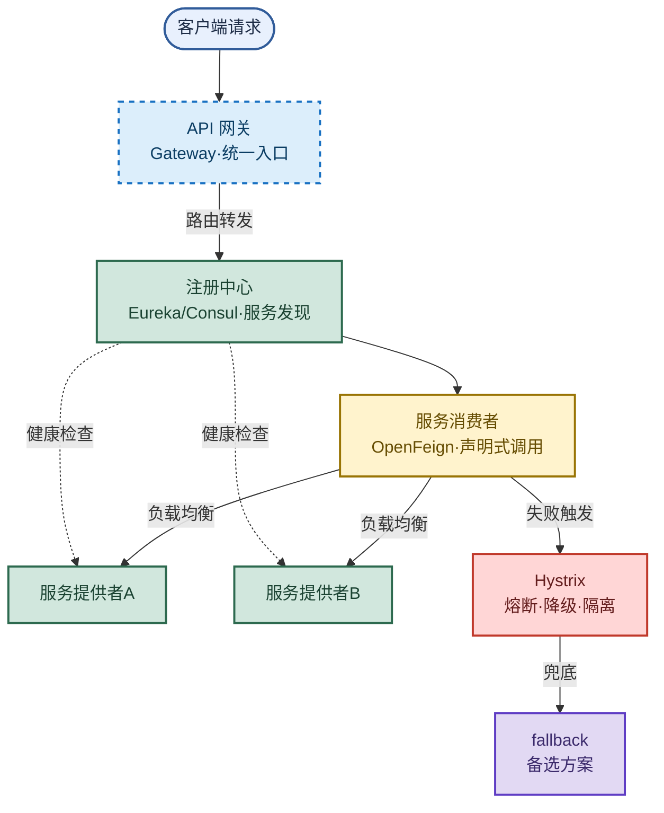

# SpringCloud：微服务治理全家桶

> 目标：不背组件清单。遇到 SpringCloud 题目先判断"问的是哪一层"——注册中心、声明式调用、容错熔断、还是网关选型，再讲机制、取舍和实战配置。
>
> 读图顺序：先看下方"先记住这张总图"，再按问题回看各节。每节底部都有**易混点**或**速记**；先遮住解释自己讲，再对照正文。
>
> 本笔记以 SpringCloud Netflix 体系为主，Consul、Sentinel、SpringCloudGateway 作为演进对比标注。

## 先记住这张总图

**一句话主线：**注册中心做服务发现 → OpenFeign 声明式调用 + 负载均衡 → Hystrix 熔断降级防雪崩 → 网关统一入口做路由鉴权。

## 1. SpringCloud 是什么：微服务治理平台

SpringCloud 是一个**服务治理平台**，提供了一整套分布式系统解决方案：服务注册与发现、配置中心、消息中心、负载均衡、数据监控等。

- **对比 Dubbo**：Dubbo 是 RPC 框架，只解决"服务间调用"；SpringCloud 提供全套分布式方案（注册、调用、容错、网关、配置、监控）。
- **基于 SpringBoot**：SpringCloud 基于 SpringBoot 实现云应用开发工具，组件以 starter 形式集成，开箱即用。

**易混点：**SpringCloud 不是"一个框架"，而是"一组组件的统称"（Netflix 体系 + Spring 自研组件 + 阿里 Sentinel/Nacos 等）。SpringCloud Alibaba 是另一套兼容实现，不是替代整个 SpringCloud。

## 2. 常用组件全景：各司其职

| 组件 | 职责 | 一句话定位 | 记忆画面 |
|---|---|---|---|
| Eureka | 服务注册中心 | 服务登记 + 发现 | 户籍管理处 |
| Ribbon | 客户端负载均衡 | 多实例挑一个调用 | 食堂多窗口排队 |
| Hystrix | 服务容错保护 | 熔断降级防雪崩 | 保险丝跳闸 |
| Feign | 声明式 HTTP 客户端 | 接口注解调远程 | 像调本地方法 |
| OpenFeign | Feign 增强 | 支持 SpringMVC 注解 | Feign + @RequestMapping |
| Zuul | API 网关（旧） | 路由过滤安全限流 | 大门保安 |
| SpringCloudGateway | API 网关（新） | Filter 链统一路由 | 升级版保安 |

**速记：**注册 Eureka、均衡 Ribbon、容错 Hystrix、调用 Feign/OpenFeign、网关 Zuul/Gateway——"注、均、容、调、网"五类。

**易混点：**Feign 与 OpenFeign 不是两个独立产品。OpenFeign 是 SpringCloud 在 Feign 基础上**支持 SpringMVC 注解**的增强版，现在说 Feign 一般就指 OpenFeign。

## 3. Eureka 注册中心：AP 优先 + 自我保护

Eureka 采用 **AP 模型**（高可用优先于强一致），核心机制四件套：

| 机制 | 原理 | 作用 | 记忆画面 |
|---|---|---|---|
| 心跳机制 | 提供者定期向 Eureka 发心跳，超时未收到则注销实例 | 判活 | 定时打卡 |
| 自我保护 | 短时间大量节点失心跳时启动，不再剔除实例 | 防网络抖动误删 | 宁可错留不杀 |
| 客户端缓存 | 消费者本地缓存注册表 | Eureka 全挂仍能调用 | 备用通讯录 |
| 高可用 | 多 Eureka 节点互相注册，请求失败自动切换 | 单点不瘫 | 多个办事处 |

**易混点：**Eureka 自我保护 vs ZooKeeper leader 选举——Eureka 网络分区时**保留**疑似宕机节点（AP，宁可脏数据也要可用）；ZooKeeper master 失联时**重新选举**，选举期 30~120 秒整个集群不可用（CP，强一致牺牲可用）。这就是注册中心选 Eureka 而非 ZK 的关键理由。

**速记：**心跳判活、自我保护防误删、客户端缓存兜底、多节点高可用——"心、保、缓、高"四件套。

## 4. Consul 注册中心：CP + 一站式治理

Consul 基于 Go 开发，单可执行文件部署，与 Docker 无缝配合。核心流程：提供者启动 → 向 Consul 注册 IP/端口 → Consul **每 10s 主动发健康检查**（HTTP/TCP/脚本）→ 消费者从临时表任选一个 IP 调用。

### Eureka vs Consul 全维度对比

| 维度 | Eureka | Consul | 记忆钩子 |
|---|---|---|---|
| 核心定位 | 纯服务注册发现 | 一站式服务网格（发现+配置+健康） | Eureka 单一 vs Consul 全能 |
| CAP 模型 | AP（高可用优先） | CP（强一致优先） | Eureka 宁脏不停，Consul 宁停不脏 |
| 健康检查 | 客户端心跳上报 | 服务端主动探测 HTTP/TCP/脚本 | 被动打卡 vs 主动体检 |
| 配置中心 | 不支持 | 内置分布式 KV 存储 | Consul 顺带管配置 |
| 多语言 | 仅 Java | HTTP/DNS API 多语言 | Consul 跨语言 |
| 管理界面 | 基础 | 功能丰富 Web UI | Consul 自带仪表盘 |
| 项目状态 | 维护模式（停更） | 活跃开发（HashiCorp 核心） | Eureka 退休，Consul 当红 |

**易混点：**从 Eureka 到 Consul 不是"换个注册中心"，而是从"服务发现工具"升级到"服务治理平台"——多出配置中心、多语言支持、主动健康检查。面试答出"AP vs CP"和"被动心跳 vs 主动探测"两条就够。

**速记：**Consul = CP + 主动探测 + KV 配置 + 多语言 + Web UI；Eureka = AP + 客户端心跳 + 仅 Java + 维护模式。

## 5. OpenFeign 声明式调用：像调本地方法

Feign 是**声明式、模板化**的 HTTP 客户端，封装了 Ribbon + RestTemplate，实现面向接口编程：只需创建接口加注解，即可像调本地方法一样调远程。

### Feign vs OpenFeign

| 对比项 | Feign | OpenFeign | 记忆点 |
|---|---|---|---|
| 注解支持 | Feign 自带注解 | 支持 SpringMVC 注解（@RequestMapping 等） | OpenFeign 更 Spring |
| 动态代理 | 有 | 有，解析 @RequestMapping 生成实现类 | 同机制 |
| 负载均衡 | 内置 Ribbon | 内置 Ribbon | 同 |
| SpringCloud 主推 | 旧 | 新，推荐使用 | 用 OpenFeign |

### OpenFeign 使用四步

1. 消费者添加 `spring-cloud-starter-openfeign` 依赖。
2. 业务层接口加 `@FeignClient(name="服务名")` 声明调用目标。
3. 抽象方法用 SpringMVC 注解（`@GetMapping`/`@PostMapping`）配置路径与参数。
4. 启动类加 `@EnableFeignClients` 激活 Feign 组件。

**易混点：**OpenFeign 的"像调本地方法"是**动态代理**实现的，不是真的本地调用——底层仍是 HTTP 请求，网络失败会抛异常，所以必须配合 Hystrix/Sentinel 做降级。`@FeignClient` 的 `name` 要与注册中心里的服务名一致，不是任意字符串。

**速记：**依赖 → `@FeignClient` 接口 → SpringMVC 注解配路径 → `@EnableFeignClients` 激活——"依赖、注解、配置、激活"四步。

## 6. Hystrix 四大容错机制：防雪崩基石

Hystrix 通过资源隔离、熔断、降级、缓存四大机制，防止单服务故障引发整个系统雪崩。

| 机制 | 核心逻辑 | 适用场景 | 记忆画面 |
|---|---|---|---|
| 资源隔离 | 线程池/信号量隔离，限制故障传播 | 依赖服务多、需互不影响 | 一人一房间 |
| 熔断器 | 失败率达阈值自动断开，直接走降级 | 服务持续失败 | 保险丝跳闸 |
| 服务降级 | 失败/超时/熔断时执行 fallback 备选方案 | 兜底返回友好提示 | 备用方案 |
| 请求缓存 | 同上下文重复请求走缓存 | 减少重复网络开销 | 备忘录 |

### 6.1 资源隔离：两种方式

| 方式 | 原理 | 优点 | 缺点 | 记忆画面 |
|---|---|---|---|---|
| 线程池隔离 | 每个依赖服务独立线程池（支付/库存各一个） | 故障不蔓延、最稳 | 线程切换开销、占资源 | 独立小房间 |
| 信号量隔离 | 计数器限并发请求数 | 轻量、无切换 | 不适合网络延迟场景 | 门口限流牌 |

**易混点：**线程池隔离 vs 信号量隔离——线程池隔离**有切换开销但隔离最彻底**（推荐给可能网络延迟的服务）；信号量隔离**轻量但隔离弱**（推荐给内部纯计算、无网络调用的服务）。不是"信号量更好"，而是看场景。

### 6.2 熔断器三态流转

- **Closed（关闭）**：正常调用，统计失败率。
- **Open（打开）**：失败率达阈值（如 10 秒内 20 请求且 50% 失败）→ 自动断开，所有请求直接走降级，不再调用故障服务。
- **Half-Open（半开）**：一段时间后放少量请求探测，成功则关闭恢复正常，失败则继续打开。

**速记：**Closed 统计 → Open 熔断走降级 → Half-Open 探测 → 成功关闭/失败再开——"关、开、半"三态循环。

### 6.3 服务降级与请求缓存

- **降级**：调用失败、超时、熔断打开时执行预先定义的 `fallback` 方法，返回友好提示、缓存结果或默认值。
- **缓存**：同一请求上下文中重复调用直接取缓存，减少网络与计算开销。

**易混点：**降级 ≠ 熔断。熔断是**自动切断**（机制），降级是**返回备选**（结果）。熔断打开会触发降级，但降级也会在普通超时/异常时单独触发——降级范围更广。

## 7. Sentinel：Hystrix 的轻量替代

Sentinel 是阿里开源的高性能、轻量级流量控制组件，可替代 Hystrix。

| 对比项 | Hystrix | Sentinel | 记忆点 |
|---|---|---|---|
| 切入点 | 资源隔离为主 | 以**流量**为切入点 | Sentinel 抓流量 |
| 维度 | 隔离+熔断+降级+缓存 | 流控+熔断降级+系统负载保护 | Sentinel 多一维 |
| 配置 | 代码硬编码 | 控制台动态规则实时推送 | Sentinel 可视化 |
| 状态 | 维护模式 | 活跃 | 用 Sentinel |

**速记：**Sentinel = 流量切入点 + 流控/熔断/降级/负载保护 + 控制台动态规则——"流量、多维、可视化"。

## 8. 网关服务：系统唯一入口

网关是系统对外的**唯一入口**，隔离外部访问与内部微服务。客户端请求先到网关，网关根据请求标识判断具体微服务地址再转发。

### 网关核心职责

| 职责 | 作用 | 记忆画面 |
|---|---|---|
| 动态路由 | 按请求标识转发到具体微服务 | 快递分拣 |
| 负载均衡 | 多实例挑一个 | 多窗口排队 |
| 身份认证 | 统一鉴权，下游免重复校验 | 大门保安查证 |
| 安全审查 | 限流、黑白名单 | 安检 |
| 监控统计 | 统一埋点 | 门禁日志 |
| 缓存/静态响应 | 减少下游压力 | 前台备传单 |

### 网关选型对比

| 方案 | 实现方式 | 特点 | 记忆点 |
|---|---|---|---|
| Nginx + Lua | 服务器层负载均衡 | 高性能、配置式 | 老牌门神 |
| Zuul | Ribbon + Eureka 实现负载均衡 | Netflix 旧方案、阻塞式 | 已过气 |
| SpringCloudGateway | 基于 Filter 链 + WebFlux | 非阻塞、统一 API 路由 | 推荐新选型 |

**易混点：**Nginx 负载均衡是**服务器层**（按 IP/域名转发），Zuul/Gateway 负载均衡是**应用层**（靠 Ribbon+Eureka 按服务名转发）。SpringCloudGateway 用 WebFlux 非阻塞模型，性能优于 Zuul 的阻塞模型，是 Zuul 的官方替代。

**速记：**网关 = 唯一入口 + 路由 + 鉴权 + 限流 + 监控；选型 = Nginx/Lua（服务器层）vs Zuul/Gateway（应用层，推荐 Gateway）。

## 高频场景题：用一句诊断开头

### "服务调用超时，怎么定位是网络、服务还是熔断？"

先看 Hystrix 日志是否有 `short-circuited`（熔断打开）或 `timeout`（超时）——有熔断说明下游持续失败已触发熔断器，查下游服务健康；有超时但无熔断，调大 `feign.client.config.default.connectTimeout/readTimeout` 并排查下游 RT；两者都没有则查网络链路（ping/telnet 注册中心与服务实例）。

### "Eureka 自我保护模式触发了，要不要紧？"

不要紧，反而是设计如此。自我保护在"短时间内大量心跳丢失"时启动，**保留**疑似宕机实例避免网络抖动误删。处理方式：确认是否真网络分区，若是网络恢复后会自动退出；若确实有实例下线，需手动清理或等心跳恢复。强行关闭自我保护（`eureka.server.enable-self-preservation=false`）反而可能在网络抖动时误删健康实例。

### "OpenFeign 调用报 404，但服务明明注册了？"

九成是 `@FeignClient` 的 `name` 与注册中心服务名不一致，或接口上的 `@RequestMapping` 路径与提供者 Controller 路径不匹配。先在 Eureka/Consul 控制台核对服务名，再比对 Feign 接口注解路径与提供者 `@RestController` 路径是否完全一致（包括 `@PathVariable`/`@RequestParam` 参数名）。

## 面试回答模板：三句话讲清一题

> **问题本质是……**（先说 SpringCloud 问的是哪一层：注册中心、调用、容错、还是网关）。
>
> **机制是……**（解释原理 + 关键组件），因为……（为什么这样设计，AP/CP 取舍、防雪崩等）。
>
> **实战中我会……**（选型 + 配置），例如……（具体场景，Eureka vs Consul、Hystrix vs Sentinel、Gateway vs Zuul）。

例：问"为什么用 Eureka 不用 ZooKeeper 做注册中心"——本质是注册中心的 CAP 取舍；机制上 Eureka 是 AP 模型，网络分区时保留所有实例保证可用，ZooKeeper 是 CP 模型，master 失联要 30~120 秒选举，选举期整个集群不可用；实战中我会选 Eureka/Consul（CP）按业务对"可用 vs 一致"的偏好定，微服务场景一般可用性优先所以 Eureka 更合适，配合客户端缓存即使注册中心全挂也能短期调用。

## 最后复习：闭眼回忆 8 句

1. **定位**：SpringCloud 是微服务治理全家桶，对比 Dubbo（仅 RPC）提供全套分布式方案，基于 SpringBoot。
2. **组件**：Eureka 注册、Ribbon 均衡、Hystrix 容错、Feign/OpenFeign 调用、Zuul/Gateway 网关——"注、均、容、调、网"。
3. **Eureka**：AP 模型 + 心跳判活 + 自我保护防误删 + 客户端缓存兜底 + 多节点高可用。
4. **Consul**：CP 模型 + 主动健康检查（每 10s）+ KV 配置中心 + 多语言 + Web UI，活跃开发；Eureka 已维护模式。
5. **OpenFeign**：动态代理 + SpringMVC 注解 + 内置 Ribbon，四步用：依赖、`@FeignClient`、`@RequestMapping`、`@EnableFeignClients`。
6. **Hystrix 四机制**：资源隔离（线程池/信号量）、熔断（Closed/Open/Half-Open 三态）、降级（fallback）、缓存。
7. **Sentinel**：以流量为切入点，流控+熔断+降级+系统负载保护，控制台动态规则，替代 Hystrix。
8. **网关**：唯一入口做路由/鉴权/限流/监控；Nginx+Lua 服务器层 vs Zuul/Gateway 应用层，推荐 SpringCloudGateway（WebFlux 非阻塞）。

## 怎么练才记得住

别反复通读，改成主动回忆：

1. 每次只看一个组件，遮住表格，先自己说出"职责 → 机制 → 易混点 → 适用场景"，再对照。
2. 用"高频场景题"的 3 道题各讲 30 秒；卡住时只回看对应小节。
3. 隔天再讲一遍，换成自己的项目例子；能解释"为什么选 Eureka 不选 ZK、为什么用 Gateway 不用 Zuul"才算会。
4. 复习时轮流画"微服务全链路总图"和"Eureka vs Consul 对比表"；能默写出四大容错机制和熔断三态才算熟。
