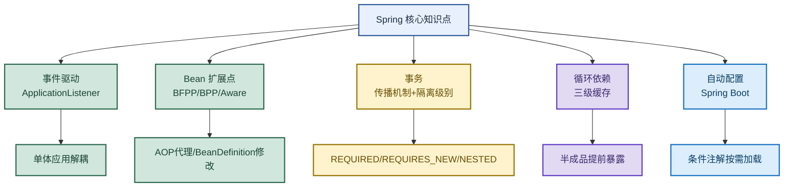

# Spring：从事件驱动到 Bean 后置处理器、事务与循环依赖

> 目标：遇到 Spring 题目先判断"问的是哪一层"——事件驱动、Bean 扩展点、事务传播/隔离、循环依赖、自动配置，再展开机制和实战。
>
> 读图顺序：先看下方"先记住这张总图"（Spring 核心知识点链路），再按问题回看各节。每节底部都有**易混点**或**速记**；先遮住解释自己讲，再对照正文。
>
> 本笔记覆盖 ApplicationListener + BeanFactoryPostProcessor/BeanPostProcessor + 事务传播/隔离 + 三级缓存循环依赖 + Spring Boot 自动配置。

## 先记住这张总图

**一句话主线：**ApplicationListener 单体解耦 → BeanPostProcessor 做 AOP 代理 → 事务传播控回滚 + 隔别级别控并发 → 三级缓存解循环依赖 → Spring Boot 条件注解自动配置。

## 1. ApplicationListener · 事件驱动解耦

> 轻量级解耦的"最优解"。事件驱动模式遵循开闭原则（对扩展开放，对修改关闭），在业务复杂的项目中，能有效降低核心模块的修改频率和风险。

| 对比维度 | ApplicationListener（Spring 事件） | 接口调用（同步/异步） | 消息队列（MQ） |
|---|---|---|---|
| 核心优势 | 极轻量，无额外依赖，代码耦合度低 | 实现简单直接，适合强依赖的同步场景 | 可靠性极高，支持重试、削峰填谷，系统间彻底解耦 |
| 适用场景 | 单体应用内部的模块解耦，如启动初始化、简单的业务联动 | 同步 RPC 调用，需要实时获取返回值，如查询用户信息 | 分布式系统间的异步通信，如跨服务的订单、支付通知 |
| 性能与资源 | 性能最高，基于 JVM 内存 | 依赖网络 IO，同步调用会阻塞线程 | 性能较高，但需独立部署 Broker，有额外运维成本 |
| 可靠性 | 一般，异常会影响主流程；若需重试，需自行实现 | 同步调用可靠性高；异步回调失败需自行处理 | 最高，有持久化和重试机制，失败消息可回溯 |
| 系统依赖 | 无，仅依赖 Spring 框架 | 无，仅依赖服务提供方 | 需额外搭建和维护 MQ 集群 |

**易混点：**ApplicationListener 是单体应用内的解耦方案，不是分布式解耦。跨服务异步通信还是要用 MQ，ApplicationListener 只解决同一 JVM 内模块间的耦合。

## 2. Bean 扩展点三剑客

> BeanFactoryPostProcessor、BeanPostProcessor、ApplicationContextAware 三个扩展点执行时机和操作对象不同。

| 特性 | BeanFactoryPostProcessor | BeanPostProcessor | ApplicationContextAware |
|---|---|---|---|
| 执行时机 | Bean 定义加载后，实例化前 | Bean 实例化后，初始化前后 | Bean 实例化 + 属性注入后，初始化前 |
| 操作对象 | BeanDefinition（元数据） | Bean 实例（对象） | 当前 Bean 自身 |
| 执行次数 | 全局一次 | 每个 Bean 都会触发 | 每个实现类触发一次 |
| 典型用途 | 修改 Bean 定义、占位符解析 | AOP 代理、属性校验、包装增强 | 获取容器资源（ApplicationContext 等） |
| 是否常见 | 较少直接写（框架内部用得多） | 较常见（尤其是 AOP 场景） | 较常见（尤其写工具类） |

### 什么时候必须用 BeanPostProcessor

- `@Aspect` 只能拦截方法调用，无法替换掉整个 Bean。但 BeanPostProcessor 可以：
  - 返回一个完全不同的对象（比如返回一个 Mock 对象用于测试）。
  - 为 Bean 动态添加新的接口实现。
- 如果你只是想给某个方法加日志、监控、权限校验，用 `@Aspect` 就够了，简单直接。
- 如果你需要修改 Bean 本身、替换掉它、或者在它初始化之前动手脚，那就必须用到 BeanPostProcessor。

**易混点：**BeanFactoryPostProcessor 操作的是 BeanDefinition（元数据，还没实例化），BeanPostProcessor 操作的是 Bean 实例（已经 new 出来了）。前者改"图纸"，后者改"成品"。

## 3. 事务的传播机制

> 三种最常用的传播行为，用拟人化口诀记忆。

| 传播行为 | 口诀 | 含义 |
|---|---|---|
| REQUIRED | 有我就加入，没有我就建。同生共死（一起回滚） | 有事务就加入，没有就新建；与外层事务一起回滚 |
| REQUIRES_NEW | 不管有没有，我都要自己开。你是你，我是我（互不影响） | 总是新建事务，外层事务挂起；内外互不影响 |
| NESTED | 我要做你儿子，我回滚不影响你，但你回滚我得死。局部自治（可局部回滚） | 嵌套事务，子事务可独立回滚（保存点），但外层回滚子事务也回滚 |

**易混点：**REQUIRES_NEW 和 NESTED 都能"局部回滚"，但机制不同。REQUIRES_NEW 是完全独立的新事务（外层挂起），NESTED 是嵌套子事务（基于保存点，外层回滚子事务也回滚）。

## 4. 事务的隔离级别

| 隔离级别 | 说明 |
|---|---|
| READ UNCOMMITTED（读未提交） | 最低隔离，有脏读风险，千万别用 |
| READ COMMITTED（读已提交） | 解决脏读，但有不可重复读；互联网大厂常用 |
| REPEATABLE READ（可重复读） | 解决不可重复读，MySQL 默认 |
| SERIALIZABLE（串行化） | 最高隔离，性能灾难，千万别用 |

**关键加分点：**虽然 SQL 标准说 REPEATABLE READ 允许幻读，但 MySQL 的 InnoDB 通过**间隙锁（Gap Lock）+ MVCC**，在 RR 级别下已经能完全解决幻读。因此 MySQL 默认的 RR 实际上达到了接近串行化的一致性，并发性能却好得多。

| 选型 | 适用场景 | 原因 |
|---|---|---|
| MySQL 默认 RR | 金融、交易等强一致性场景 | 间隙锁 + MVCC 解决幻读，接近串行化 |
| 互联网大厂常用 RC | 高并发互联网业务 | RC 没有间隙锁，锁竞争更少，并发吞吐量更高；代价是允许不可重复读（通常业务能接受） |
| 千万别用 | READ UNCOMMITTED、SERIALIZABLE | 脏读风险 / 性能灾难 |

**易混点：**"MySQL 默认 RR"和"大厂常用 RC"不矛盾。RR 适合强一致性（金融），RC 适合高并发（互联网）——选型看业务对一致性和并发的要求，不是"默认就是最优"。

## 5. Spring 如何解决 Bean 的循环依赖

> 三级缓存解决循环依赖，核心是"半成品提前暴露"。

| 缓存层级 | 名称 | 存放内容 |
|---|---|---|
| 一级缓存 | singletonObjects | 存放成品，即完全初始化好的单例 Bean |
| 二级缓存 | earlySingletonObjects | 存放半成品，即已实例化但未完全初始化，被提前暴露出来供其他 Bean 依赖的引用 |
| 三级缓存 | singletonFactories | 存放工厂（ObjectFactory），其 `getObject()` 方法封装了生成最终被暴露的引用（原始对象或 AOP 代理对象）的逻辑 |

**核心机制：**当出现循环依赖时，Bean A 通过三级缓存的工厂，在被依赖的那一刻才决定要暴露原始对象还是代理对象，从而解决了 AOP 代理与循环依赖共存的问题。三级缓存确保了 AOP 代理在循环依赖场景下也能被正确创建和注入。

**易混点：**三级缓存不是为了"三级"，而是为了**延迟决定暴露原始对象还是代理对象**。如果没有 AOP，二级缓存就够了；三级缓存的 ObjectFactory 在被调用时才决定生成原始对象还是代理，保证循环依赖下 AOP 代理也能正确注入。

## 6. Spring Boot 自动配置原理

> 核心高频题：源码链路要讲清楚。

| 步骤 | 发生什么 |
|---|---|
| 1 | 核心注解 `@SpringBootApplication` 组合了 `@EnableAutoConfiguration` |
| 2 | `@EnableAutoConfiguration` 通过 `@Import(AutoConfigurationImportSelector.class)` 导入选择器 |
| 3 | 选择器读取所有 Jar 包中 `META-INF/spring.factories` 或 `META-INF/spring/org.springframework.boot.autoconfigure.AutoConfiguration.imports`（Spring Boot 2.7+）文件里的配置类全路径 |
| 4 | 加载这些配置类时，配合 `@ConditionalOnClass`（类路径存在某类）、`@ConditionalOnMissingBean`（容器无某 Bean）等条件注解，按需加载 |

**踩坑经验：**"我曾经排包冲突，发现引入的第三方的 `RedisAutoConfiguration` 覆盖了默认的，导致连接池报错。解决方法是 `@SpringBootApplication(exclude = RedisAutoConfiguration.class)` 手动排除它。"

**易混点：**自动配置不是"全量加载"，而是"按需加载"。`@ConditionalOnClass`/`@ConditionalOnMissingBean` 等条件注解决定哪些配置类生效——类路径有对应依赖才加载，容器没有对应 Bean 才创建默认实现。

## 高频场景题：用一句诊断开头

### "Spring 怎么解决循环依赖？"

三级缓存：一级 singletonObjects 存成品，二级 earlySingletonObjects 存半成品，三级 singletonFactories 存 ObjectFactory 工厂。出现循环依赖时，Bean A 通过三级缓存的工厂在被依赖那一刻决定暴露原始对象还是代理对象，解决 AOP 代理与循环依赖共存的问题。如果没有 AOP，二级缓存就够了；三级缓存是为了延迟决定暴露原始还是代理。

### "Spring Boot 自动配置原理？"

`@SpringBootApplication` 组合 `@EnableAutoConfiguration`，通过 `@Import(AutoConfigurationImportSelector.class)` 导入选择器，选择器读取 `META-INF/spring.factories`（2.7+ 是 `AutoConfiguration.imports`）里的配置类全路径，加载时配合 `@ConditionalOnClass`/`@ConditionalOnMissingBean` 等条件注解按需加载。不是全量加载，是条件注解决定哪些生效。

## 面试回答模板：三句话讲清一题

> **问题本质是……**（先说问的是哪一层：事件、扩展点、事务、循环依赖、自动配置）。
>
> **机制是……**（解释原理 + 关键点），因为……（为什么这样设计）。
>
> **实战中我会……**（具体场景 + 例子），例如……（业务应用）。

例：问"Spring 事务传播 REQUIRED 和 REQUIRES_NEW 区别"——本质是事务回滚范围的控制；机制是 REQUIRED 有事务就加入（一起回滚），REQUIRES_NEW 总是新建事务（外层挂起，内外互不影响）；实战中核心业务日志记录用 REQUIRES_NEW，即使日志失败也不影响主事务回滚。

## 最后复习：闭眼回忆 8 句

1. **ApplicationListener**：单体应用内事件驱动解耦，极轻量无依赖；跨服务异步用 MQ。
2. **Bean 三剑客**：BFPP 改 BeanDefinition（图纸）、BPP 改 Bean 实例（成品）、Aware 获取容器资源。
3. **BeanPostProcessor 必用场景**：替换整个 Bean、动态加接口；方法加日志用 @Aspect 就够。
4. **事务传播**：REQUIRED 同生共死、REQUIRES_NEW 互不影响、NESTED 局部自治（保存点）。
5. **事务隔离**：MySQL 默认 RR（间隙锁+MVCC 解幻读），大厂常用 RC（无间隙锁高并发）；别用 READ UNCOMMITTED 和 SERIALIZABLE。
6. **循环依赖**：三级缓存——一级成品、二级半成品、三级 ObjectFactory 工厂；三级为延迟决定原始还是代理。
7. **自动配置**：@SpringBootApplication → @EnableAutoConfiguration → AutoConfigurationImportSelector → spring.factories/imports → @Conditional 按需加载。
8. **易混**：REQUIRES_NEW 和 NESTED 都能局部回滚但机制不同；自动配置是按需加载不是全量。

## 怎么练才记得住

别反复通读，改成主动回忆：

1. 每次只看一个主题，遮住表格，先自己说出"机制 → 关键点 → 场景"，再对照。
2. 用"循环依赖三级缓存"和"自动配置原理"各讲 30 秒；卡住时只回看对应小节。
3. 隔天再讲一遍，换成自己的项目例子；能解释"为什么三级缓存不是二级"才算会。
4. 复习时轮流画"Bean 扩展点对比表"和"事务传播口诀"；能默写出自动配置四步链路才算熟。
