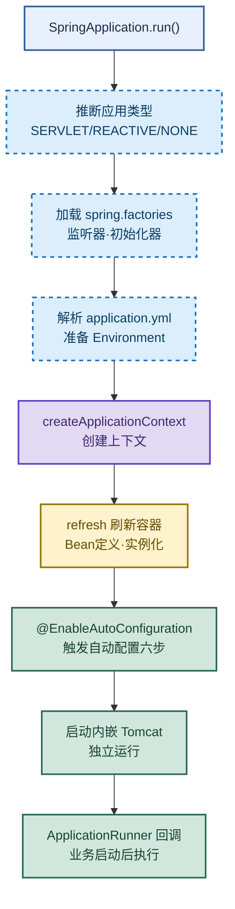
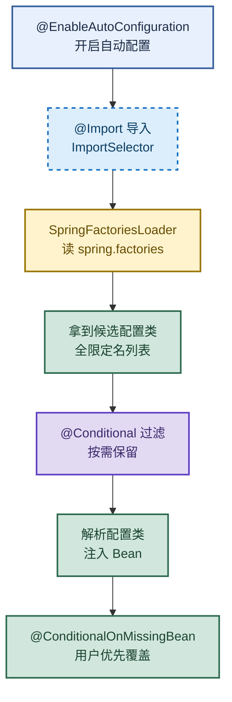

# SpringBoot：启动流程与自动装配原理

> 目标：不背孤立名词。遇到 SpringBoot 题先判断"问的是启动流程还是自动装配"，再用一条主线串起 `SpringApplication.run` 与 `@EnableAutoConfiguration` 六步链路。
> 目标：把"自动装配"从玄学变成"开启 → 加载候选 → 条件过滤 → 用户可覆盖"四步可复述的机制。

## 先记住这张总图

**一句话主线：**`run()` 推断类型 → 加载监听器 → 准备 Environment → 创建并刷新上下文 → 自动装配 → 内嵌 Tomcat → Runner 回调。

## 1. 启动流程：SpringApplication.run 的七步链路

`run()` 是 SpringBoot 的总入口，从推断类型到 Runner 回调，每一步都有明确职责。

| 步骤 | 动作 | 关键产物 | 记忆画面 |
|---|---|---|---|
| 1 | 推断应用类型 | `WebApplicationType` | 看门口：是 Web 还是普通房 |
| 2 | 加载 `spring.factories` | 监听器、初始化器 | 招工：先请好监工和师傅 |
| 3 | 解析 `application.yml` | `Environment` | 备料：把配置摆上工作台 |
| 4 | `createApplicationContext` | 上下文对象 | 搭台：建好 IoC 容器骨架 |
| 5 | `refresh` 刷新容器 | Bean 定义、BeanPostProcessor | 开工：定义→实例化→后置 |
| 6 | 启动内嵌 Tomcat | Servlet 容器 | 通水：房子接上水电 |
| 7 | `ApplicationRunner` 回调 | 业务启动逻辑 | 验收：交付后做收尾活 |

**易混点**：**监听器**（`ApplicationListener`，监听事件）≠ **初始化器**（`ApplicationContextInitializer`，在 refresh 前对上下文做预处理）。前者听事件，后者改上下文。

**速记：**推类型 → 加监听 → 备环境 → 建上下文 → 刷新 → 起容器 → 跑 Runner。

## 2. 容器刷新核心：refresh 方法做了什么

`refresh` 是 Spring 的老方法，SpringBoot 复用它完成 Bean 的加载与实例化。

| 阶段 | 方法 | 作用 | 记忆画面 |
|---|---|---|---|
| 1 | `invokeBeanFactoryPostProcessors` | 加载 `@Bean` 定义 | 画图纸：把所有零件清单登记 |
| 2 | `registerBeanPostProcessor` | 注册后置处理器 | 请质检员：准备逐个检查 |
| 3 | `initMessageSource` | 国际化消息源 | 备翻译：多语言文案 |
| 4 | `initApplicationEventMulticaster` | 事件广播器 | 装大喇叭：事件分发中枢 |
| 5 | `finishBeanFactoryInitialization` | 实例化非懒加载单例 | 造零件：真正 new 出对象 |
| 6 | `finishRefresh` | 发布 `ContextRefreshedEvent` | 敲锣：宣布容器就绪 |

**易混点**：**BeanFactoryPostProcessor**（改 Bean 定义，refresh 早期执行）≠ **BeanPostProcessor**（改 Bean 实例，在实例化前后执行）。一个改图纸，一个改成品。

**速记：**后置处理定义 → 注册后置处理器 → 消息源 → 事件广播 → 实例化单例 → 发布就绪事件。

## 3. 自动装配原理：@EnableAutoConfiguration 六步

自动装配是 SpringBoot 的灵魂，本质是"开启 + 加载候选 + 条件过滤 = 灵活可覆盖"。

| 步骤 | 机制 | 作用 | 记忆画面 |
|---|---|---|---|
| ① | `@EnableAutoConfiguration` | 开启自动配置开关 | 按总闸：通电 |
| ② | `@Import(AutoConfigurationImportSelector.class)` | 导入核心加载类 | 派采购员：去拉货 |
| ③ | `SpringFactoriesLoader` | 读 `META-INF/spring.factories` 或 `AutoConfiguration.imports` | 翻货单：列出所有候选 |
| ④ | `@Conditional` 条件过滤 | `@ConditionalOnClass`/`@ConditionalOnMissingBean` | 过安检：不合格退货 |
| ⑤ | 配置类解析注入 Bean | 保留下来的类生效 | 上架：合格品摆上货架 |
| ⑥ | `@ConditionalOnMissingBean` | 用户自定义优先 | 让位：顾客自带货优先 |

**易混点**：**`@ConditionalOnClass`**（类路径有该类才生效，决定"能不能装"）≠ **`@ConditionalOnMissingBean`**（容器没有该 Bean 才生效，决定"要不要让位"）。前者看环境，后者看用户。

**易混点**：**`spring.factories`**（SpringBoot 2.x 及以前，所有配置类塞一个文件）≠ **`AutoConfiguration.imports`**（SpringBoot 3.x 起，一行一个全限定名，更清晰）。新版本推荐后者。

**速记：**开启 → 导入 → 加载候选 → 条件过滤 → 注入 → 用户优先。

## 4. 对 SpringBoot 的理解：五大特性

SpringBoot 不是新框架，而是 Spring 的脚手架，解决"配置地狱"和"依赖冲突"两大痛点。

| 特性 | 含义 | 解决的痛点 | 记忆画面 |
|---|---|---|---|
| ① 快速开发脚手架 | 开箱即用 | 项目搭建慢 | 装修样板房：拎包入住 |
| ② 起步依赖 | `starter` 一行集成 | 依赖版本难配 | 套餐：一份全齐 |
| ③ 简化配置 | 约定优于配置 | XML 配置地狱 | 默认值：不填就用合理值 |
| ④ 内置容器 | 内嵌 Tomcat | 部署需独立容器 | 自带厨房：不用外借灶台 |
| ⑤ 依赖管理 | 版本统一管理 | 第三方版本冲突 | 总调度：版本统一发号 |

**易混点**：**起步依赖**（`spring-boot-starter-xxx`，聚合一组坐标，本身不含代码）≠ **自动配置**（`@EnableAutoConfiguration`，根据条件注入 Bean）。前者管依赖，后者管 Bean。

**速记：**脚手架 + 起步依赖 + 简化配置 + 内置容器 + 依赖管理。

## 5. 启动原理三阶段：初始化 → 事件 → 刷新

从源码视角，启动可拆成初始化、事件驱动、容器刷新三阶段。

| 阶段 | 动作 | 关键点 | 记忆画面 |
|---|---|---|---|
| ① 初始化 | 读环境变量、`spring.factories`、初始化器、监听器 | 准备扩展点 | 备料：工具人到位 |
| ② 事件驱动 | 监听器发布事件、`createApplicationContext` | 事件触发上下文创建 | 发令枪：监工喊开工 |
| ③ 容器刷新 | `refresh` 加载自动配置类、解析 `@Import` | 自动装配在此发生 | 施工：图纸落地成房 |

**易混点**：**初始化阶段**（构造 `SpringApplication` 时，读 `spring.factories` 拿监听器）≠ **运行阶段**（`run()` 中发布 `ApplicationStartedEvent` 等事件）。前者是"招工"，后者是"开工后发通知"。

**速记：**初始化招工 → 事件发令 → 刷新施工。

## 高频场景题

### "SpringBoot 自动装配是怎么实现的？"

诊断：问的是机制链路，不是名词堆砌。答六步：开启 → 导入 → 加载 → 过滤 → 注入 → 用户优先。

### "为什么我自定义的 Bean 能覆盖自动配置？"

诊断：问的是 `@ConditionalOnMissingBean` 的优先级机制。自动配置类检测到用户已定义同名 Bean，就跳过注入。

### "SpringBoot 启动慢，可能卡在哪一步？"

诊断：问的是启动流程定位能力。可能卡在 `finishBeanFactoryInitialization`（实例化过多 Bean）或自动配置类过多，可用 `spring-boot-startup-analyzer` 或延迟初始化排查。

### "spring.factories 和 AutoConfiguration.imports 有什么区别？"

诊断：问的是版本演进。2.x 用 `spring.factories`，3.x 改用 `AutoConfiguration.imports`，一行一个类名，更易维护。

## 面试回答模板：三句话讲清一题

> **自动装配原理：**问题本质是 SpringBoot 如何"零配置"集成第三方组件。机制是 `@EnableAutoConfiguration` 开启 → `SpringFactoriesLoader` 加载候选配置类 → `@Conditional` 按需过滤 → `@ConditionalOnMissingBean` 保证用户优先。实战中我会用 `debug=true` 查看生效的自动配置类，用 `@ConditionalOnMissingBean` 自定义覆盖默认实现。

> **启动流程：**问题本质是 `SpringApplication.run` 如何把一个 main 方法变成可运行的 Web 应用。机制是推断类型 → 加载监听器 → 准备 Environment → 创建并刷新上下文 → 自动装配 → 启动内嵌 Tomcat → Runner 回调。实战中我会用 `ApplicationRunner` 做启动后初始化，用 `EventListener` 监听关键节点做监控。

> **对 SpringBoot 的理解：**问题本质是 SpringBoot 解决了什么问题。机制是它通过起步依赖、自动配置、内嵌容器、约定优于配置，把 Spring 从"重型框架"变成"开箱即用脚手架"。实战中我会优先用 `starter` 集成，用 `application.yml` 覆盖默认值，需要时再自定义 Bean 覆盖自动配置。

## 最后复习：闭眼回忆 8 句

1. `SpringApplication.run` 七步：推类型 → 加监听 → 备环境 → 建上下文 → 刷新 → 起容器 → 跑 Runner。
2. `refresh` 六阶段：后置处理定义 → 注册后置处理器 → 消息源 → 事件广播 → 实例化单例 → 发布就绪事件。
3. 自动装配六步：开启 → `@Import` 导入 → `SpringFactoriesLoader` 加载 → `@Conditional` 过滤 → 注入 → 用户优先。
4. `@ConditionalOnClass` 看类路径，`@ConditionalOnMissingBean` 看容器，前者决定能不能装，后者决定要不要让位。
5. `spring.factories` 是 2.x 写法，3.x 改用 `AutoConfiguration.imports`，一行一个全限定名。
6. SpringBoot 五大特性：脚手架、起步依赖、简化配置、内置容器、依赖管理。
7. 起步依赖管依赖坐标，自动配置管 Bean 注入，两者不混。
8. 用户自定义 Bean 能覆盖自动配置，靠的是 `@ConditionalOnMissingBean` 的让位机制。

## 怎么练才记得住

1. **画一遍启动流程图**：闭着眼在纸上画出 `run()` 七步，标出每步的产物，卡住就回去看总图。
2. **复述自动装配六步**：对着空气讲一遍"开启 → 加载 → 过滤 → 注入 → 让位"，每步举一个注解例子。
3. **写一个自定义 Starter**：手写一个 `xxx-spring-boot-starter`，用 `@ConditionalOnMissingBean` 演示覆盖，比背十遍都管用。
4. **对比易混点**：把 `BeanFactoryPostProcessor` vs `BeanPostProcessor`、`@ConditionalOnClass` vs `@ConditionalOnMissingBean`、`spring.factories` vs `AutoConfiguration.imports` 各写一行区别，反复默写。
