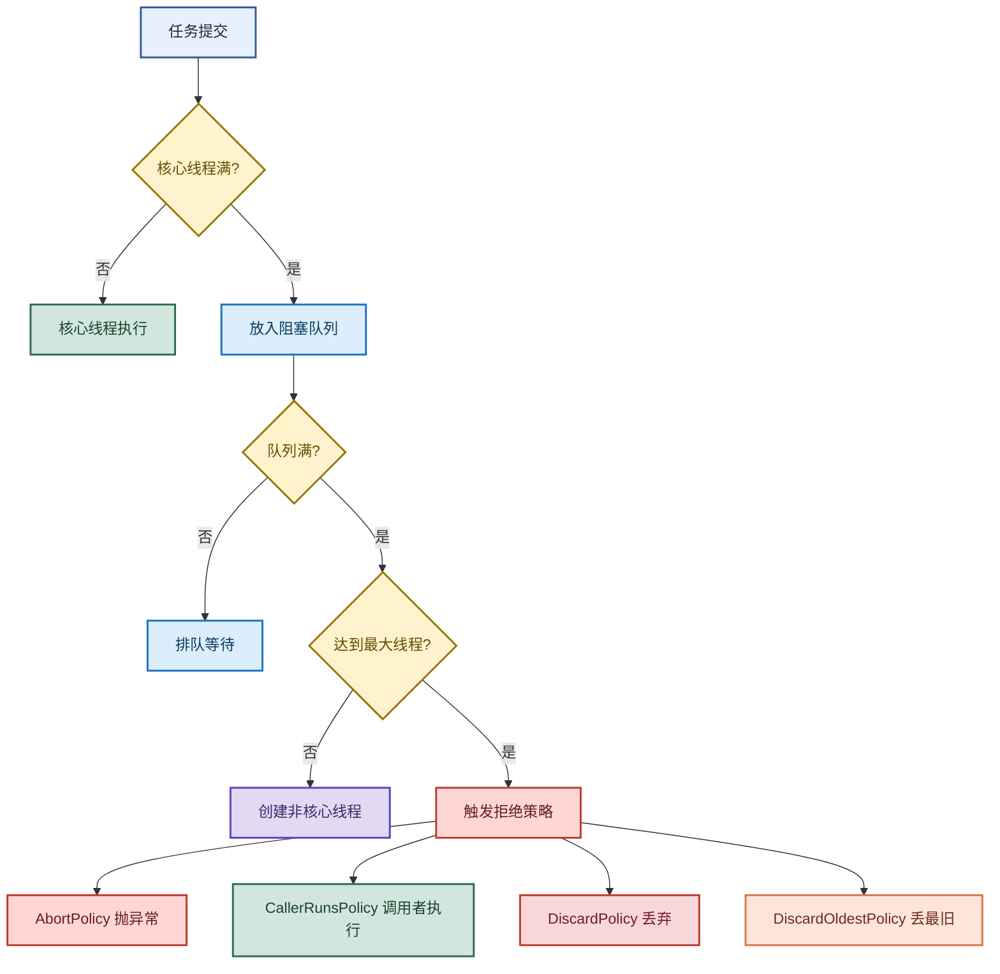

# 线程池：从参数配置到拒绝策略与阻塞队列设计

> 目标：遇到线程池题目先判断"问的是哪一层"——线程池是什么、7 大参数、4 种拒绝策略、为什么先放队列后扩线程，再展开机制和实战。
>
> 读图顺序：先看下方"先记住这张总图"（线程池核心链路），再按问题回看各节。每节底部都有**易混点**或**速记**；先遮住解释自己讲，再对照正文。
>
> 本笔记覆盖线程池定义 + 4 种创建方式 + 7 大参数 + 阻塞队列设计哲学 + 拒绝策略。

## 先记住这张总图

**一句话主线：**核心线程优先 → 任务队列次之 → 最后才扩张到最大线程数 → 满了触发拒绝策略（默认抛异常/调用者执行/丢弃/丢最旧）。

## 1. 什么是线程池

> 线程池通过复用线程避免频繁创建销毁开销，通过控制线程数量和队列避免资源耗尽。

| 价值 | 说明 |
|---|---|
| 复用线程 | 避免频繁创建销毁的开销 |
| 控制并发 | 控制线程数量和队列，避免资源耗尽 |
| 任务流转 | 核心线程优先 → 任务队列次之 → 最后才扩张到最大线程数 |
| 生产准则 | 务必手动创建，<mark>杜绝无界队列</mark> |

**易混点：**线程池不是"线程越多越好"。线程是昂贵的操作系统资源（1MB 栈内存 + 内核调用），无限制创建会拖垮系统。线程池的核心是用"常驻核心线程 + 队列缓冲 + 临时非核心线程"三层结构，在吞吐和稳定之间找平衡。

## 2. 创建线程的四种方式

| 方式 | 特点 |
|---|---|
| 继承 Thread 类 | 单继承限制，扩展性差 |
| 实现 Runnable 接口 | 无返回值 |
| 实现 Callable 接口 + Future | <mark>支持返回值</mark> |
| 使用线程池 | <mark>最推荐，生产环境标准</mark> |

**速记：**Thread、Runnable、Callable+Future、线程池。生产环境只用线程池。

## 3. 线程池的 7 大参数

| 参数 | 作用 | 关键点 |
|---|---|---|
| 核心线程数（corePoolSize） | 常驻线程 | 即使空闲也保留 |
| 阻塞队列（workQueue） | 缓冲任务 | <mark>必须用有界队列</mark>，无界队列会让最大线程数失效 |
| 最大线程数（maximumPoolSize） | 极限并发 | 队列满后才创建非核心线程 |
| 存活时间（keepAliveTime） | 非核心线程空闲存活时间 | 超时回收 |
| 时间单位（unit） | 存活时间单位 | - |
| 线程工厂（threadFactory） | 创建线程 | 可自定义命名便于排障 |
| 拒绝策略（RejectedExecutionHandler） | 满了怎么办 | 4 种内置策略 |

**易混点：**"先放队列，队列满了才扩线程"是反直觉但正确的设计。如果用了**无界队列**，队列永远不满，最大线程数就**永远失效**——这就是为什么金融项目强制用有界队列 + 自定义拒绝策略 + 队列水位监控（超 80% 立马报警扩容）。

## 4. 阻塞队列的作用与设计哲学

> 阻塞队列：缓冲 + 解耦，是线程池"先队列后扩线程"设计的核心。

| 作用 | 说明 |
|---|---|
| 缓冲 | 任务提交速度大于处理速度时，队列暂存，防止系统被瞬间流量冲垮 |
| 解耦 | 提交任务的线程和执行任务的线程通过队列隔离 |

**为什么先放队列再扩线程？**

| 理由 | 说明 |
|---|---|
| 最大化资源利用率 | 排队是廉价的 JVM 内存操作，创建线程是昂贵的操作系统操作 |
| 规避无限创建 | 避免流量一来就无限创建线程导致系统崩溃 |
| 应对瞬时毛刺 | 80% 的高峰是短时毛刺，排队让核心线程消化即可，不必动用非核心线程 |

**设计比喻：**corePoolSize 是常驻兵力，workQueue 是防御缓冲带，maximumPoolSize 是最后的核武器（Emergency Only）。只有缓冲带被洪水冲垮时，才动用核武器。一上来就用核武器，系统很快因资源耗尽而自爆。

**易混点：**"队列满了才扩线程"不是"队列满了就拒绝"。顺序是：核心线程 → 队列 → 最大线程 → 拒绝策略。队列满后还会尝试创建非核心线程到 maximumPoolSize，只有最大线程也满了才拒绝。

## 5. 四种拒绝策略

| 策略 | 行为 | 风险/适用 |
|---|---|---|
| AbortPolicy（默认） | <mark>直接抛出异常</mark> | 暴露问题，但会中断提交线程 |
| CallerRunsPolicy | 调用者线程执行任务 | <mark>降速反压</mark>，不丢任务 |
| DiscardPolicy | 丢弃任务 | <mark>风险高</mark>，静默丢失 |
| DiscardOldestPolicy | 丢弃队列中最旧的任务 | 给新任务腾位，可能丢重要任务 |

**易混点：**CallerRunsPolicy 看似"退化了"，其实是**反压**的好策略——让提交任务的线程自己去执行，自然就慢下来不再疯狂提交，起到限流作用。生产环境常用它配合有界队列，既不丢任务又能反压。

## 高频场景题：用一句诊断开头

### "线程池为什么先放队列再扩线程？"

本质是资源成本差异。操作系统线程是昂贵的物理资源（1MB 栈 + 内核调用），JVM 堆里的队列是廉价的逻辑资源。设计上 corePoolSize 是常驻兵力、workQueue 是缓冲带、maximumPoolSize 是核武器。80% 的高峰是短时毛刺，排队让核心线程消化即可；只有缓冲带被冲垮才动用非核心线程，避免一上来就无限创建线程导致系统自爆。

### "无界队列有什么坑？"

无界队列永远不满，最大线程数永远失效，并发度被锁死在 corePoolSize。流量洪峰时任务无限堆积在队列里，最终 OOM。所以生产环境必须用有界队列 + 自定义拒绝策略 + 队列水位监控。

## 面试回答模板：三句话讲清一题

> **问题本质是……**（先说问的是哪一层：参数、队列、拒绝策略）。
>
> **机制是……**（解释原理 + 关键点），因为……（为什么这样设计）。
>
> **实战中我会……**（选型 + 场景），例如……（业务应用）。

例：问"线程池怎么配置"——本质是参数与队列的平衡；机制是核心线程优先 → 队列缓冲 → 最大线程兜底 → 拒绝策略，因为线程昂贵队列廉价；实战中 CPU 密集型核心线程数设 N+1，IO 密集型设 2N，强制有界队列 + CallerRunsPolicy 反压 + 队列水位 80% 告警扩容。

## 最后复习：闭眼回忆 8 句

1. **线程池价值**：复用线程避免创建销毁开销，控制并发避免资源耗尽，生产必须手动创建。
2. **创建线程四种**：Thread、Runnable、Callable+Future（有返回值）、线程池（生产标准）。
3. **7 大参数**：核心线程、阻塞队列、最大线程、存活时间、时间单位、线程工厂、拒绝策略。
4. **任务流转**：核心线程 → 队列 → 最大线程 → 拒绝策略（先队列后扩线程）。
5. **无界队列的坑**：永远不满，最大线程数失效，流量洪峰 OOM。
6. **先队列后扩线程**：线程昂贵（1MB 栈+内核调用），队列廉价（JVM 内存），应对毛刺。
7. **四种拒绝策略**：AbortPolicy 抛异常（默认）、CallerRunsPolicy 反压、DiscardPolicy 丢弃（风险高）、DiscardOldestPolicy 丢最旧。
8. **CallerRunsPolicy 是反压**：调用者自己执行，自然降速限流，不丢任务。

## 怎么练才记得住

别反复通读，改成主动回忆：

1. 每次只看一个知识点，遮住表格，先自己说出"原理 → 关键点 → 场景"，再对照。
2. 用"任务流转顺序"和"为什么先队列后扩线程"各讲 30 秒；卡住时只回看对应小节。
3. 隔天再讲一遍，换成自己的项目例子；能解释"无界队列为什么让最大线程数失效"才算会。
4. 复习时画"任务流转图"和"四种拒绝策略表"；能默写出 7 大参数和先队列后扩线程的设计理由才算熟。
