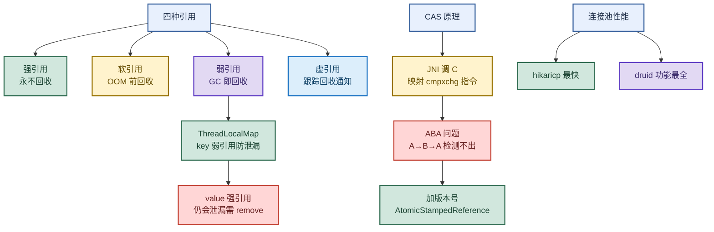

# 多线程：强软弱虚引用、ThreadLocal与CAS

> 目标：遇到引用类题目先判断"问的是哪一种引用"——强软弱虚的回收时机与用途；遇到 ThreadLocal 先想"key 弱引用防 key 泄漏、value 强引用仍会泄漏、必须 remove"；遇到 CAS 先想"原子指令 cmpxchg + ABA 用版本号解决"。
>
> 读图顺序：先看下方"先记住这张总图"（引用强度 → ThreadLocal → CAS 三条主线），再按问题回看各节。每节底部都有**易混点**或**速记**；先遮住解释自己讲，再对照正文。
>
> 本笔记覆盖强软弱虚四种引用 + ThreadLocal 原理与内存泄漏 + CAS 原理与 ABA 问题 + 数据库连接池性能对比。

## 先记住这张总图

**一句话主线：**引用强度从强到虚决定回收时机（强不回收/软 OOM 前/弱 GC 即/虚只跟踪）→ ThreadLocal 用弱引用 key 防 key 泄漏但 value 强引用仍需 remove → CAS 靠 CPU 原子指令 cmpxchg 实现无锁，ABA 用版本号解决。

## 1. 强软弱虚四种引用：回收时机与典型场景

> 四种引用的区别核心在"GC 何时回收"和"用来干什么"。

| 引用类型 | 回收时机 | 典型场景 | 记忆画面 |
|---|---|---|---|
| 强引用（Strong） | **永不回收**，哪怕 OOM 也不动 | 普通对象赋值 `Object o = new Object()` | 死忠保镖：人在保镖在，宁可 OOM 不放手 |
| 软引用（Soft） | **内存不足、OOM 前**回收 | 图片缓存、查询结果缓存（大尺寸数据临时缓存） | 备胎：内存够就留着加速，紧张了就丢 |
| 弱引用（Weak） | **只要发生 GC** 就回收，无论内存是否充足 | `ThreadLocalMap` 的 key、`WeakHashMap` 的 key、Guava/Caffeine 弱引用键值 | 路人：GC 一来就走，不留情面 |
| 虚引用（Phantom） | 最弱，**唯一目的是跟踪 GC** | 监控对象生命周期、清理外部资源、自定义内存管理 | 侦探：不碰对象只盯梢，回收时收到通知 |

**虚引用的两个关键点：**`get()` 永远返回 `null`（拿不到对象）；对象被回收时会被放入**引用队列**（ReferenceQueue），系统通知你"它没了"。

**易混点：**软引用和弱引用最容易搞混。**软引用看内存脸色**（内存够就留，不足才回收），**弱引用看 GC 脸色**（GC 一来必回收，不管内存够不够）。一句话：软引用"留到 OOM 前"，弱引用"GC 即清"。

**速记：**强不回收、软 OOM 前、弱 GC 即、虚只跟踪。软留缓存、弱做映射、虚盯生命周期。

## 2. ThreadLocal：原理与内存泄漏

> ThreadLocal 让每个线程持有自己独立的数据副本，同一线程内跨方法跨类安全传递上下文，避免显式传参。

| 要点 | 说明 |
|---|---|
| 原理 | 每个线程持有自己的 `ThreadLocalMap`，以 `ThreadLocal` 对象为 Key 存数据 |
| 线程隔离 | 不同线程访问同一 `ThreadLocal` 拿到各自独立的数据副本 |
| 应用场景 | 同线程跨方法跨类传递上下文（用户身份、TraceId、数据库连接） |
| Entry 的 key | **弱引用**，防止 `ThreadLocal` 对象本身无法被 GC |
| Entry 的 value | **强引用**，key==null 后 value 仍被 Entry 持有 → **会泄漏** |
| 清理逻辑 | 依赖 `set`/`get`/`remove` 中的清理逻辑，或显式调用 `remove()` |
| 唯一彻底解法 | **`finally` 块中调用 `remove()`** |

**为什么 key 用弱引用？**为了让 `ThreadLocal` 对象在没有外部强引用时能被 GC 回收，**防止 key 本身造成内存泄漏**。如果 key 是强引用，线程存活期间 `ThreadLocal` 永远回收不了。

**value 会泄漏吗？会。**因为 value 是强引用。当 key==null（弱引用被回收）后，value 仍被 Entry 持有，形成 `Thread → ThreadLocalMap → Entry → value` 的强引用链，线程不死 value 就不回收。线程池复用场景下尤其严重：线程长期存活，value 不断堆积，导致**内存泄漏**或**数据串扰**（前一个用户的上下文被后一个用户读到）。

**易混点：**"key 用弱引用"不等于"ThreadLocal 不会内存泄漏"。弱引用只防住了 **key 泄漏**，**value 泄漏**仍存在。唯一能彻底避免的方法是每次用完在 `finally` 块调用 `remove()`。很多人误以为用了弱引用就高枕无忧，结果线程池项目里照样 OOM。

**速记：**key 弱引用防 key 泄漏，value 强引用仍泄漏，`finally` 里 `remove()` 是唯一解。

## 3. CAS 原理：无锁原子操作与 ABA 问题

> CAS（Compare And Swap）通过 JNI 调用 C 语言，最终映射到 CPU 原子指令 `cmpxchg`，实现无锁的"比较并替换"。

| 要点 | 说明 |
|---|---|
| 全称 | Compare And Swap（比较并交换） |
| 实现链路 | Java JNI → C 语言 → CPU 指令 `cmpxchg` |
| 原子性来源 | **CPU 指令级别**原子，非锁实现 |
| 操作语义 | 比较内存值与期望值，相等则更新为新值，不相等则不操作 |
| Java API | `compareAndSwapxxx` 系列（`Unsafe`）、`Atomic*` 原子类 |

**ABA 问题：**CAS 在操作前检查值有没有变化，没变化才更新。但如果值原来是 A，被其他线程改成 B 又改回 A，CAS 检查时发现"值没变"就更新了——**实际却变化过**。对纯数值更新无影响，但对"发生过修改就视为脏"的场景（如栈操作、状态机）会出错。

**解决 ABA：给值加修改版本号。**每次值变化都更新版本号，CAS 时不仅比值还比版本号。Java 中 `AtomicStampedReference` 用一个 `(对象引用, 整数 stamp)` 的 pair 对象解决 ABA——值改一次 stamp 加一，CAS 同时对比引用和 stamp。

**易混点：**ABA 不是"值错了"，而是"值看起来没变但中间变过"。对**只关心最终值**的场景（计数器）ABA 无害；对**关心过程**的场景（资源状态、链表节点复用）ABA 有害，必须用版本号。别一提 CAS 就说"必须解决 ABA"，要看场景。

**速记：**CAS = JNI → C → `cmpxchg` 原子指令；ABA = A→B→A 检测不出，用版本号 `AtomicStampedReference` 解决。

## 4. 数据库连接池性能对比

> 连接池选型：追求性能选 HikariCP，追求功能全面选 Druid。

| 连接池 | 定位 | 特点 |
|---|---|---|
| HikariCP | **性能最强** | 字节码优化、无锁设计、极致轻量 |
| Druid | **功能最全** | SQL 拦截、统计全面、扩展性好 |
| JDBC（无池） | 基线 | 每次新建连接，性能最差 |
| DBCP | 老牌 | 功能基础，性能一般 |
| C3P0（cp30） | 老牌 | 性能最弱，已不推荐 |

**性能排序：**`hikaricp > druid > jdbc > dbcp > cp30`。

**易混点：**"性能最强"不等于"必须选"。HikariCP 极致性能但监控弱，Druid 性能略逊但 SQL 拦截、慢查询统计、防 SQL 注入等运维功能全面。互联网高并发业务选 HikariCP 榨干性能；需要强监控和 SQL 治理的传统企业系统选 Druid。

**速记：**性能 HikariCP > Druid > JDBC > DBCP > C3P0；功能 Druid 最全。

## 高频场景题：用一句诊断开头

### "ThreadLocal 用完不 remove 会怎样？"

线程池复用场景下会**内存泄漏 + 数据串扰**。ThreadLocalMap 的 key 是弱引用会被 GC 回收（key==null），但 value 是强引用仍被 Entry 持有。线程长期存活，value 不断堆积导致内存泄漏；更危险的是下一个任务可能读到上一个用户残留的上下文（如用户身份），造成数据串扰。唯一解法是 `finally` 块中 `remove()`。

### "CAS 的 ABA 问题怎么解决？"

给值加**修改版本号**。每次值变化都更新版本号，CAS 时不仅比较值还比较版本号。Java 用 `AtomicStampedReference`，内部维护 `(对象引用, stamp)` 的 pair，值改一次 stamp 加一，CAS 同时对比引用和 stamp，A→B→A 时 stamp 已变，CAS 失败。注意纯计数场景 ABA 无害，只有关心"是否发生过修改"的场景才需要解决。

### "软引用和弱引用什么时候回收？"

**软引用**在 JVM 内存不足、OOM 前回收，适合做缓存（内存够留着加速，紧张时释放）；**弱引用**只要发生 GC 就回收，无论内存是否充足，适合做容器内元数据映射（如 `WeakHashMap`、`ThreadLocalMap` 的 key）。一句话：软引用看内存脸色，弱引用看 GC 脸色。

## 面试回答模板：三句话讲清一题

> **问题本质是……**（先说问的是哪一层：引用类型、ThreadLocal 泄漏、CAS 原理）。
>
> **机制是……**（解释原理 + 关键点），因为……（为什么这样设计）。
>
> **实战中我会……**（选型 + 场景），例如……（业务应用）。

例：问"ThreadLocal 为什么会内存泄漏"——本质是 key 弱引用 value 强引用的不对称设计；机制是 `ThreadLocalMap` 的 Entry key 用弱引用防 key 泄漏，但 value 是强引用，key==null 后 value 仍被 Entry 持有，线程池复用下线程长期存活导致 value 堆积；实战中我会在 `finally` 块调用 `remove()` 彻底释放，并在拦截器/AOP 的 after 阶段统一清理，避免数据串扰。

## 最后复习：闭眼回忆 8 句

1. **强引用**：永不回收，哪怕 OOM 也不动，普通对象赋值就是强引用。
2. **软引用**：OOM 前回收，做图片缓存、查询结果缓存（内存够留、紧张丢）。
3. **弱引用**：GC 即回收，做 `ThreadLocalMap` key、`WeakHashMap` key、Guava/Caffeine 弱引用键值。
4. **虚引用**：最弱，`get()` 永远返回 null，唯一目的是跟踪 GC，回收时入引用队列通知。
5. **ThreadLocal 原理**：每线程一个 `ThreadLocalMap`，以 `ThreadLocal` 为 key 存独立副本，线程隔离。
6. **ThreadLocal 泄漏**：key 弱引用防 key 泄漏，value 强引用仍泄漏，`finally` 里 `remove()` 是唯一解。
7. **CAS 原理**：JNI → C → CPU 指令 `cmpxchg` 原子操作，无锁比较并替换。
8. **ABA 与连接池**：ABA 用版本号 `AtomicStampedReference` 解决；连接池性能 HikariCP > Druid > JDBC > DBCP > C3P0，Druid 功能最全。

## 怎么练才记得住

别反复通读，改成主动回忆：

1. 每次只看一种引用，遮住表格，先自己说出"回收时机 + 典型场景"，再对照；重点区分软引用（看内存）和弱引用（看 GC）。
2. 用"ThreadLocal 为什么 key 用弱引用、value 为什么仍泄漏、怎么彻底解决"各讲 30 秒；卡住时只回看对应小节。
3. 隔天再讲一遍，换成自己的项目例子；能解释"线程池复用下 ThreadLocal 为什么会数据串扰"和"CAS 的 ABA 什么时候才需要解决"才算会。
4. 复习时画"四种引用回收时机表"和"ThreadLocal 引用链图"；能默写出 CAS 的实现链路（JNI→C→cmpxchg）和连接池性能排序才算熟。
