# ZooKeeper：ZAB协议、Watch与分布式锁

> 目标：不背孤立名词。遇到 ZooKeeper 题先判断"问的是哪一层"——是 ZAB 协议的 Leader 选举与原子广播，还是 Watch 一次性通知，还是临时顺序节点分布式锁。
> 目标：把 CP 特性、Leader/Follower/Observer、ZXID、Watch 映射表、分布式锁加锁流程、五大应用场景串成一条主线，能三句话讲清一题。
> 目标：每个易混点都能用一句话区分，比如"ZK 是 CP 牺牲可用性，Redis 锁是 AP 牺牲强一致""Watch 是一次性触发，不是持续监听"。

## 先记住这张总图

```mermaid
flowchart TD
    A([ZooKeeper 核心体系]) --> B[ZAB 协议<br/>Leader/Follower/Observer]
    A --> C[Watch 机制<br/>一次性通知]
    A --> D[分布式锁<br/>临时顺序节点]
    A --> E[五大应用场景<br/>注册·配置·锁·选主·命名]

    B --> B1[Leader 处理写·广播]
    B --> B2[Follower 读·投票]
    B --> B3[Observer 读·不投票]
    B --> B4["ZXID=Epoch+序号"]
    C --> C1["注册:路径→SessionID"]
    C --> C2[触发:写后查表推送]
    C --> C3[一次性·需重注册]
    D --> D1[创建临时顺序节点]
    D --> D2["判断是否最小节点"]
    D --> D3[否则 Watch 前驱]
    D --> D4[释放:删除或会话断开]
    E --> E1[服务注册发现]
    E --> E2[配置中心]
    E --> E3[分布式锁]
    E --> E4[集群选主]
    E --> E5[命名服务·全局ID]

    style A fill:#E8F0FD,stroke:#315C9A,stroke-width:2px,color:#1D2C46
    style B fill:#D1E7DD,stroke:#2D6A4F,stroke-width:2px,color:#1B4332
    style C fill:#FFF3CD,stroke:#997404,stroke-width:2px,color:#664D03
    style D fill:#E2D9F3,stroke:#5F3DC4,stroke-width:2px,color:#3B2A6B
    style E fill:#DCEEFB,stroke:#1971C2,stroke-width:2px,stroke-dasharray:5,color:#0B3D63
    style B1 fill:#D1E7DD,stroke:#2D6A4F,stroke-width:2px,color:#1B4332
    style B2 fill:#D1E7DD,stroke:#2D6A4F,stroke-width:2px,color:#1B4332
    style B3 fill:#DCEEFB,stroke:#1971C2,stroke-width:2px,stroke-dasharray:5,color:#0B3D63
    style B4 fill:#FFF3CD,stroke:#997404,stroke-width:2px,color:#664D03
    style C1 fill:#FFF3CD,stroke:#997404,stroke-width:2px,color:#664D03
    style C2 fill:#FFF3CD,stroke:#997404,stroke-width:2px,color:#664D03
    style C3 fill:#FFD6D6,stroke:#C0392B,stroke-width:2px,color:#641E1E
    style D1 fill:#E2D9F3,stroke:#5F3DC4,stroke-width:2px,color:#3B2A6B
    style D2 fill:#E2D9F3,stroke:#5F3DC4,stroke-width:2px,color:#3B2A6B
    style D3 fill:#E2D9F3,stroke:#5F3DC4,stroke-width:2px,color:#3B2A6B
    style D4 fill:#D1E7DD,stroke:#2D6A4F,stroke-width:2px,color:#1B4332
    style E1 fill:#DCEEFB,stroke:#1971C2,stroke-width:2px,stroke-dasharray:5,color:#0B3D63
    style E2 fill:#DCEEFB,stroke:#1971C2,stroke-width:2px,stroke-dasharray:5,color:#0B3D63
    style E3 fill:#DCEEFB,stroke:#1971C2,stroke-width:2px,stroke-dasharray:5,color:#0B3D63
    style E4 fill:#DCEEFB,stroke:#1971C2,stroke-width:2px,stroke-dasharray:5,color:#0B3D63
    style E5 fill:#DCEEFB,stroke:#1971C2,stroke-width:2px,stroke-dasharray:5,color:#0B3D63
```

**一句话主线：**ZooKeeper 是 CP 型分布式协调服务，靠 ZAB 协议保证强一致，靠 Watch 做异步通知，靠临时顺序节点实现无羊群效应的分布式锁。

## 1. ZooKeeper 是什么：CP 型协调服务

一句话：**ZooKeeper 是开源的分布式协调服务，本质是高性能高可用的分布式数据一致性解决方案**。

| 维度 | 说明 | 记忆画面 |
|---|---|---|
| 定位 | 分布式协调服务，提供配置/命名/状态共享与同步 | 集群的"管家" |
| 数据结构 | 类文件系统的树形 Znode，每个节点存数据 | 像 Linux 目录树 |
| 一致性模型 | **CP**——一致性 + 分区容错，牺牲一定可用性保强一致 | 宁可拒服务也不给脏数据 |
| 典型用途 | 服务注册发现、配置中心、分布式锁、集群选主、命名服务 | 五大场景一把抓 |

**易混点**：**ZooKeeper 是 CP 不是 AP**——分区发生时，少数派分区会停止服务以保证数据强一致，所以 ZK **不适合做超高并发写入**的主存储。和 Eureka/Nacos（AP 优先）的取舍正好相反，别在面试里把 ZK 答成"高可用优先"。

**速记：**ZK 是 CP 协调服务，树形 Znode，牺牲可用性换强一致。

## 2. ZAB 协议：Leader/Follower/Observer 与原子广播

一句话：**ZAB 原子广播协议靠 Leader 唯一处理写、Follower 投票确认、Observer 只读不投票，保证全局顺序一致**。

| 角色 | 职责 | 是否投票 | 记忆画面 |
|---|---|---|---|
| Leader | 处理所有写请求，广播提案给 Followers，集群仅一个 | 是（发起提案） | 唯一的"班长" |
| Follower | 处理读请求，接收提案并写入本地，参与选举和投票 | 是 | "班委"既读又投票 |
| Observer | 处理读请求，不参与投票，用于提升读性能不增加写压力 | 否 | "旁听生"只读不投票 |

**读写流程**：

| 流程 | 步骤 | 记忆画面 |
|---|---|---|
| 写流程 | 客户端连任一节点 → 转发给 Leader → Leader 发 Proposal → Follower 投票 → **超半数 ACK** → Leader Commit → 通知所有节点更新 | 过半通过才生效 |
| 读流程 | 任意节点直接返回本地副本数据 | 就近读本地 |
| 一致性 | 保证**顺序一致性**，但非实时强一致（默认读本地副本，可能略滞后） | 顺序对，但可能慢半拍 |

**易混点**：**ZAB 不是 Paxos**——ZAB 是为 ZK 主备模式量身定制的原子广播协议，强调"Leader 唯一写 + 过半 ACK + 全局顺序"；Paxos 是通用一致性算法，没有"唯一 Leader"假设。面试别说"ZK 用 Paxos"，正确说法是"ZK 用 ZAB，ZAB 借鉴了 Paxos 的过半思想但不是 Paxos"。

**易混点**：**Observer 不参与投票但仍同步数据**——它接收 Leader 的提案并写入本地，只是不参与"过半 ACK"的计数，目的是横向扩展读吞吐而不拖慢写。别把 Observer 答成"不同步数据的纯缓存"。

**速记：**Leader 唯一写广播，Follower 读+投票，Observer 读不投票；写要过半 ACK，读走本地副本。

## 3. ZXID：事务 ID 的 Epoch + 序号

一句话：**每个写操作有唯一 ZXID，高 32 位是领导任期 Epoch，低 32 位是操作序号，保证全局有序**。

| 字段 | 位数 | 含义 | 记忆画面 |
|---|---|---|---|
| 高 32 位 | Epoch | Leader 的任期编号，每次选举新 Leader 自增 | "第几届班长" |
| 低 32 位 | Counter | 该任期内操作的递增序号 | "本届第几号通知" |

**易混点**：**ZXID 的 Epoch 不是"时间戳"**——Epoch 是逻辑任期号，每次 Leader 切换才 +1，和真实时间无关。新 Leader 上任后，所有旧 Leader 的未提交提案都会被丢弃，因为新 Epoch 比旧的大，旧提案的 ZXID 天然更小。

**易混点**：**ZXID 比大小 = 先比 Epoch 再比 Counter**——两个 ZXID 比较，先看高 32 位 Epoch 谁大，Epoch 相同再看低 32 位 Counter。这保证了"新 Leader 的提案一定比旧 Leader 的大"，是 ZAB 恢复阶段判断提案有效性的依据。

**速记：**ZXID = Epoch（任期）+ Counter（序号），先比任期再比序号，新 Leader 天然盖过旧 Leader。

## 4. Watch 机制：一次性触发的异步通知

一句话：**Watch 是基于客户端会话的一次性回调，服务端只维护"节点路径 → SessionID"映射，节点变更时仅向注册会话推送，通知后映射立即删除**。

| 阶段 | 动作 | 记忆画面 |
|---|---|---|
| 注册 | 客户端通过 `getData`/`exists`/`getChildren` 注册 Watch，服务端在内存维护"路径 → SessionID"映射表 | 在服务端"挂号" |
| 触发 | 其他客户端修改该节点，服务端完成写事务后查映射表，只向注册过的会话发事件通知 | 改完按挂号本通知 |
| 推送范围 | 只有注册过该节点 Watch 的会话收到，没注册的不收；A/B/C 都注册则都收 | 谁挂号通知谁 |
| 致命特点 | **一次性触发**（One-time Trigger），通知发出后映射关系立即删除，需持续监听要在回调里重新注册 | 通知一次就"销号" |

**易混点**：**Watch 是一次性不是持续监听**——这是 ZK Watch 最容易踩的坑。收到一次通知后监听就失效了，如果还想继续监听同一节点，必须在回调方法里**重新注册 Watch**，否则会"漏掉"后续变更。生产中常因忘记重注册导致状态丢失。

**易混点**：**Watch 是服务端推送不是客户端轮询**——客户端不需要定时去查节点变没变，服务端在写事务完成后主动推送给注册会话。这和"客户端定时拉取"是两套机制，别答成轮询。

**易混点**：**Watch 推送是"按会话"不是"广播给集群"**——服务端只向注册过该节点 Watch 的会话推送，不会向整个集群广播。如果只有 A 注册了，修改后只推给 A，不推给 B 和 C。

**速记：**注册建映射，写后查表推，一次性触发，要持续就重注册。

## 5. 分布式锁：临时顺序节点 + Watch 前驱

一句话：**ZK 用临时顺序节点实现分布式锁，客户端在 `/lock` 下创建自己的顺序节点，判断是否最小节点决定持锁，否则只 Watch 前一个节点，天然规避羊群效应**。

| 步骤 | 动作 | 记忆画面 |
|---|---|---|
| ① 建锁根 | 创建持久节点 `/lock` 作为锁根 | 挂一把"公共锁牌" |
| ② 加锁 | 客户端在 `/lock` 下创建临时顺序节点 `EPHEMERAL_SEQUENTIAL`，如 `/lock/lock-000000001` | 每人领一个排队号 |
| ③ 判断 | 获取 `/lock` 所有子节点排序，判断自己是否最小序号（序号 0） | 看自己是不是 1 号 |
| ④ 持锁/等待 | 是最小 → 获取锁成功执行业务；否 → Watch 前一个序号节点的删除事件，进入等待 | 1 号办事，后面人只盯前面一个 |
| ⑤ 释放 | 业务完成主动 `delete` 自己的节点，或客户端会话断开临时节点自动删除 | 办完事摘牌，或人走了自动摘 |
| ⑥ 唤醒 | 下一个节点收到 Watch 通知，重复加锁流程 | 前面人走，后面人接上 |

**ZK 锁 vs Redis 锁对比**：

| 维度 | ZK 锁 | Redis 锁 | 记忆画面 |
|---|---|---|---|
| 超时设置 | 无需设置，临时节点会话断开自动删除 | 必须设过期时间防死锁 | ZK 靠会话，Redis 靠时钟 |
| 死锁风险 | 客户端崩溃临时节点自动删，天然无死锁 | 锁过期+看门狗续期，仍有边界风险 | ZK 更稳 |
| 羊群效应 | 只 Watch 前驱节点，唤醒一个等待者 | `setNx` 无排队，可能多客户端争抢 | ZK 排队不抢 |
| 吞吐量 | 低，每次创建节点要持久化到磁盘 | 高，纯内存操作 | Redis 更快 |
| 适用场景 | 一致性要求高、并发量适中 | 高并发、容忍极小概率不一致 | 各有主场 |

**易混点**：**"羊群效应"是 ZK 锁要规避的核心问题**——如果所有等待者都 Watch 同一个节点（比如锁根 `/lock`），锁一释放所有客户端被唤醒争抢，服务端压力陡增。ZK 锁的解法是**每个等待者只 Watch 前一个序号节点**，删除时只唤醒一个后继者，形成"排队链"。这是 ZK 锁相对 Redis `setNx` 的关键优势。

**易混点**：**临时节点 vs 持久节点**——锁根 `/lock` 是**持久节点**（客户端断开不删），每个客户端创建的 `lock-000xxx` 是**临时顺序节点**（会话断开自动删）。别把锁根也建成临时节点，否则第一个客户端断开锁根就没了。

**速记：**临时顺序节点排队，最小者持锁，否则 Watch 前驱，会话断开自动释放，无羊群效应。

## 6. 五大应用场景：注册·配置·锁·选主·命名

一句话：**ZK 靠树形 Znode + 临时节点 + Watch 支撑五大经典场景，微服务里多被 Nacos/Apollo 替代但底层强一致时仍是好选择**。

| 场景 | 实现方式 | 典型案例 | 记忆画面 |
|---|---|---|---|
| 服务注册发现 | 服务启动在 `/services` 下建临时节点，下线自动删，消费者 Watch 该路径拿实时列表 | Dubbo 旧版、Spring Cloud ZK（现多用 Nacos） | 服务上下线自动"挂号/销号" |
| 配置中心 | 配置项存 ZK 节点，客户端 Watch 节点实现动态刷新 | Apollo/Nacos 原理类似 | 改配置自动推到所有客户端 |
| 分布式锁 | 临时顺序节点 + Watch 前驱节点 | — | 见第 5 节 |
| 集群选主 | 多候选者在 `/master` 下抢建临时节点，谁建成功谁是 Leader，Leader 挂了节点删除触发重新选举 | Kafka 旧版依赖 ZK | 抢"玉玺"，抢到的当王 |
| 命名服务 | 利用树形结构生成全局唯一 ID，如订单号、分布式 ID | 分布式 ID 生成 | 全局唯一"发号器" |

**易混点**：**ZK 选主 ≠ ZAB 的 Leader 选举**——ZAB Leader 选举是 ZK 集群自身协调机制（选 ZK 自己的 Leader）；"集群选主"应用场景是**业务层**利用 ZK 的临时节点抢建机制选业务主节点（如 Kafka Controller 选举）。两者都叫"选主"但作用层不同，面试要分清。

**易混点**：**ZK 配置中心 vs Apollo/Nacos**——ZK 能做配置中心但不是强项（Watch 一次性需重注册、无配置版本管理）；Apollo/Nacos 功能更丰富（版本回滚、灰度发布、配置审计）。ZK 适合"强一致 + 简单配置"，复杂配置管理用 Apollo/Nacos。

**速记：**注册建临时节点、配置 Watch 节点、锁用临时顺序、选主抢建 `/master`、命名靠树形发号。

## 高频场景题

### "ZK 分布式锁和 Redis 分布式锁怎么选？"

诊断：先看一致性与并发量。一致性要求高、并发量适中、不能容忍死锁选 ZK 锁（临时节点自动释放、Watch 前驱无羊群效应）；高并发、容忍极小概率不一致、追求吞吐量选 Redis 锁（纯内存快，但需设过期时间+看门狗）。

### "ZK 的 Watch 为什么会漏通知？怎么解决？"

诊断：Watch 是**一次性触发**，通知发出后映射立即删除，若回调里没重新注册就会漏掉后续变更。解法是在每次 Watch 回调方法里**重新注册 Watch**，或用 Curator 的 `TreeCache`/`PathChildrenCache` 封装自动重注册。

### "ZK 是 CP 还是 AP？分区时会发生什么？"

诊断：ZK 是 **CP**。分区发生时，少数派分区因无法凑齐"过半 ACK"会停止写服务以保证强一致，所以 ZK 不适合做超高并发写入的主存储，适合做协调服务。

### "Observer 存在的意义是什么？"

诊断：Observer 处理读请求但**不参与投票**，用于横向扩展读吞吐而不增加写压力（不拖慢"过半 ACK"）。适合读多写少、跨机房部署的场景。

## 面试回答模板：三句话讲清一题

> **问题本质是**：ZooKeeper 是一个 CP 型分布式协调中间件，基于 ZAB 协议实现 Leader 选举和原子广播，保证数据强一致，牺牲一定可用性。
>
> **机制是**：Watch 是基于客户端会话的一次性推送，服务端只维护"节点路径 → SessionID"映射，节点变更时仅向对应会话发通知不广播集群，每次通知后需重新注册；分布式锁用临时顺序节点，客户端在锁路径下创建顺序节点，判断是否最小节点决定持锁，未持有则只 Watch 前一个节点，避免羊群效应，客户端崩溃临时节点自动删除锁自动释放。
>
> **实战中我会**：微服务里服务注册发现和配置管理优先用 Nacos/Apollo（功能更丰富），但底层要保证强一致的场景（集群选主、分布式锁、分布式 ID）仍用 ZK；相比 Redis 锁，ZK 锁不需设超时、临时节点天然解决死锁、Watch 前驱避免羊群效应，但吞吐量低（每次创建节点要持久化到磁盘），适合一致性要求高、并发量适中的场景。

## 最后复习：闭眼回忆 8 句

1. ZK 是 CP 型分布式协调服务，树形 Znode，牺牲可用性换强一致。
2. ZAB 协议：Leader 唯一处理写并广播，Follower 读+投票，Observer 读不投票。
3. 写流程：转发 Leader → Proposal → Follower 投票 → 过半 ACK → Commit → 通知所有节点。
4. ZXID = 高 32 位 Epoch（任期）+ 低 32 位 Counter（序号），先比任期再比序号。
5. Watch 是一次性触发，服务端维护"路径 → SessionID"映射，通知后立即删除，要持续监听需重注册。
6. 分布式锁：临时顺序节点排队，最小者持锁，否则只 Watch 前驱，会话断开自动释放，无羊群效应。
7. ZK 锁 vs Redis 锁：ZK 无需超时、无死锁、无羊群效应但吞吐低；Redis 快但需过期时间+看门狗。
8. 五大场景：服务注册发现、配置中心、分布式锁、集群选主、命名服务；强一致用 ZK，丰富功能用 Nacos/Apollo。

## 怎么练才记得住

1. **画一张总图**：闭眼默写四大模块（ZAB/Watch/分布式锁/五大场景），每个模块下挂 2~3 个关键词，画不出就回去重看。
2. **对比口述**：对着空气把"ZK 锁 vs Redis 锁""ZAB Leader 选举 vs 集群选主应用""Watch 一次性 vs 持续监听"三组易混点用一句话各自讲清，讲混了就重背。
3. **场景代入**：假设面试官问"秒杀扣库存用 ZK 锁还是 Redis 锁"，逼自己说出为什么高并发选 Redis、一致性优先选 ZK，把吞吐量和死锁风险套进去。
4. **易混点自测**：把"CP vs AP""ZAB vs Paxos""Epoch vs 时间戳""临时节点 vs 持久节点""ZAB 选主 vs 应用选主"五组易混点写在卡片上，随机抽一张默答区别。
